# Cải tiến giao diện và trải nghiệm (bản 2.x, 18/10/2026)

Kết quả rà lại các luồng của app trên bản vẽ Figma và đối chiếu với [KE-HOACH-PHAT-TRIEN-ONUP.md](KE-HOACH-PHAT-TRIEN-ONUP.md). Trạng thái và thứ tự các phiên ghi ở mục 3 của file đó; lời giao việc ở mục 4. File này giữ phần mô tả: vấn đề, đề xuất, ảnh, điều kiện xong, và kết quả kiểm thử thiết kế sau khi mỗi phiên gộp (mục 5).

**Figma:** file [OnUp](https://www.figma.com/design/9mkNYX0ZOczNDMwlKo5F4e/OnUp?node-id=70-2):
- **Master 1.x:** 77 màn vẽ lại đúng app ở commit `0a1e8db`, gồm Users 51 màn, Admin 26 màn.
- **🚧 Master 2.x · Đề xuất UX/UI:** mỗi flow một section, theo thứ tự ghi chú → 1.x hiện tại → 2.x đề xuất. Section cuối có các thành phần mới: icon, thanh tab dưới `.tabbar (2.x)`. Phiên nào đã có lượt kiểm thử ở mục 5 thì màn 2.x của phiên đó đã vẽ lại theo code, cộng các chỗ sửa đang chờ phiên “b” (ví dụ F1, F2 vẽ theo cách sửa của Phiên UX7b). Section “Làm bài · Bảng số câu (9n)” và “Bài ôn dạng trang · Bảng số câu (9o)” vẽ theo code từ đầu (PR #119, #122, #123, #132).

Phiên Claude Code không mở được Figma. Vì vậy ảnh chụp 1.x và 2.x đặt cạnh nhau ở [hinh-ux-2x/](hinh-ux-2x/), và lời giao việc trỏ vào các ảnh đó. Ảnh là hướng làm, không bắt giống từng điểm ảnh. Ghi chép chỗ khó dùng của bố mẹ (mục 2 của kế hoạch) đi trước ảnh khi hai bên khác nhau.

**Cách rà:**
- Đi hết các luồng trên 77 màn 1.x: vào app, trang chính của con, làm bài, kết quả, khu phụ huynh, quản lí đề, báo cáo tuần, trang admin.
- Mỗi chỗ vướng đều được dò lại trong code: `js/app.js`, `js/quiz.js`, `js/store-supabase.js`, `css/app.css`, `admin.html`.
- Màn 2.x dựng bằng component và biến màu của design system trong Figma, rộng 390px, không tràn ngang, đã kiểm cả chế độ tối.
- Tiêu đề hai dòng được chụp thêm bằng Chromium với `css/app.css` thật (X15).

**Phần đã tốt, giữ nguyên:**
- Chốt rời trang khi đang làm bài.
- Khóa PIN tính riêng từng người, chờ lâu dần.
- Nút xem mật khẩu.
- Chạy khi mất mạng.
- Vùng bấm ≥ 44px, chữ ≥ 13px.
- Màu theo token, có chế độ tối.

---

## 1. Tóm tắt

| Flow (section Figma) | Đã có trong kế hoạch, 2.x chỉ minh họa | Mới (mã vấn đề) | Phiên mới | Ảnh |
|---|---|---|---|---|
| [Vào app](https://www.figma.com/design/9mkNYX0ZOczNDMwlKo5F4e/OnUp?node-id=71-48) | S1 (A1) | X1–X4 | **UX4** | [s1-dang-nhap](hinh-ux-2x/s1-dang-nhap.jpg), [ux4-nhap-pin](hinh-ux-2x/ux4-nhap-pin.jpg), [ux4-phu-huynh-hinh-dai-dien](hinh-ux-2x/ux4-phu-huynh-hinh-dai-dien.jpg), [kt-ux3-ma-mo-nhanh](hinh-ux-2x/kt-ux3-ma-mo-nhanh.jpg) |
| [Trang chính của con](https://www.figma.com/design/9mkNYX0ZOczNDMwlKo5F4e/OnUp?node-id=72-730) | UX1 (B1, B2) | — | — | [ux1-trang-chinh](hinh-ux-2x/ux1-trang-chinh.jpg) |
| [Làm bài](https://www.figma.com/design/9mkNYX0ZOczNDMwlKo5F4e/OnUp?node-id=75-1327) | UX1 (một dòng nhãn), R1 (C2, C3) | X5–X9 | **UX5** | [ux5-lam-bai](hinh-ux-2x/ux5-lam-bai.jpg), [r1-ux5-bao-sai-mo-de](hinh-ux-2x/r1-ux5-bao-sai-mo-de.jpg) |
| [Kết quả đề](https://www.figma.com/design/9mkNYX0ZOczNDMwlKo5F4e/OnUp?node-id=78-1495) | UX1 (D1) | X10 | **UX6** | [ux1-ux6-ket-qua](hinh-ux-2x/ux1-ux6-ket-qua.jpg) |
| [Khu phụ huynh](https://www.figma.com/design/9mkNYX0ZOczNDMwlKo5F4e/OnUp?node-id=80-1697) | UX2 (E1, E3), UX3 (E2) | X17–X20 (kiểm thử sau UX3) | **UX3b** | [ux2-ux3-khu-phu-huynh](hinh-ux-2x/ux2-ux3-khu-phu-huynh.jpg), [ux2-lich-thi](hinh-ux-2x/ux2-lich-thi.jpg), [kt-ux3-bat-dau](hinh-ux-2x/kt-ux3-bat-dau.jpg), [kt-ux3-dat-pin](hinh-ux-2x/kt-ux3-dat-pin.jpg), [kt-ux3-dang-xuat](hinh-ux-2x/kt-ux3-dang-xuat.jpg) |
| [Quản lí đề](https://www.figma.com/design/9mkNYX0ZOczNDMwlKo5F4e/OnUp?node-id=82-2135) | UX2 (tên “Đề tự soạn”) | X11–X13; X33–X36 (kiểm thử sau UX7) | UX7, UX7b xong (PR #134, #150; kiểm thử UX7 ở mục 5) | [ux7-chon-de](hinh-ux-2x/ux7-chon-de.jpg), [ux7-de-tu-soan](hinh-ux-2x/ux7-de-tu-soan.jpg), [kt-ux7-chon-de](hinh-ux-2x/kt-ux7-chon-de.jpg), [kt-ux7-de-tu-soan](hinh-ux-2x/kt-ux7-de-tu-soan.jpg), [kt-ux7-nhap-de](hinh-ux-2x/kt-ux7-nhap-de.jpg) |
| [Báo cáo tuần](https://www.figma.com/design/9mkNYX0ZOczNDMwlKo5F4e/OnUp?node-id=84-2729) | — | X14; X37 (kiểm thử sau UX8) | UX8, UX7b (X37) xong (PR #143, #150; kiểm thử UX8 ở mục 5) | [ux8-bao-cao-tuan](hinh-ux-2x/ux8-bao-cao-tuan.jpg), [kt-ux8-bao-cao](hinh-ux-2x/kt-ux8-bao-cao.jpg) |
| [Chữ và màu](https://www.figma.com/design/9mkNYX0ZOczNDMwlKo5F4e/OnUp?node-id=84-2933) | — | X15, X16; X32 (kiểm thử sau UX3, UX4) | UI1, UI2 xong (PR #40, #133; kiểm thử UI2 ở mục 5) | [ui1-tieu-de](hinh-ux-2x/ui1-tieu-de.jpg), [ui1-o-ma](hinh-ux-2x/ui1-o-ma.jpg), [ui2-nut-tat](hinh-ux-2x/ui2-nut-tat.jpg), [kt-ui2-nut-tat](hinh-ux-2x/kt-ui2-nut-tat.jpg) |
| [Làm bài · bảng số câu](https://www.figma.com/design/9mkNYX0ZOczNDMwlKo5F4e/OnUp?node-id=267-3035) | L38, L39 (flow của PO, [SUA-LOI-CHAY-THU.md](SUA-LOI-CHAY-THU.md) mục 2) | X21–X27; X28, X29 (kiểm thử sau 9n) | 9n, 9nb xong (PR #119, #122; kiểm thử ở mục 5) | [9n-bang-so-cau](hinh-ux-2x/9n-bang-so-cau.jpg), [9n-xem-lai-bai-lam](hinh-ux-2x/9n-xem-lai-bai-lam.jpg), [9n-lam-tiep-sua-cau](hinh-ux-2x/9n-lam-tiep-sua-cau.jpg), [kt-9n-xem-lai](hinh-ux-2x/kt-9n-xem-lai.jpg), [kt-9n-chu-thich](hinh-ux-2x/kt-9n-chu-thich.jpg) |
| [Bài ôn dạng trang · bảng số câu](https://www.figma.com/design/9mkNYX0ZOczNDMwlKo5F4e/OnUp?node-id=290-3561) | L38, L39 (Phiên 9o) | X26–X29 (chung với 9n); X30, X31 (kiểm thử sau 9o) | 9o, 9ob xong (PR #123, #132; kiểm thử ở mục 5) | [9o-bai-on](hinh-ux-2x/9o-bai-on.jpg), [kt-9o-bang-so-cau](hinh-ux-2x/kt-9o-bang-so-cau.jpg), [kt-9o-xem-lai](hinh-ux-2x/kt-9o-xem-lai.jpg), [kt-9ob-xem-lai](hinh-ux-2x/kt-9ob-xem-lai.jpg) |

Mã vấn đề (X1, X2…) dùng trong lời giao việc và trong commit, như mã lỗi L1–L19 của [SUA-LOI-CHAY-THU.md](SUA-LOI-CHAY-THU.md).

## 2. Đã có trong kế hoạch: 2.x chỉ minh họa

Các phiên này giữ nguyên lời giao việc, trừ UX3: đã bỏ màn hỏi “Đây là máy của nhà mình?”. Mục 4 của kế hoạch chỉ thêm một dòng “Thiết kế tham khảo” trỏ vào ảnh.

- **S1 · Màn hình đăng nhập cho người mới (A1):**
  - Thẻ nhắc “Máy này còn dữ liệu ôn tập cũ…” đặt trên form.
  - Thẻ “Chưa có tài khoản?” đặt dưới form, kèm link liên hệ.
- **UX3 · Bắt đầu và chuyển máy cho con:**
  - **Không làm màn hỏi “Đây là máy của nhà mình?”** (A2 cũ). Chủ app bỏ màn này ngày 18/10/2026. Màn đăng nhập giữ ô “Ghi nhớ trên máy này” và dòng giải thích như bản đang chạy; Figma đã xóa A2.
  - **E2:** thẻ “Bắt đầu trong 3 bước” thay cho ba ô số 0. Nút “Cho con học” mờ cho đến khi có hồ sơ con. Kết quả kiểm thử sau khi gộp ở mục 5, việc sửa thêm ở Phiên UX3b (mục 3).
  - Tên mới của “Đổi người học” là **“Chọn hồ sơ khác”** (UX3 đã làm), dùng ở cả khu phụ huynh và trang tài khoản của con. UX3 cũng thêm mã mở nhanh 4–6 số của khu phụ huynh trên máy đã ghi nhớ: ô Phụ huynh ở “Ai đang học?” mở bàn phím mã, có link “Nhập mật khẩu”.
- **UX1 · Trang “Hôm nay” và màn kết quả:**
  - **B1:**
    - Thẻ “Hôm nay ôn gì?” có một việc chính với nút Bắt đầu to, thêm một việc phụ.
    - Chuỗi ngày ôn hiện các ngày T2–CN, kèm mục tiêu 5 ngày mỗi tuần.
    - Huy hiệu nhẹ.
    - Thanh tab dưới: Hôm nay · Bài ôn · Lịch thi · Kết quả. Thanh trên bỏ nút “Lịch thi”.
  - **B2:** lịch của con chỉ có kì thi, mỗi kì một nhãn “Còn N ngày”.
  - **C1:** khi làm bài, trên câu chỉ còn một dòng nhãn: môn · chủ đề.
  - **D1:** màn kết quả có:
    - lời khen theo mức điểm;
    - so sánh với lần trước cùng đề;
    - nút chính “Ôn lại 2 câu sai”;
    - danh sách câu sai thu gọn;
    - phần chủ đề chỉ hiện chỗ cần ôn thêm.
- **R1 · Nút “Báo câu này sai”:**
  - **C2:** link nhỏ có biểu tượng lá cờ, đặt dưới lời giải.
  - **C3:** bấm vào thì hộp chọn lí do mở ngay dưới lời giải, như kiểu `.confirm` đang có, không dùng hộp nổi. Hộp có:
    - bốn lí do;
    - ô ghi chú;
    - hai nút Gửi / Thôi.
- **UX2 · Khu phụ huynh gọn lại:**
  - **E1:** ba tab Các con · Lịch thi · Cài đặt. Mỗi con một thẻ, gồm:
    - ba ô: hôm nay, điểm trung bình tuần, chuỗi ngày;
    - một dòng “kì gần nhất còn N ngày · chưa ôn …”.
    - Bấm vào thẻ là mở báo cáo.
  - **E3:** lịch thi chỉ có kì của các khối con đang học. Kì dự kiến có “Trường đã báo lịch? Sửa ngày”, sửa ngay trong danh sách.
  - **F2:** tab “Đề tự soạn” nằm trong Cài đặt.

## 3. Vấn đề mới và đề xuất

### Phiên UX7b · Sửa sau kiểm thử UX7, UX8

Tìm được khi kiểm thử thiết kế sau khi gộp PR #134 (UX7) và PR #143 (UX8) (mục 5, 24/10/2026). Figma: [F1, F2](https://www.figma.com/design/9mkNYX0ZOczNDMwlKo5F4e/OnUp?node-id=82-2135) trong section Quản lí đề đã vẽ theo code và theo các mục dưới đây; [G1, G1b](https://www.figma.com/design/9mkNYX0ZOczNDMwlKo5F4e/OnUp?node-id=84-2729) vẽ theo code. Phiên ngắn, chỉ sửa `js/app.js` (`pickBoxHTML`, `wirePickBox`, `banksHTML`, `renderBankForm`, `weekTips`) và hai bộ kiểm thử; X35 thêm một dòng vào `css/app.css`.

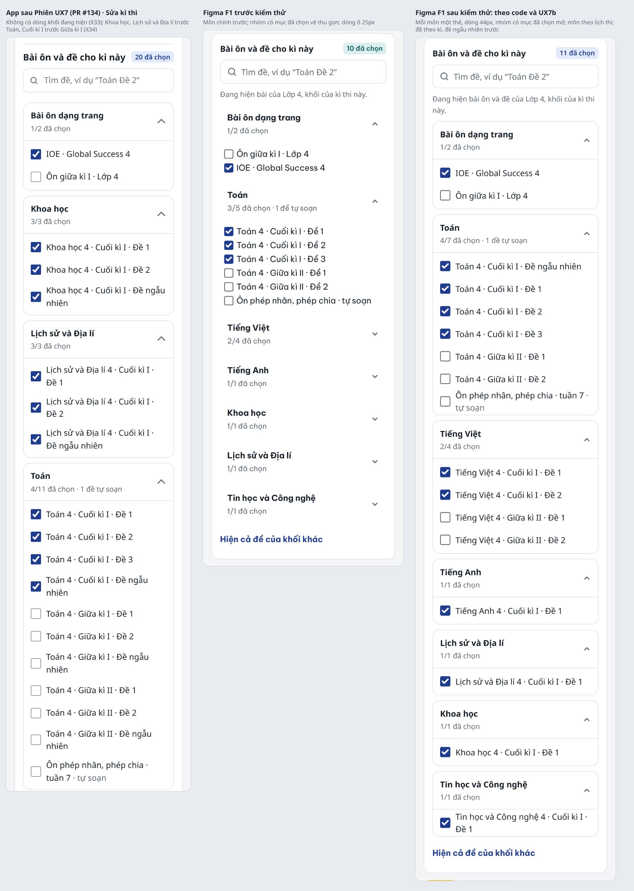

**X33. Dòng cho biết đang hiện đề của khối nào không hiện.**
- Khối “Bài ôn và đề cho kì này” của Sửa kì thi có dòng `
` (“Đang hiện bài ôn và đề của Lớp 4, khối của kì thi này.”; hiện cả khối khác: “… của mọi khối.”; bỏ hết ô Khối: “Chọn khối ở trên để thấy bài ôn và đề của khối đó.”).
- Ô “Phạm vi kiến thức” của cùng form cũng có `id="eScope"` và đứng trước, nên `wirePickBox` ghi chữ vào ô nhập (không hiện ra), còn dòng trong khối luôn trống. Bỏ hết ô Khối thì khối chỉ còn ô tìm, các mục đã chọn và link, không có lời nhắc chọn khối.
- Bước UX7 của `tests/e2e.js` đọc `querySelector("#eScope").textContent`, tức chữ đã ghi vào ô nhập, nên vẫn qua. Quét 23 màn của bản lưu trên máy thì đây là chỗ trùng id duy nhất.

**X34. Thứ tự nhóm môn và thứ tự đề trong nhóm.**
- Nhóm môn theo thứ tự đề xuất hiện trong danh mục `data/banks/index.js`: lớp 4 là Khoa học, Lịch sử và Địa lí, Toán, Tiếng Việt, Tin học và Công nghệ, Tiếng Anh; lớp 6 bắt đầu bằng KHTN. Ở Sửa kì thi, khi hiện cả khối khác, nhóm của hai khối xen nhau. Figma F1, F2 xếp môn chính trước, như ô “Môn thi” của lịch mặc định.
- Trong nhóm, đề xếp theo tên: “Cuối kì I” đứng trước “Giữa kì I”, đề ngẫu nhiên đứng sau Đề 3. Tab Bài ôn của con thì để đề ngẫu nhiên trước Đề 1.
- Ví dụ: Sửa kì thi giữa kì I lớp 4 (môn thi Toán, Tiếng Việt) thì nhóm Toán, Tiếng Việt đứng sau Khoa học, Lịch sử và Địa lí; trong nhóm Toán, bốn đề cuối kì I đứng trước các đề giữa kì I.

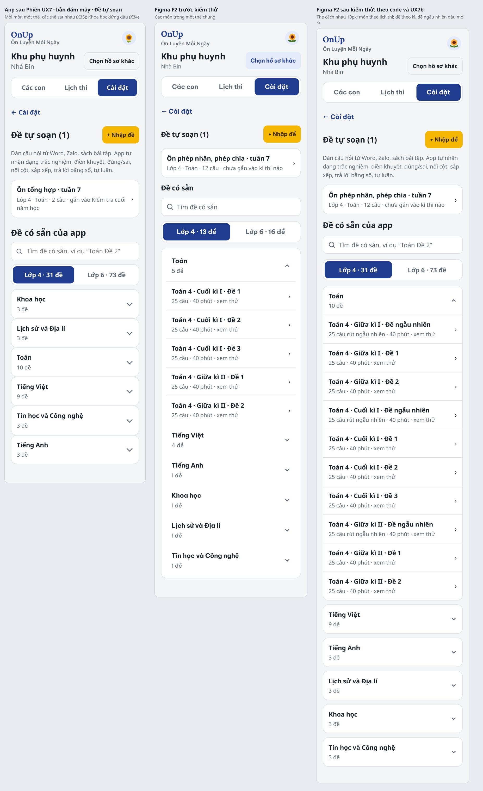

**X35. Thẻ các môn ở danh sách đề có sẵn sát nhau.** Trong `.sb-g` các thẻ `details.grp` không có khoảng cách: viền hai thẻ chồng thành 2px, góc bo tạo khe nhỏ. Ở Sửa kì thi, các thẻ môn cách nhau 10px (`.pk`).

**X36. Dòng tóm tắt khi nhập đề ghi cả dạng 0 câu.** Sau “Kiểm tra”, `#bRes` luôn ghi ba dạng đầu: “Nhận được 3 câu: 2 trắc nghiệm, 1 điền khuyết, 0 đúng/sai; 1 đoạn đọc.” (có từ trước UX7). Như X29: không ghi mục 0 câu.

**X37. Gợi ý về chủ đề hay sai ngăn tên chủ đề bằng dấu phẩy.**
- Mục Gợi ý ôn tuần sau của báo cáo tuần ghi “Ôn lại chủ đề hay sai: Góc và đo góc, Phép cộng, phép trừ, Danh từ.”: đọc như bốn chủ đề. 45 chủ đề của đề có sẵn có dấu phẩy (“Phép cộng, phép trừ”, “Số chẵn, số lẻ”, “Chu vi, diện tích”…).
- Tin nhắn gửi báo cáo của UX8 đã ngăn bằng “; ” (“• Chủ đề hay sai: Góc và đo góc; Phép cộng, phép trừ; Danh từ.”), nên trang và tin nhắn ghi khác nhau.

**Cách làm gợi ý:**
- **X33:** đổi id của dòng trong khối thành `ePickScope`; ô Phạm vi kiến thức giữ `eScope`, vì Lưu đọc ô đó. Thêm vào `audit` của hai bộ kiểm thử (hai bản giống nhau) một kiểm tra: trên màn không có hai phần tử cùng id.
- **X34:**
  - Nhóm môn theo thứ tự môn của lịch thi. Ở Sửa kì thi, nhóm Bài ôn dạng trang đứng đầu, rồi các môn trong ô “Môn thi” của kì đang sửa, theo thứ tự đã ghi, rồi các môn còn lại theo thứ tự môn trong `subjects` của các kì thi của khối đó. Lịch mặc định ghi lớp 4: Toán, Tiếng Việt, Tiếng Anh, Lịch sử và Địa lí, Khoa học, Tin học và Công nghệ; lớp 6: Toán, Ngữ văn, Tiếng Anh, KHTN, Lịch sử và Địa lí, GDCD, Tin học, Công nghệ. Môn không có trong lịch đứng cuối, theo danh mục.
  - Danh sách đề có sẵn (trang Đề tự soạn, tab Ngân hàng đề) theo thứ tự môn của lịch thi của khối đó.
  - Trong nhóm, đề có sẵn xếp theo kì: Giữa kì I, Cuối kì I, Giữa kì II, Cuối năm (tên chuẩn của đề có sẵn, `tests/kiem-tra-de.js` đã kiểm tra). Trong một kì, đề ngẫu nhiên đứng trước, rồi Đề 1, Đề 2…, như tab Bài ôn. Đề tự soạn cuối nhóm như bây giờ. Ở Sửa kì thi, đề của khối kì thi đứng trước đề khối khác như bây giờ.
- **X35:** các thẻ môn trong `.sb-g` cách nhau 10px như `.pk` (ví dụ `.sb-g{display:flex;flex-direction:column;gap:10px}`).
- **X36:** dòng tóm tắt chỉ ghi dạng có ít nhất 1 câu.
- **X37:** `weekTips` ngăn tên chủ đề bằng “; ” như tin nhắn: “Ôn lại chủ đề hay sai: Góc và đo góc; Phép cộng, phép trừ; Danh từ.”
- Không đổi cách lưu kì thi, cách chọn đề, cách tìm, nội dung tin nhắn.

**Xong khi:** `tests/e2e.js` và `tests/supabase/cloud-e2e.js` có thêm các bước sau và vẫn in OK:
- Sửa kì thi cuối kì I lớp 4: dòng `#ePickScope` hiện (cao hơn 0) và ghi “Đang hiện bài ôn và đề của Lớp 4…”; bấm “Hiện cả đề của khối khác” thì đổi chữ; bỏ ô Lớp 4 thì ghi “Chọn khối ở trên…”. `audit` không báo id trùng ở màn nào.
- Thứ tự: Sửa kì thi giữa kì I lớp 4 có các nhóm Bài ôn dạng trang, Toán, Tiếng Việt đứng đầu; tab Lớp 4 của đề có sẵn: Toán, Tiếng Việt, Tiếng Anh, Lịch sử và Địa lí, Khoa học, Tin học và Công nghệ; nhóm Toán lớp 4: ba đề giữa kì I trước bốn đề cuối kì I, đề ngẫu nhiên đầu mỗi kì.
- Các thẻ môn của danh sách đề cách nhau 10px.
- Nhập đề không có câu đúng/sai: dòng tóm tắt không có “0 đúng/sai”.
- Báo cáo tuần có chủ đề hay sai có dấu phẩy: gợi ý ngăn bằng “; ”, giống dòng của tin nhắn.
- CLAUDE.md (mục “Quản lí đề”, “Gửi báo cáo tuần”) ghi id `#ePickScope`, thứ tự nhóm và đề, khoảng cách các thẻ môn.
- Ảnh 360px sáng/tối chép lại: `docs/hinh-ux7/sua-ki-thi.jpg`, `ngan-hang-de-tim.jpg`, `dam-may-de-tu-soan.jpg`.

Đã làm ở PR #150; ảnh 360px sáng/tối ở [hinh-ux7/](hinh-ux7/): [sua-ki-thi](hinh-ux7/sua-ki-thi.jpg), [ngan-hang-de-tim](hinh-ux7/ngan-hang-de-tim.jpg), [dam-may-de-tu-soan](hinh-ux7/dam-may-de-tu-soan.jpg) (cùng các ảnh khác của hinh-ux7/ có chỗ đổi, và báo cáo tuần ở [hinh-ux8/](hinh-ux8/)); ảnh trước/sau: [ux7b-truoc-sau](hinh-ux7/ux7b-truoc-sau.jpg).

### Phiên UX3b · Sửa sau kiểm thử UX3

Tìm được khi kiểm thử thiết kế sau khi gộp PR #56 (mục 5). Figma: [E2b, E4](https://www.figma.com/design/9mkNYX0ZOczNDMwlKo5F4e/OnUp?node-id=80-1697) trong section Khu phụ huynh.

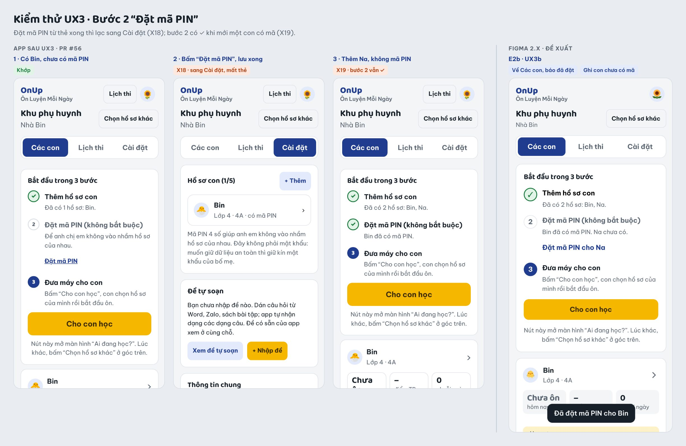

**X17. Đăng xuất chưa cần mật khẩu.**
- Lời giao việc UX3 ghi “Đổi mật khẩu và đăng xuất vẫn cần mật khẩu”, và ô mã mở nhanh ở trang Tài khoản cũng ghi đúng câu đó. Nhưng nút `#signOut` trong `renderCloudAccount` gọi `Store.signOut()` ngay.
- Vào khu phụ huynh bằng mã mở nhanh (`Store.checkQuickCode` mở khóa như vừa nhập mật khẩu), rồi Cài đặt → Tài khoản → “Đăng xuất khỏi máy này”: thoát ngay, không hỏi gì, mã bị xóa. Ai biết mã, ví dụ con nhìn bố mẹ gõ, cũng đăng xuất được tài khoản gia đình; lần sau bố mẹ phải nhập lại tên đăng nhập, mật khẩu và đặt lại mã.

**X18. Đặt mã PIN từ thẻ Bắt đầu xong thì lạc sang Cài đặt.**
- Link “Đặt mã PIN” của bước 2 (`startCard`; nhà một con: `#/admin/user/<mã>`) mở form sửa hồ sơ. Lưu xong, `renderUserForm` về Cài đặt theo quy ước của UX2 (sửa xong về Cài đặt). Thẻ Bắt đầu không còn trên màn hình; bố mẹ phải tự bấm tab Các con để làm bước 3.
- Mở từ thẻ mà ô “Mã PIN” không được focus: trên điện thoại bàn phím số không tự mở, bố mẹ phải chạm vào ô.

**X19. Bước 2 có ✓ khi mới một con có mã PIN.**
- `step(2, pinned.length > 0, …)`: nhà có Bin (có mã) và Na (không mã) thì bước 2 có ✓, ghi “Bin đã có mã PIN.” và không còn link. Bố mẹ không biết Na chưa có mã, trong khi bước này để “anh chị em không vào nhầm hồ sơ của nhau”.
- Nhà hai con trở lên thì link “Đặt mã PIN” mở Cài đặt (danh sách hồ sơ), chưa mở thẳng hồ sơ của con chưa có mã.

**X20. Chữ ở ô mã mở nhanh.**
- Dòng cuối có chữ kĩ thuật “(đã băm)” (CLAUDE.md: không thuật ngữ kỹ thuật trên màn hình).
- Máy chưa ghi nhớ đăng nhập: chữ bảo chọn “Ghi nhớ trên máy này” khi đăng nhập, nhưng bố mẹ đang đăng nhập rồi; chữ chưa nói phải đăng xuất trước.

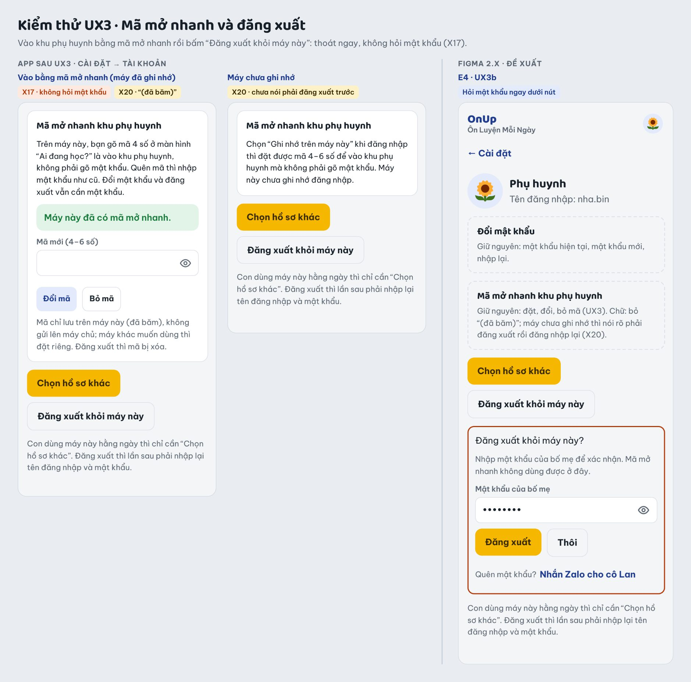

**Cách làm gợi ý:**
- **Đăng xuất hỏi mật khẩu (E4, X17).** Bấm “Đăng xuất khỏi máy này” thì hộp `.confirm` mở ngay dưới nút, không dùng hộp nổi. Hộp gồm:
  - “Đăng xuất khỏi máy này?” và dòng “Nhập mật khẩu của bố mẹ để xác nhận. Mã mở nhanh không dùng được ở đây.”;
  - ô “Mật khẩu của bố mẹ” (`type="password"`, nút xem qua `wireReveal`);
  - nút “Đăng xuất” và “Thôi”;
  - dòng “Quên mật khẩu?” lấy từ `contactText`, `contactUrl` như màn đăng nhập.

  Lúc nào cũng hỏi, kể cả khi vừa nhập mật khẩu: bố mẹ ít khi đăng xuất, một luồng thì dễ hiểu hơn. Kiểm bằng `Store.checkPassword` (có CAPTCHA như ô mật khẩu ở “Ai đang học?”). Hàm này hiện luôn đặt ô CAPTCHA vào `#pwCaptcha`, mà trên trang Tài khoản ô đó nằm trong form đổi mật khẩu: cho hàm nhận thêm chỗ đặt ô (mặc định vẫn `#pwCaptcha`) để ô CAPTCHA hiện trong hộp đăng xuất, nên phiên này sửa cả `js/store-supabase.js`. Đúng thì `Store.signOut()`; sai thì báo trong hộp và tính vào `PinLock` của Phụ huynh như sai mật khẩu ở “Ai đang học?”. Nút “Đăng xuất” ở màn đổi mật khẩu tạm (`#npOut`) và màn tài khoản bị khóa (`#bOut`) giữ nguyên: ở đó chưa vào khu phụ huynh, chưa có mã mở nhanh.
- **Đặt mã PIN từ thẻ (E2b, X18, X19).**
  - Link trong thẻ mở form hồ sơ của con với một dấu cho biết mở từ thẻ (ví dụ `?tu=batdau`, hoặc cách tương đương). Khi đó ô Mã PIN được focus và nằm giữa màn hình; lưu xong về Các con (`#/admin/overview`): có mã thì toast “Đã đặt mã PIN cho <tên>”, để trống ô mã thì toast như lưu bình thường. Nút quay lại của form mở từ thẻ cũng về Các con. Mở form từ chỗ khác thì giữ như UX2 (về Cài đặt).
  - Bước 2 có ✓ khi mọi con đã có mã. Còn con chưa có thì không có ✓, ghi “Bin đã có mã PIN. Na chưa có.” (chưa ai có thì giữ “Để anh chị em không vào nhầm hồ sơ của nhau.”), kèm link “Đặt mã PIN cho Na” mở thẳng form của con đầu tiên chưa có mã, kể cả khi nhà nhiều con.
  - Bước 3 và nút “Cho con học” giữ như UX3: bật khi đã có hồ sơ con, kể cả khi bước 2 chưa xong (mã PIN không bắt buộc).
- **Chữ (X20).**
  - Dòng cuối ô mã mở nhanh: “Mã chỉ lưu trên máy này, không gửi đi đâu; máy khác muốn dùng thì đặt riêng. Đăng xuất thì mã bị xóa.”
  - Máy chưa ghi nhớ: thay câu nhắc bằng “Máy này chưa ghi nhớ đăng nhập. Muốn đặt mã: bấm “Đăng xuất khỏi máy này”, rồi đăng nhập lại và chọn “Ghi nhớ trên máy này”.”
  - `tests/supabase/cloud-e2e.js` đang so đúng chữ cũ của ô này: sửa theo chữ mới.

**Xong khi:** `tests/supabase/cloud-e2e.js` kiểm các điều sau và vẫn in `CLOUD E2E OK`, cả lượt sáng và tối. Vài bước UX3 đang có phải sửa theo hành vi mới, không chỉ thêm bước:
- **Đăng xuất.** Bước đăng xuất đang có (bấm `#signOut` rồi chờ `#loginForm`) đổi thành: bấm nút → hộp hỏi mật khẩu hiện ngay dưới nút, chưa đăng xuất.
  - Sai mật khẩu: báo trong hộp, vẫn đăng nhập, số lần sai trong `PinLock` của Phụ huynh tăng một.
  - “Thôi”: hộp đóng, vẫn đăng nhập.
  - Đúng mật khẩu: về màn đăng nhập, `ontap_cloud_quick` không còn mã của gia đình.
  - `revealTry` có ô mật khẩu của hộp.

  Giữ bước này ở cuối luồng của máy gia đình: các tab dùng chung localStorage, đăng xuất ở một tab là mọi tab đều ra.
- **Thẻ Bắt đầu.** Kiểm tra đang có so bước 2 có ✓ khi Bin có mã, Na không mã: đổi thành bước 2 không có ✓, có chữ “Na chưa có”, link “Đặt mã PIN cho Na” mở hồ sơ của Na (so đường dẫn `#/admin/user/<mã của Na>`, bỏ phần `?…` nếu có). Bấm link: ô Mã PIN được focus; lưu có mã thì về `#/admin/overview`, toast “Đã đặt mã PIN cho Na”, bước 2 có ✓. Các bước sau đang vào hồ sơ Na không mã (chạm là vào) thì đổi theo, hoặc thử bước này bằng một hồ sơ khác.
- **Chữ.** Ô mã mở nhanh không có “băm”; máy chưa ghi nhớ có câu bảo đăng xuất rồi đăng nhập lại và chọn “Ghi nhớ trên máy này”.
- Có ảnh 360px sáng/tối của hộp đăng xuất và thẻ Bắt đầu khi hai con mà một con chưa có mã, chép sang `docs/hinh-ux3/`.

### Phiên UX4 · Chọn hồ sơ và nhập PIN

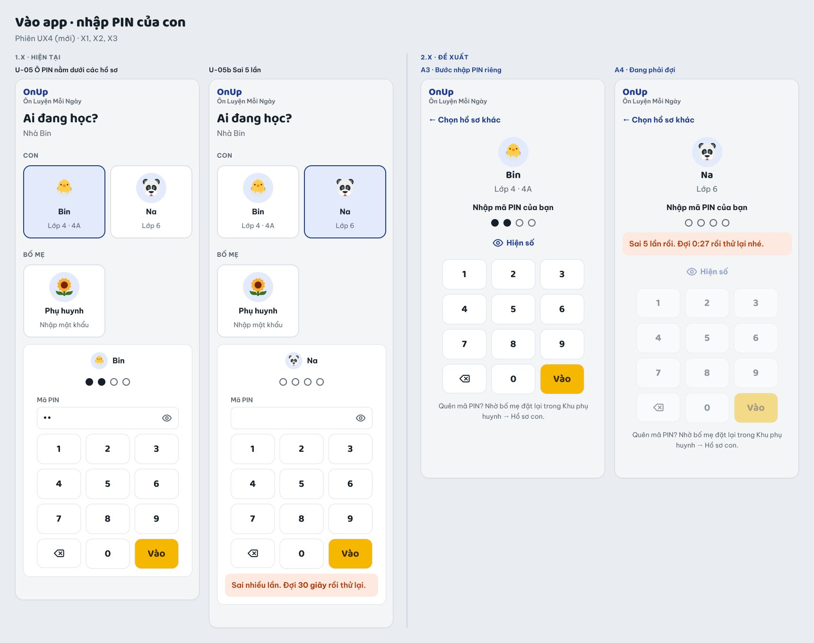

**X1. Ô nhập PIN nối dưới danh sách hồ sơ.**
- `pinBoxHTML()` nằm cuối `renderLogin` trong `js/app.js`.
- Ở 360×740, nhà có 2 con và ô Phụ huynh: vừa chạm một hồ sơ thì nút cuối của bàn phím ở khoảng 1.180px, dưới mép màn hình (U-05, U-07). Nhiều con hơn thì còn thấp hơn.
- `scrollIntoView` kéo trang xuống khoảng 460px, và hồ sơ vừa chọn trượt khỏi màn hình.
- Ô Phụ huynh có mã mở nhanh (UX3) dùng chung bàn phím này nên vướng y như vậy: kiểm thử 19/10 đo trang tự cuộn 420px, ô Phụ huynh trượt một phần khỏi màn hình, mã hiện cả ở hàng chấm lẫn ô nhập ([kt-ux3-ma-mo-nhanh](hinh-ux-2x/kt-ux3-ma-mo-nhanh.jpg)).

**X2. Mã PIN hiện hai lần.** Hàng chấm `#pinDots` và ô `#pinIn` (`type="password"`, có nút xem) cùng hiện số đã gõ.

**X3. Báo sai và đếm ngược nằm cuối khung.**
- `#pinErr` nằm dưới bàn phím, xa hàng chấm (U-05b).
- Đang phải đợi (`PinLock.wait(id) > 0`) mà bàn phím vẫn bấm được: số vẫn hiện thành chấm, đến khi gõ đủ hoặc bấm Vào mới hiện lại thông báo phải đợi.

**X4. Đổi hình đại diện phải bấm thêm “Lưu”.** Trong `renderCloudAccount` và `renderAccount` của học sinh, con chọn hình rồi rời trang mà quên bấm “Lưu” thì mất lựa chọn (U-26).

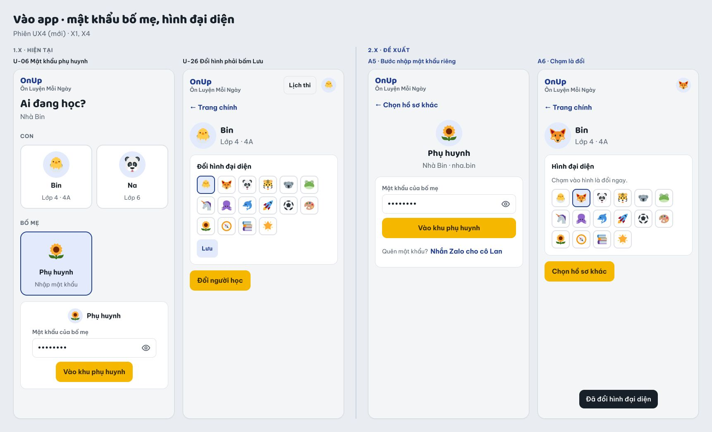

**Cách làm gợi ý:**
- **Bước nhập riêng (A3, A5).** Chạm hồ sơ có PIN thì danh sách được thay bằng màn nhập, gồm:
  - link “← Chọn hồ sơ khác” về lại danh sách;
  - hình to, tên, lớp, dòng “Nhập mã PIN của bạn”;
  - hàng chấm, nút chữ “Hiện số”, bàn phím ngay dưới;
  - dòng “Quên mã PIN? Nhờ bố mẹ đặt lại trong Khu phụ huynh → Hồ sơ con.” Bản lưu trên máy ghi: “Nhờ quản trị đặt lại trong Quản trị → Tài khoản.”

  Có thể cho bước nhập một đường dẫn riêng (ví dụ `#/vao/<mã>`) để nút Back của điện thoại quay về danh sách. Cách tương đương khác cũng được.

  Ô Phụ huynh của bản đám mây làm cùng kiểu, gồm:
  - hình, tên, tên đăng nhập;
  - ô mật khẩu (giữ nút xem);
  - nút to “Vào khu phụ huynh”;
  - dòng “Quên mật khẩu?” lấy từ `contactText`, `contactUrl`.

  Máy đã đặt mã mở nhanh (UX3) thì bước của Phụ huynh mở bàn phím mã trước, cùng kiểu bước nhập PIN (A5b):
  - dòng “Nhập mã mở nhanh của máy này”;
  - hàng chấm theo độ dài mã (`Store.quickCodeLen()`), nút “Hiện số”, bàn phím ngay dưới;
  - dòng “Quên mã? Nhập mật khẩu” sang bước mật khẩu ở trên; bước mật khẩu có link “Dùng mã mở nhanh” quay lại.

  Giữ cách tính sai mã vào `PinLock` của Phụ huynh như UX3.

  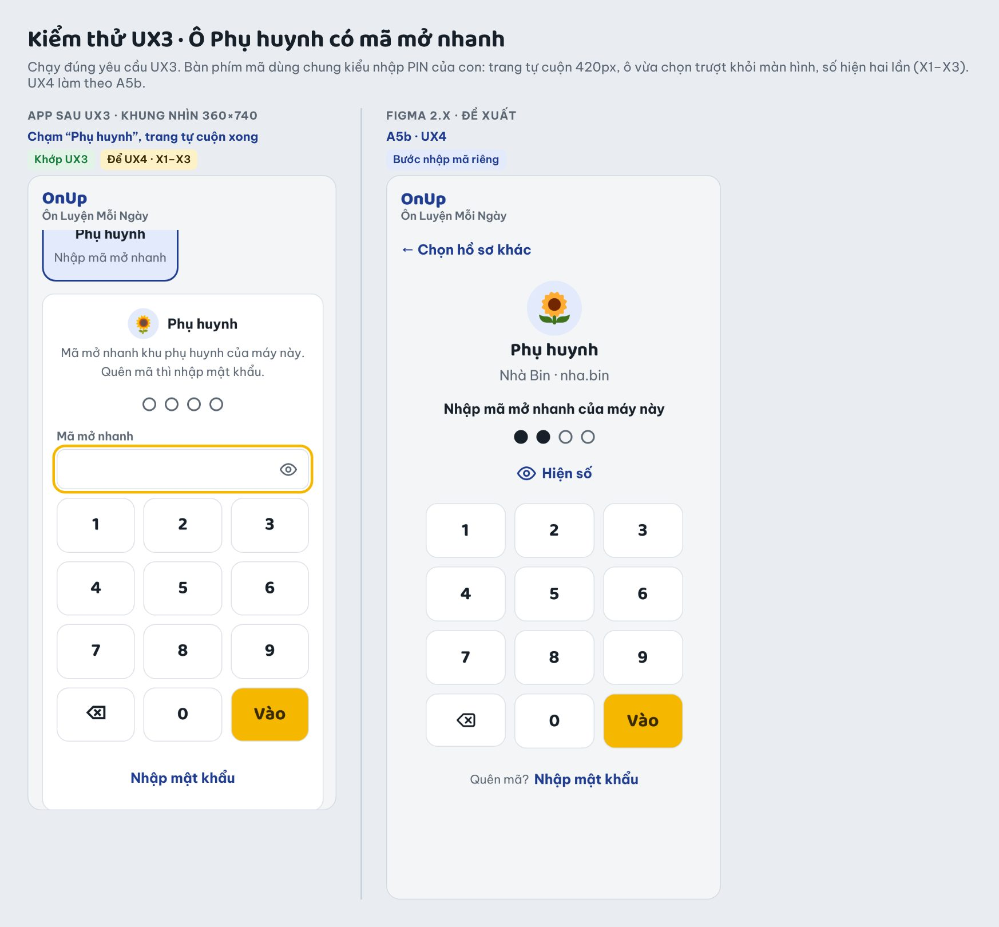

  Hồ sơ không có PIN thì chạm là vào, như hiện nay. Bản lưu trên máy (U-07) dùng chung bước này.
- **Một chỗ hiện số (X2).**
  - Giữ ô `#pinIn` để gõ bằng bàn phím máy tính và cho trình đọc màn hình, nhưng ẩn khỏi mắt, theo kiểu chỉ trình đọc màn hình đọc được. Không dùng `display:none`, vì các bộ kiểm thử gõ PIN bằng `page.fill("#pinIn")`.
  - Nút xem trở thành nút chữ “Hiện số” dưới hàng chấm, vẫn bật/tắt bằng `wireReveal`/`conceal`. Hiện nay:
    - `wireReveal` đặt nút mắt ngay sau ô;
    - `revealTry` (`tests/e2e.js`, `tests/supabase/cloud-e2e.js`) tìm `button.reveal-btn` có `<svg>` đứng sau ô.

    Vì vậy cần sửa `wireReveal` để nhận một nút đặt sẵn, sửa `revealTry` cho ô PIN, và ghi ngoại lệ này vào quy ước “nút xem” của CLAUDE.md.
- **Lỗi ngay dưới hàng chấm (X3).** Khi đang phải đợi:
  - bàn phím, nút Vào và nút Hiện số chuyển sang `disabled` (mờ);
  - hết giờ thì tự bật lại, kèm dòng “Bạn nhập lại được rồi.”

  Giữ nguyên `PinLock`, lượt thử lặng lẽ khi chưa biết độ dài (`probe`) và việc tự vào khi gõ đủ `pinLen`.
- **Chạm hình là đổi (A6, X4).**
  - Chạm một hình thì gọi `Store.updateUser` ngay, hiện toast “Đã đổi hình đại diện”, đổi luôn hình trên thanh trên. Bỏ nút Lưu.
  - Bản lưu trên máy: `renderAccount` dùng cho mọi vai trò và hiện lưu hình cùng PIN trong một form. Tách phần đổi mã PIN thành form riêng, với nút “Đổi mã PIN”.
  - Nút “Chọn hồ sơ khác” (tên UX3 đã dùng) giữ nguyên.

**Xong khi:** `tests/e2e.js` và `tests/supabase/cloud-e2e.js` có thêm các bước sau và vẫn in OK:
- Sau khi chạm hồ sơ có PIN:
  - trang không cuộn (`scrollY` = 0), đo sau khi cuộn mượt đã dừng: đo ngay sau khi chạm thì vẫn ra 0 dù trang sắp cuộn (kiểm thử 19/10);
  - tên hồ sơ đang nhập và cả 12 nút bàn phím đều nằm trong khung nhìn: 740px ở `tests/e2e.js`, 760px ở `cloud-e2e.js`.

  Hiện nay chỉ đo nút cuối sau khi trang tự cuộn thì vẫn qua, nên phải kiểm cả hai điều trên.
- Không lúc nào vừa hiện hàng chấm vừa hiện ô nhập có chữ hoặc dấu chấm.
- Sai 5 lần thì nút bàn phím `disabled`, đếm ngược nằm trên bàn phím; hết giờ thì bấm được lại.
- Chạm hình đại diện thì `Store.user(id).avatar` đổi ngay, không phải bấm Lưu.
- Bản đám mây, máy có mã mở nhanh: chạm “Phụ huynh” thì trang không cuộn, cả 12 nút bàn phím mã nằm trong khung nhìn, số hàng chấm bằng độ dài mã; “Quên mã? Nhập mật khẩu” sang bước mật khẩu, “Dùng mã mở nhanh” quay lại; sai 5 lần thì bàn phím mã `disabled` như PIN của con.
- `revealTry` vẫn qua. Có ảnh 360px sáng/tối của các màn A3–A6 và A5b.

### Phiên UX5 · Làm bài tập trung

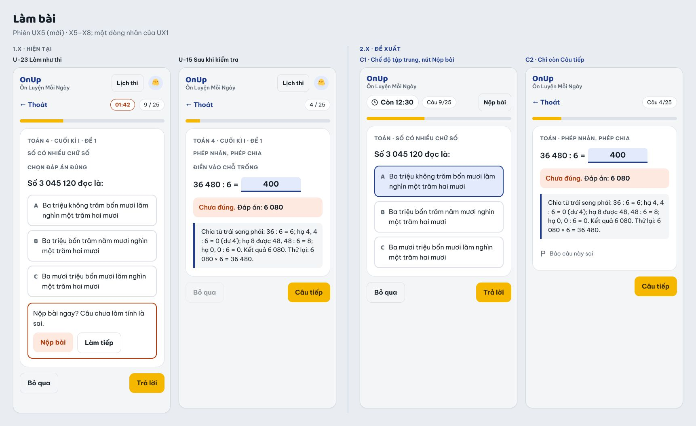

**X5. Đang làm bài vẫn có lối ra.** Thanh trên vẫn có link “Lịch thi” và hình đại diện (U-14, U-23). Con bấm nhầm thì gặp hộp hỏi rời bài của chốt rời trang. Không mất bài, nhưng làm con mất tập trung.

**X6. “← Thoát” mà thực ra là nộp bài.** Khi làm như thi, `#qzExit` ghi “← Thoát”, nhưng `confirmExit` hỏi “Nộp bài ngay? Câu chưa làm tính là sai.”

**X7. Đồng hồ không nói rõ.** `#qzTimer` hiện “01:42”: con không biết đó là thời gian còn lại hay thời gian đã qua.

**X8. Nút thừa sau khi kiểm tra.** Sau khi bấm Kiểm tra, `#qzSkip` (“Bỏ qua”) chỉ bị `disabled` nên vẫn nằm đó, mờ đi (U-15).

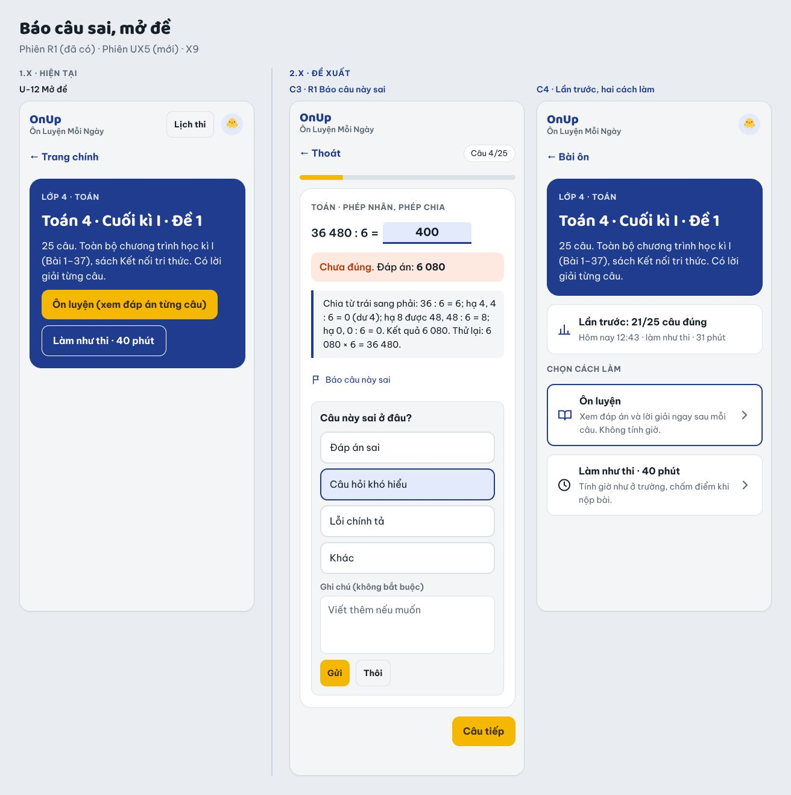

**X9. Màn mở đề thiếu thông tin.**
- `renderQuiz` không cho biết lần trước con làm đề này được bao nhiêu.
- Hai cách làm chỉ khác nhau ở chữ trên nút: “Ôn luyện (xem đáp án từng câu)” và “Làm như thi · 40 phút” (U-12).

**Cách làm gợi ý:**
- **Chế độ tập trung (C1, X5).** Trong lúc làm đề ngân hàng, cả ôn luyện lẫn làm như thi:
  - thanh trên chỉ còn chữ OnUp;
  - ẩn link “Lịch thi”, hình đại diện, và cả thanh tab dưới nếu UX1 đã thêm. Có thể dùng một class trên `body` như cách `playing` của bài ôn trong khung.

  Chốt rời trang giữ nguyên: nút Back và tải lại trang vẫn hỏi. Trang kết quả có lại đủ thanh trên.

  `js/quiz.js` hiện chưa báo cho app biết lượt làm đã xong: `onFinish` không chạy khi chưa trả lời câu nào. Cần thêm một callback, ví dụ `opts.onEnd`, gọi ở mọi nhánh của `finish()`.
- **Nút Nộp bài (X6).**
  - Làm như thi: bỏ “← Thoát”, thay bằng nút “Nộp bài” (`btn ghost sm`, bên phải). Bấm vẫn hỏi như cũ. Chưa trả lời câu nào thì hỏi “Thoát đề?” như L15.
  - Ôn luyện giữ “← Thoát”.
- **Đồng hồ và tiến độ (X7).** Chip đồng hồ ghi “Còn 12:30”, có biểu tượng đồng hồ và `aria-label` “Thời gian còn lại”. Còn dưới 2 phút thì vẫn đổi màu như `.warn`. Tiến độ ghi “Câu 9/25”.
- **Sau khi kiểm tra (C2, X8).** Ẩn hẳn `#qzSkip`; “Câu tiếp” (hoặc “Xem kết quả”) đứng một mình bên phải.
- **Màn mở đề (C4, X9).**
  - Thẻ “Lần trước”: kết quả gần nhất của hồ sơ đang học với đề này, gồm số câu đúng, lúc làm, cách làm, thời gian. Chưa làm lần nào thì không có thẻ.
    - Lọc bằng `graded()`: kết quả tự chấm (`mode: "self"`) có cùng `refId` nhưng tính bằng phần tư điểm.
  - Hai thẻ chọn cách làm, mỗi thẻ cao ≥ 64px, có biểu tượng và một dòng giải thích:
    - “Ôn luyện”: “Xem đáp án và lời giải ngay sau mỗi câu. Không tính giờ.”
    - “Làm như thi · N phút”: “Tính giờ như ở trường, chấm điểm khi nộp bài.”
  - Đề không có `minutes` thì chỉ có thẻ Ôn luyện.
  - Phụ huynh xem thử thì giữ dòng “Chế độ xem thử: điểm không được lưu.”

**Xong khi:** `tests/e2e.js` có thêm các bước sau và vẫn in `E2E OK`:
- Trong lúc làm đề, thanh trên không có link Lịch thi, không có hình đại diện. Ở trang kết quả thì có lại.
- Làm như thi: có nút “Nộp bài”, không có “← Thoát”. Chip đồng hồ có chữ “Còn”.
- Sau Kiểm tra, không còn nút “Bỏ qua” nào hiện ra.
- Làm xong một lượt rồi mở lại đề thì thấy “Lần trước: x/y”.
- Vùng bấm ≥ 44px, có ảnh 360px sáng/tối các màn C1, C2, C4. `tests/supabase/cloud-e2e.js` vẫn in OK.

### Phiên UX6 · Biết bài đã gửi chưa (bản đám mây)

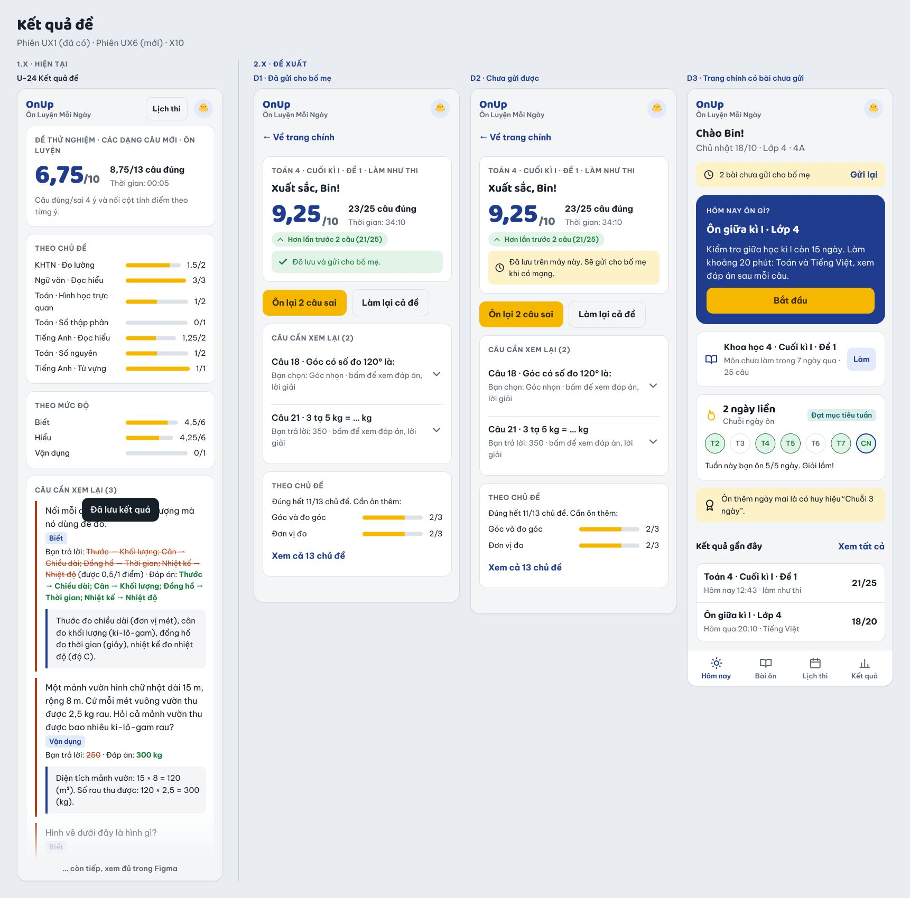

**X10. Không biết bài đã tới bố mẹ chưa.**
- Bản đám mây đưa kết quả vào hộp gửi trên máy (`ontap_cloud_outbox`) rồi mới gửi lên máy chủ (`sendOutbox` trong `js/store-supabase.js`).
- Toast “Đã lưu kết quả” giống hệt nhau dù đã gửi hay chưa.
- Mất mạng thì chỉ có một thông báo chung, một lần: “Chưa gửi được kết quả lên máy chủ…”. Sau đó không còn dấu hiệu nào.
- Bố mẹ xem trên máy khác thì không thấy bài con vừa làm và không biết vì sao. Con thì không biết bài của mình đang nằm chờ.

**Cách làm gợi ý:**
- **Kho dữ liệu.** Thêm hai hàm ở cả hai kho:
  - `Store.pendingResults(userId?)`: số kết quả còn trong hộp gửi của các hồ sơ thuộc tài khoản đang đăng nhập; bỏ trống `userId` thì đếm cả tài khoản. LocalStore trả 0.
  - `Store.sendPending()`: gọi `sendOutbox`, trả Promise. LocalStore trả `Promise.resolve()`.

  `tests/supabase/store-test.mjs` so danh sách hàm của hai kho.

  Chỉ gọi `changed()` khi số bài chưa gửi thay đổi. Lý do: `Store.onChange` vẽ lại cả trang (cuộn lên đầu, đóng `#evDetail`), mà `sendOutbox` còn chạy lúc mở app và mỗi khi có mạng lại.
- **Màn kết quả (D1, D2).** Sau khi lưu, app chờ lượt gửi xong (tối đa vài giây) rồi hiện một dòng trạng thái trong màn kết quả, kèm toast cùng ý:
  - đã gửi: “Đã lưu và gửi cho bố mẹ.” (nền `ok-soft`, chữ `ok`);
  - chưa gửi: “Đã lưu trên máy này. Sẽ gửi cho bố mẹ khi có mạng.” (nền `sun-soft`, chữ `ink`).

  `js/quiz.js` cần một chỗ trống trong màn kết quả để app điền dòng này, ví dụ `#qzSaved`. Bài ôn trong khung cũng ghi rõ như vậy trong toast “Đã lưu kết quả: x/y câu đúng”.
- **Bài chưa gửi (D3).** Khi `pendingResults() > 0`:
  - trang chính của con có dòng “N bài chưa gửi cho bố mẹ · Gửi lại”;
  - Khu phụ huynh trên cùng máy có dòng “N bài làm trên máy này chưa gửi đi · Gửi lại”.

  Dòng cao ≥ 44px, nền `sun-soft`, chữ `ink`. Bấm Gửi lại thì gọi `sendPending()`, rồi hiện toast “Đã gửi” hoặc “Chưa gửi được. App sẽ thử lại khi có mạng.”
- Bản lưu trên máy không có hộp gửi, giữ nguyên “Đã lưu kết quả”.

**Xong khi:** các bộ kiểm thử có thêm các bước sau và vẫn in OK:
- `store-test.mjs`: có kiểm tra `pendingResults`, `sendPending` ở cả hai kho.
- `cloud-e2e.js`:
  - Mọi lệnh gọi Supabase ở đây đi qua máy chủ giả (`exposeFunction`), không qua mạng, nên `context.setOffline` không làm lượt gửi lỗi được. Thêm vào `tests/supabase/fake-backend.js` một công tắc làm lượt gửi kết quả lỗi.
  - Bật công tắc, làm một đề: màn kết quả có “Sẽ gửi cho bố mẹ khi có mạng”, trang chính có “1 bài chưa gửi”.
  - Tắt công tắc, bấm Gửi lại: dòng biến mất, máy chủ giả có kết quả, màn kết quả lượt sau có “Đã lưu và gửi”.
  - Không dùng sự kiện `online` trong bước này: sự kiện đó cũng tự gửi lại, nên kết quả kiểm thử sẽ phụ thuộc vào việc bên nào chạy trước.
  - Có ảnh 360px sáng/tối.
- `tests/e2e.js` vẫn in `E2E OK`, và bản lưu trên máy không hiện các dòng mới.

### Phiên UX7 · Quản lí đề

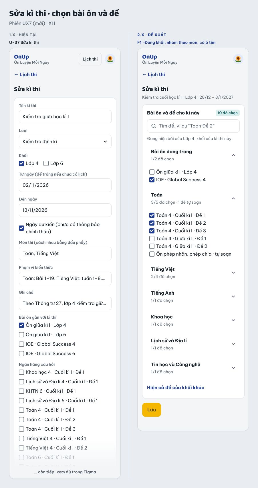

**X11. Chọn đề cho kì thi trong một danh sách phẳng.**
- “Ngân hàng câu hỏi” trong `renderEventForm` liệt kê mọi `Store.banks()`: 29 đề có sẵn của lớp 4 và lớp 6 cộng đề tự soạn, mỗi đề một ô đánh dấu (U-37).
- Không tìm được, không nhóm theo môn, không biết đã chọn bao nhiêu.
- Bài ôn dạng trang nằm ở một khối riêng phía trên.

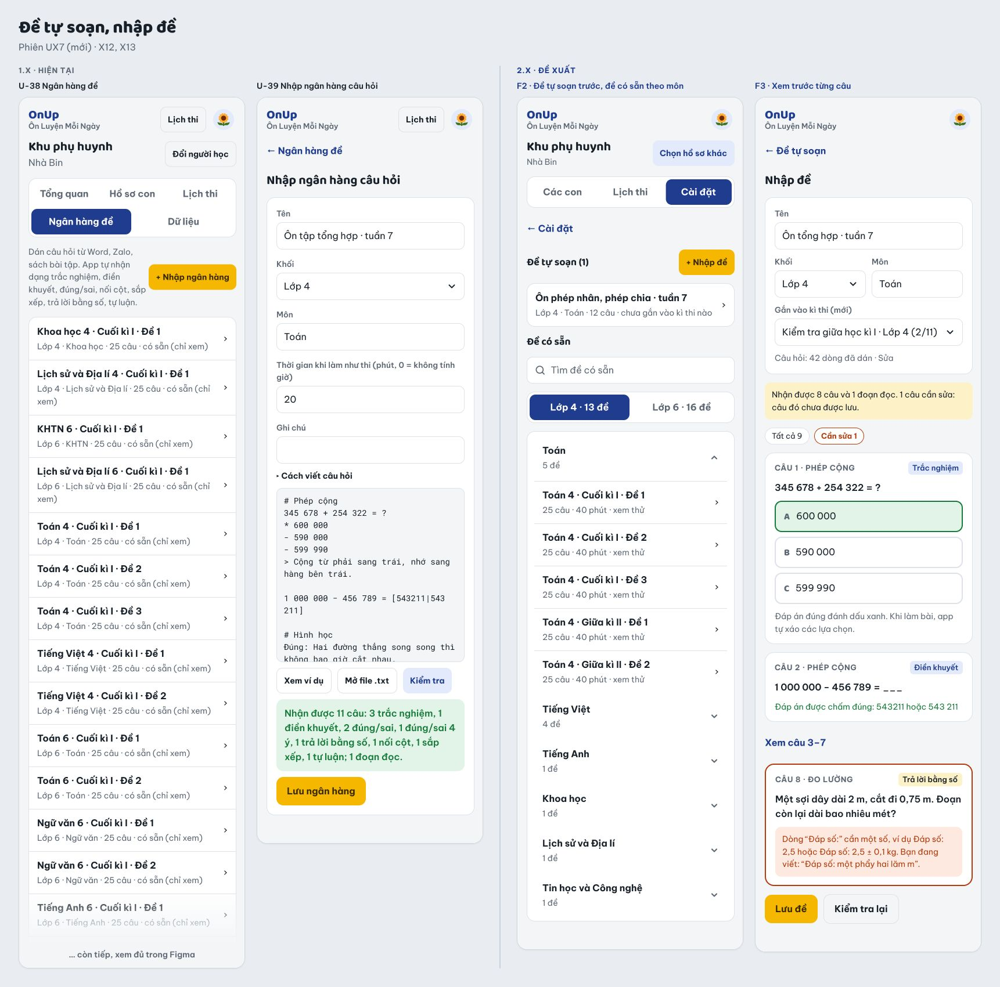

**X12. Danh sách đề trộn lẫn.** Tab “Ngân hàng đề” là một danh sách dài trộn đề có sẵn của mọi khối với đề tự soạn. Đề tự soạn, thứ phụ huynh hay tìm nhất, lại nằm cuối cùng (U-38).

**X13. Nhập đề không xem trước được.**
- Nút “Kiểm tra” trong `renderBankForm` chỉ báo số câu theo dạng, cộng một danh sách lỗi “Câu N: …” và “Đoạn đọc N: …”. Không thấy câu sẽ hiện ra sao, đáp án nào được chấm đúng (U-39).
- Nhiều lỗi làm `Quiz.parse` bỏ hẳn câu đó, ví dụ dòng “Đáp số:” không phải số. Một số lỗi khác (mức độ, hình, thang chấm) vẫn lưu câu nhưng bỏ phần sai. Cả hai trường hợp, nút Lưu đều không hỏi lại.
- Lưu xong, toast bảo “Vào Lịch thi để gắn ngân hàng này vào kì thi”: phải sang tab khác, mở kì thi, tìm đề trong danh sách X11.

**Cách làm gợi ý:**
- **Sửa kì thi (F1, X11).**
  - Gộp hai khối thành một khối “Bài ôn và đề cho kì này”, có nhãn “N đã chọn”.
  - Mặc định chỉ hiện bài ôn và đề có khối nằm trong `grades` của kì thi. Đổi ô Khối thì danh sách đổi theo.
  - Nhóm theo môn bằng `
` với tóm tắt kiểu “Toán · 3/5 đã chọn”. Nhóm có mục đã chọn thì mở sẵn.
  - Ô “Tìm đề” lọc theo tên, không phân biệt dấu, theo từng từ: mọi từ gõ vào đều phải có trong tên. Ô tìm của `admin.html` so cả chuỗi, nên “toan de 2” không khớp “Toán 4 · Cuối kì I · Đề 2”.
  - Link “Hiện cả đề của khối khác”.
  - Mục đã chọn mà khác khối vẫn hiện, không mất lựa chọn cũ.
  - Mỗi dòng ô đánh dấu cao ≥ 44px.
- **Danh sách đề (F2, X12).** Áp dụng cho tab “Đề tự soạn” trong Cài đặt, hoặc tab “Ngân hàng đề” nếu UX2 chưa gộp:
  - Đề tự soạn lên đầu. Mỗi đề ghi kì thi đã gắn, hoặc “chưa gắn vào kì thi nào”.
  - Đề có sẵn chọn theo khối: tab khối lấy từ `gradeList()`, mặc định là khối của các con. Trong mỗi khối, đề nhóm theo môn, thu gọn, có ô tìm.
- **Nhập đề (F3, X13).**
  - Sau “Kiểm tra”, dưới dòng tóm tắt có danh sách xem trước từng câu, gồm:
    - dạng câu, chủ đề, câu hỏi;
    - đáp án được chấm đúng: trắc nghiệm đánh dấu lựa chọn đúng; điền khuyết, trả lời bằng số ghi các đáp án nhận được; đúng/sai, nối cột, sắp xếp ghi đáp án; tự luận ghi thang chấm;
    - hình vẽ qua `Quiz.svg`;
    - đoạn đọc, thu gọn.
  - Lỗi gắn vào thẻ của câu, hoặc của đoạn đọc, bị lỗi. `Quiz.parse` trả thêm mảng `issues`, ví dụ `[{n, msg, dropped}]` cho câu và `[{p, msg}]` cho đoạn đọc:
    - `n` là thứ tự câu trong văn bản dán vào, kể cả câu bị bỏ, đúng như số trong “Câu N:” hiện nay;
    - `dropped` cho biết câu có bị bỏ hẳn không.

    Giữ nguyên `errors` dạng chữ cho các chỗ đang dùng.
  - Bộ lọc “Tất cả · Cần sửa”.
  - Có lỗi mà bấm Lưu thì hỏi lại theo kiểu `.confirm`, nói đúng mức độ, ví dụ “1 câu sẽ không được lưu, 1 câu thiếu phần bị lỗi. Vẫn lưu?”
  - Thêm ô không bắt buộc “Gắn vào kì thi”: chọn một kì thi chưa qua của khối đã chọn. Lưu xong là đề hiện ở kì thi đó.

**Xong khi:** `tests/e2e.js` và `tests/supabase/cloud-e2e.js` có thêm các bước sau và vẫn in OK:
- Sửa kì thi lớp 4 chỉ hiện đề lớp 4; số đề hiện ra khớp `Store.banks()` của khối 4.
- Tìm “toan de 2” thì còn đúng các đề Toán có “Đề 2” trong tên. Bật “Hiện cả đề của khối khác” thì thấy đề lớp 6.
- Lưu kì thi giữ đúng các lựa chọn cũ, kể cả mục khác khối.
- Nhập đề có một câu lỗi: thẻ của câu đó có lỗi, bấm Lưu thì hỏi lại.
- Chọn “Gắn vào kì thi” thì kì thi có đề mới.
- Có ảnh 360px sáng/tối.

Đã làm ở PR #134; ảnh 360px sáng/tối ở [hinh-ux7/](hinh-ux7/): [sua-ki-thi](hinh-ux7/sua-ki-thi.jpg), [dam-may-sua-ki-thi-tim](hinh-ux7/dam-may-sua-ki-thi-tim.jpg), [ngan-hang-de-tim](hinh-ux7/ngan-hang-de-tim.jpg), [nhap-de-loi](hinh-ux7/nhap-de-loi.jpg), [nhap-de-hoi-lai](hinh-ux7/nhap-de-hoi-lai.jpg), [nhap-de-xem-truoc](hinh-ux7/nhap-de-xem-truoc.jpg).

### Phiên UX8 · Gửi báo cáo tuần

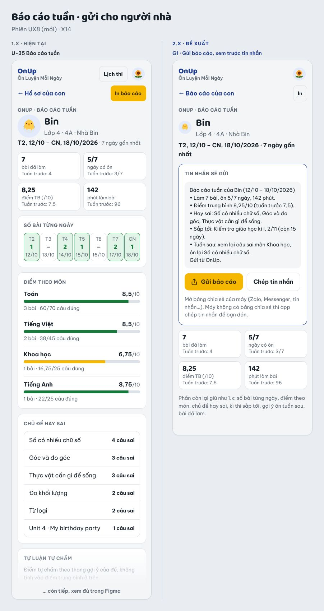

**X14. Báo cáo tuần chỉ in được.**
- `renderReport` có một nút “In báo cáo” (`window.print()`).
- Trên điện thoại, bố mẹ muốn gửi cho ông bà, cô giáo hay người kia trong nhà qua Zalo. Hiện phải lưu PDF rồi gửi file, hoặc chụp nhiều ảnh màn hình (U-35).

**Cách làm gợi ý (G1):**
- Đầu trang có nút chính “Gửi báo cáo” và nút phụ “In”.
- Khối “Tin nhắn sẽ gửi” xem trước một tin nhắn chữ thuần, khoảng 600 chữ cái trở xuống, gồm:
  - tên con, khoảng ngày;
  - số bài, số ngày ôn, số phút;
  - điểm trung bình, so với tuần trước;
  - tối đa 3 chủ đề hay sai;
  - kì thi gần nhất: ngày, còn N ngày;
  - 1–2 gợi ý của `weekTips`, bỏ gợi ý đã nói về kì thi sắp tới (gợi ý thứ hai thường đã ghi “còn N ngày”);
  - dòng cuối “Gửi từ OnUp.”
- Bấm “Gửi báo cáo”:
  - máy có bảng chia sẻ thì gọi `navigator.share({ title, text })`, bọc try/catch; người dùng hủy thì thôi, không báo lỗi;
  - không có thì chép tin nhắn (`navigator.clipboard`; không được thì chọn sẵn chữ trong khối xem trước) và hiện toast “Đã chép tin nhắn. Dán vào Zalo hoặc tin nhắn để gửi.”
- Có thêm nút “Chép tin nhắn”.
- Tin nhắn không có tên đăng nhập, không có đường dẫn vào tài khoản, không có gì ngoài nội dung báo cáo.
- Khối xem trước không in ra (`noprint`). Làm cho cả hai bản.

**Xong khi:** `tests/e2e.js` và `tests/supabase/cloud-e2e.js` có thêm các bước sau và vẫn in OK:
- Báo cáo có khối tin nhắn, với số bài và điểm khớp các ô số liệu.
- Giả lập `navigator.share` (`page.addInitScript`) thì tin nhắn được truyền vào đúng.
- Không có `navigator.share` thì clipboard có tin nhắn.
- Bản in (`emulateMedia print`) không có khối xem trước.
- Có ảnh 360px sáng/tối.

Đã làm ở PR #143; ảnh 360px sáng/tối ở [hinh-ux8/](hinh-ux8/): [bao-cao-tin-nhan](hinh-ux8/bao-cao-tin-nhan.jpg), [da-chep](hinh-ux8/da-chep.jpg), [ban-in](hinh-ux8/ban-in.jpg), [dam-may-bao-cao-tuan](hinh-ux8/dam-may-bao-cao-tuan.jpg).

### Phiên UI1 · Chỉnh nhỏ chữ và màu

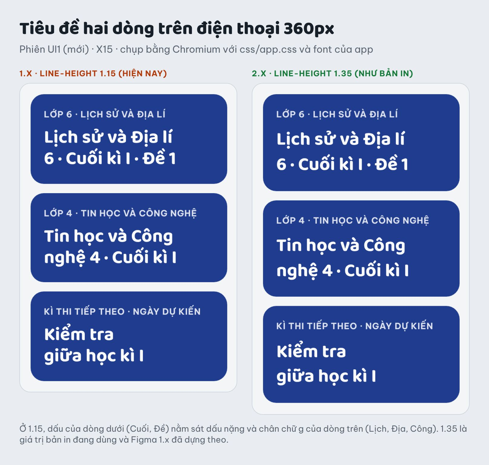

**X15. Tiêu đề hai dòng chật.**
- `h1,h2,h3{line-height:1.15}` (`css/app.css` dòng 31).
- Baloo 2 có dấu thanh cao. Ở 360px, tiêu đề hay xuống dòng, và dấu của dòng dưới nằm sát dấu nặng và chân chữ g của dòng trên. Ví dụ:
  - tên đề ở màn mở đề: “Lịch sử và Địa lí 6 · Cuối kì I · Đề 1”;
  - tên kì thi trong khung “Kì thi tiếp theo” của trang chính: “Kiểm tra giữa học kì I”.

  Thẻ kì thi trong danh sách lịch ghi tên bằng chữ thường (`<b>`), nên không đổi.
- Bản in đã phải nâng lên 1.35 (dòng 313). Design system trên Figma cũng dùng 1.35.

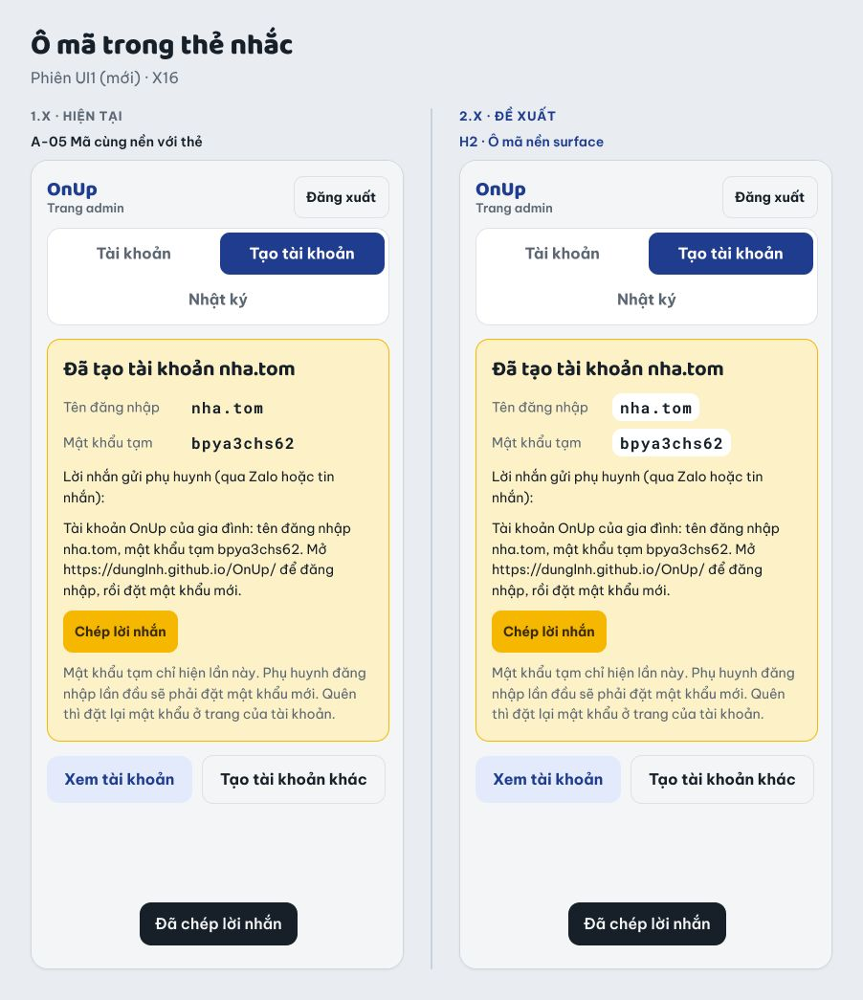

**X16. Ô mã chìm trong thẻ nhắc.**
- `.code` có nền `sun-soft` và nằm trong thẻ `.remind` cũng nền `sun-soft`.
- Ở trang admin (A-05), tên đăng nhập và mật khẩu tạm vừa tạo không nổi khung, khó thấy chỗ cần chép.

**Cách làm gợi ý:**
- `h1,h2,h3{line-height:1.35}` cho cả màn hình, giữ `text-wrap:balance`. Dòng `line-height` trong `@media print` thành thừa, có thể bỏ; giữ `break-after`.
- Thêm `.remind .code{background:var(--surface)}`.
- Phiên này sửa `css/app.css` và thêm một kiểm tra vào `tests/e2e.js`. Chạy cùng lúc với D0 được, vì D0 chỉ sửa tài liệu. Với phiên khác cũng sửa `tests/e2e.js`, ví dụ K3, thì Merge phiên đó trước.

**Xong khi:**
- `tests/e2e.js` in `E2E OK`.
- Thêm một kiểm tra: `line-height` tính ra của `h1` ≥ 1,3 lần cỡ chữ.
- Xem lại ảnh 360px sáng/tối trong `tests/screenshots/360/` và ảnh `admin-da-tao` của `tests/supabase/cloud-e2e.js`: không có chỗ nào vỡ, ô mã nổi khung.

### Phiên UI2 · Nút chính bị tắt ở chế độ tối

Ghi nhận ở kiểm thử UX3 (mục 5, 19/10/2026: nút “Cho con học”), gặp lại ở kiểm thử UX4 (23/10/2026: phím Vào khi phải đợi). Figma: khung [H3](https://www.figma.com/design/9mkNYX0ZOczNDMwlKo5F4e/OnUp?node-id=298-4156) sáng và tối trong section Chữ và màu; component `.btn` (Variant=main, State=disabled) đã vẽ theo đề xuất, nên E2 cũng đổi theo.

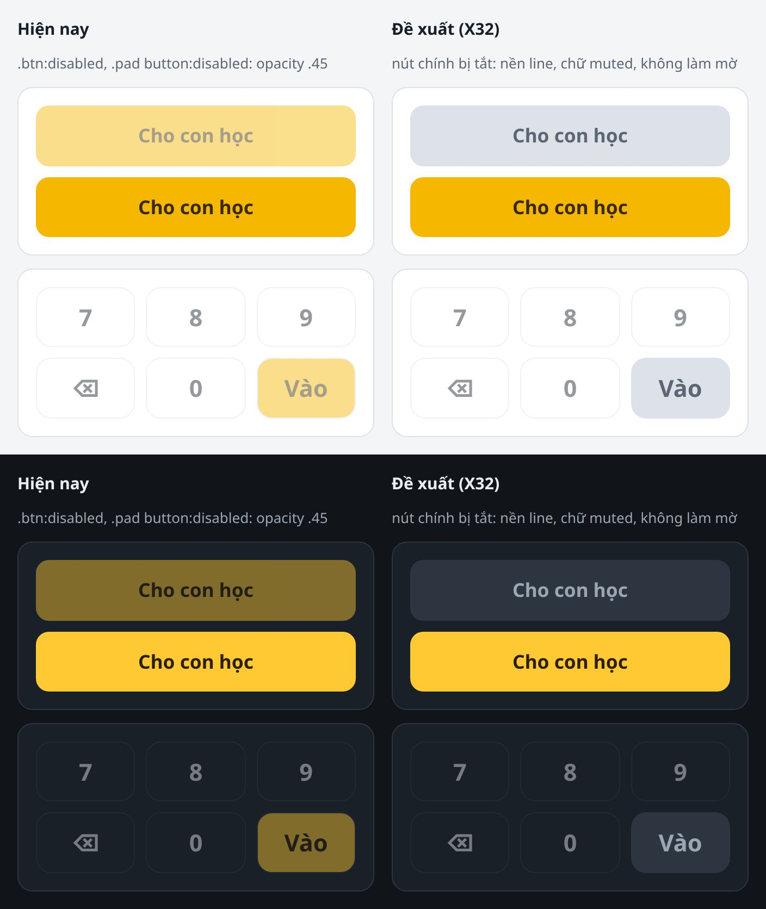

**X32. Nút chính bị tắt trông như nút đang bấm được ở chế độ tối.**
- `.btn:disabled` và `.pad button:disabled` chỉ làm mờ (`opacity: .45`). Nút chính có nền `--sun`; phím Vào của bàn phím PIN cũng tô `--sun` (style viết thẳng trong `pinBoxHTML` của `js/app.js`).
- Chế độ sáng: nút mờ thành vàng nhạt, nhìn là biết đang tắt (nút so với thẻ 1,3:1, chữ 2,0:1).
- Chế độ tối: làm mờ trên nền thẻ tối thành khối màu ô liu, nổi trên thẻ 3,2:1 (nút bấm được: 10,7:1), chữ trên nút 3,2:1. Trông như một nút khác màu vẫn bấm được, nhất là khi đứng cạnh nút chính bấm được.
- Các nút chính có lúc bị tắt: “Cho con học” (`#letStudy`, chưa có hồ sơ con), “Vào khu phụ huynh” (`#pwGo`) và phím Vào khi phải đợi, “Đăng xuất” trong hộp hỏi (`#outYes`) khi phải đợi, “Tạo hồ sơ” khi đã đủ 5 hồ sơ, “Chuyển dữ liệu máy này lên đám mây” (`#dMigrate`) khi máy không có dữ liệu cũ.

**Cách làm gợi ý:**
- Nút chính bị tắt (`.btn.main:disabled`) và phím Vào bị tắt: nền `--line`, chữ `--muted`, không làm mờ (`opacity: 1`), ở cả sáng và tối. Đo: chữ 4,4:1 (sáng), 5,0:1 (tối); nút so với thẻ 1,3:1 ở cả hai chế độ, nên nhìn là biết đang tắt.
- Phím Vào: bỏ style viết thẳng trong `pinBoxHTML`, dùng một lớp trong `css/app.css` (ví dụ `.pad .ok`) có nền `--sun`, chữ `--sun-ink` và trạng thái `:disabled` như trên.
- Nút khác (`.btn` thường, `ghost`, `danger`, phím số, “Hiện số”) giữ `opacity: .45`.
- Không đổi cách bật, tắt nút; 4 bài ôn dạng trang không có nút chính bị tắt nên không phải sửa.

**Xong khi:**
- `tests/e2e.js` (bước UX4, lúc phải đợi) và `tests/supabase/cloud-e2e.js` (UX3, “Cho con học” khi chưa có hồ sơ con) kiểm tra ở cả sáng và tối: nút chính bị tắt và phím Vào bị tắt có màu nền bằng `--line`, chữ bằng `--muted`, `opacity` 1; hai bộ kiểm thử in OK.
- Ảnh 360px sáng/tối chép lại: `docs/hinh-ux4/a4-dang-doi.jpg`, `ma-mo-nhanh-dang-doi.jpg` (phải đợi) và `docs/hinh-ux3/bat-dau-3-buoc.jpg` (“Cho con học” khi chưa có hồ sơ con).

Đã làm ở PR #133; ảnh trước/sau: [ui2-truoc-sau](hinh-ux-2x/ui2-truoc-sau.jpg).

### Phiên 9nb · Sửa sau kiểm thử 9n

Tìm được khi kiểm thử thiết kế sau khi gộp PR #119 (mục 5). Figma: [C5–C8](https://www.figma.com/design/9mkNYX0ZOczNDMwlKo5F4e/OnUp?node-id=267-3035) trong section Làm bài · Bảng số câu (9n), vẽ theo code, chú thích đã sửa theo hai mục dưới đây. Phiên ngắn: sửa `keyHtml` trong `js/quiz.js`, bước L38, L39 của `tests/e2e.js` và CLAUDE.md. Làm trước 9o, vì 9o vẽ cùng chú thích trong bài ôn dạng trang.

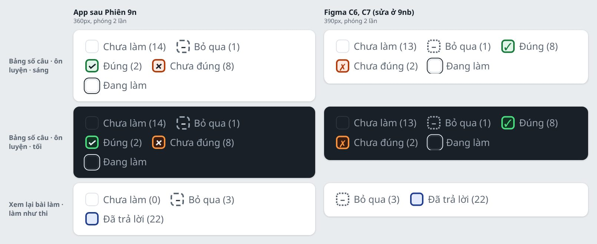

**X28. Mẫu ô ở chú thích không giống ô thật.**
- `keyHtml` vẽ mẫu ô là `<i class="qz-cell st-ok">✓</i>`: dấu nằm thẳng trong thẻ `<i>` mang lớp `.qz-cell`. Các quy tắc cho dấu (`.qz-cell i`: chữ đứng, màu `muted`; `.qz-cell.st-ok i`, `.qz-cell.st-bad i`: màu `ok`, `bad`) chỉ áp vào thẻ `<i>` nằm bên trong ô, nên không áp vào mẫu ô. Quy tắc `.qz-key .qz-cell i` có sẵn trong `css/app.css` cũng không áp vào đâu.
- Đo ở 360px: dấu –, ✓, ✗ của mẫu ô là chữ nghiêng (mặc định của `<i>`), màu `ink` (sáng #172029, tối #e8edf2). Dấu trong ô thật là chữ đứng, màu `muted`, `ok`, `bad`. Ở chế độ tối, ✓ và ✗ của chú thích thành chữ trắng trên nền xanh, nền cam, khác ô mà chú thích giải thích.

**X29. Chú thích ghi “Chưa làm (0)”.**
- `keyHtml` luôn ghi mục “Chưa làm” (`st === "blank" || cnt[st]`), đúng như mục thiết kế bên dưới từng ghi “luôn có Chưa làm”. Lỗi nằm ở thiết kế.
- Ở màn “Xem lại bài làm”, khi các câu còn trống đều là câu đã bỏ qua, dòng đầu ghi “Bạn còn 3 câu chưa làm.” mà chú thích ngay dưới ghi “Chưa làm (0)”. Con đọc thấy hai số trái nhau. Đề Tiếng Anh cũng vậy: “You have 2 questions left.” và “Not done (0)”. Gặp ở mọi lượt đi hết đề lần lượt, vì đi lần lượt thì không còn câu chưa mở. Ảnh `docs/hinh-9n/xem-lai-con-trong.jpg` của PR #119 cũng có.

**Cách làm gợi ý:**
- **Mẫu ô (X28).** Trong `keyHtml`, đặt dấu vào một thẻ `<i>` bên trong mẫu ô, như ô thật: `<i class="qz-cell st-skip" aria-hidden="true"><i>–</i></i>`. Các quy tắc có sẵn sẽ tự áp vào: dấu đứng, cùng màu với dấu trong ô, cỡ 13px (`.qz-key .qz-cell i`). Mẫu ô vẫn 18px, bo 5px, viền và nền như cũ. Không phải sửa `css/app.css`.
- **Chỉ ghi mục có câu (X29).** `keyHtml` bỏ ngoại lệ của “Chưa làm”: mục nào 0 câu thì không ghi. “Đang làm” giữ như cũ (khi bảng mở trên một câu). Mở bảng ở câu đầu của lượt thì chú thích vẫn là “Chưa làm (25)”, “Đang làm”.
- **Kiểm thử** (bước L38, L39 của `tests/e2e.js`):
  - chỗ so `eb.key === "Chưa làm (0)Đã trả lời (15)"` đổi thành `"Đã trả lời (15)"`;
  - màn “Xem lại bài làm” còn câu đã bỏ qua mà không còn câu chưa mở: chú thích không có “Chưa làm” (ôn luyện), không có “Not done” (đề Tiếng Anh);
  - mẫu ô: dấu nằm trong một thẻ `<i>` bên trong mẫu; `getComputedStyle` của dấu đó có `font-style: normal` và màu bằng màu dấu trong ô thật cùng trạng thái, ở cả sáng và tối.
- **CLAUDE.md:** câu “dòng chú thích `p.qz-key` chỉ ghi trạng thái đang có” ghi thêm: mục 0 câu không ghi, kể cả “Chưa làm”; mẫu ô có dấu trong thẻ `<i>` như ô thật.

**Xong khi:**
- `tests/e2e.js` in `E2E OK`, có ba kiểm tra trên.
- Ảnh 360px sáng/tối của bước L38, L39 chép lại sang `docs/hinh-9n/` (`bang-so-cau`, `xem-lai-con-trong`, `xem-lai-da-lam-het`): chú thích không còn “Chưa làm (0)”, dấu ✓, ✗ của chú thích cùng màu với ô.

Đã làm ở PR #122; kiểm thử thiết kế ở mục 5 (“9nb”).

### Phiên 9ob · Sửa sau kiểm thử 9o

Tìm được khi kiểm thử thiết kế sau khi gộp PR #123 (mục 5). Figma: [C12–C18](https://www.figma.com/design/9mkNYX0ZOczNDMwlKo5F4e/OnUp?node-id=290-3561) trong section Bài ôn dạng trang · Bảng số câu (9o), vẽ theo code, đã sửa theo hai mục dưới đây. Phiên ngắn: CSS và phần vẽ nhãn trên câu của 4 bài ôn (`modules/*/index.html`), bước 9o của `tests/e2e.js` và CLAUDE.md.

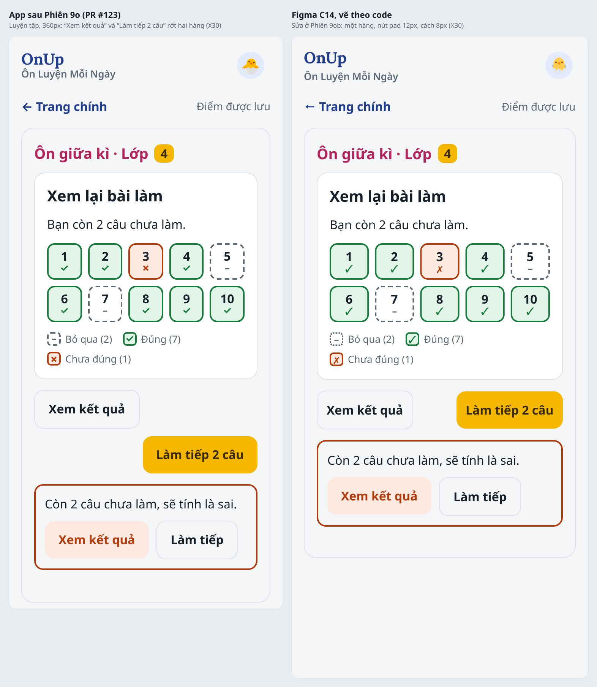

**X30. Hai nút của màn “Xem lại bài làm” (luyện tập) xuống hai hàng.**
- Khung bài ôn hẹp hơn màn đề ngân hàng: ở 360px, hàng `.actions` dưới `#recap` rộng 294px (đề ngân hàng 328px).
- Luyện tập ở l4, l6: `#endBtn` “Xem kết quả” 138,7px, khoảng cách 10px, `#moreBtn` “Làm tiếp 2 câu” 151,4px, tổng 300px. Hàng tự xuống dòng (`flex-wrap: wrap`): “Xem kết quả” đứng một mình bên trái, nút chính “Làm tiếp 2 câu” xuống hàng dưới, bên phải. Hộp hỏi lại trong `#endArea` cách nút vừa bấm thêm một hàng. Thiết kế (mục 3, “Phiên 9n, 9o”) đặt hai nút một hàng như đề ngân hàng.
- Gặp ở mọi lượt luyện tập còn câu trống của l4, l6, với mọi số câu (“Làm tiếp 12 câu” 160,5px). Đề thi thử (“Nộp bài” 99,8px) và IOE (“See results” 124,6px, “Finish test” 120,8px) vẫn một hàng.

**X31. Nhãn trên câu lặp tên bài khi luyện theo bài, theo unit.**
- `.qhead` có hai nhãn: tên lượt (`S.label`) bên trái, bài của câu (`L.short`; IOE “Unit N”) bên phải. Luyện theo bài thì tên lượt đã có tên bài (“Tiếng Việt · Tên cơ quan”), nên nhãn bên phải lặp lại “Tên cơ quan”. Tên dài thì nhãn đó xuống dòng, và trên câu có ba dòng nhãn chữ hoa chồng nhau (thêm “Chọn đáp án đúng”). IOE luyện theo unit: “Unit 3 Practice” rồi “Unit 3”.
- Trái quy tắc chữ chủ app chốt 20/10/2026 (CLAUDE.md, “Quy ước code”: một khối một tiêu đề, không chồng nhãn chữ hoa). Đề ngân hàng chỉ có một dòng nhãn trên câu (UX1, C1). Chỗ này có từ artifact gốc, không do 9o.

**Cách làm gợi ý:**
- **Một hàng (X30).** Ở cả 4 bài, hai nút dưới `#recap` có padding ngang 12px (thay 18px) và cách nhau 8px (thay 10px), ví dụ `.recap+.actions{gap:8px}` và `.recap+.actions .btn{padding-inline:12px}`. Đo ở 360px: “Xem kết quả” 126,7px, 8px, “Làm tiếp 120 câu” 157,7px, tổng 292,4px, vừa hàng 294px kể cả số câu có ba chữ số (“Ôn câu sai” không giới hạn số câu); IOE “See results” và “Do the 120 left” 260,6px. Nút vẫn cao 50,8px. Màn câu hỏi và đề ngân hàng giữ như cũ.
- **Một nhãn (X31).** Lượt luyện theo bài (l4, l6: nút “Ôn tập: …”, một dòng ở “Ôn theo bài”) và luyện theo unit (IOE) chỉ vẽ nhãn bên trái. Đề thi thử, “Ôn câu sai”/“Mistake Review”, “My Questions” giữ nhãn bài bên phải, vì câu thuộc nhiều bài. Chỉ đổi phần vẽ `.qhead`; `label` của lượt (lưu trong lịch sử, gửi về app) giữ nguyên.
- **Kiểm thử** (bước 9o của `tests/e2e.js`, 360px, trong khung):
  - màn “Xem lại bài làm” còn câu trống ở cả 4 bài: `#endBtn`, `#moreBtn` cùng một hàng (cùng `top`), không tràn khung; đổi chữ của `#moreBtn` thành “Làm tiếp 120 câu” (IOE “Do the 120 left”) rồi đo lại, vẫn một hàng;
  - luyện theo bài (l4, l6) và theo unit (IOE): `.qhead` chỉ có một nhãn; đề thi thử vẫn có hai.
- **CLAUDE.md:** thêm một ý vào “Hợp đồng giữa bài ôn và app”: Phiên 9ob, X30, X31; chủ app duyệt khi Merge lời giao việc này.

**Xong khi:**
- `tests/e2e.js` in `E2E OK`, có các kiểm tra trên; `node tests/so-du-lieu-bai-on.js` in `DU LIEU BAI ON OK`.
- Ảnh 360px sáng/tối chép lại sang `docs/hinh-9o/` (`bai-on-xem-lai`: hai nút một hàng; `bai-on-bang-so-cau`: một nhãn trên câu).

Đã làm ở PR #132; ảnh trước/sau: [hai-nut-mot-nhan-truoc-sau](hinh-9o/hai-nut-mot-nhan-truoc-sau.jpg).

### Phiên 9n, 9o · Bảng số câu và màn “Xem lại bài làm” (L38, L39)

Flow do PO viết ở [SUA-LOI-CHAY-THU.md](SUA-LOI-CHAY-THU.md), mục 2, “Phiên 9n” (chủ app yêu cầu 22/10/2026). Mục này là phần thiết kế cho flow đó: ảnh, cách trình bày, id, chữ. Khi rà flow có bảy chỗ chưa rõ (X21–X27); cách chốt đã ghi vào flow. Ảnh chụp bản mẫu ở 360px: `css/app.css` thật, câu hỏi vẽ bằng `Quiz.run` thật, bài ôn dạng trang thật (như X15). Ảnh là hướng làm, không bắt giống từng điểm ảnh. Phiên 9n đã làm phần đề ngân hàng (PR #119, kiểm thử ở mục 5). Figma: section [Làm bài · Bảng số câu (9n)](https://www.figma.com/design/9mkNYX0ZOczNDMwlKo5F4e/OnUp?node-id=267-3035), vẽ theo code sau khi gộp (C5–C11, bản tối của C6, C7). Bài ôn dạng trang (9o, PR #123): section [Bài ôn dạng trang · Bảng số câu (9o)](https://www.figma.com/design/9mkNYX0ZOczNDMwlKo5F4e/OnUp?node-id=290-3561), vẽ theo code sau khi gộp (C12–C18, bản tối của C12, C18; X30, X31 sửa ở Phiên 9ob), ảnh app ở [hinh-9o/](hinh-9o/), kiểm thử ở mục 5.

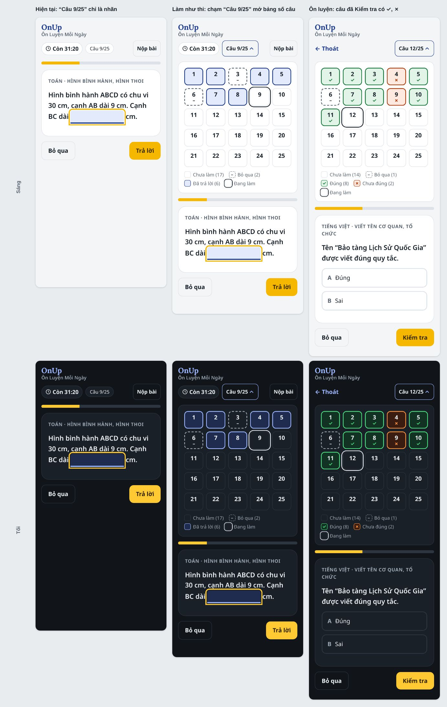

**X21. Trùng id.** Flow đặt id màn mới là `#qzReview`. Nhưng id này đang là mục “Câu cần xem lại” của màn kết quả: `tests/e2e.js` đọc `#qzReview .rv-body` và so thứ tự `qzScore,row,qzReview,…`. Màn mới dùng `#qzRecap`.

**X22. Sửa câu từ màn “Xem lại bài làm” xong thì đi đâu.** Theo luật “Câu tiếp tới câu sau theo số câu”, sửa câu 7 xong thì phải bấm qua câu 8–25 mới về lại màn này để nộp. Cách khác là mở bảng tìm ô 25.

**X23. Lựa chọn chưa bấm “Trả lời” (làm như thi).**
- Con chọn B rồi chạm ô số khác: flow chưa nói B có được ghi không. Con nghĩ đã chọn là đã trả lời (như tô phiếu), nên mất B thì bất ngờ. Hết giờ hay bấm “Nộp bài” lúc đang chọn cũng vậy: hiện nay lựa chọn đó bị bỏ.
- Câu đã trả lời mở lại mà vẫn có nút “Bỏ qua”: bấm “Bỏ qua” để đi tiếp là xóa câu trả lời cũ.

**X24. Ôn luyện có hai lối kết thúc, tính câu chưa mở khác nhau.**
- “← Thoát” (như bây giờ): câu chưa tới không tính.
- “Xem kết quả” ở màn mới: hỏi lại “Còn 3 câu chưa làm, sẽ tính là sai”.

Có bảng số câu thì có câu chưa mở, vì con nhảy qua. Vậy phải chốt mỗi lối tính câu đó thế nào, và màn mới chỉ nên có một lối ra. Thêm một trường hợp: chưa trả lời câu nào mà bấm “Nộp bài” ở màn mới thì lời “sẽ tính là sai” không đúng. Khi đó app không lưu điểm (“Thoát đề?”).

**X25. Nút ở câu cuối ghi “Câu tiếp” mà lại tới màn “Xem lại bài làm”.**

**X26. Hàng trên cùng chật ở 360px.**
- Làm như thi: [Còn 08:40] [Câu 11/25 ▾] [Nộp bài] cần 335px mà khung có 328px. Từ câu 10, “Nộp bài” rớt xuống hàng thứ hai. Tiếng Anh cần 336px.
- Bài ôn dạng trang: thanh trên đã kín 328px (chữ của trang 184px, đồng hồ, chip “1 / 20”), chưa thêm được nút.

**X27. IOE thay câu nghe theo vị trí.** Máy không phát được tiếng thì `soundFailed()` làm như sau:
- đề thi thử: thay các câu nghe từ `S.i` trở đi;
- luyện tập: bỏ các câu nghe khỏi `S.qs`.

Có bảng số câu thì câu nghe đã bỏ qua có thể nằm trước `S.i`, và bỏ câu khỏi `S.qs` làm lệch `S.ans`, vốn ghi theo vị trí. Ngoài ra, mỗi lần vẽ câu nghe, `renderQ` đặt lại 3 lượt nghe, nên rời câu rồi quay lại là có thêm lượt.

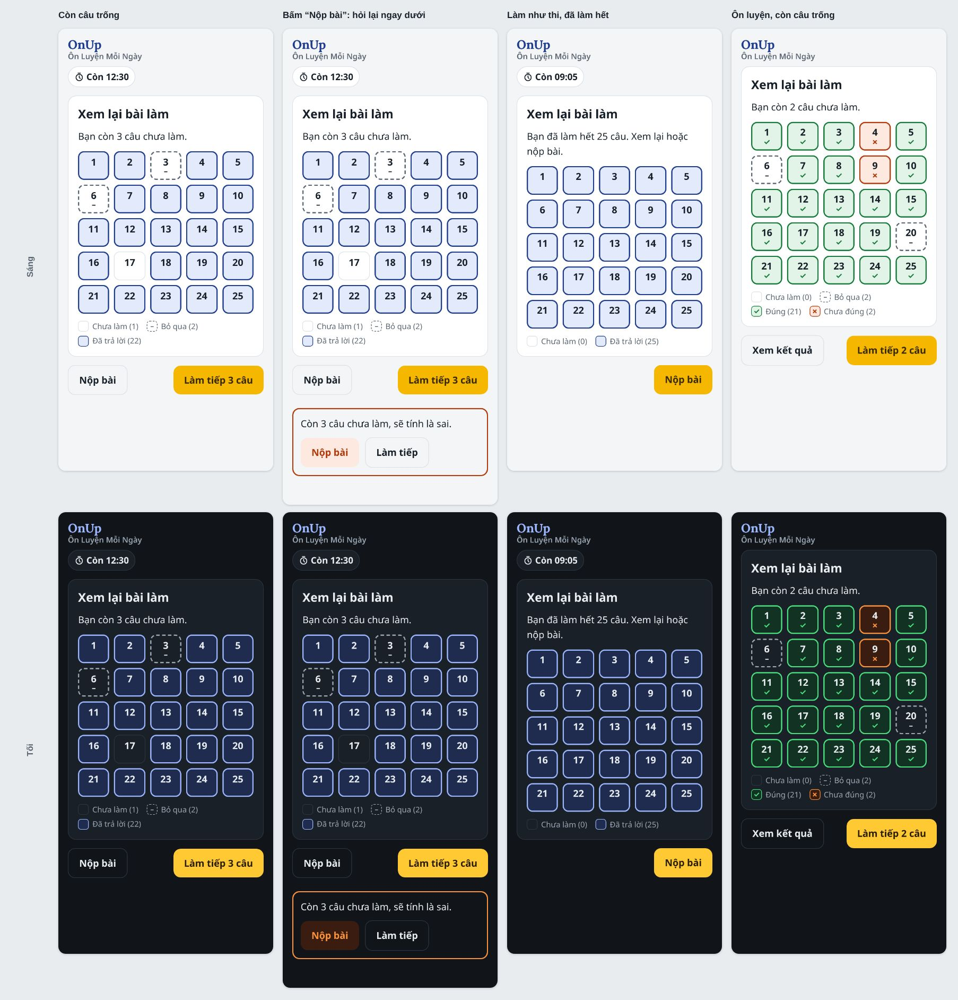

**Thiết kế cho đề ngân hàng (9n, `js/quiz.js`, `css/app.css`):**
- **Nút mở bảng.** `#qzProg` đổi từ chip thành `button.btn.ghost.sm.qz-prog`, cao 44px như “Nộp bài”:
  - chữ `L.progress` (“Câu 9/25”, tiếng Anh “9 of 25”) và mũi tên xuống 16px màu `acc`;
  - `aria-expanded`, `aria-controls="qzGrid"`; mở thì viền `acc`, mũi tên quay lên.

  Hàng trên cùng: ôn luyện [← Thoát] … [Câu 9/25 ▾]; làm như thi [Còn 31:20] [Câu 9/25 ▾] … [Nộp bài]. Để vừa một hàng (X26), sửa trong `.qz-top`:
  - gap 8px;
  - chip đồng hồ padding 5px 10px, gap 4px;
  - nút “Nộp bài” padding 7px 10px;
  - nút mở bảng padding 7px 6px 7px 10px, gap 2px.

  Đo ở câu 11/25: tiếng Việt 313px, tiếng Anh 314px, trong khung 328px.
- **Bảng số câu.** `section.panel.qz-grid#qzGrid` (gap 12px) nằm ngay dưới `.qz-top`, trên `.bar`. Khi vẽ câu mới, bảng đóng sẵn.
  - Ô là `button.qz-cell`: số câu (`<b>`) ở dòng trên, dấu trạng thái (`<i aria-hidden="true">`, 13px) ở dòng dưới.
  - Lưới `repeat(auto-fill,minmax(48px,1fr))`, gap 8px, ô cao 48px, bo 10px. Ở 360px có 5 ô một hàng (52×48px); màn rộng hơn có nhiều ô hơn.
  - Nhóm ô có `role="group"` và `aria-label` “Bảng số câu”. Mỗi ô có `aria-label` “Câu 5, đã bỏ qua”; ô đang làm thêm “, đang làm” và `aria-current="step"`.
  - Dòng chú thích `p.qz-key`: mẫu ô 18px, tên trạng thái và số câu, như “Bỏ qua (2)”. Chỉ ghi trạng thái có câu, không ghi mục 0 câu, kể cả “Chưa làm” (X29); thêm “Đang làm” khi bảng mở trên một câu. Mẫu ô vẽ như ô thật: cùng viền, nền, dấu đứng cùng màu với dấu trong ô (X28). Chữ 13px màu `muted`, tự xuống dòng.

  Trạng thái phân biệt bằng viền và dấu, không chỉ bằng màu:

  | Trạng thái | Ô | Dấu | Chú thích (vi / en) |
  |---|---|---|---|
  | Chưa làm: chưa mở, hoặc mở rồi rời đi mà chưa trả lời | viền 1px `line`, nền `surface` | | Chưa làm / Not done |
  | Bỏ qua: đã bấm “Bỏ qua”, chưa làm lại | viền 2px nét đứt `muted` | – | Bỏ qua / Skipped |
  | Đã trả lời (làm như thi) | viền 2px `acc`, nền `acc-soft`, như ô đang chọn | | Đã trả lời / Answered |
  | Đã làm (ôn luyện, câu tự luận đã Xem gợi ý) | như Đã trả lời | | Đã làm / Done |
  | Đúng (ôn luyện, đủ điểm) | viền 2px `ok`, nền `ok-soft` | ✓ màu `ok` | Đúng / Correct |
  | Chưa đúng (ôn luyện, dưới 1 điểm, cả câu đúng một phần) | viền 2px `bad`, nền `bad-soft` | ✗ màu `bad` | Chưa đúng / Not correct |
  | Đang làm | thêm vòng ngoài `box-shadow: 0 0 0 2px var(--surface), 0 0 0 4px var(--ink)` | | Đang làm / Current |

  Làm như thi không hiện ✓, ✗ trước khi nộp.
- **Màn “Xem lại bài làm”** (`section.panel.qz-grid.qz-recap#qzRecap`, X21):
  - Tiêu đề `h2` “Xem lại bài làm” (1.25rem), một dòng chữ thường (“Bạn còn 3 câu chưa làm.” / “Bạn đã làm hết 25 câu. Xem lại hoặc nộp bài.”), bảng số câu và chú thích. Không có ô đang làm.
  - Dưới thẻ là `.row.between.qz-nav`:
    - còn câu trống: nút phụ `#qzEnd` (`btn ghost`: “Nộp bài” / “Xem kết quả”) bên trái, nút chính `#qzMore` “Làm tiếp 3 câu” bên phải, cùng chỗ với “Trả lời”, “Câu tiếp” ở màn câu hỏi;
    - đã làm hết (làm như thi): chỉ `#qzEnd` “Nộp bài”, là nút chính (`btn main`), bên phải.
  - Bấm `#qzEnd` khi còn câu trống thì hộp `.confirm` mở ngay dưới, trong `#qzFb`: “Còn 3 câu chưa làm, sẽ tính là sai.”, nút `#qzYes` (`btn danger`, chữ như `#qzEnd`) và `#qzNo` “Làm tiếp” (đóng hộp, ở lại màn này). Chưa trả lời câu nào thì hỏi như bây giờ (“Thoát đề?…”, X24).
  - Hàng trên cùng của màn này: làm như thi chỉ còn chip đồng hồ (vẫn chạy, vẫn đổi màu dưới 2 phút); ôn luyện không có hàng trên. Không có “← Thoát”, “Nộp bài” ở hàng trên, nút mở bảng, `.bar`: nút ở cuối màn là lối ra duy nhất (X24).

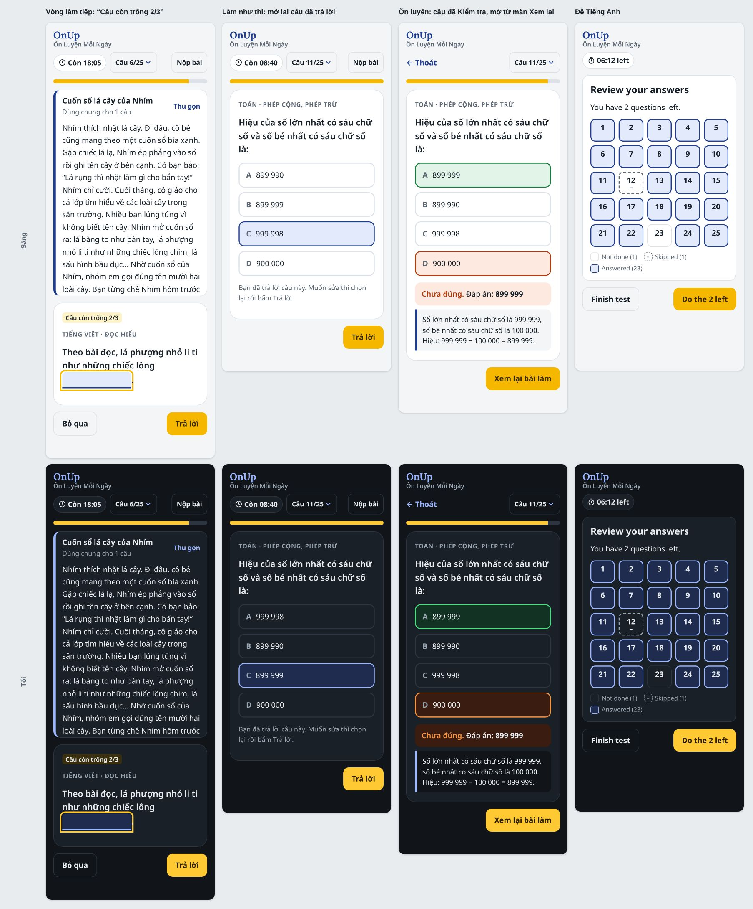

- **Đi giữa các câu** (X22):
  - Lượt đầu: “Bỏ qua”, “Trả lời”, “Câu tiếp” tới câu sau theo số câu, kể cả câu vừa nhảy tới bằng bảng (từ câu 20 thì tới câu 21). Qua câu cuối thì tới màn “Xem lại bài làm” hoặc màn kết quả, như flow.
  - Vòng làm tiếp: danh sách câu còn trống lúc bấm “Làm tiếp N câu”, theo số câu. Câu sau là câu kế tiếp trong danh sách, có số lớn hơn câu đang mở; hết danh sách thì về màn “Xem lại bài làm”. Nhãn `span.tag.warn.qz-left` “Câu còn trống 2/3” (vị trí trong danh sách) đứng đầu thẻ câu, chỉ trên câu của danh sách mà còn trống.
  - Câu mở từ màn “Xem lại bài làm”: xong câu đó (“Trả lời”, “Bỏ qua”, hay nút đi tiếp sau Kiểm tra) thì về lại màn đó; ôn luyện mà không còn câu trống thì ra kết quả. Từ câu đó chạm một ô khác trên bảng cũng vậy, cho đến khi bấm “Làm tiếp”.
  - Chạm ô thì tới câu đó, bảng đóng, trang cuộn lên đầu (`render()` đã `scrollTo(0,0)`). Câu có đoạn đọc chung thì đoạn đọc hiện lại, giữ trạng thái mở/thu gọn (`S.psgOpen`).
- **Ghi câu trả lời** (X23):
  - Làm như thi:
    - “Trả lời” ghi lựa chọn đang có rồi đi tiếp; chưa đủ thì báo như bây giờ.
    - “Bỏ qua” bỏ lựa chọn đang có, để trống câu, rồi đi tiếp. Nút này chỉ có ở câu chưa trả lời.
    - Câu đã trả lời mở lại thì vẽ sẵn câu trả lời cũ: ô đã chọn, chữ đã gõ, Đúng/Sai của 4 ý, cặp đã nối, thứ tự đã xếp, bài tự luận. Dưới câu có dòng `p.small.muted#qzEditNote` “Bạn đã trả lời câu này. Muốn sửa thì chọn lại rồi bấm Trả lời.”. Chỉ có nút “Trả lời”, bên phải. Chưa đủ thì báo lỗi không kèm đuôi “hoặc bấm Bỏ qua nhé.”.
    - Rời câu bằng bảng số câu: lựa chọn đã đủ thì ghi như bấm “Trả lời” nhưng không đi tiếp. Chưa đủ thì giữ câu trả lời đã ghi trước đó (nếu có). Câu tự luận để trống không tính là đã trả lời.
    - Nộp bài bằng mọi lối (nút, hết giờ, rời trang): câu đang mở mà lựa chọn đã đủ thì ghi trước khi chấm.
  - Ôn luyện:
    - Chỉ “Kiểm tra” (tự luận: “Xem gợi ý”) ghi câu trả lời. Rời câu bằng bảng thì bỏ lựa chọn chưa kiểm tra; câu giữ trạng thái cũ.
    - Câu đã Kiểm tra mở lại thì vẽ lại như ngay sau Kiểm tra: lựa chọn, đúng/sai, đáp án, lời giải, link báo câu sai. Tự luận hiện bài làm (chỉ đọc), gợi ý, thang tự chấm (vẫn chọn lại mức được). Chỉ có một nút đi tiếp.
    - Nên tách phần vẽ sau Kiểm tra thành một hàm, dùng cho cả hai chỗ.
- **Nút đi tiếp ghi tên màn sẽ tới** (ôn luyện, sau Kiểm tra; X25): “Câu tiếp” (câu khác), “Xem lại bài làm” (về màn mới, khi còn câu trống), “Xem kết quả” (không còn câu trống, kể cả câu mở từ màn mới). Làm như thi giữ “Trả lời”.
- **Kết thúc lượt** (X24):
  - Làm như thi: mọi lối chấm như bây giờ, câu còn trống tính sai.
  - Ôn luyện:
    - “Xem kết quả” ở màn mới tính mọi câu còn trống (bỏ qua và chưa làm) là sai, đúng như lời hỏi lại. Cách làm: ghi các câu đó như câu bỏ qua rồi gọi `finish()`.
    - “← Thoát” ở màn câu hỏi và rời trang: như bây giờ (câu bỏ qua tính sai, câu chưa làm không tính).
- **Thanh tiến độ** `.bar`: theo số câu đã trả lời hoặc đã Kiểm tra trên tổng số câu, không theo vị trí, vì giờ nhảy câu được.

**Chữ mới** (bảng `TXT`, cả hai cột; chuỗi có tham số viết là hàm):

| Khóa (gợi ý) | vi | en |
|---|---|---|
| `gridAria` | Bảng số câu | Question board |
| `cellAria(n, st, cur)` | Câu 5, đã bỏ qua(, đang làm) | Question 5, skipped(, current) |
| `st` (aria) | chưa làm · đã bỏ qua · đã trả lời · đã làm · đúng · chưa đúng | not done · skipped · answered · done · correct · not correct |
| `key` (chú thích) | Chưa làm · Bỏ qua · Đã trả lời · Đã làm · Đúng · Chưa đúng · Đang làm | Not done · Skipped · Answered · Done · Correct · Not correct · Current |
| `recapHead` | Xem lại bài làm | Review your answers |
| `recapLeft(n)` | Bạn còn 3 câu chưa làm. | You have 3 questions left. (1: “1 question”) |
| `recapAll(n)` | Bạn đã làm hết 25 câu. Xem lại hoặc nộp bài. | You have answered all 25 questions. Review or finish the test. |
| `doLeft(n)` | Làm tiếp 3 câu | Do the 3 left |
| `leftWarn(n)` | Còn 3 câu chưa làm, sẽ tính là sai. | 3 questions are not done and will count as wrong. (1: “1 question is …”) |
| `leftTag(i, n)` | Câu còn trống 2/3 | Left to do: 2 of 3 |
| `editNote` | Bạn đã trả lời câu này. Muốn sửa thì chọn lại rồi bấm Trả lời. | You have answered this question. To change it, choose again and tap Answer. |
| `backRecap` | Xem lại bài làm | Back to review |

Dùng lại khóa có sẵn: `progress`, `submit` (“Nộp bài” / “Finish test”), `seeResults`, `next`, `keepGoing`, `exNone`.

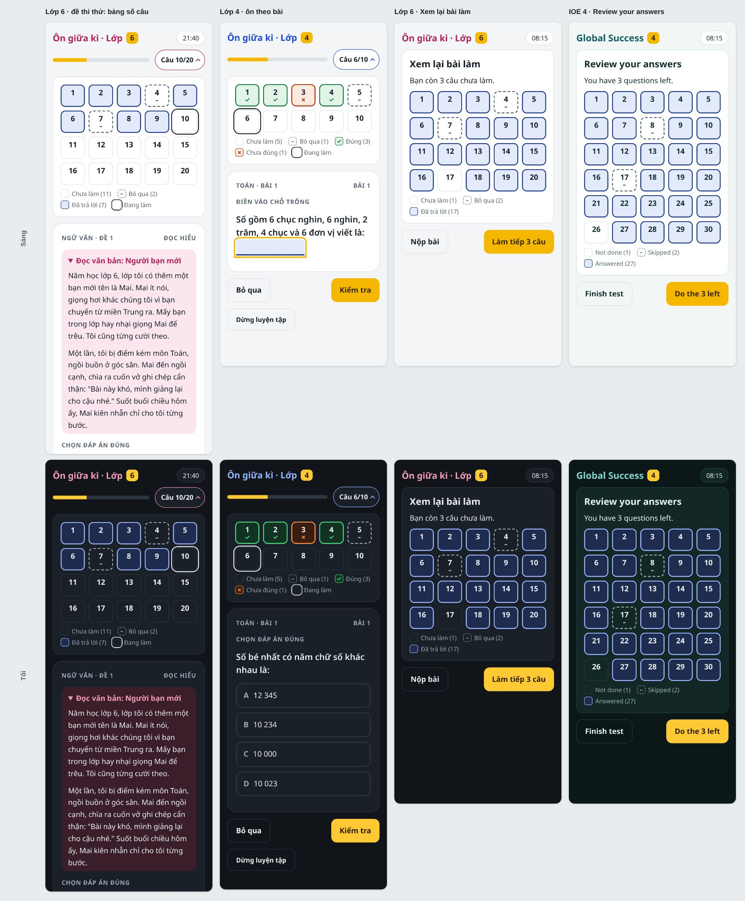

**Thiết kế cho bài ôn dạng trang (9o):**
- **Số câu chuyển xuống màn làm bài (X26).** Bỏ chip “10 / 20” khỏi thanh trên (`#topRight` chỉ còn đồng hồ khi làm đề thi thử). Hàng đầu của màn làm bài là `.qtop`: thanh tiến độ co giãn bên trái, nút `#gridBtn` bên phải.
  - Nút: “Câu 10/20 ▾”, IOE “10 of 30 ▾”; viên thuốc cao 44px, viền `line`, mũi tên màu `--acc` của môn; mở thì viền `--acc`.
  - Bảng `#grid` (`.panel.qgrid`) ngay dưới, cùng kiểu ô, chú thích như 9n. Ô đã trả lời dùng `--pick`, `--pick-soft` (không theo màu của môn, như ô đang chọn).
  - Số đo lấy từ code của 9n sau 9nb (`.qz-cells`, `.qz-cell`, `.qz-cell.st-…`, `.cur`, `.qz-key` trong `css/app.css`; Figma C5–C8), chép vào CSS của trang. Chú thích theo X28, X29: mẫu ô như ô thật, không ghi mục 0 câu. Nên đặt tên lớp trạng thái như 9n (`st-blank`, `st-skip`, `st-ans`, `st-ok`, `st-bad`, `cur`) để kiểm thử đọc bảng của hai nơi theo một cách.
- **Màn “Xem lại bài làm” `#recap`.** Nút kết thúc của màn chính là `#endBtn` (“Nộp bài” / “Xem kết quả”, IOE “Finish test” / “See results”), đứng bên trái `#moreBtn` “Làm tiếp N câu”. Hỏi lại trong `#endArea` bằng `#yesEnd`, `#noEnd` như bây giờ. Đã làm hết thì `#endBtn` là nút chính, bấm là nộp. Như vậy:
  - app vẫn biết bài đang làm dở (hợp đồng: có `#endBtn` hoặc `#yesEnd`);
  - màn này không có hai nút nộp;
  - màn câu hỏi giữ `#endArea` (“Nộp bài sớm”, “Dừng luyện tập”…) như bây giờ.
- **Chữ.** Như 9n, viết thẳng trong trang. IOE viết tiếng Anh như bảng trên.
- **IOE (X27).**
  - `soundFailed()` thay mọi câu nghe chưa trả lời, ở mọi vị trí, bằng câu đọc. Luyện tập cũng thay như đề thi thử, không bỏ câu khỏi `S.qs`.
  - Số lượt nghe còn lại giữ theo từng câu (ví dụ `S.plays[i]`), rời câu rồi quay lại không có thêm lượt.
  - Câu đã Check thì nghe lại thoải mái như bây giờ.

**Kiểm thử thêm** (ngoài “Xong khi” của flow):
- 9n:
  - hàng trên cùng của làm như thi một hàng (cao 44px) ở 360px, ở câu từ 10 trở đi, cả đề Tiếng Anh;
  - ô bảng ≥ 44px, 5 ô một hàng ở 360px;
  - `#qzReview` chỉ có ở màn kết quả;
  - câu mở từ màn “Xem lại bài làm” xong thì về màn đó;
  - làm như thi: chọn rồi chạm ô khác thì câu thành “Đã trả lời” và điểm tính lựa chọn đó; câu đã trả lời không có “Bỏ qua”; chọn rồi để hết giờ thì câu đó được chấm;
  - ôn luyện: “Xem kết quả” ở màn mới tính câu chưa làm là sai; “← Thoát” giữa chừng không tính câu chưa tới;
  - mở lại từng dạng câu ở làm như thi (đề `thunghiem6-dang-cau-moi` có đủ dạng) thì thấy đúng câu trả lời cũ;
  - `audit` không báo chữ đè ở bảng và màn mới.
- 9o:
  - thanh trên của trang một hàng ở 360px;
  - chú thích dưới bảng không có mục 0 câu, dấu trong mẫu ô cùng màu với dấu trong ô (X28, X29);
  - IOE: máy không phát được tiếng thì câu nghe đã bỏ qua cũng được thay; rời câu nghe rồi quay lại không có thêm lượt nghe.

## 4. Để sau

- **Đánh dấu câu để xem lại trên bảng số câu** (như lá cờ của bài thi trên máy tính): làm sau khi con đã quen bảng số câu của 9n, 9o; hiện “Bỏ qua” đã dùng để để dành câu khó.
- **Bố mẹ đọc và chấm bài tự luận thay con.** Việc này cần lưu chữ con viết lên máy chủ, nên phải quyết định về dữ liệu của trẻ trước (CLAUDE.md: thu thập tối thiểu). Hiện con tự chấm theo thang, và kết quả tự chấm ghi riêng.
- **Thanh tab dưới cho Khu phụ huynh:** xem lại sau khi đã dùng ba mục của UX2 một thời gian.

## 5. Kiểm thử thiết kế sau khi gộp

Sau khi một phiên UX gộp vào `main`, người làm thiết kế kiểm lại trước khi giao phiên tiếp theo:
1. Chạy app ở 360px sáng và tối: bản đám mây trên máy chủ giả (như `tests/supabase/cloud-e2e.js`) hoặc bản lưu trên máy.
2. Đi lại từng ý trong lời giao việc của phiên (mục 4 của kế hoạch) và màn 2.x tương ứng trong Figma; chụp từng trạng thái, đặt cạnh Figma.
3. Ghi kết quả vào mục này: khớp, lệch so với yêu cầu, khác Figma nhưng chấp nhận.
4. Chỗ lệch thành mã X mới (tiếp theo X1–X16) và một phiên sửa ngắn tên “<phiên>b” ở mục 3. Chỗ khác Figma mà chấp nhận thì sửa Figma theo code.

Lượt kiểm thử không sửa code: chỉ ghi lại, rồi giao việc.

### UX3 · Bắt đầu và chuyển máy cho con · PR #56 · kiểm thử 19/10/2026

**Kết luận:** đạt phần lớn. Thẻ “Bắt đầu trong 3 bước”, nút “Chọn hồ sơ khác” và mã mở nhanh làm đúng lời giao việc và màn E2. Một ý chưa làm: đăng xuất chưa hỏi mật khẩu (X17). Thêm ba chỗ nhỏ trong luồng và chữ (X18–X20). Cả bốn giao cho Phiên UX3b (mục 3).

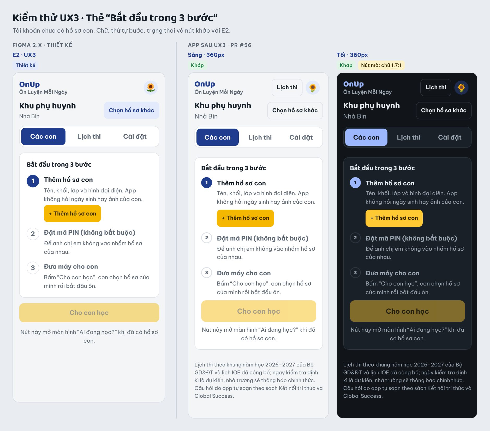

| Yêu cầu (lời giao việc UX3, màn E2) | Kết quả | Ghi chú |
|---|---|---|
| Thẻ “Bắt đầu” 3 bước trên mục Các con: thêm hồ sơ con → đặt PIN (không bắt buộc) → đưa máy cho con | Khớp | Chữ, thứ tự bước, nút “+ Thêm hồ sơ con” trong thẻ đúng E2. Bước đang làm có số trên nền xanh, bước xong có ✓. Chưa có con thì mục Các con chỉ có thẻ này. |
| Thẻ hiện đến khi làm xong | Khớp | Thẻ ẩn khi một con đã chọn hồ sơ trên máy này hoặc đã có kết quả. |
| Nút to “Cho con học” mở “Ai đang học?”, mờ khi chưa có hồ sơ con | Khớp | Cao 55px (CSS tối thiểu 52px). Ở chế độ tối nút mờ khó nhận ra là đang tắt (xem “Ghi nhận” bên dưới). |
| Bước 2 “Đặt mã PIN” | Lệch nhỏ | Lưu mã xong thì lạc sang Cài đặt (X18); có ✓ khi mới một con có mã (X19). |
| Đổi “Đổi người học” thành một tên dễ hiểu, dùng thống nhất | Khớp | “Chọn hồ sơ khác” ở góc trên khu phụ huynh, trang Tài khoản của phụ huynh và của con. Code không còn chữ “Đổi người học”. |
| Mã mở nhanh 4–6 số trên máy đã ghi nhớ, lưu trên máy, quên thì nhập mật khẩu | Khớp | Chỉ đặt được khi máy ghi nhớ đăng nhập; mã băm, lưu theo gia đình trên máy, không lên máy chủ. Ô Phụ huynh ghi “Nhập mã mở nhanh”, có link “Nhập mật khẩu” và ngược lại “Dùng mã mở nhanh”. Sai 5 lần thì ô mật khẩu cũng phải đợi; đúng mã thì vào. Dòng Tài khoản ở Cài đặt có ghi “mã mở nhanh”. Chữ trên ô mã cần sửa nhỏ (X20). |
| Đổi mật khẩu vẫn cần mật khẩu | Khớp | Form đổi mật khẩu có ô mật khẩu hiện tại. |
| Đăng xuất vẫn cần mật khẩu | **Chưa làm** | Vào bằng mã mở nhanh rồi bấm “Đăng xuất khỏi máy này” là thoát ngay (X17), dù ô mã ghi “đăng xuất vẫn cần mật khẩu”. |
| Không có màn “Đây là máy của nhà mình?”; màn đăng nhập giữ ô Ghi nhớ và dòng giải thích | Khớp | Đăng nhập lần đầu, đổi mật khẩu tạm xong là vào thẳng khu phụ huynh. |
| 360px sáng/tối: không tràn ngang, vùng bấm ≥ 44px, chữ ≥ 13px | Khớp | 11 trạng thái đo ở 360px đều đạt, ảnh chụp cả sáng và tối; `cloud-e2e.js` đo cả hai chế độ. Không có lỗi JavaScript. |

**Khác Figma nhưng chấp nhận** (Figma đã vẽ theo code ở E2b):
- Nút “Cho con học” và dòng chú thích nằm trong thẻ; E2 vẽ dưới thẻ. Gọn hơn, giữ như code.
- Nút “Chọn hồ sơ khác” ở góc trên khu phụ huynh là nút viền; E2 vẽ nền xanh nhạt. Giữ như code.
- Thanh trên của phụ huynh vẫn có “Lịch thi”, cuối trang có dòng chú thích lịch thi; E1, E2 không vẽ hai thứ này. Đây là phần của UX2: nút đó về đúng tab Lịch thi, nên không còn hai nút cùng tên làm hai việc khác nhau.

**Đã biết, để UX4:** ô Phụ huynh có mã mở nhanh dùng chung bàn phím PIN, nên vướng cùng X1–X3: trang tự cuộn, số hiện hai lần, đang phải đợi vẫn bấm được. UX4 làm bước nhập mã riêng theo A5b (mục 3, Phiên UX4).

**Ghi nhận cho design system, chưa giao việc:** nút chính bị tắt (`.btn:disabled`, `opacity: .45`) ở chế độ tối thành một khối màu ô liu nổi rõ trên thẻ (3,2:1) trong khi chữ trên nút chỉ đạt 1,7:1, nên trông như một nút khác màu đang bấm được. Ở chế độ sáng thì nhạt rõ ràng. Nếu sửa: nút tắt dùng nền `--line`, chữ `--muted` thay cho làm mờ, áp dụng cho mọi nút chính, và sửa cùng component `.btn` (State=disabled) trong Figma. (23/10/2026: gặp lại ở kiểm thử UX4, thành X32, giao Phiên UI2 ở mục 3.)

**Kiểm thử tự động trên `main` sau khi gộp (`d121ca1`):**
- `tests/e2e.js`: E2E OK.
- `tests/supabase/cloud-e2e.js`: CLOUD E2E OK, 116 mục đạt ở hai lượt sáng và tối, trong đó có 4 kiểm tra UX3 mỗi lượt.
- `store-test.mjs`: SUPABASE STORE OK. `admin-test.mjs`: ADMIN OK.
- `sh tests/supabase/run.sh`: RLS OK, 205 kiểm tra. PR #56 chưa chạy bước này vì máy của phiên đó không có PostgreSQL.

### UX4 · Chọn hồ sơ và nhập PIN · PR #59 · kiểm thử 23/10/2026

**Kết luận:** đạt. Bước nhập riêng (A3), bàn phím mờ khi phải đợi (A4), mật khẩu và mã mở nhanh của Phụ huynh (A5, A5b), chạm hình là đổi (A6) đúng lời giao việc, trên `main` hiện nay (sau đổi font, hình hải cẩu, 9n). Một chỗ cũ gặp lại: ở chế độ tối, phím Vào bị tắt khi phải đợi thành khối màu ô liu, như nút “Cho con học” của kiểm thử UX3 (X32, giao Phiên UI2 ở mục 3).

**Cách kiểm:** ảnh 360px sáng/tối của `tests/e2e.js` (bước UX4) và `tests/supabase/cloud-e2e.js` (các kiểm tra “UX4:”) chạy trên `main` (`2f6b5d9`), đặt cạnh khung A3–A6, A5b của section [Vào app](https://www.figma.com/design/9mkNYX0ZOczNDMwlKo5F4e/OnUp?node-id=71-48); đọc `renderEnter`, `pinBoxHTML` (`js/app.js`) và `.enter`, `.pin-show` (`css/app.css`).

| Yêu cầu (mục 3, “Phiên UX4”) | Kết quả | Ghi chú |
|---|---|---|
| Bước nhập riêng `#/vao/<mã>`: “← Chọn hồ sơ khác”, hình to, tên, lớp, hàng chấm, “Hiện số”, bàn phím ngay dưới, dòng quên PIN (A3, X1) | Khớp | Cả màn vừa 360×740, không cuộn; kiểm thử đo `scrollY` và 12 phím trong khung nhìn. |
| Số chỉ hiện ở hàng chấm; “Hiện số” là nút chữ dưới hàng chấm (X2) | Khớp | Ô `#pinIn` ẩn khỏi mắt; nút đổi “Hiện số”, “Giấu số”. |
| Lỗi và đếm ngược ngay dưới hàng chấm; đang phải đợi thì bàn phím, Vào, “Hiện số” tắt, hết giờ tự bật lại (A4, X3) | Khớp | “Mã PIN chưa đúng. Đợi 30 giây rồi thử lại.” Ở chế độ tối phím Vào bị tắt thành khối ô liu (X32). |
| Phụ huynh: ô mật khẩu, nút to “Vào khu phụ huynh”, “Quên mật khẩu?”; máy có mã mở nhanh thì bàn phím mã trước, “Quên mã? Nhập mật khẩu” (A5, A5b) | Khớp | Số chấm theo độ dài mã. |
| Chạm hình là đổi, toast “Đã đổi hình đại diện”, không có nút Lưu; bản lưu trên máy có form “Đổi mã PIN” riêng (A6, X4) | Khớp | Bộ chọn có 16 emoji và 6 hải cẩu (PR #116). |
| 360px sáng/tối: không tràn ngang, vùng bấm ≥ 44px, chữ ≥ 13px, chữ không đè | Khớp | `audit` của hai bộ kiểm thử. |

**Khác Figma nhưng chấp nhận** (đã sửa A3, A4, A5b theo code): hàng chấm, “Hiện số”, bàn phím (A5b có thêm “Quên mã? Nhập mật khẩu”) nằm trong thẻ `.panel#pinBox`; dòng “Nhập mã PIN của bạn” chữ nhỏ màu nhạt, “Hiện số” màu nhạt (Figma cũ: chữ đậm, màu `acc`); lời báo phải đợi theo code.

### UX5 · Làm bài tập trung · PR #61 · kiểm thử 23/10/2026

**Kết luận:** đạt. Chế độ tập trung, nút “Nộp bài”, đồng hồ “Còn …”, bỏ “Bỏ qua” sau Kiểm tra và màn mở đề có thẻ “Lần trước” làm đúng lời giao việc và khung C1, C2, C4. Hàng trên cùng đã đổi ở Phiên 9n (nút mở bảng số câu), khớp section 9n.

**Cách kiểm:** ảnh 360px sáng/tối của bước UX5 của `tests/e2e.js` (`c1-lam-nhu-thi`, `c1-nop-bai`, `c2-sau-kiem-tra`, `c4-mo-de`) trên `main` (`2f6b5d9`), đặt cạnh khung C1, C2, C4 của section [Làm bài](https://www.figma.com/design/9mkNYX0ZOczNDMwlKo5F4e/OnUp?node-id=75-1327).

| Yêu cầu (mục 3, “Phiên UX5”) | Kết quả | Ghi chú |
|---|---|---|
| Trong lúc làm đề, thanh trên chỉ còn chữ OnUp; màn kết quả có lại đủ (X5) | Khớp | Không hình đại diện, không thanh tab; chốt rời trang vẫn hỏi. |
| Làm như thi: “Nộp bài” thay “← Thoát”; ôn luyện giữ “← Thoát” (X6) | Khớp | |
| Đồng hồ “Còn 40:00” có biểu tượng và `aria-label`; tiến độ “Câu 1/25” (X7) | Khớp | Từ Phiên 9n, “Câu 1/25 ▾” là nút mở bảng số câu; hàng trên một hàng ở 360px (X26). |
| Sau Kiểm tra không còn “Bỏ qua”; “Câu tiếp” đứng một mình bên phải (X8) | Khớp | |
| Màn mở đề: thẻ “Lần trước: 1/25 câu đúng” (lúc làm, cách làm, thời gian); hai thẻ cách làm cao ≥ 64px, có biểu tượng và một dòng giải thích (X9) | Khớp | |
| 360px sáng/tối | Khớp | |

**Khác Figma nhưng chấp nhận:** C1 vẽ “Câu 9/25” là chip; code (từ 9n) là nút `.qz-prog`, hàng cách nhau 8px. Đã sửa C1 theo code.

### UX6 · Biết bài đã gửi chưa · PR #66, #70 · kiểm thử 23/10/2026

**Kết luận:** đạt. Màn kết quả ghi rõ đã gửi hay chưa, trang chính của con và Khu phụ huynh có dòng “N bài chưa gửi · Gửi lại”, bản lưu trên máy không đổi; đúng lời giao việc và khung D1–D3.

**Cách kiểm:** ảnh 360px sáng/tối của `tests/supabase/cloud-e2e.js` (`c8i-chua-gui`, `c8j-bai-chua-gui`, `c8k-da-gui`, `c11b-bai-chua-gui`; máy chủ giả có công tắc làm lượt gửi lỗi) trên `main` (`2f6b5d9`), đặt cạnh khung D1–D3 của section [Kết quả đề](https://www.figma.com/design/9mkNYX0ZOczNDMwlKo5F4e/OnUp?node-id=78-1495).

| Yêu cầu (mục 3, “Phiên UX6”) | Kết quả | Ghi chú |
|---|---|---|
| Màn kết quả: “Đã lưu và gửi cho bố mẹ.” (nền `ok-soft`) hoặc “Đã lưu trên máy này. Sẽ gửi cho bố mẹ khi có mạng.” (nền `sun-soft`), kèm toast (D1, D2) | Khớp | Có biểu tượng ✓ hoặc đồng hồ. |
| Trang chính của con: “1 bài chưa gửi cho bố mẹ · Gửi lại” dưới lời chào, trên thẻ “Hôm nay ôn gì?”; Khu phụ huynh: “N bài làm trên máy này chưa gửi đi · Gửi lại” (D3) | Khớp | Dòng cao ≥ 44px, nền `sun-soft`, chữ `ink`. |
| Bài ôn trong khung: toast ghi rõ đã gửi hay chưa | Khớp | Theo `cloud-e2e.js` (UX6), cả IOE. |
| Bản lưu trên máy không có dòng mới | Khớp | Cờ `ux6LocalOK` của `tests/e2e.js`. |

**Khác Figma nhưng chấp nhận:** D1, D2 vẽ link “← Về trang chính” ở đầu màn kết quả và câu cần xem lại thành từng dòng trong một thẻ; code (UX1) để câu cần xem lại thành khối có vạch trái, nút “Về trang chính” ở cuối màn. Phần này thuộc UX1 (chưa có lượt kiểm thử ở mục này), giữ như code; Figma D1, D2 chưa sửa phần đó.

**Kiểm thử tự động cho UX4, UX5, UX6:** cùng lượt với 9o (mục “9o” bên dưới): `tests/e2e.js` E2E OK, `tests/supabase/cloud-e2e.js` CLOUD E2E OK (152 mục) trên `main` `2f6b5d9`.

### 9n · Bảng số câu và màn “Xem lại bài làm” · PR #119 · kiểm thử 23/10/2026

**Kết luận:** đạt. Bảng số câu, màn “Xem lại bài làm”, vòng làm tiếp, sửa câu khi làm như thi và chỉ xem lại khi ôn luyện làm đúng flow “Phiên 9n” ([SUA-LOI-CHAY-THU.md](SUA-LOI-CHAY-THU.md), mục 2) và mục thiết kế ở mục 3 (X21–X26). Còn hai chỗ nhỏ ở dòng chú thích dưới bảng: mẫu ô không giống ô thật (X28), và mục “Chưa làm (0)” trái với dòng đầu của màn “Xem lại bài làm” (X29, lỗi ở mục thiết kế). Cả hai giao cho Phiên 9nb (mục 3), làm trước 9o.

**Cách kiểm:**
- Chạy `Quiz.run` của `main` (`34aa512`) với `css/app.css` thật và đề có sẵn (Toán 4, Tiếng Việt 4, Tiếng Anh 4 · Cuối kì I), ở 360px sáng và tối; đi các luồng bằng chạm; đo bằng `getBoundingClientRect`, `getComputedStyle`.
- Đọc `js/quiz.js`, `css/app.css` của PR #119.
- Vẽ section [Làm bài · Bảng số câu (9n)](https://www.figma.com/design/9mkNYX0ZOczNDMwlKo5F4e/OnUp?node-id=267-3035) trong Figma theo code, rồi đặt cạnh app.

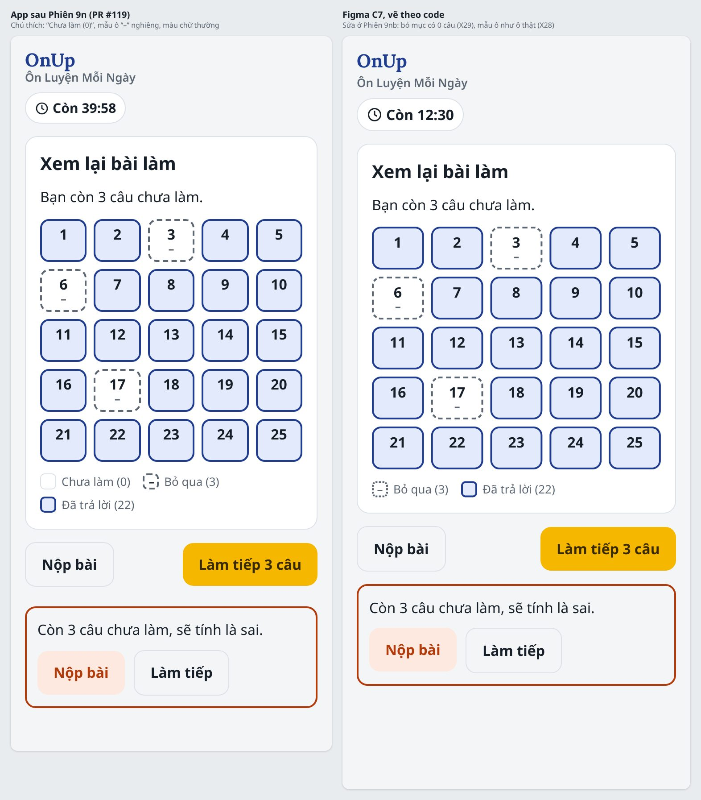

| Yêu cầu (flow “Phiên 9n”, mục thiết kế) | Kết quả | Ghi chú |
|---|---|---|
| “Câu 9/25” là nút mở bảng ngay dưới hàng trên (`aria-expanded`, `aria-controls="qzGrid"`); mở thì viền `acc`, mũi tên quay lên | Khớp | Nút cao 44px. Bảng vẽ lại mỗi lần mở, đóng sẵn khi sang câu mới. |
| Ô ≥ 44px, 5 ô một hàng ở 360px; trạng thái bằng viền và dấu, không chỉ màu; ô đang làm có vòng ngoài; `aria-label` theo trạng thái | Khớp | Ô 52×48px. `aria-label` “Câu 5, đã bỏ qua”; ô đang làm thêm “, đang làm” và `aria-current="step"`. Làm như thi không hiện ✓, ✗. |
| Dòng chú thích dưới bảng | **Lệch nhỏ** | Dấu trong mẫu ô nghiêng, màu `ink` (X28). Luôn có “Chưa làm”, kể cả “Chưa làm (0)” (X29). |
| Bấm ô thì tới câu đó, bảng đóng, trang lên đầu; đoạn đọc hiện lại, giữ mở/thu gọn | Khớp | |
| Hàng trên cùng một hàng ở 360px từ câu 10, cả đề Tiếng Anh (X26) | Khớp | [Còn 31:20] [Câu 11/25 ▾] [Nộp bài] và “11 of 25” một hàng, cao 44px. |
| Làm như thi: mở lại câu đã trả lời thấy câu trả lời cũ, sửa được; dòng `#qzEditNote`; chỉ nút “Trả lời”; rời câu bằng bảng, nộp, hết giờ thì lựa chọn đã đủ được ghi (X23) | Khớp | `tests/e2e.js` mở lại đủ 7 dạng câu của đề thử nghiệm. |
| Ôn luyện: câu đã Kiểm tra mở lại chỉ xem lại; rời câu bằng bảng thì bỏ lựa chọn chưa Kiểm tra | Khớp | Câu mở từ màn “Xem lại bài làm” có một nút “Xem lại bài làm” (Figma C11). |
| Màn “Xem lại bài làm” `#qzRecap` (X21): tiêu đề, một dòng, bảng không có ô đang làm; còn câu trống thì [Nộp bài hoặc Xem kết quả] [Làm tiếp N câu]; làm như thi đã làm hết thì chỉ “Nộp bài”, là nút chính | Khớp | `#qzReview` chỉ còn ở màn kết quả. |
| Màn đó không có “← Thoát”, nút mở bảng, “Nộp bài” ở hàng trên, `.bar`; làm như thi hàng trên chỉ còn đồng hồ, vẫn chạy (X24) | Khớp | Rời trang vẫn hỏi lại. |
| Bấm nút phụ khi còn câu trống: hỏi lại ngay dưới (“Còn 3 câu chưa làm, sẽ tính là sai.”, `#qzYes` đỏ, `#qzNo` “Làm tiếp”); chưa trả lời câu nào thì “Thoát đề?” | Khớp | |
| Vòng làm tiếp chỉ gồm câu còn trống; nhãn “Câu còn trống 1/3” đầu thẻ câu; hết vòng về màn đó; câu mở từ màn đó xong là về màn đó (X22) | Khớp | |
| Nút đi tiếp sau Kiểm tra ghi tên màn sẽ tới (X25) | Khớp | “Câu tiếp”, “Xem lại bài làm”, “Xem kết quả”. |
| Ôn luyện: “Xem kết quả” ở màn mới tính câu còn trống là sai; “← Thoát” giữa chừng không tính câu chưa tới (X24) | Khớp | `tests/e2e.js` so dòng điểm của cả hai lối. |
| Thanh tiến độ theo số câu đã làm, không theo vị trí | Khớp | |
| Chữ mới ở cả hai cột `TXT`; đề Tiếng Anh không có chữ cái tiếng Việt | Khớp | “Review your answers”, “Do the 2 left”, “Left to do: 1 of 3”, “Back to review”. |
| 360px sáng/tối: không tràn ngang, vùng bấm ≥ 44px, chữ ≥ 13px, chữ không đè | Khớp | Mẫu ô 18px của chú thích không phải nút. `audit` của `tests/e2e.js` không báo gì. |

**Khác thiết kế nhưng chấp nhận** (Figma vẽ theo code):
- “Nộp bài” ở hàng trên khi còn câu trống hỏi “Nộp bài ngay? Còn 22 câu chưa làm, sẽ tính là sai.”. Thiết kế chỉ ghi lời hỏi lại có số câu còn trống; code ghép câu hỏi cũ với `leftWarn`. Rõ, giữ.
- Chạm ô của câu đang mở thì bảng đóng, ở lại câu đó. Thiết kế không nói; giữ.

**Figma:** section [Làm bài · Bảng số câu (9n)](https://www.figma.com/design/9mkNYX0ZOczNDMwlKo5F4e/OnUp?node-id=267-3035), ngay dưới section Làm bài:
- C5: làm như thi, bảng mở ở câu 11. C6: ôn luyện, bảng mở ở câu 12.
- C7: màn “Xem lại bài làm” còn câu trống, đang hỏi lại. C8: làm như thi, đã làm hết.
- C9: vòng làm tiếp, câu có đoạn đọc. C10: làm như thi, sửa câu đã trả lời. C11: ôn luyện, câu đã Kiểm tra mở từ màn “Xem lại bài làm”.
- Bản tối của C6, C7.

Ba component mới ở Local Components: `.qz-cell` (State chưa làm, bỏ qua, đã trả lời, đã làm, đúng, chưa đúng × Current), `.qz-key item`, `.qz-prog` (Expanded). Chú thích ở C5–C8 vẽ theo X28, X29.

**Kiểm thử tự động trên `main` sau khi gộp (`34aa512`):**
- `tests/e2e.js`: E2E OK.
- `tests/supabase/cloud-e2e.js`: CLOUD E2E OK, 152 mục đạt ở hai lượt sáng và tối. PR #119 chỉ sửa chỗ đọc tiến độ ở đây (`#qzProg`); các luồng làm đề của bản đám mây kết thúc bằng “Nộp bài”, “← Thoát” hoặc làm hết mọi câu, nên chưa đi qua màn “Xem lại bài làm”.
- Không chạy `store-test.mjs`, `admin-test.mjs`, `run.sh`: PR #119 không sửa kho dữ liệu, trang admin, máy chủ.

### 9nb · Chú thích dưới bảng số câu · PR #122 · kiểm thử 23/10/2026

**Kết luận:** đạt. Mẫu ô ở chú thích giống ô thật (X28) và chú thích không còn mục 0 câu (X29), ở ôn luyện, làm như thi và đề Tiếng Anh, sáng và tối. Figma C5–C8 đã vẽ theo hai ý này từ trước, nay khớp code; ghi chú của section 9n đổi từ “giao Phiên 9nb” thành “đã sửa”. Ảnh trước và sau của phiên: [chu-thich-truoc-sau](hinh-9n/chu-thich-truoc-sau.jpg).

**Cách kiểm:** chạy `Quiz.run` của `main` (`2f6b5d9`) với `css/app.css` thật ở 360px sáng, tối: Tiếng Việt 4 · Cuối kì I · Đề 1 ôn luyện (bảng mở ở câu 12, màn “Xem lại bài làm”) và làm như thi; Tiếng Anh 4 · Cuối kì I · Đề 1 làm như thi, bỏ qua cả đề. So `getComputedStyle` của dấu trong mẫu ô với dấu trong ô thật cùng trạng thái.

| Yêu cầu (mục 3, “Phiên 9nb”) | Kết quả | Ghi chú |
|---|---|---|
| Mẫu ô có dấu trong một thẻ `<i>` như ô thật: chữ đứng, cùng màu với dấu trong ô (X28) | Khớp | –, ✓, ✗ đứng, màu `muted`, `ok`, `bad` như dấu trong ô, cả sáng và tối. Mẫu ô vẫn 18px, bo 5px. |
| Không ghi mục 0 câu, kể cả “Chưa làm” (X29) | Khớp | “Xem lại bài làm” ôn luyện: “Bỏ qua (6) · Đúng (7) · Chưa đúng (12)”; làm như thi: “Bỏ qua (7) · Đã trả lời (18)”; đề Tiếng Anh bỏ qua cả đề: chỉ “Skipped (25)”. Bảng mở ở câu 12 vẫn có “Chưa làm (14)” và “Đang làm”. |

### 9o · Bảng số câu ở 4 bài ôn dạng trang · PR #123 · kiểm thử 23/10/2026

**Kết luận:** đạt phần lớn. Bảng số câu, màn “Xem lại bài làm”, vòng làm tiếp và sửa câu ở đề thi thử chạy đúng flow “Phiên 9o” ([SUA-LOI-CHAY-THU.md](SUA-LOI-CHAY-THU.md), mục 2) và mục thiết kế ở mục 3 (X26–X29), ở cả 4 bài, sáng và tối. Lệch một chỗ: ở luyện tập của l4, l6, hai nút của màn “Xem lại bài làm” xuống hai hàng (X30). Thêm một chỗ có từ trước 9o: nhãn trên câu lặp tên bài khi luyện theo bài, theo unit (X31). Cả hai giao cho Phiên 9ob (mục 3).

**Cách kiểm:**
- Chạy app bản lưu trên máy của `main` (`2f6b5d9`) ở 360px sáng và tối, mở bài ôn trong khung như học sinh: l4 Tiếng Việt, bài “Tên cơ quan” (10 câu, luyện tập); l6 Ngữ văn, Đề 1 (20 câu, đề thi thử); IOE 4, đề thi thử (30 câu); IOE 6, luyện theo unit (45 câu). Đi các luồng bằng chạm; đo bằng `getBoundingClientRect`, `getComputedStyle` trong khung (khung rộng 326px, nội dung 294px).
- Đọc phần làm bài và CSS của 4 trang sau PR #123.
- Vẽ section [Bài ôn dạng trang · Bảng số câu (9o)](https://www.figma.com/design/9mkNYX0ZOczNDMwlKo5F4e/OnUp?node-id=290-3561) trong Figma theo code, rồi đặt cạnh app.

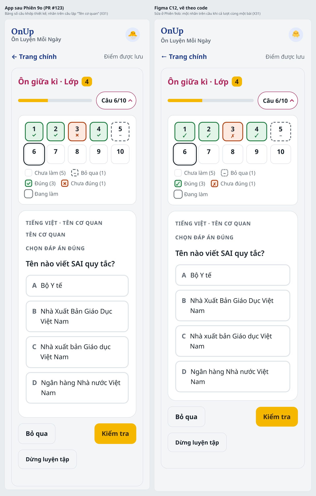

| Yêu cầu (flow “Phiên 9o”, mục thiết kế) | Kết quả | Ghi chú |
|---|---|---|
| Chip số câu rời thanh trên; thanh trên của trang một hàng ở 360px (X26) | Khớp | Thanh trên cao 58–59px; đề thi thử: tên bài và đồng hồ (60,8 × 31px) cùng hàng. |
| Hàng `.qtop`: thanh tiến độ co giãn, nút `#gridBtn` “Câu 6/10 ▾” (IOE “11 of 30 ▾”) dạng viên thuốc cao 44px, viền `line`, mũi tên màu của bài; mở thì viền màu của bài, mũi tên quay lên | Khớp | Nút 99,6 × 44px (“Câu 10/20” 107,9px), thanh tiến độ cao 8px. Màu của bài: `--lang` (Tiếng Việt, Ngữ văn), `--sea` (IOE). |
| Bảng `#grid` ngay dưới; ô như đề ngân hàng sau 9nb, 5 ô một hàng, ô ≥ 44px; ô đã trả lời dùng `--pick`, `--pick-soft` | Khớp | Ô 45,6 × 48px (xem bên dưới). Bỏ qua: viền nét đứt `muted`, dấu –; đúng: `ok`, ✓; chưa đúng: `bad`, ✗; ô đang làm có vòng ngoài. `aria-label` “Câu 5, đã bỏ qua”, IOE “Question 3, skipped”. |
| Chú thích không ghi mục 0 câu; mẫu ô có dấu đứng, cùng màu với dấu trong ô (X28, X29) | Khớp | Ví dụ màn “Xem lại bài làm” của đề thi thử: “Bỏ qua (3) · Đã trả lời (17)”. |
| Màn “Xem lại bài làm” `#recap`: tiêu đề 20px, một dòng, bảng không có ô đang làm; không có `#gridBtn`, `#skipBtn`, `.bar`; đề thi thử: đồng hồ ở thanh trên vẫn chạy | Khớp | |
| `#endBtn` (“Xem kết quả”, “Nộp bài”) bên trái `#moreBtn` “Làm tiếp N câu”, cùng hàng; đã làm hết thì chỉ `#endBtn` “Nộp bài”, là nút chính | **Lệch** ở luyện tập của l4, l6 | Hai nút cần 300px mà hàng có 294px: “Làm tiếp 2 câu” xuống hàng dưới (X30). Đề thi thử và IOE một hàng. |
| Hỏi lại trong `#endArea` (`#yesEnd` đỏ, `#noEnd` “Làm tiếp”); luyện tập: câu còn trống tính sai | Khớp | Hộp hỏi lại nằm dưới hàng nút. |
| Vòng làm tiếp: nhãn `.qleft` “Câu còn trống 1/2” ở đầu thẻ câu; hết vòng về màn đó | Khớp | Nền `sun-soft`, chữ 13px đậm. |
| Đề thi thử mở lại câu đã trả lời: thấy câu trả lời cũ, dòng `#editNote`, chỉ nút “Trả lời” | Khớp | Dòng ghi chú 14px `muted`. |
| Nút đi tiếp ở câu cuối ghi tên màn sẽ tới | Khớp | “Xem lại bài làm”. |
| IOE: chữ tiếng Anh; lượt nghe theo từng câu, thay câu nghe khi máy không phát được tiếng (X27) | Khớp | Theo bước 9o của `tests/e2e.js` (máy kiểm thử không phát tiếng). |
| Ở bảng số câu và màn “Xem lại bài làm” app vẫn hỏi khi rời bài (`#endBtn`) | Khớp | Bước 9o của `tests/e2e.js`; L16 của `cloud-e2e.js`. |
| 360px sáng/tối: không tràn ngang, vùng bấm ≥ 44px, chữ ≥ 13px, chữ không đè | Khớp | Không có nút nào dưới 44px trong khung (mẫu ô 18px của chú thích không phải nút). |

**Khác thiết kế nhưng chấp nhận** (Figma vẽ theo code):
- Cột ô `minmax(44px,1fr)` (đề ngân hàng 48px): khung bài ôn hẹp hơn 34px, nên ô 45,6 × 48px để vẫn 5 ô một hàng, vẫn ≥ 44px.
- Nút `#gridBtn` padding trái 12px (đề ngân hàng 10px), chữ 14,4px.
- Nhãn `.qleft` chữ 700 (đề ngân hàng dùng `.tag`, chữ 600).

**Figma:** section [Bài ôn dạng trang · Bảng số câu (9o)](https://www.figma.com/design/9mkNYX0ZOczNDMwlKo5F4e/OnUp?node-id=290-3561), ngay dưới section 9n:
- C12: luyện theo bài (l4 Tiếng Việt), bảng mở ở câu 6. C13: đề thi thử (l6 Ngữ văn), bảng mở ở câu 10.
- C14: màn “Xem lại bài làm” của luyện tập, còn 2 câu, đang hỏi lại. C15: đề thi thử, còn 3 câu.
- C16: vòng làm tiếp. C17: đề thi thử, mở lại câu đã trả lời. C18: IOE 4 “Review your answers”.
- Bản tối của C12, C18.

C14, C15, C18 vẽ hai nút một hàng theo X30; C12, C16 vẽ một nhãn trên câu theo X31. Bộ biến mới `OnUp/Bài ôn` (Light, Dark) giữ màu riêng của 4 bài ôn: màu môn của l4, l6 (`math`, `lang`, `sci` và bản nhạt) và bảng màu của IOE 4 (`ioe/bg`, `ioe/surface`, `ioe/line`, `ioe/ink`, `ioe/muted`, `ioe/sea`, `ioe/sea-soft`). Component mới `.gbtn (bài ôn)` (Expanded) ở Local Components.

**Kiểm thử tự động trên `main` sau khi gộp (`2f6b5d9`, sau PR #122, #123 và bốn phiên làm đề):**
- `tests/e2e.js`: E2E OK (bước L38, L39 có kiểm tra X28, X29; bước 9o chạy 4 bài, sáng và tối).
- `tests/supabase/cloud-e2e.js`: CLOUD E2E OK, 152 mục đạt ở hai lượt sáng và tối.
- Không chạy `store-test.mjs`, `admin-test.mjs`, `run.sh`: PR #122, #123 không sửa kho dữ liệu, trang admin, máy chủ.

### 9ob · Bài ôn dạng trang: hai nút một hàng, một nhãn trên câu · PR #132 · kiểm thử 24/10/2026

**Kết luận:** đạt. Ở màn “Xem lại bài làm” của cả 4 bài, hai nút luôn một hàng ở 360px, kể cả số câu ba chữ số; luyện theo bài, theo unit chỉ còn một nhãn trên câu. Khớp C12, C14, C16, C18 của section [Bài ôn dạng trang · Bảng số câu (9o)](https://www.figma.com/design/9mkNYX0ZOczNDMwlKo5F4e/OnUp?node-id=290-3561), vốn đã vẽ theo X30, X31; ghi chú của section đổi thành “đã sửa ở 9ob”.

**Cách kiểm:** chạy app bản lưu trên máy của `main` (`68353f0`) ở 360px sáng và tối, mở bài ôn trong khung như học sinh: l4 Tiếng Việt, bài “Tên cơ quan” (luyện theo bài); l6 Ngữ văn, Bài 1 (luyện theo bài) và Đề 1 (đề thi thử); IOE 4 luyện theo unit. Đo trong khung bằng `getBoundingClientRect`, `getComputedStyle`; đổi chữ của `#moreBtn` thành số câu ba chữ số rồi đo lại.

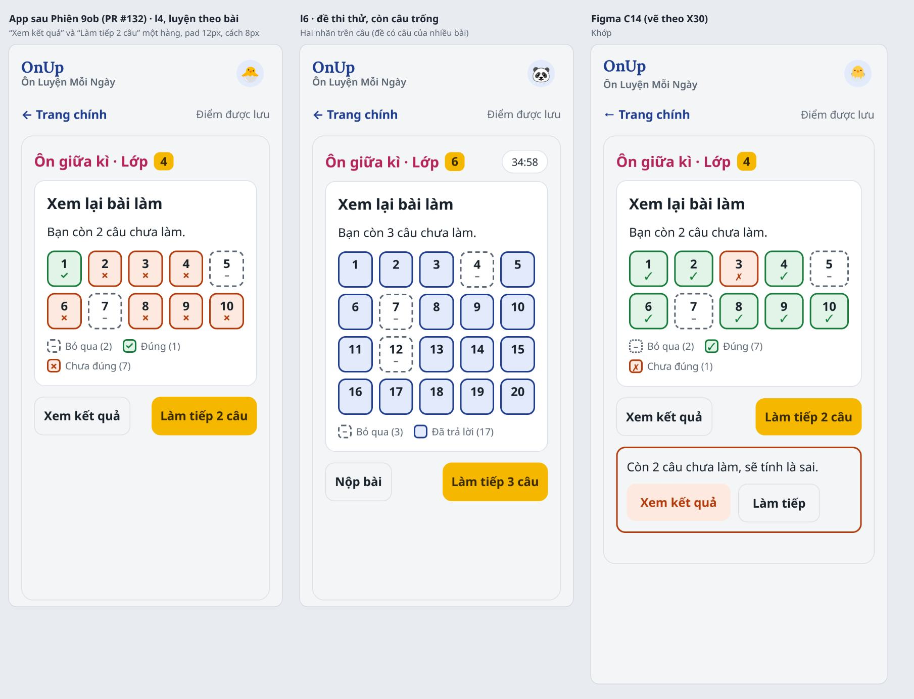

| Yêu cầu (mục 3, “Phiên 9ob”) | Kết quả | Ghi chú |
|---|---|---|
| Hai nút dưới `#recap` có padding ngang 12px, cách nhau 8px; màn câu hỏi giữ 18px, 10px (X30) | Khớp | Cả 4 bài. |
| Một hàng ở 360px, kể cả “Làm tiếp 120 câu”, “Do the 120 left” | Khớp | Hàng rộng 294px: l4 “Xem kết quả” và “Làm tiếp 2 câu” cần 266px, “Làm tiếp 120 câu” (157,7px) 284px; IOE “Do the 120 left” 140px. Hai nút cao 50,8px. |
| Luyện theo bài, theo unit chỉ có một nhãn trên câu (tên lượt); đề thi thử, “Ôn câu sai” giữ nhãn bài, unit bên phải (X31) | Khớp | “Tiếng Việt · Tên cơ quan”, “Ngữ văn · Bài 1”, “Unit 1 Practice”, cả câu mở lại và vòng làm tiếp; đề thi thử l6: “Ngữ văn · Đề 1” và “Đọc hiểu”. |
| `label` của lượt và dữ liệu bài ôn không đổi | Khớp | `node tests/so-du-lieu-bai-on.js` ở commit của PR #132 so với commit trước đó: `DU LIEU BAI ON OK`. |
| 360px sáng/tối: không tràn ngang, vùng bấm ≥ 44px, chữ ≥ 13px, chữ không đè | Khớp | Bước 9o của `tests/e2e.js`. |

### UI2 · Nút chính bị tắt · PR #133 · kiểm thử 24/10/2026

**Kết luận:** đạt. Nút chính và phím Vào bị tắt có nền `line`, chữ `muted`, không làm mờ, ở cả sáng và tối: nhìn là biết đang tắt, không còn khối màu ô liu. Khớp component `.btn` (State=disabled) và khung H3 của section [Chữ và màu](https://www.figma.com/design/9mkNYX0ZOczNDMwlKo5F4e/OnUp?node-id=84-2933); A4 của section Vào app sửa theo code.

**Cách kiểm:** ảnh 360px sáng/tối của `tests/supabase/cloud-e2e.js` (`c3-khu-phu-huynh-moi`: “Cho con học” khi chưa có hồ sơ con; `c10c-dang-doi`: phím Vào của mã mở nhanh khi phải đợi) và bước UX4 của `tests/e2e.js`; đo màu và độ tương phản bằng `getComputedStyle` với `css/app.css` thật: nút chính cỡ thường, `sm`, `lg`, phím Vào, nút thường, `ghost`, `danger`, phím số.

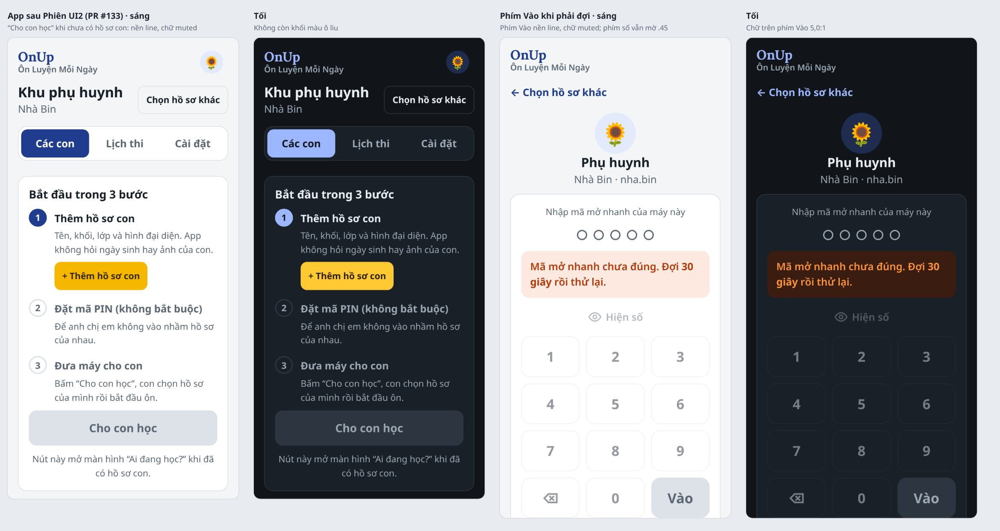

| Yêu cầu (mục 3, “Phiên UI2”) | Kết quả | Ghi chú |
|---|---|---|
| Nút chính bị tắt (`.btn.main:disabled`, mọi cỡ): nền `--line`, chữ `--muted`, `opacity` 1, sáng và tối | Khớp | Chữ 4,4:1 (sáng), 5,0:1 (tối); nút so với thẻ 1,3:1. Bật lại: nền `sun`, chữ `sun-ink`. |
| Phím Vào bị tắt như trên; bỏ style viết thẳng trong `pinBoxHTML`, dùng lớp `.pad .ok` | Khớp | Phím Vào giữ viền `line` như phím số. |
| Nút khác (`.btn` thường, `ghost`, `danger`, phím số, “Hiện số”) giữ `opacity: .45` | Khớp | |
| Không đổi cách bật, tắt nút | Khớp | |
| Kiểm thử ở cả sáng và tối | Khớp | Kiểm tra “UI2 (X32)” của `cloud-e2e.js` (cả phím Vào của mã mở nhanh), bước UX4 của `tests/e2e.js`. |

**Figma:** A4 (Nhập PIN · đang phải đợi) trước đây làm mờ cả bàn phím; nay phím số mờ .45, phím Vào nền `line`, chữ `muted`. Khung H3 ghi “Đã làm ở UI2 (PR #133)”; mô tả của component `.btn`, `.pad button` ghi quy tắc nút bị tắt.

### UX7 · Quản lí đề · PR #134 · kiểm thử 24/10/2026

**Kết luận:** đạt phần lớn. Sửa kì thi chỉ hiện đề đúng khối, nhóm theo môn, tìm theo từng từ, giữ lựa chọn khác khối; danh sách đề có đề tự soạn trước, đề có sẵn theo tab khối; nhập đề xem trước từng câu, lỗi nằm trong thẻ của câu, có lỗi thì hỏi lại khi lưu, gắn được vào kì thi. Một chỗ lệch yêu cầu: dòng “Đang hiện bài ôn và đề của Lớp 4…” không hiện vì trùng id (X33). Ba chỗ nhỏ: thứ tự nhóm môn và thứ tự đề (X34), các thẻ môn của danh sách đề sát nhau (X35), dòng tóm tắt ghi “0 đúng/sai” (X36). Cả bốn, cùng X37 của UX8, giao cho Phiên UX7b (mục 3).

**Cách kiểm:**
- Chạy app bản lưu trên máy của `main` (`68353f0`) ở 360px sáng và tối: Sửa kì thi cuối kì I lớp 4 (20 mục đã chọn), tìm, hiện cả khối khác, bỏ ô Khối; tab Ngân hàng đề; nhập đề có một câu bị bỏ, một câu thiếu phần và một đoạn đọc, rồi đề mẫu đủ dạng câu. Đo bằng `getBoundingClientRect`, `getComputedStyle`; quét id trùng ở 23 màn.
- Ảnh 360px sáng/tối của `cloud-e2e.js` (`c5b`–`c5h`) cho bản đám mây.
- Đặt cạnh F1–F3 của section [Quản lí đề](https://www.figma.com/design/9mkNYX0ZOczNDMwlKo5F4e/OnUp?node-id=82-2135).

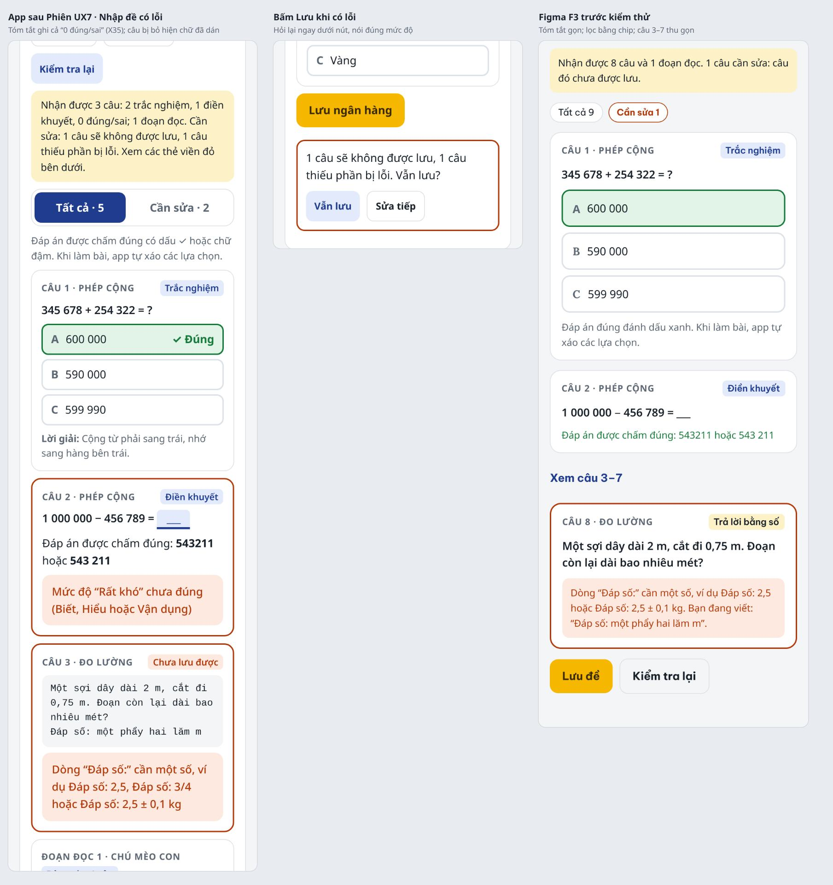

| Yêu cầu (mục 3, “Phiên UX7”) | Kết quả | Ghi chú |
|---|---|---|
| Sửa kì thi: một khối “Bài ôn và đề cho kì này”, nhãn “N đã chọn” (X11) | Khớp | |
| Mặc định chỉ hiện mục có khối trong `grades` của kì thi; đổi ô Khối thì danh sách đổi theo | Khớp | Lớp 4: đúng số đề của `Store.banks(4)`; bỏ ô Lớp 4 thì chỉ còn các mục đã chọn. |
| Dòng cho biết đang hiện khối nào (F1) | **Lệch** | Dòng luôn trống vì trùng id với ô “Phạm vi kiến thức” (X33). |
| Nhóm theo môn bằng `
`, tóm tắt “3/5 đã chọn”, nhóm có mục đã chọn mở sẵn | Khớp | “4/11 đã chọn · 1 đề tự soạn”. Thứ tự nhóm, thứ tự đề khác F1 (X34). |
| Ô tìm không phân biệt dấu, theo từng từ | Khớp | “toan de 2” còn đúng các đề Toán có “Đề 2”; “2” không khớp “Đề 12”; nhóm có đề khớp mở ra; không có gì khớp thì “Không có bài ôn hay đề nào khớp …”. |
| Link “Hiện cả đề của khối khác”; mục đã chọn khác khối vẫn hiện, Lưu giữ đủ lựa chọn cũ | Khớp | Link đổi thành “Chỉ hiện đề của khối kì thi”. |
| Dòng ô đánh dấu ≥ 44px | Khớp | 44px, ô 20px màu `acc`. |
| Danh sách đề: đề tự soạn đầu, ghi kì thi đã gắn hoặc “chưa gắn vào kì thi nào” (X12) | Khớp | |
| Đề có sẵn theo tab khối (`gradeList()`, mặc định khối của con), nhóm theo môn thu gọn, có ô tìm | Khớp | “Lớp 4 · 31 đề”; đang tìm thì tab ghi số đề khớp. Thẻ các môn sát nhau (X35); thứ tự môn khác F2 (X34). |
| Nhập đề: sau “Kiểm tra”, xem trước từng câu: dạng, chủ đề, câu hỏi, đáp án được chấm đúng, hình, đoạn đọc thu gọn (X13) | Khớp | Lựa chọn đúng có viền xanh và “✓ Đúng”; điền khuyết ghi mọi đáp án nhận được; đề mẫu (11 câu, một đoạn đọc) ra đủ 8 dạng câu, mỗi câu một thẻ. |
| Lỗi nằm trong thẻ của câu, của đoạn đọc; biết câu nào bị bỏ hẳn | Khớp | Thẻ lỗi viền đỏ 2px; câu bị bỏ có nhãn “Chưa lưu được” và chữ đã dán. Dòng tóm tắt ghi cả “0 đúng/sai” (X36). |
| Bộ lọc “Tất cả · Cần sửa” | Khớp | “Tất cả · 5”, “Cần sửa · 2”. |
| Có lỗi mà bấm Lưu thì hỏi lại, nói đúng mức độ | Khớp | “1 câu sẽ không được lưu, 1 câu thiếu phần bị lỗi. Vẫn lưu?”, nút “Vẫn lưu”, “Sửa tiếp”. |
| Ô “Gắn vào kì thi”: kì thi chưa qua của khối; lưu xong đề có ở kì thi đó | Khớp | “Kiểm tra giữa học kì I (2/11)”; đề đứng đầu `banks` của kì thi; toast ghi tên kì thi. |
| 360px sáng/tối | Khớp | `audit` của hai bộ kiểm thử không báo gì; không lỗi JavaScript. |

**Khác Figma nhưng chấp nhận** (đã vẽ lại F1–F3 theo code):
- Mỗi nhóm môn là một thẻ `.grp` riêng (viền, bo 14px); Figma vẽ các nhóm trong một thẻ chung. Dòng ô đánh dấu cao 44px (Figma 25px).
- Nhãn “N đã chọn” màu `acc` như các `.tag` khác (Figma: màu IOE).
- Mọi nhóm có mục đã chọn đều mở sẵn, đúng mục 3; F1 vẽ thu gọn vài nhóm có mục đã chọn. Kì thi chọn nhiều đề thì trang dài (cuối kì I lớp 4, 20 mục: khoảng 3 600px); bấm tóm tắt để thu gọn từng nhóm.
- Bài ôn dạng trang xếp theo tên (“IOE · Global Success 4” trước “Ôn giữa kì I · Lớp 4”).
- Danh sách đề: tiêu đề “Đề có sẵn của app”, chữ mờ trong ô tìm “Tìm đề có sẵn, ví dụ “Toán Đề 2””, dưới “Đề tự soạn” có đoạn giải thích cách dán câu hỏi; nút “Chọn hồ sơ khác” là nút viền.
- Nhập đề: ô dán câu hỏi và các nút “Xem ví dụ”, “Mở file .txt”, “Kiểm tra lại” vẫn ở dưới form (F3 thu gọn thành một dòng); mọi thẻ đều hiện (F3: “Xem câu 3–7”); bộ lọc là nhóm nút `.tabs` (F3: chip); dòng “Đáp án được chấm đúng có dấu ✓ hoặc chữ đậm…” một lần, trên các thẻ; thẻ có “Lời giải”; ô “Gắn vào kì thi” ghi “(2/11)”, không ghi lớp; hàng cuối chỉ có nút Lưu.

**Figma:** F1, F2 vẽ lại theo code và theo cách sửa của X33–X35 (dòng khối đang hiện; môn theo lịch thi; đề theo kì, đề ngẫu nhiên đầu mỗi kì; thẻ môn cách nhau 10px); F3 vẽ lại theo code, dòng tóm tắt theo X36. Component mới ở Local Components: `.ck (chọn đề)` (Checked) cho dòng ô đánh dấu 44px, `.pv-opt (xem trước)` (State default, right) cho lựa chọn trong thẻ xem trước; `.tag` có thêm Variant=bad (“Chưa lưu được”).

### UX8 · Gửi báo cáo tuần · PR #143 · kiểm thử 24/10/2026

**Kết luận:** đạt. Khối “Tin nhắn sẽ gửi”, nút “Gửi báo cáo”, “Chép tin nhắn” và nút “In” làm đúng lời giao việc và khung G1. Bốn chỗ khác bản vẽ chủ app đã nêu khi Merge đều hợp lí; Figma vẽ lại theo code. Thêm một chỗ nhỏ có từ trước UX8: gợi ý về chủ đề hay sai ở mục Gợi ý ôn tuần sau còn ngăn tên chủ đề bằng dấu phẩy, khác tin nhắn (X37, giao Phiên UX7b).

**Cách kiểm:**
- Chạy app bản lưu trên máy của `main` (`6d11b6a`) ở 360px, 375px, 390px sáng và tối: Mẹ Bin (phụ huynh) mở báo cáo tuần của Bin (5 bài trong 7 ngày, có chủ đề “Phép cộng, phép trừ”, 1 bài tuần trước) và của Na (chưa làm bài nào); bản in (`emulateMedia print`).
- Đọc kết quả bước UX8 của `tests/e2e.js` (giả lập `navigator.share`: gửi, hủy, lỗi khác; máy không có bảng chia sẻ; chép không được) và ảnh `c12-bao-cao-tuan` của `cloud-e2e.js`.
- Đặt cạnh khung G1 của section [Báo cáo tuần](https://www.figma.com/design/9mkNYX0ZOczNDMwlKo5F4e/OnUp?node-id=84-2729).

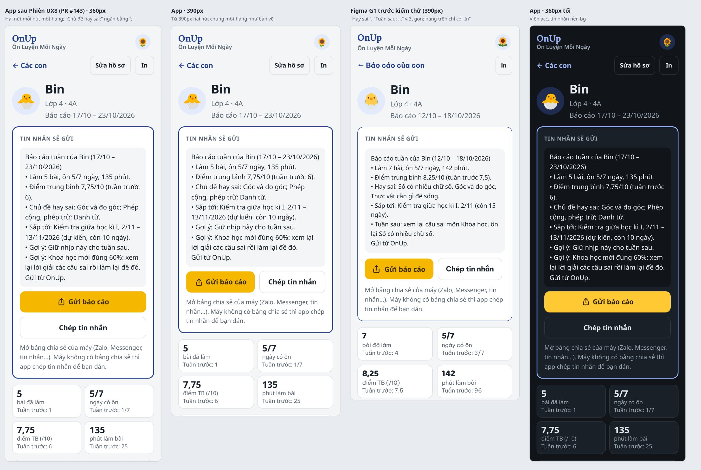

| Yêu cầu (mục 3, “Phiên UX8”) | Kết quả | Ghi chú |
|---|---|---|
| Nút chính “Gửi báo cáo”, nút phụ “In” | Khớp | “Gửi báo cáo” có biểu tượng chia sẻ, nằm trong khối tin nhắn như G1; “In” ở hàng trên, 44 × 44px, `aria-label` “In báo cáo”. |
| Khối “Tin nhắn sẽ gửi” xem trước tin nhắn chữ thuần, khoảng 600 chữ cái trở xuống | Khớp | Ngay dưới đầu trang, trước các ô số liệu; viền `acc` 2px; tin nhắn 15px, nền `bg`, xuống dòng như khi gửi. Ví dụ dài 388 chữ cái. |
| Tên con, khoảng ngày; số bài, số ngày ôn, số phút; điểm trung bình so với tuần trước | Khớp | Khớp các ô số liệu; tuần trước không có bài: “(tuần trước chưa làm bài)”. |
| Tối đa 3 chủ đề hay sai | Khớp | “• Chủ đề hay sai: Góc và đo góc; Phép cộng, phép trừ; Danh từ.” |
| Kì thi gần nhất: ngày, còn N ngày | Khớp | “• Sắp tới: Kiểm tra giữa học kì I, 2/11 – 13/11/2026 (dự kiến, còn 10 ngày).” |
| 1–2 gợi ý của `weekTips`, bỏ gợi ý đã nói về kì thi | Khớp | Bỏ cả gợi ý về chủ đề hay sai (trùng dòng trên); gợi ý ngày ôn chỉ lấy phần lời khuyên. |
| Dòng cuối “Gửi từ OnUp.”; không có tên đăng nhập, đường dẫn | Khớp | Không có cả tên gia đình; `cloud-e2e.js` kiểm tra ở bản đám mây. |
| “Gửi báo cáo”: `navigator.share({ title, text })`; hủy thì thôi; máy không có bảng chia sẻ thì chép, toast “Đã chép tin nhắn…”; chép không được thì chọn sẵn chữ | Khớp | Bấm lần nữa khi bảng chia sẻ đang mở cũng bỏ qua, không báo gì. |
| Thêm nút “Chép tin nhắn” | Khớp | |
| Khối xem trước không in | Khớp | Bản in không có khối tin nhắn, nút In; vẫn có nhãn “OnUp · Báo cáo tuần · Nhà Bin”. |
| 360px sáng/tối | Khớp | Không tràn ngang; nút ≥ 44px; chữ ≥ 13px; `audit` không báo gì. |

**Khác Figma nhưng chấp nhận** (chủ app nêu khi Merge PR #143; Figma đã vẽ lại theo code):
- Ở 360px (cả 375px) hai nút mỗi nút một hàng, rộng cả khối, “Gửi báo cáo” ở trên; từ 390px chung một hàng như G1 (hai nút cần 322px).
- “Hay sai:” thành “Chủ đề hay sai:”; các chủ đề ngăn bằng “; ” vì tên chủ đề có thể có dấu phẩy.
- Gợi ý lấy nguyên câu của mục Gợi ý ôn tuần sau, sau chữ “Gợi ý:”, không viết gọn thành “Tuần sau: …”; tin nhắn bỏ gợi ý trùng dòng kì thi và dòng chủ đề.
- Hàng trên giữ nút “Sửa hồ sơ” (có từ UX2) cạnh “In”; link về là “← Các con” (G1: “← Báo cáo của con”).
- Dòng kì thi ghi cả ngày cuối và “dự kiến” như thẻ kì thi (“2/11 – 13/11/2026 (dự kiến, còn 10 ngày)”).

**Ghi nhận cho design system, chưa giao việc:** nút chính và nút viền cùng cỡ thường đứng cạnh nhau lệch nhau 2px: `.btn.main` không viền cao 48,8px, `.btn.ghost` viền 1px cao 50,8px. Gặp ở UX8 từ 390px (“Gửi báo cáo”, “Chép tin nhắn”), ở hộp hỏi lại của bài ôn (`#yesEnd` 48,8px, `#noEnd` 50,8px) và vài hộp hỏi khác. Nếu sửa: `.btn` có viền 1px trong suốt, mọi nút cùng cỡ cao bằng nhau (nút chính cao thêm 2px); để khi có phiên UI khác. Đã ghi vào mô tả component `.btn` trong Figma.

**Figma:** G1 (390px) sửa theo code: hàng trên “← Các con”, “Sửa hồ sơ”, “In”; chữ của tin nhắn; viền khối 2px. Thêm G1b ở 360px, sáng và tối: hai nút mỗi nút một hàng. Ghi chú của section ghi bốn chỗ khác bản vẽ và X37.

**Kiểm thử tự động cho 9ob, UI2, UX7, UX8:**
- `main` `68353f0` (sau PR #132–#134, trước UX8): `tests/e2e.js` E2E OK; `tests/supabase/cloud-e2e.js` CLOUD E2E OK, 160 mục đạt ở hai lượt sáng và tối (có kiểm tra UX7, UI2).
- `main` `6d11b6a` (sau PR #143): `tests/e2e.js` E2E OK (bước UX8 sáng và tối); `cloud-e2e.js` CLOUD E2E OK, 162 mục đạt; `node tests/kiem-tra-de.js` DE OK (PR #134 sửa `Quiz.parse`).
- Không chạy `store-test.mjs`, `admin-test.mjs`, `run.sh`: bốn PR không sửa kho dữ liệu, trang admin, máy chủ.
