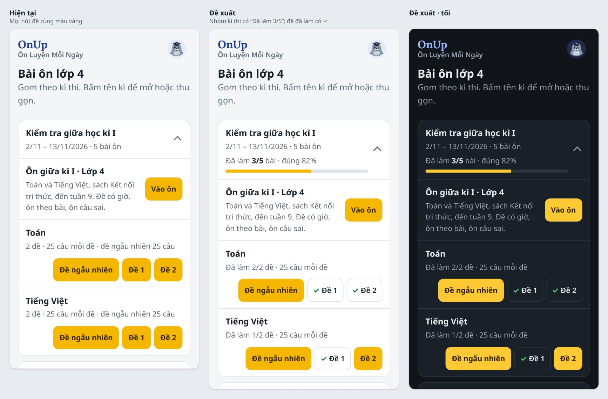
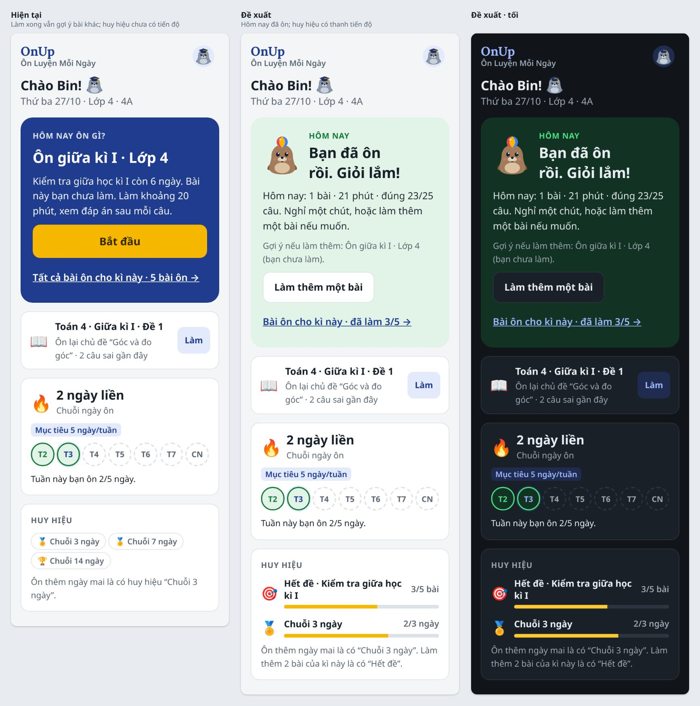
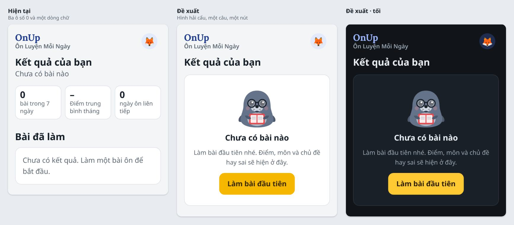
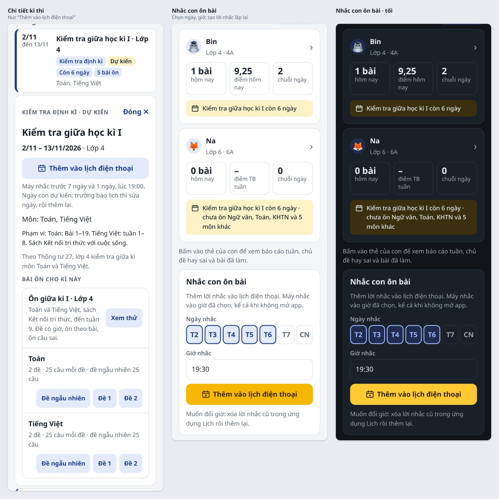
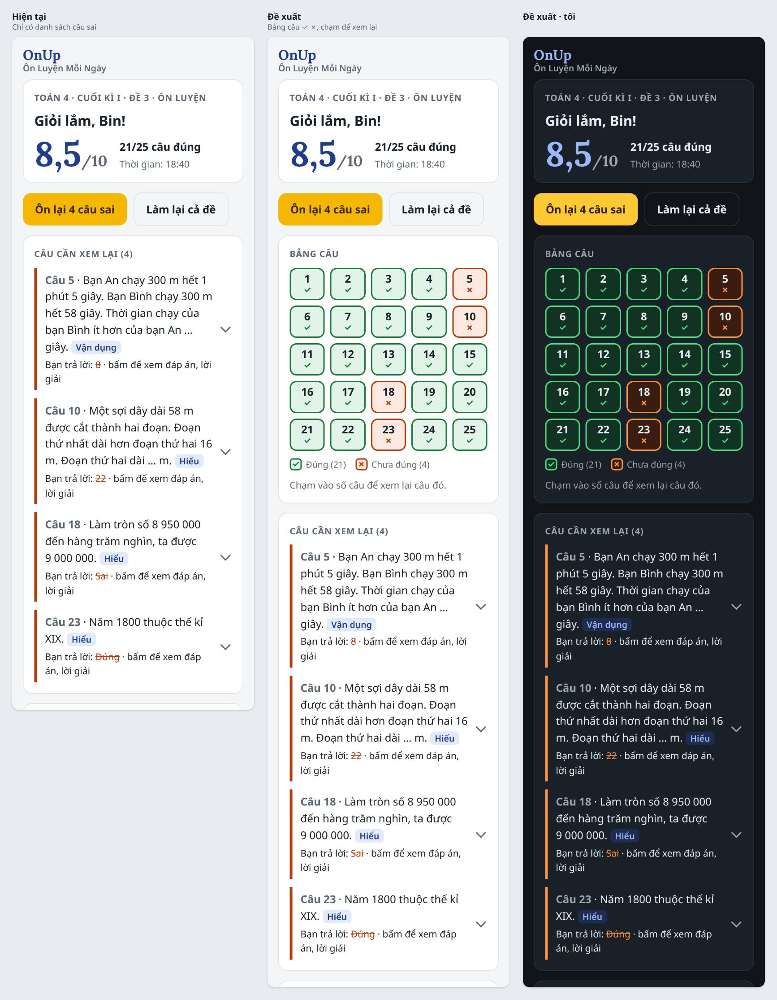
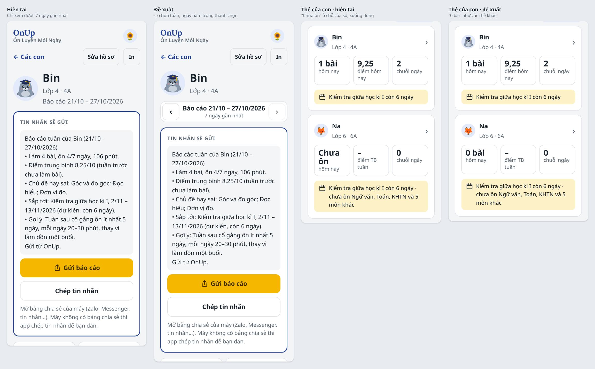
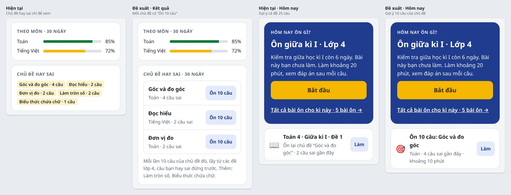
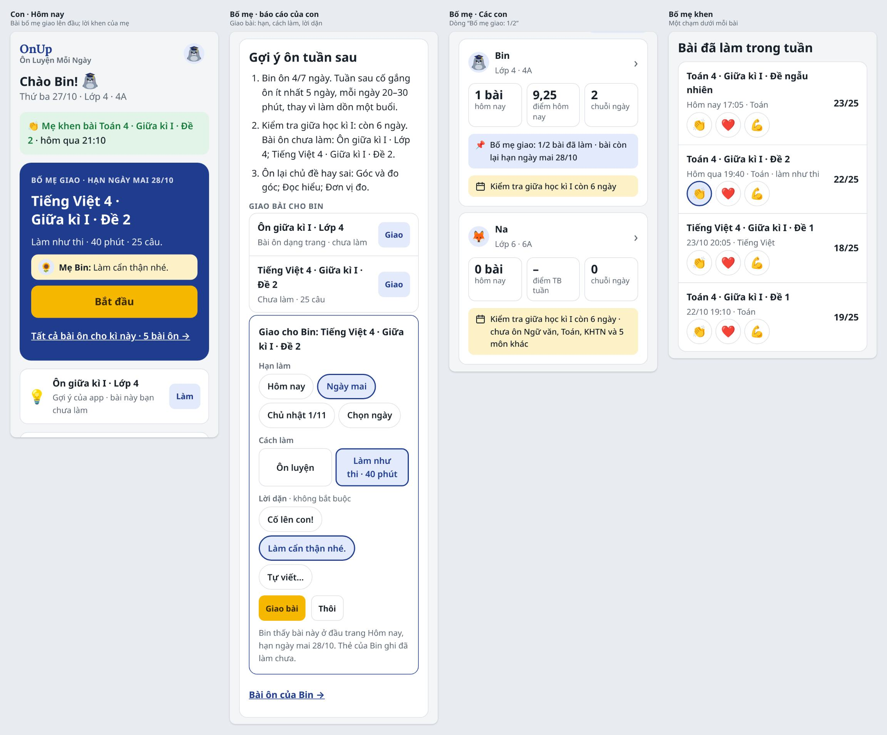

# Đề xuất giao diện 3.x (27/10/2026)

Bản 2.x (UX1–UX8, UI1, UI2, 9n, 9o và các phiên “b”) đã làm xong và đã kiểm thử thiết kế ([CAI-TIEN-UX-2X.md](CAI-TIEN-UX-2X.md), mục 5). Bản 3.x rà lại app để trả lời ba câu hỏi:
- con có biết mình đã ôn đến đâu không;
- bố mẹ làm được gì ngoài đọc báo cáo;
- app có nhắc được con ôn, nhắc bố mẹ ngày thi không.

**Figma:** trang [🚧 Master 3.x · Đề xuất UX/UI](https://www.figma.com/design/9mkNYX0ZOczNDMwlKo5F4e/OnUp?node-id=329-2). Mỗi phiên một section, xếp theo thứ tự làm. Trong section là ghi chú rồi các khung 3.x, phần lớn khung có thêm bản tối:
- [UX9](https://www.figma.com/design/9mkNYX0ZOczNDMwlKo5F4e/OnUp?node-id=329-12): K1–K3;
- [UX11](https://www.figma.com/design/9mkNYX0ZOczNDMwlKo5F4e/OnUp?node-id=329-59): M1, M2;
- [UX10](https://www.figma.com/design/9mkNYX0ZOczNDMwlKo5F4e/OnUp?node-id=329-36): L1, L2;
- [UX12](https://www.figma.com/design/9mkNYX0ZOczNDMwlKo5F4e/OnUp?node-id=329-81): N1, N2;
- [UX14](https://www.figma.com/design/9mkNYX0ZOczNDMwlKo5F4e/OnUp?node-id=329-126): P1–P3.

Khung vẽ bằng component và biến màu của design system. Thành phần mới (icon/target, icon/calendar-plus, `.bdg`, `.day-pick button`, `.wk-nav`, `.btn icon`, `.empty`) nằm ở section [3.x · Thành phần đề xuất](https://www.figma.com/design/9mkNYX0ZOczNDMwlKo5F4e/OnUp?node-id=342-238). Phiên Claude Code không mở được Figma, nên lời giao việc trỏ vào ảnh ở [hinh-ux-3x/](hinh-ux-3x/).

File này giữ vấn đề, đề xuất, ảnh và điều kiện xong. Chủ app đã chọn phiên ngày 27/10/2026 (mục 3). Thứ tự, hạn và lời giao việc ở mục 3, 4 của [KE-HOACH-PHAT-TRIEN-ONUP.md](KE-HOACH-PHAT-TRIEN-ONUP.md); trạng thái chỉ ghi ở đó. Mã vấn đề nối tiếp bản 2.x: X38–X48.

**Cách rà:**
- Chạy `main` (`a739293`) bản lưu trên máy, ngày giả lập 27/10/2026 17:30, 360px sáng và tối. Dữ liệu mẫu: Bin lớp 4 làm 4 bài trong 6 ngày (Toán 4 · Giữa kì I · Đề 1, Đề 2, Đề ngẫu nhiên; Tiếng Việt 4 · Giữa kì I · Đề 1); Na lớp 6 chưa làm bài nào; Mẹ Bin là phụ huynh của hai con.
- Đi các màn: Hôm nay, Bài ôn, Kết quả, Lịch thi của con; màn kết quả đề; Các con, báo cáo tuần, lịch thi của bố mẹ.
- Ảnh đề xuất ở [hinh-ux-3x/](hinh-ux-3x/) là app thật, phần đề xuất chèn vào trang bằng `css/app.css` cộng vài lớp mới (ghi ở từng mục), nên phiên code làm theo được sát. Đã đo trong trang: không cuộn ngang, nút cao ≥ 44px, chữ ≥ 13px. Ảnh là hướng làm, không bắt giống từng điểm ảnh.
- Tên lớp, id mới đã tra trong `css/app.css`, `js/app.js`, `js/quiz.js` để không trùng (`.ck`, `.opts`, `.note`, `.remind` đã có, nên đề xuất dùng tên khác).

---

## 1. Tóm tắt

| Phiên | Mã | Việc | Đổi dữ liệu | File sửa | Ảnh |
|---|---|---|---|---|---|
| **UX9** · Con biết mình đã ôn đến đâu | X38–X40 | Bài ôn có tiến độ, đề đã làm có dấu ✓; huy hiệu có tiến độ; Hôm nay đã ôn; trang rỗng có hình | Không | `js/app.js`, `css/app.css` | [ux9-bai-on](hinh-ux-3x/ux9-bai-on.jpg), [ux9-hom-nay](hinh-ux-3x/ux9-hom-nay.jpg), [ux9-trang-rong](hinh-ux-3x/ux9-trang-rong.jpg) |
| **UX10** · Nhắc bằng lịch của điện thoại | X41 | Thêm kì thi vào lịch điện thoại; lời nhắc ôn bài lặp lại theo ngày, giờ | Không (file lịch tạo trên máy) | `js/app.js`, `css/app.css` | [ux10-lich-dien-thoai](hinh-ux-3x/ux10-lich-dien-thoai.jpg) |
| **UX11** · Bảng câu ở màn kết quả | X42 | Ô ✓ ✗ của mọi câu, chạm để xem lại câu đó | Không | `js/quiz.js`, `css/app.css` | [ux11-bang-cau](hinh-ux-3x/ux11-bang-cau.jpg) |
| **UX12** · Báo cáo các tuần trước, sửa nhỏ | X43–X45 | Chọn tuần ở báo cáo của con; ô “0 bài”; nút chính và nút viền cao bằng nhau | Không | `js/app.js`, `css/app.css` | [ux12-bao-cao-tuan](hinh-ux-3x/ux12-bao-cao-tuan.jpg) |
| **UX14** · Ôn 10 câu theo chủ đề | X48 | “Ôn 10 câu” từ chủ đề hay sai, rút từ các đề có sẵn của khối | Không (kết quả lưu như đề) | `js/app.js`, `js/quiz.js` | [ux14-on-chu-de](hinh-ux-3x/ux14-on-chu-de.jpg) |

UX13 (bố mẹ giao bài, khen bài; X46, X47) chủ app quyết không làm, ngày 27/10/2026. Đề xuất của UX13 giữ ở mục 5.

**Thứ tự (chủ app chọn 27/10/2026):** UX9 → UX11 → UX10 → UX12 → UX14.
- UX10 xong trước kì kiểm tra cuối kì I. Lớp 6 thi từ 21/12/2026, nên lời nhắc trước 7 ngày phải có từ 14/12.
- UX14 làm sau UX12, để con ôn chủ đề hay sai trước kì cuối kì I.
- Hạn từng phiên: mục 3 của [KE-HOACH-PHAT-TRIEN-ONUP.md](KE-HOACH-PHAT-TRIEN-ONUP.md).
- Mỗi phiên một Pull Request. Không chạy cùng lúc hai phiên sửa `js/app.js` hay `js/quiz.js`. Phiên làm đề chỉ sửa `data/banks/`, nên chạy xen được.

## 2. Nguyên tắc giữ nguyên

- Không bảng xếp hạng, không so với bạn khác (có từ UX1).
- Điều hướng giữ như bây giờ: con có 4 tab, bố mẹ có 3 mục. Không thêm menu, không chuông thông báo có chấm đỏ. Tin mới cho con (sau này, như bài bố mẹ giao) hiện thành thẻ ở đầu trang Hôm nay.
- Mỗi màn chỉ một nút chính màu vàng cho việc nên làm tiếp.
- Danh sách xếp dọc. Ở 360px không dùng băng chuyền ngang, không cắt chữ bằng “…”, không có nút nổi đè lên nội dung.
- Trang chính không có quảng cáo, khuyến mãi; không có con số không giúp con ôn (lượt xem, số người học).
- Bài quá hạn không tô đỏ, không đếm ngược: chữ nhạt, lời nhẹ.
- Đề là bài làm ngay trong app, không phải file để xem.
- Thu thập tối thiểu (CLAUDE.md): không hỏi thêm gì về con.

## 3. Chủ app đã quyết (27/10/2026)

1. **Làm UX9, UX11, UX10, UX12, UX14, không làm UX13.** UX13 cần thêm bảng trên máy chủ (bài giao) và một cột (lời khen) ở cả hai kho. Đề xuất của UX13 giữ ở mục 5 để xem lại sau khi mời dùng thử.
2. **Lời dặn khi giao bài:** không cần quyết nữa, vì chỉ UX13 có lời dặn.
3. **UX14 làm trong đợt này,** sau UX12, không đợi “Ôn theo bài từ ngân hàng” của đợt rà sách 2027.
4. **UX10 vẫn cần thử trên máy thật.** File lịch (.ics) phải mở được trên iPhone, cả trong Safari lẫn khi app đã thêm vào Màn hình chính, và trên Android. Chủ app thử trước khi Merge.

## 4. Vấn đề và đề xuất theo phiên

### Phiên UX9 · Con biết mình đã ôn đến đâu

Khung Figma ([section UX9](https://www.figma.com/design/9mkNYX0ZOczNDMwlKo5F4e/OnUp?node-id=329-12)): K1 là tab Bài ôn, K2 là Hôm nay đã ôn, K3 là tab Kết quả chưa có bài. Cả ba khung có bản tối.

**X38. Tab Bài ôn không cho biết bài nào đã làm.**
- Mọi nút đề cùng màu vàng, đã làm hay chưa cũng như nhau. Con lớp 4 không biết còn bài nào, và nút nào cũng như nút nên bấm (`practiceList`).
- Nhóm kì thi chỉ ghi “5 bài ôn”, không ghi đã làm mấy bài (`practiceGroups`).
- Thẻ kì thi ghi “Đã làm đúng 82% bài ôn của kì này”. Câu này đọc như “82% số bài”, nhưng thật ra là tỉ lệ câu đúng của các lần làm trong 28 ngày (`readiness`).

**X39. Huy hiệu không có mục tiêu gần.**
- Ba huy hiệu chuỗi ngày là ba chip xám như nhau cho đến khi đạt; chỉ có một dòng gợi ý cho huy hiệu chuỗi kế tiếp.
- “Hết đề · <kì thi>” chỉ hiện khi đã đạt. Bin còn 2 bài là đạt mà không thấy ở đâu, dù đó là mục tiêu gần nhất trong tuần thi.

**X40. Không có điểm dừng trong ngày; trang rỗng chỉ có một dòng chữ.**
- Con làm xong bài hôm nay, thẻ “Hôm nay ôn gì?” vẫn là nút Bắt đầu to cho bài khác. Ngoài chuỗi ngày, không có gì ghi nhận việc vừa làm, cũng không có chỗ để dừng.
- Tab Kết quả của con mới có ba ô “0 · – · 0” và dòng “Chưa có kết quả. Làm một bài ôn để bắt đầu.”
- Dòng “Chưa có bài ôn cho mục này. Quản trị viên có thể nhập ngân hàng câu hỏi trong mục Quản trị.” (`practiceList`) và “Quản trị viên có thể nhập thêm đề trong mục Quản trị.” (`renderToday`) hiện cả cho con và cho bố mẹ bản đám mây, nơi không có mục Quản trị.

**Cách làm:**
- **Tiến độ của một kì thi (X38).** Một hàm dùng chung, ví dụ `progressOf(e, s, results)`, trả `{ done, total, p }`:
  - `total`: bài ôn dạng trang và đề cố định của kì cho khối của con, như `practiceCount` (đề ngẫu nhiên không tính);
  - `done`: số bài trong đó con đã có kết quả, mọi lần, kể cả kết quả tự chấm (đề toàn tự luận chỉ có kết quả tự chấm);
  - `p`: tỉ lệ câu đúng của lần làm gần nhất của mỗi bài đã làm, kể cả đề ngẫu nhiên, chỉ tính kết quả chấm tự động (`graded`). Chưa có thì `null`.

  Dùng ở bốn chỗ, cùng chữ, cùng số:
  - tóm tắt nhóm kì thi;
  - thẻ kì thi (`.ready`): “Đã làm 3/5 bài ôn · đúng 82%”, chưa làm bài nào thì không ghi;
  - link ở thẻ Hôm nay: “Bài ôn cho kì này · đã làm 3/5 →” (chưa làm bài nào: giữ “Tất cả bài ôn cho kì này · 5 bài ôn →”);
  - huy hiệu “Hết đề” (X39).
- **Tóm tắt nhóm kì thi (X38).** Có bài đã làm thì dưới dòng ngày thêm `span.grp-prog`:
  - dòng `.prog-txt` “Đã làm **3/5** bài · đúng 82%”;
  - thanh `.bar` cao 6px, phần tô là `done/total`, `role="img"`, `aria-label` “Đã làm 3 trên 5 bài”;
  - làm hết thì `.bar.good` và chữ “Đã làm hết 5 bài · đúng 85%”.

  Chưa làm bài nào thì không có dòng này.
- **Nút đề đã làm (X38).** Đề cố định con đã làm (như `done` ở trên):
  - nút thành `btn sm done`: nền trong, viền 1px `line`, chữ `ink`, đậm 600, đệm 7px 10px, khoảng cách 4px;
  - trước chữ có dấu “✓” (`span.done-ic`, màu `ok`, đậm 700, `aria-hidden`), như dấu trong ô của bảng số câu. Không đặt tên lớp `.ck`: lớp này đã có (dòng ô đánh dấu, cao 44px), đặt vào nút thì nút cao lên 60px;
  - `aria-label` thêm “, đã làm, lần gần nhất đúng 76%”.

  Đề chưa làm giữ `btn main sm`. Đề ngẫu nhiên luôn là nút vàng, vì mỗi lần ra một đề khác. Bài ôn dạng trang đã làm: nút “Vào ôn” cũng thành `done`, dòng mô tả thêm “ · đã ôn 3 lần”.
- **Dòng môn (X38).** Đã làm ít nhất một đề của môn thì ghi “Đã làm 2/2 đề · 25 câu mỗi đề” (bỏ phần đề ngẫu nhiên cho gọn); chưa làm đề nào thì giữ như cũ. Hàng “Đề ngẫu nhiên · ✓ Đề 1 · ✓ Đề 2” vừa một hàng ở 360px (298px trong nhóm).
- **Bố mẹ xem thử (X38).** Trang “Bài ôn của <tên>” (`renderChildPractice`) có ✓ và dòng tiến độ theo bài của con đó. Nút vẫn ghi “Xem thử”, chỉ đổi kiểu thành `done`. Chi tiết kì thi trên lịch của bố mẹ không có ✓, vì không biết đang xem cho con nào.
- **Huy hiệu (X39).** `#badges` thành `.bdg-list`, tối đa hai mục tiêu kế tiếp, mỗi mục là một `.bdg` (biểu tượng, tên đậm 15px, số 14px màu `muted`, thanh `.bar` 6px bên dưới):
  1. “🎯 Hết đề · <kì thi gần nhất có bài ôn>” · “3/5 bài” (theo `progressOf`);
  2. huy hiệu chuỗi đầu tiên chưa có (3, 7, 14 ngày) · “2/3 ngày” (chuỗi hiện tại trên số ngày của huy hiệu).

  Phía dưới:
  - Huy hiệu đã có nằm trong một hàng `.bdg-got`: chữ “Đã có:” rồi các `span.badge.on` như cũ. Chưa có huy hiệu nào thì không có hàng này.
  - `#badgeHint` ghi cả hai mục tiêu, ví dụ “Ôn thêm ngày mai là có “Chuỗi 3 ngày”. Làm thêm 2 bài của kì này là có “Hết đề”.”
  - Dòng chúc mừng huy hiệu mới (`#newBadge`) giữ nguyên.
- **Hôm nay đã ôn (X40).** Hôm nay con đã có kết quả (từ 0:00, kể cả tự chấm) thì `#today` thêm lớp `done`:
  - nền `ok-soft`, chữ `ink`, nhãn màu `ok`;
  - đầu thẻ `.done-head`: hình `icons/avatars/hai-cau-bong.svg` 64px (`alt=""`), nhãn “Hôm nay”, h1 “Bạn đã ôn rồi. Giỏi lắm!”;
  - dòng “Hôm nay: 1 bài · 21 phút · đúng 23/25 câu. Nghỉ một chút, hoặc làm thêm một bài nếu muốn.” Số phút tính như báo cáo tuần (`MAX_SECS`);
  - dòng nhỏ màu `muted` “Gợi ý nếu làm thêm: <bài chính của todayPicks> (bạn chưa làm).”;
  - nút `btn ghost` cỡ thường “Làm thêm một bài” (`#todayGo`, tới bài chính), nền `surface`;
  - link `#toBanks` như X38.

  Bài phụ `#todayMore` giữ nguyên.
- **Trang rỗng (X40).** Thành phần `.empty`: một `panel` căn giữa, đệm 24px 16px, gồm:
  - hình hải cẩu 96px lấy từ `icons/avatars/` (`alt=""`);
  - tên đậm 18px;
  - một dòng `small muted`;
  - không quá một nút.

  Dùng ở:
  - tab Kết quả chưa có bài: hình `hai-cau-kinh`, “Chưa có bài nào”, “Làm bài đầu tiên nhé. Điểm, môn và chủ đề hay sai sẽ hiện ở đây.”, nút chính “Làm bài đầu tiên” tới bài chính của Hôm nay. Không có ba ô số liệu, không có dòng “Chưa có bài nào” dưới tiêu đề;
  - Hôm nay, Bài ôn khi khối chưa có đề: chữ theo vai. Con bản đám mây: “Bố mẹ có thể nhập đề trong Khu phụ huynh.” Bản lưu trên máy: “Nhờ thầy cô nhập đề trong mục Quản trị.” Phụ huynh bản đám mây: “Bạn có thể nhập đề ở Cài đặt → Đề tự soạn.”, kèm nút tới `#/admin/banks`;
  - Lịch thi của con khi không còn kì thi: “Không còn kì thi nào trong năm học này.”

  Báo cáo tuần chưa có bài trong 7 ngày giữ như cũ.

**Xong khi:** `tests/e2e.js` có thêm các bước sau và vẫn in OK (cloud-e2e.js chỉ cần vẫn in OK):
- Bin có 3/5 bài của giữa kì I: nhóm kì thi, thẻ kì thi, link ở Hôm nay đều ghi “3/5” và cùng tỉ lệ đúng.
- Nút của đề đã làm có lớp `done`, có `.done-ic`, cao đúng 44px, `aria-label` ghi đã làm; đề chưa làm và đề ngẫu nhiên vẫn là `btn main`.
- Hàng nút của một môn có hai đề và một đề ngẫu nhiên nằm trên một hàng ở 360px.
- Huy hiệu ghi “3/5 bài” và “2/3 ngày”; làm thêm bài cuối thì “Hết đề” sang hàng “Đã có”.
- Hôm nay có bài thì thẻ đầu có lớp `done`, chữ đúng số bài, số phút; ngày khác (đồng hồ giả lập sang hôm sau) thì về như cũ.
- Na (chưa có bài): tab Kết quả có `.empty`, không có `.stats`.
- `audit` 360px sáng/tối không báo gì; có ảnh 360px sáng/tối của bốn màn.

### Phiên UX10 · Nhắc lịch thi và giờ ôn bằng lịch của điện thoại

Khung Figma ([section UX10](https://www.figma.com/design/9mkNYX0ZOczNDMwlKo5F4e/OnUp?node-id=329-36)): L1 là lịch thi của bố mẹ, có chi tiết kì thi đang mở. L2 là Cài đặt có thẻ “Nhắc con ôn bài”, sáng và tối.

**X41. App không nhắc gì.**
- Bố mẹ phải tự nhớ ngày thi, con phải tự nhớ mở app. Chuỗi ngày ôn chỉ có tác dụng khi con đã mở app.
- Thông báo của trang web cần máy chủ gửi. Trên iPhone, thông báo chỉ chạy khi app đã thêm vào Màn hình chính (iOS 16.4 trở lên).
- Lịch của điện thoại nhắc được ngay, không cần máy chủ, và bố mẹ đã quen dùng.

**Cách làm** (`js/app.js`; không đổi dữ liệu):
- **Kì thi.** Chi tiết kì thi có ngày (`openEvent`, mọi vai trò) có `div.cal-add#evIcs` ngay sau dòng ngày:
  - nút `btn` (nền `acc-soft`) có biểu tượng lịch, chữ “Thêm vào lịch điện thoại”;
  - dòng `small muted` “Máy nhắc trước 7 ngày và 1 ngày, lúc 19:00.” Kì dự kiến (`tentative`) thêm “Ngày còn dự kiến: trường báo lịch thì sửa ngày, rồi thêm lại.”

  File `onup-<mã kì thi>.ics`:
  - `text/calendar`, UTF-8, xuống dòng CRLF;
  - một `VEVENT` cả ngày: `DTSTART;VALUE=DATE` là ngày đầu, `DTEND` là ngày cuối cộng 1;
  - `SUMMARY` “<tên kì thi> · Lớp <khối>”, thêm “ (dự kiến)” khi `tentative`;
  - `DESCRIPTION` gồm môn, phạm vi và địa chỉ app (`location.origin + location.pathname`);
  - `UID` cố định `<mã kì thi>-l<khối>@onup`, để thêm lại thì ứng dụng Lịch có thể cập nhật sự kiện cũ;
  - hai `VALARM` `ACTION:DISPLAY`: `TRIGGER:-P6DT5H` (19:00, bảy ngày trước) và `TRIGGER:-PT5H` (19:00, ngày trước).

  Kì thi nhiều khối thì lấy khối đang xem (tab khối ở lịch thi, khối của con).
- **Lời nhắc ôn bài.** Thẻ `section.panel#studyRemind` nằm ở Cài đặt của Khu phụ huynh (bản đám mây, sau Hồ sơ con) và ở trang chủ phụ huynh bản lưu trên máy (dưới thẻ các con). Thẻ gồm:
  - h3 “Nhắc con ôn bài”;
  - dòng `small muted` “Thêm lời nhắc vào lịch điện thoại. Máy nhắc vào giờ đã chọn, kể cả khi không mở app.”;
  - `.field` “Ngày nhắc”: `.day-pick` gồm 7 nút T2–CN, có `aria-pressed`, cao ≥ 44px, mặc định T2–T6;
  - `.field` “Giờ nhắc”: `input type="time"`, mặc định 19:30;
  - nút chính có biểu tượng lịch “Thêm vào lịch điện thoại”;
  - dòng `small muted` “Muốn đổi giờ: xóa lời nhắc cũ trong ứng dụng Lịch rồi thêm lại.”

  Lựa chọn gần nhất nhớ ở localStorage cho tiện (bọc try/catch); không lưu lên máy chủ.

  File `onup-nhac-on-bai.ics`:
  - `VTIMEZONE` Asia/Ho_Chi_Minh (một mục `STANDARD`, +0700);
  - một `VEVENT` bắt đầu ở ngày đầu tiên hợp lệ kể từ hôm nay, đúng giờ đã chọn, `DURATION:PT20M`;
  - `RRULE:FREQ=WEEKLY;BYDAY=MO,TU,WE,TH,FR` theo các ngày đã chọn;
  - `SUMMARY` “OnUp: ôn bài 20 phút”, `DESCRIPTION` có địa chỉ app;
  - `VALARM` `TRIGGER:PT0M`.
- **Đưa file cho máy.** Như `backupNow`:
  - máy cảm ứng chia sẻ được file (`navigator.canShare({ files })`) thì `navigator.share`;
  - còn lại thì tải bằng `download()`;
  - hủy chia sẻ thì thôi;
  - tải xong thì toast “Mở file vừa tải để thêm vào Lịch.”;
  - lỗi thì toast “Chưa tạo được lời nhắc. Thử lại nhé.”

  Chủ app thử trên iPhone và Android. Cách nào chạy tốt hơn (tải hay chia sẻ) thì ghi vào dòng dưới nút.
- Không gửi gì lên mạng; không đổi `sw.js`.

**Xong khi:**
- `tests/e2e.js` bắt file tải về (`page.waitForEvent("download")`) và đọc nội dung. File kì thi đúng ngày đầu, ngày cuối cộng 1, hai lời nhắc, `UID`, chữ tiếng Việt UTF-8, CRLF. File nhắc ôn đúng `RRULE` theo ngày chọn, đúng giờ, `TZID`.
- `tests/supabase/cloud-e2e.js` thấy thẻ “Nhắc con ôn bài” ở Cài đặt của Khu phụ huynh, tải được file nhắc ôn, và vẫn in OK.
- Không có request nào ra ngoài máy chủ của app (bước kiểm tra sẵn có của `tests/e2e.js`).
- Có ảnh 360px sáng/tối.
- Chủ app đã thử: iPhone (Safari, app trên Màn hình chính) mở được và thêm vào Lịch; Android (Google Lịch hoặc Lịch của máy) cũng vậy.

### Phiên UX11 · Bảng câu ở màn kết quả

Khung Figma ([section UX11](https://www.figma.com/design/9mkNYX0ZOczNDMwlKo5F4e/OnUp?node-id=329-59)): M1 là bảng câu, sáng và tối. M2 là lúc chạm ô của một câu đúng: hộp `#qzPeek` mở ngay dưới lưới.

**X42. Màn kết quả chỉ có danh sách câu sai.**
- Con không nhìn được cả đề: câu mấy đúng, câu mấy sai.
- Muốn xem lại câu 18 thì phải cuộn tìm.
- Lúc làm bài đã có bảng số câu (9n), sang màn kết quả thì mất.

**Cách làm** (`js/quiz.js`, `css/app.css`; chữ mới thêm ở cả hai cột của `TXT`):
- **Bảng câu.** Ngay sau hàng nút “Ôn lại N câu sai” / “Làm lại cả đề” có `section.panel#qzSheet`:
  - nhãn `L.sheet`: “Bảng câu” / “Answers”;
  - lưới `.qz-cells` như 9n. Mỗi câu một `button.qz-cell`: câu chấm tự động đúng hết điểm là `st-ok` (✓), còn lại là `st-bad` (✗), kể cả câu chưa làm của bài làm như thi; câu tự luận là `st-done`, không có dấu. Dấu nằm trong `<i>` như 9n;
  - `aria-label` `L.cellAria`, ví dụ “Câu 5, chưa đúng”;
  - chú thích `.qz-key` chỉ ghi mục có câu, ví dụ “Đúng (21)”, “Chưa đúng (4)”, “Tự chấm (2)”;
  - dòng `small muted` `L.sheetTap`: “Chạm vào số câu để xem lại câu đó.” / “Tap a number to review that question.”
- **Chạm ô câu sai.** Mở `details.rv` của câu đó trong `#qzReview`, cuộn tới (`block: "start"`) và đặt focus vào `summary`.
- **Chạm ô câu đúng hoặc câu tự luận.** Hộp `#qzPeek` mở ngay dưới lưới, kiểu `.report-box`:
  - dòng đầu “Câu 7 · Đúng”, nút “Đóng”;
  - câu hỏi, đáp án, lời giải (`nbNum`), link báo câu sai.

  Chạm ô khác thì thay nội dung; chạm lại ô đang mở hoặc bấm “Đóng” thì đóng.
- Đề tính điểm (K5) cũng có bảng. Lượt “Ôn lại câu sai” chỉ có các câu của lượt đó. Đề Tiếng Anh dùng chữ tiếng Anh.

**Xong khi:**
- `tests/e2e.js` (bước mới) kiểm tra:
  - đề 25 câu ở 360px là 5 hàng, mỗi hàng 5 ô cao 48px;
  - số ô `st-bad` bằng số câu trong `#qzReview`;
  - chạm ô sai thì `details.rv` của câu đó mở và nằm trong khung nhìn;
  - chạm ô đúng thì `#qzPeek` ghi đúng số câu.
- Bước TA2 không thấy chữ cái tiếng Việt trên bảng.
- `tests/supabase/cloud-e2e.js` vẫn in OK. Có ảnh 360px sáng/tối.

### Phiên UX12 · Báo cáo các tuần trước, sửa nhỏ

Khung Figma ([section UX12](https://www.figma.com/design/9mkNYX0ZOczNDMwlKo5F4e/OnUp?node-id=329-81)): N1 là báo cáo có chọn tuần, sáng và tối. N2 là thẻ của con có ô “0 bài”. X45 không có khung: component `.btn` sửa ở lượt kiểm thử thiết kế, sau khi gộp.

**X43. Báo cáo của con chỉ xem được 7 ngày gần nhất.** Tuần trước chỉ còn trong danh sách thu gọn “Bài làm trước tuần này”. Bố mẹ không so được hai tuần, không gửi lại được báo cáo tuần trước.

**X44. Ô số liệu đặt chữ vào chỗ của số.** Thẻ của con (`kidCard`) chưa làm bài hôm nay thì ô đầu ghi “Chưa ôn” bằng cỡ chữ của số. Ở 360px chữ này xuống ba dòng (“Chưa / ôn / hôm nay”), các ô bên cạnh thì không.

**X45. Nút chính và nút viền đứng cạnh nhau lệch 2px.** `.btn.main` không viền cao 48,8px, `.btn.ghost` viền 1px cao 50,8px. Đã ghi ở lượt kiểm thử UX8 ([CAI-TIEN-UX-2X.md](CAI-TIEN-UX-2X.md), mục 5).

**Cách làm:**
- **Chọn tuần (X43, `renderReport`).** `nav.wk-nav#rpWeek` (`aria-label` “Chọn tuần”) nằm ngay dưới `#rpHead`, thay dòng “Báo cáo …” ở đầu trang:
  - nút ‹ (`btn ghost`, 44 × 44px, `aria-label` “Tuần trước”);
  - ở giữa: “Báo cáo 21/10 – 27/10/2026”, dòng nhỏ “7 ngày gần nhất” (lùi một tuần: “Tuần trước”; lùi xa hơn: “3 tuần trước”);
  - nút › (“Tuần sau”), tắt khi đang ở tuần này.

  Cách tính:
  - Hash `#/child/<mã>?tuan=<n>`, với n là số tuần lùi lại. Mỗi bước lùi 7 ngày, tính như bây giờ (hôm nay và 6 ngày trước).
  - Các mục theo tuần đang chọn: tin nhắn, bốn ô số liệu (“Tuần trước:” là tuần ngay trước tuần đang chọn), số bài từng ngày, điểm theo môn, chủ đề hay sai, bài đã làm.
  - Kì thi sắp tới và gợi ý vẫn tính theo hôm nay.
  - Nút ‹ tắt khi lùi tới tuần có kết quả đầu tiên. `#rpOlder` chỉ có ở tuần này. Bản in in tuần đang chọn.
- **Ô số liệu (X44).** Chưa làm bài hôm nay thì ô ghi “0 bài”, dòng dưới vẫn là “hôm nay”.
- **Nút (X45).** `.btn` có `border:1px solid transparent` thay cho `border:0`; `.btn.ghost` giữ viền `line`. Soát lại các chỗ `.btn` có viền riêng (`.hero .btn.ghost`, `.who .btn`, `.pad`), chụp lại ảnh 360px các màn có hai nút cạnh nhau (báo cáo tuần từ 390px, hộp hỏi lại của bài ôn, `#qzYes`/`#qzNo`).

**Xong khi:**
- `tests/e2e.js` (bước UX2 hoặc UX8) kiểm tra:
  - lùi một tuần thì số bài, số ngày, tin nhắn đúng tuần đó;
  - nút › tắt ở tuần này;
  - `?tuan=1` mở thẳng tuần trước;
  - thẻ của Na ghi “0 bài”;
  - hai nút cùng cỡ đứng cạnh nhau cao bằng nhau (đo `getBoundingClientRect`).
- `cloud-e2e.js` vẫn in OK. Có ảnh 360px sáng/tối.

### Phiên UX14 · Ôn 10 câu theo chủ đề hay sai

Khung Figma ([section UX14](https://www.figma.com/design/9mkNYX0ZOczNDMwlKo5F4e/OnUp?node-id=329-126)):
- P1: tab Kết quả, sáng và tối;
- P2: Hôm nay có bài phụ “Ôn 10 câu” (vẽ sau UX9, nên link có “đã làm 3/5”);
- P3: màn mở đề “Ôn chủ đề”, chỉ có Ôn luyện.

**X48. Chủ đề hay sai chỉ để xem.**
- Tab Kết quả và báo cáo tuần liệt kê chủ đề hay sai nhưng không làm gì được với chúng.
- Bài phụ ở Hôm nay ghi “Ôn lại chủ đề “Góc và đo góc”” nhưng mở cả đề 25 câu; trong đề đó chỉ 3 câu thuộc chủ đề này.

**Cách làm:**
- **Kết quả.** `#weakTopics` thành danh sách:
  - mỗi chủ đề một `.item.topic-row`: tên đậm, dòng “Toán · 4 câu sai”, nút `btn sm` “Ôn 10 câu”;
  - tối đa 3 dòng; các chủ đề còn lại ghi tên ở một dòng `muted` bên dưới.

  Thêm hai chỗ:
  - Bài phụ theo chủ đề hay sai ở Hôm nay thành “Ôn 10 câu: <chủ đề>” · “<môn> · 4 câu sai gần đây · khoảng 10 phút”.
  - Màn kết quả đề (`#qzTopics`): chủ đề cần ôn thêm có link “Ôn 10 câu”. Chữ thêm ở cả hai cột `TXT`.
- **Đề “Ôn chủ đề”** (`#/chu-de/<khối>/<mã môn>/<chủ đề>`, chủ đề mã hóa bằng `encodeURIComponent`):
  - kho câu: các câu có `topic` đó trong đề có sẵn của khối, môn (`Store.loadBank` các file cần), kì gần nhất trước;
  - rút 10 câu bằng `Quiz.draw` với ma trận một chủ đề, ưu tiên câu chưa làm, hay sai (`PoolHist`); có dưới 10 câu thì lấy hết;
  - câu dùng chung đoạn đọc thì rút cả đoạn như K4;
  - tên “<môn> <khối> · Ôn chủ đề · <chủ đề>”, đề Tiếng Anh thì `Quiz.title` ra “English 4 · Topic practice · <chủ đề>”;
  - chỉ có Ôn luyện.
- **Lưu kết quả.**
  - `source: "bank"`, `refId: "chu-de:<khối>:<mã môn>:<chủ đề>"`, `wrongTopics` như đề. Cột `ref_id` là chữ, nên không đổi bảng.
  - Báo cáo tuần, chủ đề hay sai tính như đề thường. `progressOf` (X38) và `weekTips` không tính đề này vào bài ôn của kì.
  - Ôn chủ đề mà đúng từ 80% thì chủ đề đó có nhãn “Đã ôn lại ✓” trong 7 ngày.
- Chỉ dùng đề có sẵn; đề tự soạn không rút.

**Xong khi:**
- `tests/e2e.js` kiểm tra:
  - Bin bấm “Ôn 10 câu” ở “Góc và đo góc” thì có 10 câu, đều của chủ đề đó, của lớp 4;
  - làm xong thì kết quả có `refId` đúng;
  - tab Kết quả có nhãn “Đã ôn lại ✓”;
  - đề Tiếng Anh có tên tiếng Anh (bước TA2).
- `tests/kiem-tra-de.js` thử rút theo chủ đề cho mọi chủ đề có ít nhất 10 câu.
- Có ảnh 360px sáng/tối.

## 5. Để sau

- **Phiên UX13 · Bố mẹ giao bài, khen bài (X46, X47):** chủ app quyết không làm, ngày 27/10/2026. Phiên này cần thêm bảng trên máy chủ (bài giao) và một cột (lời khen). Đề xuất giữ nguyên dưới đây để xem lại sau khi mời dùng thử. Nếu làm thì chủ app quyết lời dặn: chọn câu có sẵn hay cho tự viết (tối đa 60 kí tự, xóa sau 14 ngày, trang Quyền riêng tư của Phiên G0 ghi thêm một dòng).

Đề xuất của Phiên UX13 (giữ để xem lại)

#### Phiên UX13 · Bố mẹ giao bài, khen bài (không làm)

**X46. Bố mẹ chỉ đọc được báo cáo, không giao được bài.**
- Bố mẹ biết lịch của trường (đề cương, ngày kiểm tra từng môn) rõ hơn app.
- Mục Gợi ý ôn tuần sau ghi “Bài ôn chưa làm: …” nhưng không bấm vào được.
- Con chỉ có gợi ý của app.

**X47. Con không biết bố mẹ đã xem bài làm chưa.** Lời khen ở màn kết quả là của app, tự động theo điểm.

**Cách làm:**
- **Bố mẹ giao bài (X46).** Ở báo cáo của con, cuối mục Gợi ý ôn tuần sau, có khối `#rpAssign` “Giao bài cho <tên>”:
  - danh sách bài chưa làm của kì gần nhất (tối đa 5, như gợi ý), mỗi dòng một nút `btn sm` “Giao”;
  - trang “Bài ôn của <tên>” cũng có nút “Giao” ở mỗi đề.

  Bấm “Giao” thì `form.panel.fix#asgBox` mở ngay dưới dòng đó, như hộp sửa ngày `#fixBox`:
  - tiêu đề “Giao cho <tên>: <tên đề>”;
  - `.field` “Hạn làm”: `.choices` gồm Hôm nay · Ngày mai · Chủ nhật <ngày> (chủ nhật gần nhất) · Chọn ngày (mở ô `date`);
  - `.field` “Cách làm” (chỉ đề ngân hàng): `.choices.two`, hai ô một hàng: Ôn luyện · Làm như thi · N phút;
  - `.field` “Lời dặn · không bắt buộc”: Cố lên con! · Làm cẩn thận nhé. · Tự viết… (ô chữ tối đa 60 kí tự, nếu chủ app cho tự viết);
  - nút “Giao bài”, “Thôi”;
  - dòng `small muted` “<tên> thấy bài này ở đầu trang Hôm nay, hạn ngày mai 28/10. Thẻ của <tên> ghi đã làm chưa.”

  Mỗi con tối đa 5 bài đang giao; giao lại cùng một đề thì thay bài cũ. Dòng đã giao có `.tag` “Đã giao · hạn 28/10” và link “Bỏ giao”.

  Các nút chọn trong `.choices` là `button` có `aria-pressed`, cao ≥ 44px, bo tròn, chọn rồi thì viền 2px `acc`, nền `acc-soft`. Không dùng `.opt`, `.opts` của câu hỏi.
- **Con, trang Hôm nay (X46).** Có bài giao chưa làm thì `#today` là bài đó (hạn gần nhất trước):
  - nhãn “Bố mẹ giao · hạn ngày mai 28/10”. Quá hạn thì “Bố mẹ giao · quá hạn 1 ngày”, không tô đỏ;
  - h1 tên đề, dòng cách làm (“Làm như thi · 40 phút · 25 câu.”);
  - lời dặn `.asg-note`: nền `sun-soft`, chữ `ink`, hình đại diện của bố mẹ, “<tên của bố mẹ>: <lời dặn>”;
  - nút Bắt đầu, mở đề ở đúng cách làm (`renderQuiz` nhận `?cach=thi`); link bài ôn của kì.

  Gợi ý của app chuyển xuống `#todayMore` (💡, “Gợi ý của app · …”). Có hơn một bài giao thì thêm dòng “Bố mẹ giao thêm 2 bài”, bấm vào thì mở danh sách. Bài giao đã làm thì không còn ở Hôm nay; dòng của bài đó ở tab Kết quả ghi thêm “ · bố mẹ giao”. Bài giao được ưu tiên hơn thẻ “Hôm nay đã ôn” của X40.
- **Bố mẹ theo dõi (X46).**
  - Thẻ của con có dòng `.asg-line` (nền `acc-soft`, 📌), đặt trên dòng kì thi: “Bố mẹ giao: 1/2 bài đã làm · bài còn lại hạn ngày mai 28/10”.
  - Báo cáo tuần có mục “Bố mẹ giao tuần này”, và tin nhắn có thêm dòng “• Bố mẹ giao: 2/3 bài đã làm.”
- **Khen (X47).** Trong báo cáo của con, mục “Bài đã làm trong tuần”, dưới mỗi bài có `.cheer`:
  - ba nút tròn 44px: 👏 · ❤️ · 💪 (`aria-label` “Vỗ tay”, “Thương con”, “Cố lên”, có `aria-pressed`);
  - chọn một nút; chạm lại thì bỏ.

  Phía con:
  - lần đầu thấy lời khen, trang Hôm nay có `div.fb.ok#cheerNew` “👏 Mẹ khen bài <tên đề> · hôm qua 21:10”. Tên bố mẹ lấy từ hồ sơ phụ huynh, bản đám mây ghi “Bố mẹ”. Mỗi lời khen chỉ hiện một lần, nhớ ở localStorage như huy hiệu mới;
  - tab Kết quả có biểu tượng nhỏ cạnh điểm.

  Bài còn trong hộp gửi, chưa lên máy chủ, thì chưa khen được: nút mờ, dòng “Bài này chưa gửi lên.”
- **Dữ liệu** (ở cả hai kho; `tests/supabase/store-test.mjs` so danh sách hàm):
  - `Store.assignments(childId)`, `Store.addAssignment({ childId, refId, kind: "bank" | "module", mode, due, note })`, `Store.removeAssignment(id)`;
  - `Store.setCheer(resultId, "clap" | "heart" | "muscle" | null)`.

  LocalStore: `db.assignments` (dữ liệu cũ đọc vào là `[]`) và trường `cheer` của kết quả.

  Bản đám mây:
  - bảng `assignments`: id `generated always as identity`, `family_id`, `profile_id`, `ref_id`, `kind`, `mode`, `due date`, `note` (tối đa 60 kí tự), `created_at`;
  - RLS: gia đình chỉ đọc, ghi của mình; trigger điền `family_id`, trần 20 bài mỗi hồ sơ;
  - cột `results.cheer` có `check` ba giá trị; grant `update (cheer)` và chính sách update cho gia đình mình;
  - đủ các bước grant ở CLAUDE.md, trong `schema.sql` và `supabase/cap-nhat-ux13.sql` (chạy lại được);
  - sửa `fake-backend.js`, `rls-test.sql`, `run.sh`.

  Đã làm hay chưa tính từ `results`: có kết quả của đề đó sau lúc giao. Không lưu trạng thái riêng. Bài giao đã làm xong quá 14 ngày thì xóa.

**Xong khi:**
- `tests/e2e.js` (bản lưu trên máy) đi hết luồng:
  - Mẹ Bin giao một đề, hạn ngày mai, làm như thi, lời dặn;
  - Bin thấy bài ở `#today`, làm xong thì bài biến khỏi Hôm nay;
  - thẻ của Bin ghi 1/1;
  - Mẹ Bin khen một bài, Bin thấy `#cheerNew` một lần.
- `tests/supabase/cloud-e2e.js` đi cùng luồng trên máy chủ giả.
- `store-test.mjs`, `admin-test.mjs` in OK; `run.sh` in RLS OK, có kiểm tra bảng mới (máy không có PostgreSQL thì ghi rõ trong Pull Request).
- Có ảnh 360px sáng/tối.

- **Đánh dấu câu để xem lại trên bảng số câu; bố mẹ chấm tự luận thay con:** giữ ở mục 4 của [CAI-TIEN-UX-2X.md](CAI-TIEN-UX-2X.md).
- **Thông báo của trang web:** cần máy chủ gửi; trên iPhone chỉ chạy khi app đã thêm vào Màn hình chính. Xem lại sau UX10, nếu lời nhắc bằng lịch chưa đủ.
- **Biểu đồ số bài từng ngày ở tab Kết quả của con:** báo cáo tuần đã có “Số bài từng ngày” cho bố mẹ; trang Hôm nay đã có hàng T2–CN. Làm khi con cần xem lại nhiều tuần.
- **Bố mẹ giao bài tự soạn câu:** đã có Đề tự soạn; giao được cả đề tự soạn nếu sau này làm UX13.
- **Màn hình máy tính bảng hai cột:** app đang là một cột rộng tối đa của `.app`; xem lại khi có ghi chép bố mẹ, con dùng iPad.

## 6. Kiểm thử thiết kế sau khi gộp

Như mục 5 của [CAI-TIEN-UX-2X.md](CAI-TIEN-UX-2X.md). Kết quả của các phiên 3.x ghi vào mục này. Chỗ lệch thành mã X mới, nối tiếp mã lớn nhất của hai file, và một phiên sửa ngắn “<phiên>b”.
