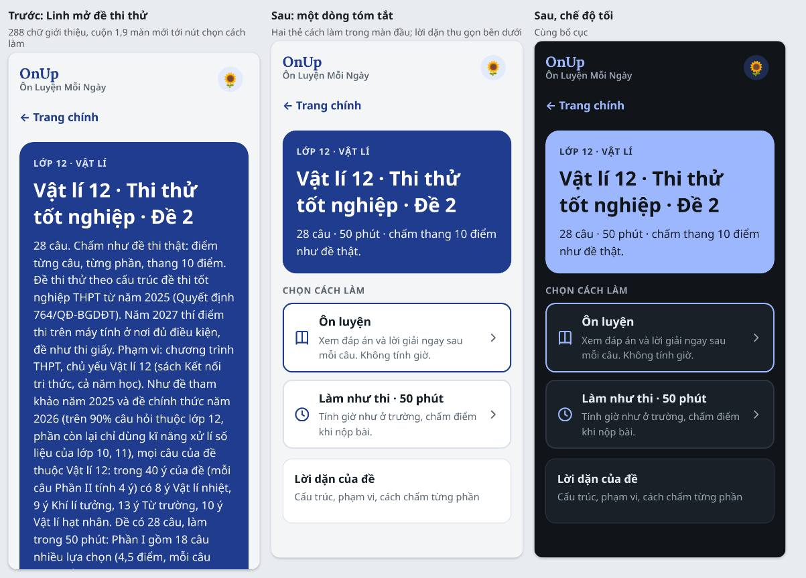
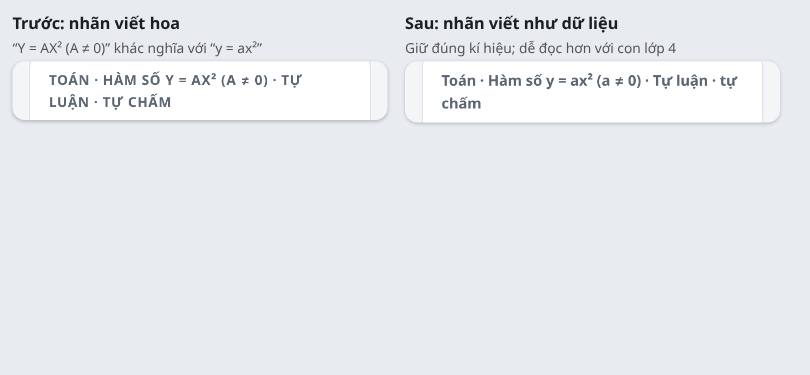
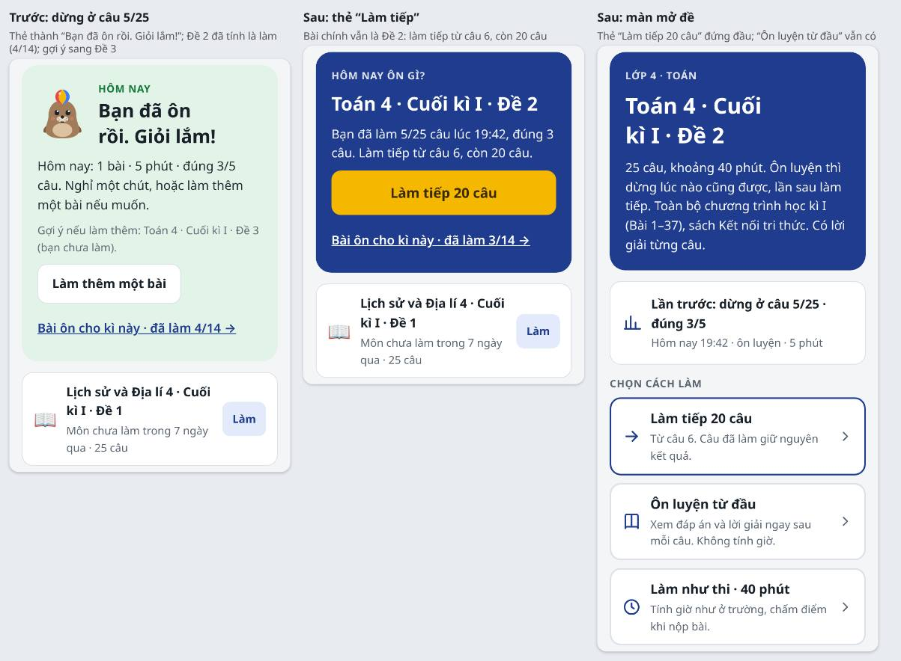
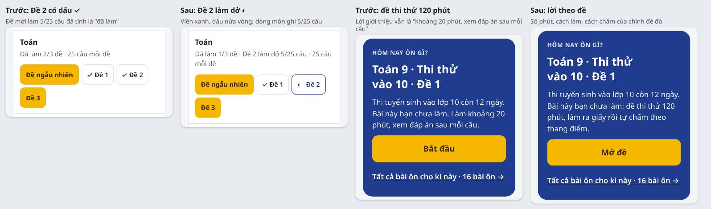
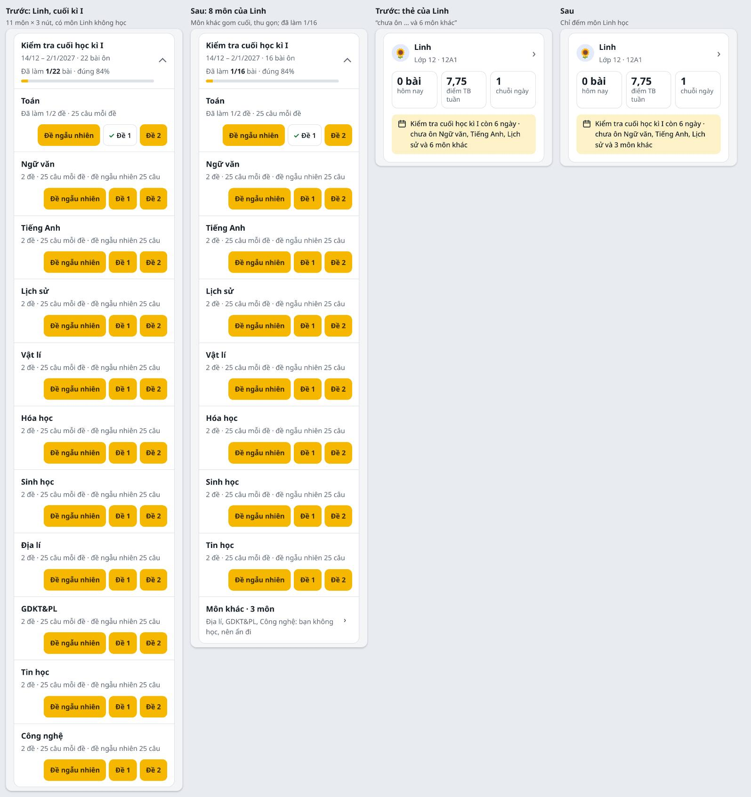
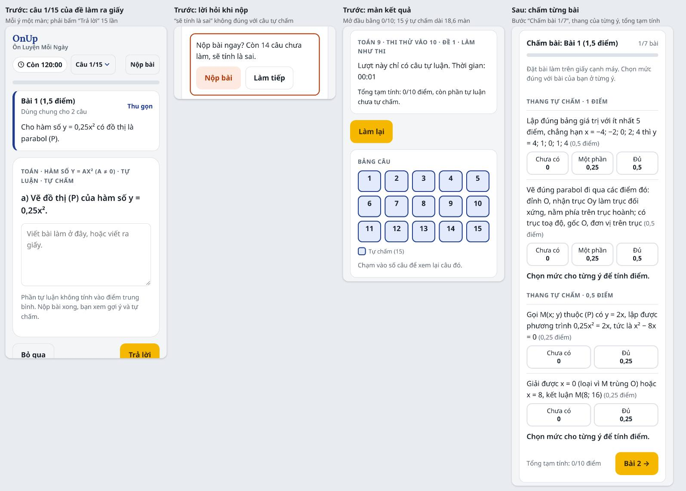
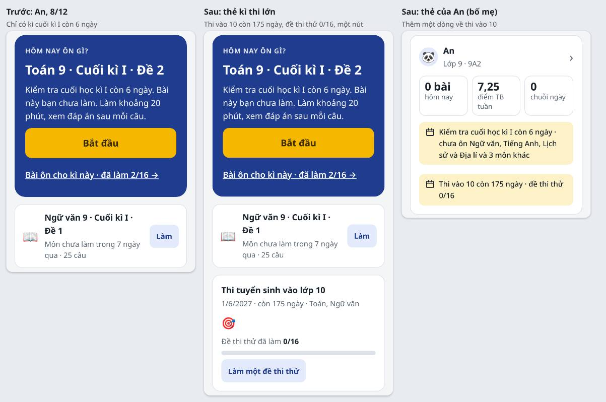

# Đề xuất giao diện 4.x (11/11/2026)

Bản 3.x đã làm xong UX9–UX15; UX13 không làm. Kiểm thử thiết kế ghi ở mục 6 của [CAI-TIEN-UX-3X.md](CAI-TIEN-UX-3X.md). Bản 4.x là kết quả đợt UAT định kì đầu tiên, chạy theo bộ persona ba cấp ở [PERSONA.md](PERSONA.md). Đợt này trả lời ba câu hỏi:
- một giao diện có hợp cả con 9 tuổi lẫn con 17 tuổi không;
- chỗ nào làm một persona khó dùng, đo được bao nhiêu;
- sửa thế nào để không persona nào bị thiệt.

**Figma:** trang [🚧 Master 4.x · Persona và đề xuất](https://www.figma.com/design/9mkNYX0ZOczNDMwlKo5F4e/OnUp?node-id=376-2). Trang có ba khung persona, rồi mỗi phiên ứng viên một section có ghi chú. Khung màn hình của phiên chỉ vẽ khi chủ app chọn phiên đó, như cách làm của bản 3.x.

File này giữ cách chạy UAT, kết quả đo, vấn đề (mã X52–X61, nối tiếp bản 3.x), đề xuất theo phiên, ảnh và “Xong khi”. Các phiên UX16–UX21 là **phiên ứng viên, chờ chủ app chọn**. Khi chủ app chọn, PD viết lời giao việc ở mục 4 và thêm dòng ở mục 3 của [KE-HOACH-PHAT-TRIEN-ONUP.md](KE-HOACH-PHAT-TRIEN-ONUP.md). Trạng thái chỉ ghi ở file đó.

## 1. Tóm tắt

| Phiên ứng viên | Vấn đề | Persona được lợi nhiều nhất | Cỡ | Gợi ý |
|---|---|---|---|---|
| **UX17** · Màn mở đề gọn, nhãn câu giữ đúng chữ | X54, X55 | Linh, An; lớp 5 | nhỏ | làm trước: nhỏ, cả ba cấp được lợi |
| **UX16** · Làm dở, làm tiếp; lời giới thiệu đúng đề | X52, X53, X61 | Bin, Mẹ Hạnh; cả An, Linh | vừa | ngay sau UX17 |
| **UX20** · Môn học của con, khối 10–12 | X59 | Linh, Mẹ Thu | lớn; cần chủ app quyết chỗ lưu | trước khi bật khối 12 (sau RS12) |
| **UX18** · Đề thi thử làm ra giấy | X56 | An; Linh (Ngữ văn) | lớn | sau Phiên 9u (L47) |
| **UX19** · Đường tới kì thi lớn | X57, X58 | An, Linh, Bố Tuấn, Mẹ Thu | vừa | sau 9u |
| **UX21** · Làm đề bằng bàn phím | X60 | Linh | nhỏ | để sau, hoặc làm cùng UX17 |

Không cần sửa (đo đạt ở cả ba cấp):
- Hôm nay của Bin, An, Linh cùng bố cục; nút Bắt đầu nằm trong màn đầu.
- Từ “Xin chào!” tới câu 1 mất 7 chạm: chọn hồ sơ, 4 số PIN, Bắt đầu, Ôn luyện.
- Chữ câu hỏi 18,4px, ô lựa chọn cao 53px, chữ 16px: đủ cho Bin, không chậm với Linh.
- Không màn nào cuộn ngang, có nút dưới 44px, chữ dưới 13px, chữ đè, lỗi JavaScript.
- Tin nhắn tuần ngắn, khớp số liệu.
- Phiên UX15 xếp bài chính và thứ tự môn đúng ở cả ba cấp (kiểm thử thiết kế ở mục 6 của 3X).

## 2. Nguyên tắc giữ nguyên

Mọi phiên 4.x giữ các quy tắc của CLAUDE.md và mục 2 của [CAI-TIEN-UX-3X.md](CAI-TIEN-UX-3X.md). Thêm các nguyên tắc cân đối ba cấp ở mục 3 của [PERSONA.md](PERSONA.md), tóm tắt như sau:
- một bộ màn, khác nhau theo dữ liệu (số môn, kì thi lớn, độ dài đề, lựa chọn của con), không theo nhãn tuổi;
- tiến độ trung thực;
- lời nói đúng việc;
- mỗi đề xuất ghi persona nào được lợi.

## 3. Cách chạy UAT (11/11/2026)

- Chạy `main` `f49a98a` (sau PR #297), bản lưu trên máy, 360 × 740 sáng và tối. Bin chạy thêm ở 768 × 1024 (máy tính bảng), Linh thêm ở 1366 × 768 (máy tính).
- Khối 5, 12 bật giả bằng `route` của Playwright cho `data/grades.js`, như lúc khối 12 sẽ bật; repo không đổi.
- Gia đình mẫu “Nhà Hạnh”: Mẹ Hạnh (phụ huynh), Bin lớp 4, Na lớp 6, An lớp 9, Linh lớp 12. Bốn con trong một tài khoản để so các thẻ cạnh nhau, vì gia đình có con ở nhiều cấp cũng là chuyện thường. Kết quả mẫu:
  - Bin 3 bài trong 7 ngày (Toán, Tiếng Việt, Tiếng Anh 4 · Cuối kì I · Đề 1);
  - An 2 bài (Toán, KHTN 9 · Cuối kì I · Đề 1);
  - Linh 2 bài (Toán 12 · Cuối kì I · Đề 1; Vật lí 12 · Thi thử tốt nghiệp · Đề 1, 6,5/10 điểm);
  - Na 2 bài giữa kì I.
- Ngày giả lập:
  - 8/12/2026 19:30: cuối kì I lớp 9, 12 còn 6 ngày; lớp 4 còn 20 ngày;
  - 20/5/2027 19:30: thi vào 10 còn 12 ngày, thi tốt nghiệp còn 22 ngày;
  - riêng kiểm thử UX15: 14/11 và 20/12/2026.
- Đo trong trang bằng Playwright:
  - số màn (chiều cao trang chia 740), số chữ, số chữ trong màn đầu, số nút;
  - cuộn ngang, nút dưới 44px, chữ dưới 13px, lỗi JavaScript;
  - số chạm từ “Xin chào!” tới câu 1;
  - phím trên máy tính.

  Script để trong thư mục nháp của PD, không vào repo. Kịch bản U1–U11 ở mục 4 của [PERSONA.md](PERSONA.md).
- Kiểm thử tự động trên cùng commit: `node tests/kiem-tra-de.js` DE OK; `tests/e2e.js` E2E OK (60 bước); `tests/supabase/cloud-e2e.js` CLOUD E2E OK (174 mục).

**Số đo (360px, 8/12/2026):**

| Màn | Bin, lớp 4 | An, lớp 9 | Linh, lớp 12 |
|---|---|---|---|
| Hôm nay: số màn · chữ · chữ màn đầu | 2,5 · 262 · 95 | 2,4 · 240 · 93 | 2,4 · 253 · 93 |
| Bài ôn: số màn · nút | 2,5 · 61 | 2,4 · 117 | 2,8 · 142 (mở hết các nhóm: 8 màn, 138 nút đề) |
| Lịch thi: số màn · số kì thi | 1,9 · 6 | 1,6 · 4 | 1,7 · 4 |
| Kết quả: số màn | 1,3 | 1,2 | 1,0 |
| Màn mở đề: chữ ở khối giới thiệu (cả màn) | 33 (71), Toán 4 · Cuối kì I · Đề 2 | 152 (190), Toán 9 · Thi thử vào 10 · Đề 1 | 288 (326), Vật lí 12 · Thi thử tốt nghiệp · Đề 2; cuộn 1,9 màn mới tới nút cách làm |

Lời dặn của đề (`note`), số chữ trung vị theo khối:
- lớp 4: 49;
- lớp 5: 109;
- lớp 6: 65;
- lớp 9: 106 (đề tính điểm: 119);
- lớp 12: 125 (đề tính điểm: 209, dài nhất 258).

## 4. Vấn đề và đề xuất theo phiên

Ảnh ở [hinh-ux-4x/](hinh-ux-4x/) là app thật của `main`, phần đề xuất chèn vào trang bằng các lớp đang có của `css/app.css` cộng vài lớp mới ghi ở từng mục. Ảnh là hướng làm, không bắt giống từng điểm ảnh. Tên lớp, id mới đã tra trong `css/app.css`, `js/app.js`, `js/quiz.js` để không trùng. Mức: **Cao** là sai thông tin hoặc mất việc con đã làm; **Vừa** là tốn thời gian, dễ hiểu sai; **Thấp** là đánh bóng.

### Phiên UX17 · Màn mở đề gọn, nhãn câu giữ đúng chữ (X54, X55)

Sửa `js/app.js`, `js/quiz.js`, `css/app.css`; cả hai bản; không đổi dữ liệu.

**X54. Lời dặn dài của đề đẩy hai thẻ cách làm xuống dưới màn đầu (Vừa; Linh, An, con lớp 5).**
- Đo: Linh mở “Vật lí 12 · Thi thử tốt nghiệp · Đề 2”: khối giới thiệu có 288 chữ, cả màn đầu là chữ, cuộn 1,9 màn mới tới “Làm như thi · 50 phút”. An mở đề thi thử Toán vào 10: 152 chữ. Bin mở đề lớp 4: 33 chữ, cả màn vừa một màn. Lời dặn dài lên theo khối (mục 3); lớp 5 đã dài gấp đôi lớp 4.
- Vì sao: `.hero p` của màn mở đề (`quizScreen`, js/app.js) ghép số câu, cách chấm và cả `b.note`.
- Đề xuất:
  - `.hero p` chỉ giữ một dòng do app dựng, ngăn bằng “ · ”: số câu, số phút (`b.minutes`), cách chấm. Ví dụ “28 câu · 50 phút · chấm thang 10 điểm như đề thật.” hay “25 câu · 40 phút · có lời giải từng câu.”. Câu “(15 câu tự luận tự chấm)” giữ như nay.
  - `b.note` dài hơn 40 chữ chuyển vào `details.panel.note-more#qNote` ngay sau `.modes`:
    - `summary` cao ≥ 44px, gồm dòng đậm “Lời dặn của đề” và dòng nhỏ “Cấu trúc, phạm vi, cách chấm”;
    - mở ra là cả đoạn lời dặn;
    - lời dặn từ 40 chữ trở xuống vẫn ở `.hero p`, như đa số đề lớp 4.
  - Chữ ở hai cột `TXT`: `appNoteHead` (“Lời dặn của đề” / “Test notes”), `appNoteSub` (“Cấu trúc, phạm vi, cách chấm” / “Structure, scope, marking”).
- Xong khi:
  - Bước mới của `tests/e2e.js`, ở 360 × 740 sáng và tối, học sinh chưa làm đề. Mở màn mở đề của các đề sau: đề có lời dặn dài nhất của mỗi khối có đề, mọi đề tính điểm, một đề Tiếng Anh. Với mỗi đề: `#qPractice` (và `#qExam` nếu có) nằm trọn trong màn đầu; `#qNote` có `summary` cao ≥ 44px; mở ra thì đúng chữ của `note`.
  - Đề lớp 4 có lời dặn ngắn vẫn hiện lời dặn trong `.hero`. Đề Tiếng Anh không có chữ cái tiếng Việt.
  - `audit` không báo gì.

**X55. Nhãn trên câu viết hoa làm sai kí hiệu toán, khó đọc với con nhỏ (Vừa; mọi cấp).**
- Đo: `.label` có `text-transform: uppercase` (css/app.css). Nhãn “môn · chủ đề · cách làm” trên câu (js/quiz.js) thành “TOÁN · HÀM SỐ Y = AX² (A ≠ 0) · TỰ LUẬN · TỰ CHẤM”.
  - Đã có 40 câu lớp 9 bị như vậy. Lớp 10, 11 sẽ có nhiều chủ đề có kí hiệu (hàm số, lôgarit…).
  - Nhãn đầu màn kết quả cũng viết hoa tên đề: “TOÁN 9 · THI THỬ VÀO 10 · ĐỀ 1 · LÀM NHƯ THI”.
  - Chữ hoa có dấu khó đọc hơn với con lớp 4.
- Đề xuất:
  - Nhãn có chữ lấy từ dữ liệu dùng lớp mới `.label.as-is` (`text-transform:none; letter-spacing:0`), giữ cỡ, màu, độ đậm. Chữ lấy từ dữ liệu là tên đề, môn, chủ đề, tên phần.
  - Áp cho hai chỗ: nhãn trên câu (dòng có `subj`, `q.topic`, `INSTR` trong `Quiz.run`) và nhãn đầu màn kết quả (tên đề · cách làm).
  - Nhãn cố định của giao diện vẫn viết hoa như nay: “BẢNG CÂU”, “THEO PHẦN”, “HÔM NAY ÔN GÌ?”.
- Xong khi:
  - `tests/e2e.js` mở một câu chủ đề “Hàm số y = ax² (a ≠ 0)” (lớp 9) và một câu đề lớp 4. Nhãn đọc bằng `innerText` (có tính `text-transform`) đúng chữ thường của dữ liệu.
  - Nhãn đầu màn kết quả đúng tên đề.
  - Bước TA2 vẫn qua.

### Phiên UX16 · Làm dở, làm tiếp; lời giới thiệu đúng đề (X52, X53, X61)

Sửa `js/app.js`, `js/quiz.js`, `css/app.css`; cả hai bản. Không đổi bảng, SQL, dữ liệu đã lưu.

**X52. Dừng giữa đề ôn luyện vẫn tính là đã làm đề (Cao; Bin, Mẹ Hạnh; mọi cấp).**
- Tái hiện: Bin ôn luyện “Toán 4 · Cuối kì I · Đề 2”, làm 5 câu, bấm “← Thoát” rồi “Dừng”. Kết quả lưu 5 câu (`t` = 5). Sau đó:
  - nút “Đề 2” có ✓ (“đã làm, lần gần nhất đúng 0%” khi 5 câu sai);
  - tiến độ kì tính đề đó (đã làm 4/14 thay vì 3/14);
  - thẻ Hôm nay thành “Bạn đã ôn rồi. Giỏi lắm!” với “đúng 0/5 câu”, gợi ý làm thêm sang Đề 3, không nhắc 20 câu còn lại của Đề 2;
  - mở lại Đề 2 thì làm từ đầu.
  Persona: Bin hay dừng giữa chừng, mẹ thấy “1 bài” mà Bin mới làm 5 câu.
- Vì sao: `itemKey`/`resKey` và `doneMap` (`progressOf`), `todayPicks`, `practiceList` coi mọi kết quả của đề là đã làm. `Quiz.run` không giữ chỗ dừng.
- Đề xuất:
  - **Làm dở.** Kết quả ôn luyện của đề cố định không tính điểm có `t` nhỏ hơn số câu của đề (`qCount(b)`) là làm dở. Làm dở không tính vào “đã làm” của tiến độ kì, huy hiệu “Hết đề”, nút ✓. Làm dở vẫn tính vào số bài hôm nay, chuỗi ngày, điểm, như nay.
  - **Nút đề làm dở:** `btn sm part`: nền `surface`, viền và chữ `acc`, đậm 600, cao 44px. Đầu nút có `span.part-ic` “◐” (`aria-hidden`). `aria-label` “…, làm dở 5 trên 25 câu”. Dòng môn ghi “Đề 2 làm dở 5/25 câu”.
  - **Giữ chỗ dừng:**
    - `Quiz.run` gọi `opts.onPause(keys)` khi dừng một lượt ôn luyện chưa hết câu; `keys` là mã câu đã làm (`Quiz.key`).
    - `renderQuiz` lưu ở localStorage khóa `ontap_resume_v1`, theo mã học sinh rồi mã đề, bọc try/catch như `PoolHist`. Chỗ dừng chỉ có trên máy đó.
    - Xóa chỗ dừng khi làm hết đề hoặc chọn làm lại từ đầu.
  - **Màn mở đề có chỗ dừng:**
    - thẻ “Lần trước” ghi “Lần trước: dừng ở câu 5/25 · đúng 3/5”;
    - thẻ cách làm đầu tiên là `#qResume` (`.mode.main`): “Làm tiếp 20 câu” · “Từ câu 6. Câu đã làm giữ nguyên kết quả.”;
    - thẻ Ôn luyện đổi thành “Ôn luyện từ đầu”.
  - **Vòng làm tiếp:** chỉ gồm câu chưa làm, theo thứ tự cũ. Xong vòng thì lưu một kết quả cho cả đề: `r` cộng câu đúng của hai lần, `t` là số câu của đề, `s` cộng thời gian hai lần. Nhờ vậy đề thành đã làm. Kết quả làm dở cũ giữ trong lịch sử.
  - Máy khác (không có chỗ dừng) vẫn thấy nút làm dở, nhưng chỉ có “Ôn luyện từ đầu”.
  - **Hôm nay (`todayPicks`):** đề làm dở trong 7 ngày đứng trước đề chưa làm.
    - Lời: “Bạn đã làm 5/25 câu lúc 19:42, đúng 3 câu. Làm tiếp từ câu 6, còn 20 câu.”
    - Nút `#todayGo` ghi “Làm tiếp 20 câu” và mở màn mở đề.
    - Thẻ “Hôm nay đã ôn” (X40) chỉ hiện khi hôm nay có ít nhất một bài làm hết: đề hết câu, đề làm như thi hoặc bài ôn dạng trang.
  - Chữ của màn mở đề, màn làm đề ở hai cột `TXT` (`appResume`, `appResumeNote`, `appFromStart`, `appPrevPart`), như đề Tiếng Anh: “Continue: 20 left”, “From question 6. Answers so far are kept.”, “Practice from the start”.
- Xong khi:
  - Bước mới của `tests/e2e.js`: Bin, ngày giả lập 8/12/2026 19:45, 360px sáng và tối. Ôn luyện Đề 2, làm 5 câu rồi dừng. Khi đó:
    - nút Đề 2 có `.part`, không có ✓; nhóm kì ghi đã làm 3/14;
    - Hôm nay có bài chính Đề 2 với “Làm tiếp 20 câu”;
    - màn mở đề có `#qResume` đứng đầu.
  - Làm tiếp: vòng có 20 câu, không có câu đã làm. Xong vòng thì kết quả có 25 câu, nút có ✓, đã làm 4/14, `ontap_resume_v1` không còn mục của Đề 2.
  - Dừng giữa lượt làm như thi vẫn như nay: nộp bài, câu trống tính sai.
  - `tests/supabase/cloud-e2e.js` in OK.

**X53. Lời giới thiệu bài chính ghi “khoảng 20 phút, xem đáp án sau mỗi câu” cho mọi đề (Vừa; mọi cấp).**
- Đo:
  - Toán 4 Đề 2 (25 câu, đề thật 40 phút) và đề lớp 9, 12 (25 câu, 45 phút) đều ghi “khoảng 20 phút”.
  - Ngày 20/5/2027 An được giao “Toán 9 · Thi thử vào 10 · Đề 1” (15 ý tự luận làm ra giấy, 120 phút) và Linh được giao “Toán 12 · Thi thử tốt nghiệp · Đề 1” (90 phút, tính điểm). Cả hai cùng nhận câu đó.
- Vì sao: `how(x)` trong `todayPicks` chỉ xét `intro` của bài ôn dạng trang.
- Đề xuất: câu thứ ba của lời giới thiệu theo đề.
  - Đề thường: “25 câu, khoảng 40 phút. Ôn luyện thì dừng lúc nào cũng được, lần sau làm tiếp.”. Số phút lấy từ `b.minutes`; đề không có số phút thì không ghi phút.
  - Đề tính điểm có câu chấm tự động: “Đề thi thử 90 phút, chấm thang 10 như đề thật.”
  - Đề tính điểm mọi câu tự chấm: “Đề thi thử 120 phút, làm ra giấy rồi tự chấm theo thang điểm.”
  - Đề ngẫu nhiên, ôn chủ đề, bài ôn dạng trang giữ như nay.
  - Bài chính là đề tính điểm thì nút `#todayGo` ghi “Mở đề”, để con chọn cách làm ở màn sau.
- Xong khi: bước UX1, UX15 của `tests/e2e.js` đọc lời mới. Bước mới:
  - An ngày 20/5/2027: bài chính là đề thi thử vào 10, lời có “làm ra giấy”, nút “Mở đề”;
  - Linh ngày 20/5/2027 (khối 12 bật giả trong bước): lời có “90 phút”.

**X61. Lời khen chung chung; hình hải cẩu cố định ở thẻ “Hôm nay đã ôn” (Thấp; Linh, Bin).**
- Đo: thẻ X40 ghi “Bạn đã ôn rồi. Giỏi lắm!” cả khi con dừng ở câu 5, đúng 0/5. Hình là hải cẩu tung bóng cho mọi con, kể cả Linh lớp 12 có hình đại diện 🌻. Chủ đề “quá trẻ con” với tuổi teen: [PERSONA.md](PERSONA.md), nguồn NN/g.
- Đề xuất:
  - Tiêu đề thẻ đổi thành “Hôm nay bạn đã ôn xong.”; dòng `#todayDone` giữ số bài, số phút, số câu đúng như nay.
  - Hình là hình đại diện của chính con (`avatar(s, true)`, 64px): Bin vẫn thấy hải cẩu, Linh thấy 🌻.
  - Lời khen ở màn kết quả giữ nguyên, vì đã theo điểm.
- Xong khi: bước UX9 của `tests/e2e.js` đọc chữ mới. Học sinh có hình đại diện emoji thì thẻ có emoji đó, không có `img` hải cẩu tung bóng.

### Phiên UX20 · Môn học của con, khối 10–12 (X59)

Sửa `js/store.js`, `js/store-supabase.js`, `supabase/` (cột mới), `js/app.js`, `css/app.css`.

**X59. Lớp 10–12: mọi màn liệt kê 11 môn, còn con học 8 môn và thi tốt nghiệp 4 môn (Cao khi bật khối 12; Linh, Mẹ Thu).**
- Đo (khối 12 bật giả, ngày 8/12/2026):
  - Bài ôn của Linh: nhóm cuối kì I có 11 môn × 3 nút (33 nút); nhóm thi tốt nghiệp có 39 đề; mở hết các nhóm thì 8 màn, 138 nút đề.
  - Thẻ của Linh ở Các con: “chưa ôn Ngữ văn, Tiếng Anh, Lịch sử và 6 môn khác”.
  - Gợi ý trong báo cáo tuần: “Tuần này chưa ôn Ngữ văn, Tiếng Anh, Lịch sử, Hóa học, Sinh học, Địa lí, GDKT&PL, Tin học, Công nghệ cho kì thi sắp tới.”
  - Bài phụ ở Hôm nay có thể là môn Linh không học.
- Vì sao: kì thi lớp 10–12 ghi đủ 11 môn có đề. Theo Thông tư 13/2022, con học 4 môn bắt buộc có điểm (Toán, Ngữ văn, Tiếng Anh, Lịch sử) và chọn 4 môn lựa chọn; 7 trong các môn lựa chọn có đề trong app (Vật lí, Hóa học, Sinh học, Địa lí, GDKT&PL, Tin học, Công nghệ). Thi tốt nghiệp gồm Toán, Ngữ văn và 2 môn tự chọn trong các môn đã học ở lớp 12. Nguồn ở [PERSONA.md](PERSONA.md).
- Đề xuất:
  - **Chọn môn.** Hồ sơ khối 10–12 có thêm ô chọn “Môn lựa chọn” (4 môn). Hồ sơ lớp 12 có thêm “Môn thi tốt nghiệp tự chọn” (2 môn, trong Tiếng Anh, Lịch sử và 4 môn lựa chọn).
    - Ô chọn dạng chip, cao ≥ 44px, `aria-pressed`, như `.day-pick` của UX10.
    - Có ở form hồ sơ của bố mẹ (`renderUserForm`) và ở trang Tài khoản của con, vì con lớn tự chọn được.
    - Chưa chọn thì app như nay (đủ 11 môn). Hôm nay có một dòng nhắc, bấm “Thôi” thì ẩn: “Chọn môn bạn học để danh sách gọn hơn.”
  - **Dùng ở:**
    - `examItems`: môn con không học gom vào một dòng `details` “Môn khác · 3 môn” ở cuối nhóm, thu gọn sẵn;
    - `progressOf`: chỉ đếm môn của con (“đã làm 1/16”);
    - `todayPicks`: bài chính, bài phụ;
    - `kidCard`, `weekTips`, chi tiết kì thi;
    - nhóm thi tốt nghiệp: Toán, Ngữ văn và 2 môn thi tự chọn.
  - **Lưu:**
    - Bản lưu trên máy: trường `subjects` (mảng tên môn) và `tnSubjects` của học sinh. Dữ liệu cũ đọc vào là `[]`.
    - Bản đám mây: cột `profiles.subjects text[]`, `profiles.tn_subjects text[]`, thêm bằng file `supabase/cap-nhat-<phiên>.sql`, grant theo cột như các cột đang có của `profiles` (mục “Grant khi thêm bảng, cột, hàm” của CLAUDE.md). Máy chủ chưa cập nhật thì app giữ như nay.
  - **Chủ app quyết:** đây là thông tin học tập, không phải thông tin cá nhân của con. Nhưng quy tắc “thu thập tối thiểu” trong CLAUDE.md chỉ kể tên, khối, lớp. Nếu chủ app không muốn lưu lên máy chủ, mỗi máy lưu riêng (localStorage) và chọn một lần trên mỗi máy.
- Xong khi:
  - Bước mới của `tests/e2e.js` (khối 12 bật giả trong bước), chọn 4 môn cho Linh. Khi đó:
    - Bài ôn: nhóm cuối kì I có 8 dòng môn và dòng “Môn khác · 3 môn” thu gọn; đã làm 1/16;
    - thẻ của Linh và gợi ý tuần chỉ nhắc môn của Linh;
    - nhóm thi tốt nghiệp chỉ có 4 môn thi;
    - chưa chọn môn thì như nay.
  - `tests/supabase/store-test.mjs`, `cloud-e2e.js` in OK; `sh tests/supabase/run.sh` in RLS OK, có kiểm tra cột mới.
- Thời điểm: nên xong trước khi bật khối 12 (sau RS12). Không kịp thì bật khối 12 như nay rồi làm sau; khối 10, 11 (tháng 1/2027) cũng cần phiên này.

### Phiên UX18 · Đề thi thử làm ra giấy (X56)

Sửa `js/quiz.js`, `css/app.css`; cả hai bản. Làm sau Phiên 9u (L47), vì cùng phần điểm của đề có câu tự chấm.

**X56. Đề thi thử làm ra giấy đi theo luồng của đề làm trên máy (Cao với lớp 9; An, Linh).**
- Đo với “Toán 9 · Thi thử vào 10 · Đề 1” (15 ý tự luận, 120 phút; cả 10 đề Toán thi thử vào 10 như vậy), làm như thi:
  - mỗi ý một màn; muốn tới “Nộp bài” phải bấm “Trả lời” hoặc “Bỏ qua” ở từng ý; không xem được cả đề một lúc, trong khi đọc cả đề trước là kĩ năng làm bài thi;
  - bấm “Nộp bài” sau câu 1 thì app hỏi “Nộp bài ngay? Còn 14 câu chưa làm, sẽ tính là sai.”, nhưng câu tự luận không bị tính sai, vì con tự chấm sau khi nộp;
  - màn kết quả mở đầu bằng “Lượt này chỉ có câu tự luận… Tổng tạm tính: 0/10 điểm”; 15 ý tự chấm nằm dưới bảng câu và mục “Theo phần”, cả trang dài 18,6 màn.
- Đề xuất:
  - **Trang cả đề.** Đề tính điểm có câu tự luận, khi làm như thi, có nút “Xem cả đề” (`#qzAll`) trong bảng số câu.
    - Nút mở trang đọc cả đề theo thứ tự: đoạn chung, hình, các ý; không có ô trả lời. Trang có đồng hồ ở hàng trên cùng và hai nút “Về câu đang làm”, “Nộp bài”.
    - Đề mà mọi câu tự chấm (làm ra giấy) mở thẳng trang này khi bắt đầu.
  - **Lời hỏi khi nộp:** đếm riêng hai loại câu còn trống.
    - Câu chấm tự động: “… sẽ tính là sai”.
    - Câu tự luận: “15 câu tự luận: bạn chấm ngay sau khi nộp, theo thang điểm của từng ý.”
    - Chữ ở hai cột `TXT`.
  - **Chấm từng bài.** Màn kết quả của đề tính điểm có câu tự luận mở đầu bằng khối `section.panel#qzMark`.
    - Khối gồm: “Chấm bài: Bài 1 (1,5 điểm) · 1/7 bài”, thanh tiến độ, dòng “Đặt bài làm trên giấy cạnh máy. Chọn mức đúng với bài của bạn ở từng ý.”, các ý của bài (thang tự chấm như nay), nút “Bài 2 →”.
    - Bài là `part` của câu; đề không có `part` thì theo đoạn chung `p`, rồi từng câu.
    - Chấm xong mọi bài thì khối thu thành dòng “Đã chấm 7/7 bài”; điểm to là điểm cả đề.
    - Điểm to, bảng câu, mục “Theo phần” đứng sau khối chấm.
- Xong khi:
  - Bước mới của `tests/e2e.js`: An, 360px sáng và tối, làm như thi “Toán 9 · Thi thử vào 10 · Đề 1”.
    - Bắt đầu là trang cả đề.
    - Nộp ngay thì lời hỏi không có “sẽ tính là sai”.
    - Khối chấm 1/7 đứng đầu màn kết quả; chấm hết 7 bài thì điểm to là tổng điểm tự chấm.
  - “Ngữ văn 9 · Thi thử vào 10 · Đề 1” (vừa chấm tự động vừa tự luận): lời hỏi đếm hai loại câu.
  - `audit` không báo gì; `tests/supabase/cloud-e2e.js` in OK.

### Phiên UX19 · Đường tới kì thi lớn (X57, X58)

Sửa `js/app.js`, `css/app.css`; cả hai bản. Làm sau 9u, để điểm của đề tính điểm ghi cùng một cách.

**X57. Lớp 9, 12 không thấy đường tới kì thi lớn ở Hôm nay và thẻ của con (Vừa; An, Linh, Bố Tuấn, Mẹ Thu).**
- Đo: ngày 8/12, Hôm nay của An, Linh chỉ nói “Kiểm tra cuối học kì I còn 6 ngày”. 16 đề thi thử vào 10 và 39 đề thi thử tốt nghiệp chỉ có ở tab Bài ôn (nhóm thu gọn) và Lịch thi. Thẻ của An, Linh ở Các con cũng chỉ có kì gần nhất.
- Đề xuất:
  - **Hôm nay.** Khối có kì thi `kind: "thi-khac"` chưa qua (thi vào 10, tốt nghiệp), mà kì đó không phải kì gần nhất, thì thêm `section.panel#bigExam` ngay sau bài phụ. Thẻ gồm:
    - tên kì; ngày · “còn N ngày” · môn thi;
    - “Đề thi thử đã làm 0/16” (đề cố định của kì, tính bằng `progressOf`) và thanh `.bar`;
    - “gần nhất 6,5/10” khi đã có điểm;
    - nút `btn sm` “Làm một đề thi thử”: đề chưa làm đầu tiên theo môn thi; làm hết thì đề có điểm thấp nhất.

    Khi kì thi lớn đã là kì gần nhất thì không có thẻ, vì bài chính đã là đề của kì đó.
  - **Thẻ của con** (`kidCard`): thêm dòng `.kid-ev` thứ hai, có biểu tượng icon/target: “Thi vào 10 còn 175 ngày · đề thi thử 2/16 · gần nhất 6,5/10”.
  - **Tin nhắn tuần:** khi đã làm ít nhất một đề thi thử, thêm dòng “• Thi thử vào 10: 2/16 đề, gần nhất 6,5/10.”.
- Xong khi:
  - Bước mới của `tests/e2e.js`: An ngày 8/12/2026 có `#bigExam` ghi “còn 175 ngày”, “0/16”. Làm một đề thi thử thì thẻ ghi “1/16” và điểm.
  - Ngày 20/5/2027 An không có `#bigExam`. Bin không có thẻ này.
  - Thẻ của An có dòng thứ hai. Linh (khối 12 bật giả trong bước) có thẻ của thi tốt nghiệp.
  - `tests/supabase/cloud-e2e.js` in OK.

**X58. Gợi ý tuần cho đề tính điểm nói theo phần trăm (Thấp; Linh, Mẹ Thu).**
- Đo: báo cáo tuần của Linh ghi “Gợi ý: Vật lí mới đúng 65%: xem lại lời giải các câu sai rồi làm lại đề đó.” cho một đề thi thử được 6,5/10 điểm.
- Đề xuất: khi môn có điểm thấp nhất là đề tính điểm (`scoredRes`), gợi ý ghi theo điểm: “Vật lí thi thử 6,5/10 điểm: xem lại các câu sai rồi làm một đề thi thử khác.” (`weekTips`).
- Xong khi: bước mới của UX19 đọc gợi ý theo điểm.

### Phiên UX21 · Làm đề bằng bàn phím (X60)

Sửa `js/quiz.js`, `css/app.css`.

**X60. Làm đề trên máy tính không có phím chọn đáp án (Thấp; Linh).**
- Đo ở 1366 × 768: cột app rộng 720px, lựa chọn xếp 2 cột. Phím 1, a, A không chọn được đáp án. Phải bấm Tab 3 lần mới tới lựa chọn đầu; phím cách chọn được; viền focus 3px, rõ. Năm 2027 thí điểm thi tốt nghiệp trên máy tính, nên Linh muốn tập trên máy tính.
- Đề xuất:
  - Câu nhiều lựa chọn: phím 1–4 hoặc A–D chọn lựa chọn theo thứ tự đang hiện.
  - Enter bấm nút chính (Kiểm tra, Trả lời, Câu tiếp).
  - Không bắt phím khi con đang gõ trong ô nhập.
  - Sau lần gõ phím đầu tiên, dưới câu có dòng nhỏ “Phím 1–4 chọn đáp án, Enter để tiếp”. Máy cảm ứng không thấy dòng này. Chữ ở hai cột `TXT`.
- Xong khi:
  - `tests/e2e.js` ở 1366 × 768: phím 2 chọn lựa chọn thứ hai, Enter kiểm tra, Enter nữa sang câu tiếp.
  - Ở 360px không có dòng phím; gõ trong ô điền không bị bắt phím.

## 5. Ghi nhận khác, chưa cần phiên

- **Máy riêng của con lớn** (An, Linh): mỗi lần mở app phải chọn lại hồ sơ ở “Ai đang học?”, vì hồ sơ đang dùng giữ trong sessionStorage. Lựa chọn “Máy này của Linh” có thể bớt 1–5 chạm mỗi lần. Chờ ghi chép dùng thử.
- **Tab Kết quả với con lớp 4:** “Điểm trung bình tháng”, “Theo môn · 30 ngày” trừu tượng với con 9 tuổi, nhưng Bin thường xem cùng mẹ. Chờ ghi chép dùng thử.
- **L47** (Phiên 9u, mục 3 của [SUA-LOI-CHAY-THU.md](SUA-LOI-CHAY-THU.md)) đã ghi điểm của đề tính điểm có câu tự luận. UX18, UX19 làm sau 9u.
- Lịch thi của phụ huynh bản lưu trên máy có tab “Mọi khối” dài 7,9 màn khi nhà có 4 con ở 4 khối. Bản đám mây (UX2) đã chia tab theo con, nên không cần sửa.

## 6. Kiểm thử thiết kế sau khi gộp

Chưa có. Phiên 4.x nào gộp thì ghi kết quả kiểm thử thiết kế ở đây, theo cách của mục 6 trong [CAI-TIEN-UX-3X.md](CAI-TIEN-UX-3X.md).
