# Đề xuất giao diện 4.x (11/11/2026; thêm Phiên UX22 ngày 25/11/2026, Phiên UX23 ngày 27/11/2026)

Bản 3.x đã làm xong UX9–UX15; UX13 không làm. Kiểm thử thiết kế ghi ở mục 6 của [CAI-TIEN-UX-3X.md](CAI-TIEN-UX-3X.md). Bản 4.x là kết quả đợt UAT định kì đầu tiên, chạy theo bộ persona ba cấp ở [PERSONA.md](PERSONA.md). Đợt này trả lời ba câu hỏi:
- một giao diện có hợp cả con 9 tuổi lẫn con 17 tuổi không;
- chỗ nào làm một persona khó dùng, đo được bao nhiêu;
- sửa thế nào để không persona nào bị thiệt.

**Figma:** trang [🚧 Master 4.x · Persona và đề xuất](https://www.figma.com/design/9mkNYX0ZOczNDMwlKo5F4e/OnUp?node-id=376-2). Trang có ba khung persona, rồi mỗi phiên một section có ghi chú. Khung màn hình của phiên chỉ vẽ khi chủ app chọn phiên đó, như cách làm của bản 3.x: Phiên UX22 có khung ở section [UX22](https://www.figma.com/design/9mkNYX0ZOczNDMwlKo5F4e/OnUp?node-id=380-63), ngay dưới persona.

File này giữ cách chạy UAT, kết quả đo, vấn đề (mã X52–X68, nối tiếp bản 3.x), đề xuất theo phiên, ảnh và “Xong khi”. Các phiên UX16–UX21 là phiên ứng viên; **ngày 26/11/2026 PO đã chọn cả sáu** (chủ app giao PO chốt các điểm còn chờ), thứ tự và hạn ở cột “Gợi ý” của bảng dưới. Phiên UX22 (X62–X65) đến từ góp ý của chủ app ngày 25/11/2026 và **đã được chọn**. Phiên UX23 (X66–X68) đến từ yêu cầu của chủ app ngày 27/11/2026 và **đã được chọn**: PO viết vấn đề và yêu cầu; lượt PD (27/11/2026) vẽ khung, viết đề xuất chi tiết, “Xong khi” và lời giao việc của hai phiên code UX23a, UX23b. Phiên đã chọn thì PD vẽ khung ở Figma và viết lời giao việc ở mục 4 của [KE-HOACH-PHAT-TRIEN-ONUP.md](KE-HOACH-PHAT-TRIEN-ONUP.md); dòng của sáu phiên ở mục 3 của file đó (PO thêm ngày 26/11/2026). Trạng thái chỉ ghi ở file đó.

## 1. Tóm tắt

| Phiên | Vấn đề | Persona được lợi nhiều nhất | Cỡ | Gợi ý |
|---|---|---|---|---|
| **UX22** · Hôm nay chọn cách làm ngay; gọi “Bài ôn 1, 2…” | X62–X65 (gộp cả X53) | mọi cấp, nhất là Bin | vừa | **chủ app chọn 25/11/2026**; làm trước các phiên dưới |
| **UX23** · Ôn theo chủ đề mỗi tuần; chọn cách ôn trước | X66–X68 | mọi cấp, nhất là Bin | lớn | **chủ app yêu cầu 27/11/2026**; thứ 1 (sau Phiên 9aa sửa IOE); lượt PD xong 27/11/2026, chia hai phiên code: UX23a trước 3/12/2026, UX23b trước 6/12/2026 |
| **UX17** · Màn mở đề gọn, nhãn câu giữ đúng chữ | X54, X55 | Linh, An; lớp 5 | nhỏ | **PO chọn 26/11/2026**; thứ 2 (PO lùi ngày 27/11/2026, sau UX23, 9x), trước 20/12/2026: nhỏ, cả ba cấp được lợi |
| **UX16** · Làm dở, làm tiếp | X52, X61 (X53 gộp vào UX22) | Bin, Mẹ Hạnh; cả An, Linh | vừa | **PO chọn 26/11/2026**; thứ 3, trước 31/12/2026; PD rà lại X52 theo cách ôn mới của UX23 |
| **UX20** · Môn học của con, khối 10–12 | X59 | Linh, Mẹ Thu | lớn; lưu trên máy chủ (PO quyết 26/11/2026) | **PO chọn 26/11/2026**; thứ 4, trước 20/1/2027 (trước khi bật khối 10, 11; khối 12 đã bật khi Merge PR #334; `run.sh` chạy lại được từ PR #346) |
| **UX18** · Đề thi thử làm ra giấy | X56 | An; Linh (Ngữ văn) | lớn | **PO chọn 26/11/2026**; thứ 5, trước 10/2/2027 (9u đã xong) |
| **UX19** · Đường tới kì thi lớn | X57, X58 | An, Linh, Bố Tuấn, Mẹ Thu | vừa | **PO chọn 26/11/2026**; thứ 6, trước 20/2/2027 |
| **UX21** · Làm đề bằng bàn phím | X60 | Linh | nhỏ | **PO chọn 26/11/2026**; thứ 7, trước 28/2/2027 nếu còn lượt, không thì sau khi mở dùng thử |

Không cần sửa (đo đạt ở cả ba cấp, ngày 11/11/2026):
- Hôm nay của Bin, An, Linh cùng bố cục; nút Bắt đầu nằm trong màn đầu. Ngày 25/11/2026 chủ app muốn bỏ bước Bắt đầu và bớt hành động: Phiên UX22.
- Từ “Xin chào!” tới câu 1 mất 7 chạm: chọn hồ sơ, 4 số PIN, Bắt đầu, Ôn luyện. Sau UX22 còn 6 chạm.
- Chữ câu hỏi 18,4px, ô lựa chọn cao 53px, chữ 16px: đủ cho Bin, không chậm với Linh.
- Không màn nào cuộn ngang, có nút dưới 44px, chữ dưới 13px, chữ đè, lỗi JavaScript.
- Tin nhắn tuần ngắn, khớp số liệu.
- Phiên UX15 xếp bài chính và thứ tự môn đúng ở cả ba cấp (kiểm thử thiết kế ở mục 6 của 3X).

## 2. Nguyên tắc giữ nguyên

Mọi phiên 4.x giữ các quy tắc của CLAUDE.md và mục 2 của [CAI-TIEN-UX-3X.md](CAI-TIEN-UX-3X.md). Thêm các nguyên tắc cân đối ba cấp ở mục 3 của [PERSONA.md](PERSONA.md), tóm tắt như sau:
- một bộ màn, khác nhau theo dữ liệu (số môn, kì thi lớn, độ dài đề, lựa chọn của con), không theo nhãn tuổi;
- tiến độ trung thực;
- lời nói đúng việc;
- mỗi đề xuất ghi persona nào được lợi;
- **mỗi màn tối đa một hành động chính, một phụ, một thứ ba** (chủ app chốt 25/11/2026, ghi ở CLAUDE.md):
  - hành động là nút, link trong nội dung màn; không tính thanh trên, thanh tab, nút quay lại;
  - chính là nút vàng (`.btn.main`); phụ là nút nền nhạt hoặc nút viền; thứ ba là link chữ (`.linkbtn`);
  - danh sách để chọn (bài ôn, kì thi, kết quả, ô số câu) là một nhóm: các mục cùng một kiểu trung tính, chỉ mục app gợi ý là nút chính;
  - dòng báo trạng thái tạm (bài chưa gửi) có nút sửa riêng, không tính;
  - màn chưa theo quy tắc ghi ở mục 5.

## 3. Cách chạy UAT (11/11/2026)

- Chạy `main` `f49a98a` (sau PR #297), bản lưu trên máy, 360 × 740 sáng và tối. Bin chạy thêm ở 768 × 1024 (máy tính bảng), Linh thêm ở 1366 × 768 (máy tính).
- Khối 5, 12 bật giả bằng `route` của Playwright cho `data/grades.js`, như lúc khối 12 sẽ bật; repo không đổi.
- Gia đình mẫu “Nhà Hạnh”: Mẹ Hạnh (phụ huynh), Bin lớp 4, Na lớp 6, An lớp 9, Linh lớp 12. Bốn con trong một tài khoản để so các thẻ cạnh nhau, vì gia đình có con ở nhiều cấp cũng là chuyện thường. Kết quả mẫu:
  - Bin 3 bài trong 7 ngày (Toán, Tiếng Việt, Tiếng Anh 4 · Cuối kì I · Đề 1);
  - An 2 bài (Toán, KHTN 9 · Cuối kì I · Đề 1);
  - Linh 2 bài (Toán 12 · Cuối kì I · Đề 1; Vật lí 12 · Thi thử tốt nghiệp · Đề 1, 6,5/10 điểm);
  - Na 2 bài giữa kì I.
- Ngày giả lập:
  - 8/12/2026 19:30: cuối kì I lớp 9, 12 còn 6 ngày; lớp 4 còn 20 ngày;
  - 20/5/2027 19:30: thi vào 10 còn 12 ngày, thi tốt nghiệp còn 22 ngày;
  - riêng kiểm thử UX15: 14/11 và 20/12/2026.
- Đo trong trang bằng Playwright:
  - số màn (chiều cao trang chia 740), số chữ, số chữ trong màn đầu, số nút;
  - cuộn ngang, nút dưới 44px, chữ dưới 13px, lỗi JavaScript;
  - số chạm từ “Xin chào!” tới câu 1;
  - phím trên máy tính.

  Script để trong thư mục nháp của PD, không vào repo. Kịch bản U1–U11 ở mục 4 của [PERSONA.md](PERSONA.md).
- Kiểm thử tự động trên cùng commit: `node tests/kiem-tra-de.js` DE OK; `tests/e2e.js` E2E OK (60 bước); `tests/supabase/cloud-e2e.js` CLOUD E2E OK (174 mục).

**Số đo (360px, 8/12/2026):**

| Màn | Bin, lớp 4 | An, lớp 9 | Linh, lớp 12 |
|---|---|---|---|
| Hôm nay: số màn · chữ · chữ màn đầu | 2,5 · 262 · 95 | 2,4 · 240 · 93 | 2,4 · 253 · 93 |
| Bài ôn: số màn · nút | 2,5 · 61 | 2,4 · 117 | 2,8 · 142 (mở hết các nhóm: 8 màn, 138 nút đề) |
| Lịch thi: số màn · số kì thi | 1,9 · 6 | 1,6 · 4 | 1,7 · 4 |
| Kết quả: số màn | 1,3 | 1,2 | 1,0 |
| Màn mở đề: chữ ở khối giới thiệu (cả màn) | 33 (71), Toán 4 · Cuối kì I · Đề 2 | 152 (190), Toán 9 · Thi thử vào 10 · Đề 1 | 288 (326), Vật lí 12 · Thi thử tốt nghiệp · Đề 2; cuộn 1,9 màn mới tới nút cách làm |

Lời dặn của đề (`note`), số chữ trung vị theo khối:
- lớp 4: 49;
- lớp 5: 109;
- lớp 6: 65;
- lớp 9: 106 (đề tính điểm: 119);
- lớp 12: 125 (đề tính điểm: 209, dài nhất 258).

## 4. Vấn đề và đề xuất theo phiên

Ảnh ở [hinh-ux-4x/](hinh-ux-4x/) là app thật của `main`, phần đề xuất chèn vào trang bằng các lớp đang có của `css/app.css` cộng vài lớp mới ghi ở từng mục. Ảnh là hướng làm, không bắt giống từng điểm ảnh. Tên lớp, id mới đã tra trong `css/app.css`, `js/app.js`, `js/quiz.js` để không trùng. Mức: **Cao** là sai thông tin hoặc mất việc con đã làm; **Vừa** là tốn thời gian, dễ hiểu sai; **Thấp** là đánh bóng.

### Phiên UX22 · Hôm nay chọn cách làm ngay; gọi “Bài ôn 1, 2…” (X62–X65; chủ app chọn 25/11/2026)

Từ góp ý của chủ app ngày 25/11/2026, kèm ảnh màn Hôm nay và tab Bài ôn của một học sinh lớp 9 ở chế độ tối:
- **Hôm nay:** bỏ bước Bắt đầu, cho chọn cách làm bài ôn 1 ngay; bỏ thẻ “chưa làm trong 7 ngày”; bớt hành động để con không rối, không biết bắt đầu từ đâu. Mỗi màn tối đa 1 hành động chính, 1 phụ, 1 thứ ba.
- **Tab Bài ôn:** chữ khó hiểu. Gọi “Bài ôn 1, 2, 3…” thay cho “Đề 1”, “Đề ngẫu nhiên”. Dòng phụ viết lại ngắn, ví dụ “các bài ôn gồm 25 câu, bấm chọn bài ôn”.

Sửa `js/app.js`, `js/quiz.js`, `css/app.css`; cả hai bản. Không đổi dữ liệu (tên đề trong `data/banks/`, `label` của kết quả đã lưu, mã đề), cách chấm, cách lưu. Figma: section [UX22](https://www.figma.com/design/9mkNYX0ZOczNDMwlKo5F4e/OnUp?node-id=380-63), khung R1 (Hôm nay chưa ôn), R2 (đã ôn), R3 (Bài ôn lớp 9), sáng và tối.

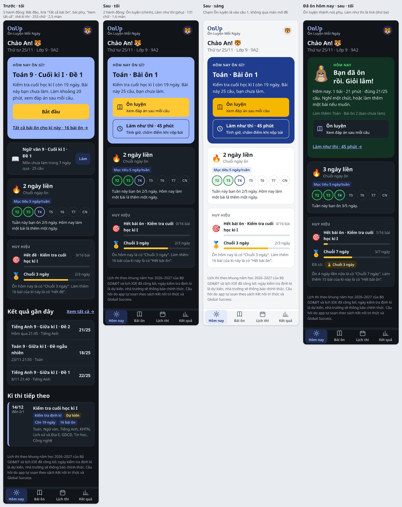

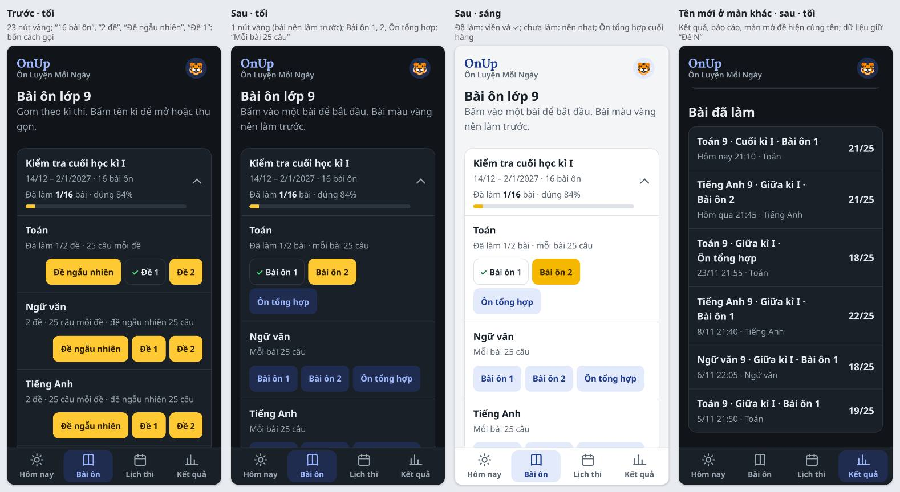

**Đo** (`main` `40771df`, bản lưu trên máy, 360 × 740). An lớp 9, ngày 25/11/2026 21:40: đã làm 5 đề giữa kì I, chưa làm đề nào của cuối kì I (còn 19 ngày). Cột “Sau” là đề xuất chèn vào trang như các ảnh khác của bản 4.x.

| | Trước | Sau |
|---|---|---|
| Hôm nay chưa ôn: hành động · chữ · màn | 5 · 253 · 2,5 | 2 · 131 · 1,6 |
| Hôm nay đã ôn: hành động · chữ · màn | 5 · 267 · 2,6 | 2 · 138 · 1,7 |
| Chạm từ “Xin chào!” tới câu 1 | 7 | 6 |
| Tab Bài ôn: nút vàng trong nhóm đang mở | 24 (23 khi đã làm một đề) | 1 |

Hành động là nút, link trong nội dung màn, không tính thanh trên, thanh tab. Màn là chiều cao trang chia 740, tính cả chú thích lịch thi cuối trang.

**X62. Hôm nay: phải bấm “Bắt đầu” rồi mới chọn cách làm (Vừa; mọi cấp).**
- Nút “Bắt đầu” (`#todayGo`) dẫn sang màn mở đề. Ở đó con đọc lại tên đề và lời dặn (đề Toán 9 cuối kì I: 114 chữ), rồi mới chọn Ôn luyện hay Làm như thi.
- Lời giới thiệu bài chính ghi “Làm khoảng 20 phút, xem đáp án sau mỗi câu.” cho mọi đề (X53). Đề 25 câu lớp 9 làm như thi là 45 phút.

**X63. Hôm nay có 5 hành động, con không biết bắt đầu từ đâu (Vừa; mọi cấp, nhất là Bin).**
- Ngoài “Bắt đầu” còn bốn hành động:
  - link “Tất cả bài ôn cho kì này · 16 bài ôn →” (`#toBanks`);
  - bài phụ “Môn chưa làm trong 7 ngày qua” có nút “Làm” (`#todayMore`);
  - “Xem tất cả →” của Kết quả gần đây (`#recent`);
  - thẻ Kì thi tiếp theo, bấm để mở (`#nextEvent`).
- Bài phụ kéo con sang môn khác khi chưa làm bài chính.
- Link, Kết quả gần đây và Kì thi tiếp theo trùng với tab Bài ôn, Kết quả, Lịch thi ngay dưới màn. Tên kì thi và số ngày còn lại đã có ở dòng đầu của thẻ.

**X64. Tab Bài ôn: mọi nút chưa làm đều vàng (Vừa; mọi cấp).**
- Nhóm cuối kì I lớp 9 có 24 nút vàng: “Đề ngẫu nhiên”, “Đề 1”, “Đề 2” của 8 môn. Trong `practiceList`, nút chưa làm và đề ngẫu nhiên đều là `btn main sm`.
- Vàng là màu của nút chính, nên cả màn là nút chính.

**X65. Bốn cách gọi một thứ (Vừa; mọi cấp).**
- Đầu nhóm ghi “16 bài ôn”. Dòng môn ghi “2 đề · 25 câu mỗi đề · đề ngẫu nhiên 25 câu”. Nút ghi “Đề ngẫu nhiên”, “Đề 1”. Huy hiệu ghi “Hết đề”.
- Con không biết “bài ôn” và “đề” có phải một không, “đề ngẫu nhiên” là gì, sao 16 bài ôn mà có 24 nút.

**Đề xuất**

*Hôm nay* (`renderToday`, `todayPicks`; khung R1, R2):
- **Thẻ bài chính, hôm nay chưa ôn** (`#today`, `.hero.today`):
  - nhãn “Hôm nay ôn gì?” giữ nguyên;
  - `h1` là tên ngắn: môn · chữ trên nút của bài đó ở tab Bài ôn. Ví dụ “Toán · Bài ôn 1”, “Toán · Ôn tổng hợp”. Bài ôn dạng trang giữ tên bài (“Ôn giữa kì I · Lớp 4”);
  - một dòng `p`: “<kì thi> còn N ngày.” (đang diễn ra: “<kì thi> đang diễn ra.”), rồi lí do:
    - chưa làm: “Bài này 25 câu, bạn chưa làm.”;
    - đúng dưới 90%: “Lần trước bạn đúng 64%, làm lại để lên điểm.”;
    - ôn tổng hợp: “Mỗi lần một bộ 25 câu khác, câu bạn hay sai được hỏi lại.”;
    - làm tốt cả kì: “Bạn đã làm tốt cả kì này, làm lại một bài để nhớ lâu hơn.”;
  - bỏ câu “Làm khoảng 20 phút, xem đáp án sau mỗi câu.” (X53): hai nút đã nói cách làm và số phút;
  - nhóm `div.go-modes` (`role="group"`, `aria-label` “Chọn cách làm”) thay cho `#todayGo`:
    - nút chính `a.btn.main.go#todayPractice`: biểu tượng sách như thẻ Ôn luyện của màn mở đề, dòng đậm “Ôn luyện”, dòng nhỏ “Xem đáp án sau mỗi câu”; tới `#/quiz/<mã>?cach=on-luyen`;
    - nút phụ `a.btn.ghost.go#todayExam`: biểu tượng đồng hồ, “Làm như thi · 45 phút” (số phút của đề), dòng nhỏ “Tính giờ, chấm điểm khi nộp bài”; tới `#/quiz/<mã>?cach=thi`. Đề không có số phút thì không có nút này;
    - `.btn.go`: căn trái, rộng hết thẻ, cao ≥ 60px, cách nhau 10px, dòng nhỏ 14px;
  - bỏ link `#toBanks`.
- **Bài chính là đề thi thử** (đề có `pts`): một nút chính `#todayGo` “Mở đề thi thử” tới màn mở đề như nay. Đề thi thử có lời dặn dài, làm 90–120 phút, nên con cần đọc cấu trúc đề trước khi bấm giờ. Tên ngắn: “Toán · Đề thi thử 1”.
- **Bài chính là bài ôn dạng trang:** một nút chính `#todayGo` “Vào ôn” tới `#/play/<mã>`; dòng `p` dùng `intro` như nay.
- **Đã ôn hôm nay** (`.hero.done`, X40):
  - đầu thẻ và dòng `#todayDone` giữ nguyên;
  - `.done-tip` thành “Làm thêm: <tên ngắn> (<ghi chú>).”, ví dụ “Làm thêm: Toán · Bài ôn 2 (bạn chưa làm).”;
  - `#todayPractice` là nút phụ: `btn ghost go`, nền `surface`, viền `line`, chữ `ink`, biểu tượng `acc`;
  - “Làm như thi · 45 phút →” là link (thứ ba): `a.linkbtn#todayExam`;
  - đề thi thử, bài ôn dạng trang: `#todayGo` là nút viền như nay (“Mở đề thi thử”, “Vào ôn”);
  - bỏ `#toBanks`.
- **Bỏ khỏi Hôm nay:**
  - bài phụ `#todayMore`, cả “Ôn 10 câu: <chủ đề>” của UX14. Lối vào Ôn 10 câu ở tab Kết quả và màn kết quả đề giữ nguyên;
  - Kết quả gần đây (`#recent`): có ở tab Kết quả;
  - Kì thi tiếp theo (`#nextEvent`): có ở tab Lịch thi; tiến độ kì đã có ở huy hiệu “Hết bài ôn”.
- **Giữ:** lời chào, dòng bài chưa gửi (bản đám mây), thông báo hồ sơ khóa, thẻ bài chính, chuỗi ngày ôn, huy hiệu, chú thích lịch thi cuối trang.
- `todayPicks` chỉ còn trả bài chính (bỏ phần bài phụ).

*Vào thẳng câu 1* (`route`, `renderQuiz`, `quizScreen`):
- `#/quiz/<mã>?cach=on-luyen` hoặc `?cach=thi`: vẽ màn mở đề rồi bắt đầu ngay lượt theo cách đó, như bấm thẻ cách làm. `cach=thi` mà đề không có số phút thì chỉ vẽ màn mở đề.
- Ngay sau khi bắt đầu, `history.replaceState` về `#/quiz/<mã>` và đặt `shownHash` theo. Nhờ vậy tải lại trang thì về màn mở đề, không tự làm lại; nút Back về Hôm nay, đang làm thì hỏi như nay.
- Đề chưa tải câu hỏi: màn tải đề, tải xong thì bắt đầu (`loadQuiz` gọi lại với cùng `cach`).
- Các lối vào khác (tab Bài ôn, chi tiết kì thi, Ôn 10 câu, bố mẹ xem thử) vẫn tới màn mở đề.

*Tab Bài ôn và các danh sách bài ôn* (`practiceList`, `practiceGroups`, `renderPractice`, `openEvent`; khung R3):
- Dòng dưới “Bài ôn lớp 9”: “Bấm vào một bài để bắt đầu. Bài màu vàng nên làm trước.” Dòng này thay “Gom theo kì thi. Bấm tên kì để mở hoặc thu gọn.”. “Bài ôn của <tên>” của bố mẹ giữ dòng của nó.
- **Một nút vàng.** Chỉ bài chính của Hôm nay (`todayPicks`) là `btn main sm`, `aria-label` thêm “, nên làm trước”. Chỉ khi học sinh xem: tab Bài ôn, chi tiết kì thi mở từ Lịch thi của học sinh. Còn lại:
  - bài chưa làm và Ôn tổng hợp: `btn sm` (nền `acc-soft`);
  - bài đã làm: `btn sm done` có ✓ như nay (X38).
- **Chữ trên nút** (`bankLabels`), ở kì kiểm tra định kì (Giữa kì I, Cuối kì I, Giữa kì II, Cuối năm):
  - “Đề N” → “Bài ôn N”; “Đề ngẫu nhiên” → “Ôn tổng hợp”;
  - nhóm “Bài ôn khác”: “Giữa kì I · Bài ôn 1”, “Giữa kì I · Ôn tổng hợp”;
  - đề thi thử (“Thi thử vào 10”, “Thi thử tốt nghiệp”) giữ “Đề N”: đó là đề thi, chấm như đề thật;
  - đề tự soạn giữ tên.
- **Thứ tự trong một kì** (`bankOrder`): Bài ôn 1, 2… trước, Ôn tổng hợp sau, đúng thứ tự gợi ý của `todayPicks` (bài chưa làm trước, ôn tổng hợp sau). Áp cho mọi màn dùng hàm này: tab Bài ôn, chi tiết kì thi, Sửa kì thi, Đề có sẵn của app. Trước đây đề ngẫu nhiên đứng đầu (Phiên K3, X51).
- **Dòng môn:**
  - “Mỗi bài 25 câu”; đã làm: “Đã làm 1/2 bài · mỗi bài 25 câu”;
  - các bài khác số câu: “2 bài”, “Đã làm 1/2 bài”; chỉ có Ôn tổng hợp: “Mỗi lần 25 câu”;
  - đề thi thử: “Mỗi đề 120 phút”, “Đã làm 2/10 đề · mỗi đề 120 phút”.
- **Đầu nhóm:** “… · 16 bài ôn” giữ nguyên. Nhóm chỉ có đề thi thử (mọi đề cố định của nhóm có `pts`) ghi “… · 16 đề thi thử” và dòng tiến độ “Đã làm 2/16 đề” (`progTxt` nhận chữ “bài” hay “đề”).
- **Ở 360px** nút của dòng môn căn trái dưới tên môn: `@media (max-width:520px){.subj .des{margin-left:0}}`. Dòng xuống hàng vẫn đọc từ trái sang: 1, 2, Ôn tổng hợp. Từ 521px giữ như nay (bên phải tên môn).

*Tên hiển thị ở mọi màn* (một hàm; dữ liệu không đổi):
- `Quiz.title(bank, lang)` (js/quiz.js) đổi cả tiếng Việt. Tên chuẩn “<môn> <khối> · <kì định kì> · Đề N” → “… · Bài ôn N”; “… · Đề ngẫu nhiên” → “… · Ôn tổng hợp”. Tiếng Anh: “Review N”, “Mixed review” (thay “Test N”, “Random test”). Kì thi thử, “Ôn chủ đề”, tên tự đặt giữ như nay.
- Dùng ở mọi chỗ hiện tên một đề có sẵn hoặc `label` của kết quả:
  - Hôm nay, màn mở đề, màn làm đề và màn kết quả (`Quiz.run`);
  - tab Kết quả; báo cáo tuần (bài đã làm, “Bài ôn chưa làm: …”, “Ôn tiếp “…””); tin nhắn báo cáo;
  - chi tiết kì thi; Sửa kì thi, Đề có sẵn của app, Ngân hàng đề (để bố mẹ thấy cùng tên với con); danh sách câu bị báo; thông báo; `aria-label`.
- Trong chữ hiện ra, “Bài ôn N” và “Ôn tổng hợp” không tách dòng (khoảng trắng không ngắt, như `nb()`). `aria-label`, dữ liệu lưu, `Quiz.text` giữ khoảng trắng thường.
- Ô tìm đề (`findKey`, `data-k`) ghi cả tên hiển thị và tên trong danh mục: “toan de 2” và “toan bai on 2” đều tìm được.
- Chữ ở bảng `TXT`:
  - `appRandom`: “Ôn tổng hợp” / “Mixed review”;
  - `appPoolIntro`: “Mỗi lần một bộ câu khác: 25 câu rút từ 100 câu của các bài ôn, ưu tiên câu bạn chưa làm hoặc hay sai” / “A new set every time: 25 questions from the 100 in the reviews, more of the ones you haven't done or often get wrong” (bỏ chữ “ma trận đề”).
- Huy hiệu “Hết đề · <kì thi>” → “Hết bài ôn · <kì thi>”, cả `#badgeHint`. Mã `exam:<mã kì thi>` giữ nguyên.
- Không đổi: tên trong `data/banks/index.js` và quy ước tên ở CLAUDE.md, `tests/kiem-tra-de.js` (các phiên làm đề vẫn đặt tên “Đề N”); `label` đã lưu; `refId`.

**Persona:**
- Bin: Hôm nay từ 5 xuống 2 hành động; tab Bài ôn chỉ một nút vàng, đúng bài mẹ thấy ở “Làm thêm”.
- An, Linh: tới câu 1 bớt một chạm. Đề thi thử vẫn qua màn mở đề nên không mất lời dặn.
- Bố mẹ: thấy cùng tên “Bài ôn 1” ở báo cáo tuần và trong tab của con.

**Xong khi:**
- Bước mới của `tests/e2e.js` (“today: choose a mode on the card, review names (UX22)”). 360 × 740 sáng và tối, ngày giả lập 25/11/2026 21:40. Học sinh lớp 9 (thêm trong bước như An của L47) đã làm vài đề giữa kì I.
  - Hôm nay:
    - `#today h1` là “Toán · Bài ôn 1”;
    - có `#todayPractice` (`.btn.main`) và `#todayExam` (không phải `.btn.main`);
    - không có `#todayGo`, `#toBanks`, `#todayMore`, `#recent`, `#nextEvent`, chữ “Làm khoảng 20 phút”;
    - trong `#view` đúng 2 nút, link.
  - Chạm `#todayPractice`: câu 1 hiện ngay (`#qzProg` “Câu 1/25”); địa chỉ là `#/quiz/<mã>`, không còn `?cach`. Tải lại trang thì là màn mở đề. Back thì hỏi rời bài; đồng ý thì về Hôm nay. Chạm `#todayExam`: đồng hồ “Còn 45:00”.
  - Làm xong một bài: thẻ `.hero.done`; `#todayPractice` không phải `.btn.main`; `#todayExam` là `.linkbtn`; `.done-tip` có “Bài ôn 2”.
  - Tab Bài ôn:
    - nhóm đang mở có đúng 1 `.btn.main`, đúng bài chính của Hôm nay;
    - nút đọc “Bài ôn 1”, “Bài ôn 2”, “Ôn tổng hợp”, Ôn tổng hợp cuối hàng;
    - nhóm kì định kì không có chữ “Đề ngẫu nhiên”, “Đề 1”; dòng môn “Mỗi bài 25 câu”;
    - nhóm thi vào 10 ghi “đề thi thử”, nút “Đề 1”.
  - Tab Kết quả và báo cáo tuần của bố mẹ ghi “… · Cuối kì I · Bài ôn 1”, “… · Giữa kì I · Ôn tổng hợp”; “Bài ôn 1” không tách dòng ở 360px.
  - Ngày 20/5/2027 (bài chính là đề thi thử vào 10): một nút “Mở đề thi thử” tới màn mở đề.
  - `audit` mọi màn của bước.
- Sửa các bước cũ đọc chữ, nút, thứ tự đã đổi: UX1 (bài phụ, `#recent`, `#nextEvent`, “Bắt đầu”), UX9 (thẻ kì thi ở Hôm nay sang tab Lịch thi, `#toBanks`, “Hết bài ôn”), UX10 (mở chi tiết kì thi từ tab Lịch thi), UX14 (bài phụ “Ôn 10 câu”), UX15 (bài phụ; Ôn tổng hợp cuối hàng), K3 (nút `.rnd` không còn vàng, cuối hàng), UX7, UX7b (thứ tự đề; tìm “toan de 2” vẫn ra), TA2 (tên “Review N”, “Mixed review”). Ảnh `tests/screenshots/ux22/`, bản ghép `<tên>.jpg`, chép sang `docs/hinh-ux22/`.
- `tests/supabase/cloud-e2e.js` in OK (sửa kiểm tra đọc chữ cũ); `node tests/kiem-tra-de.js` in DE OK.
- Sửa CLAUDE.md: các mục “Trang "Hôm nay" và thanh tab của học sinh”, “Con biết mình đã ôn đến đâu”, “Đề ngẫu nhiên” (tên hiển thị, thứ tự), “Ôn 10 câu theo chủ đề hay sai” (bỏ lối vào ở Hôm nay), “Quy ước code” (tên hiển thị qua `Quiz.title`). Sửa `docs/TINH-NANG.md` tương ứng.

### Phiên UX23 · Ôn theo chủ đề mỗi tuần; chọn cách ôn trước (X66–X68; chủ app yêu cầu 27/11/2026)

Chủ app ngày 27/11/2026: mỗi tuần con ôn theo chủ đề, có ngay năm nay, không đợi đến 2027; tab Bài ôn cho chọn ôn theo chủ đề hay làm đề như thi trước, thay vì chọn đề rồi mới chọn Ôn luyện hay Làm như thi. Quyết định ngày 24/10/2026 để ôn theo bài từ ngân hàng đến đợt rà sách 2027 nay bỏ (đoạn “Bài ôn dạng trang” ở đầu [KE-HOACH-PHAT-TRIEN-ONUP.md](KE-HOACH-PHAT-TRIEN-ONUP.md)); gộp bài ôn dạng trang vào ngân hàng vẫn để 2027.

PO viết vấn đề X66–X68 dưới đây (đo trên `main` `3ce8728`). Lượt PD (27/11/2026) chốt cách làm, vẽ khung ở Figma và chia phiên code làm hai: UX23a (tab Bài ôn, danh mục chủ đề, tên đề, lịch sử câu) và UX23b (Hôm nay, huy hiệu, báo cáo tuần). Hai phiên làm sau Phiên 9aa (IOE là phần tự chọn, L54 ở [SUA-LOI-CHAY-THU.md](SUA-LOI-CHAY-THU.md)), trước UX17 và UX16.

**X66. Không có chỗ ôn chủ đề vừa học trong tuần (Cao; mọi cấp, nhất là Bin).**
- Tab Bài ôn chỉ có đề 25 câu trộn mọi chủ đề của kì. Con chọn đề trước, rồi mới chọn Ôn luyện hay Làm như thi ở màn mở đề (ở Hôm nay thì chọn ngay, UX22).
- Lượt “Ôn chủ đề” 10 câu (UX14, `renderTopic`) đã có, nhưng chỉ mở từ chủ đề hay sai (tab Kết quả, màn kết quả đề). Con vừa học “Danh từ” trên lớp không có chỗ chọn chủ đề đó.
- Ôn theo bài học chỉ có ở hai bài ôn dạng trang giữa kì I lớp 4, 6 (“Ôn theo bài”), nay nằm ở nhóm “Bài ôn khác”.

**X67. Tiến độ, bài chính, huy hiệu, báo cáo chỉ đếm đề (Cao khi làm X66).**
- Lượt Ôn chủ đề lưu `refId` `chu-de:<khối>:<mã môn>:<chủ đề>`, không thuộc kì thi nào. `progressOf`, `todayPick`, `badges`, `badgePanel`, `weekTips` (“Bài ôn chưa làm”) không tính các lượt này.
- Con ôn hết chủ đề của kì vẫn thấy “Đã làm 0/13 bài”, Hôm nay vẫn gợi ý đề chưa làm, báo cáo tuần ghi “Bài ôn chưa làm: …”, không có huy hiệu “Hết bài ôn”.
- Dừng giữa lượt Ôn chủ đề cũng lưu kết quả (như X52). Tính lượt ôn vào tiến độ thì lượt làm dở phải không tính.

**X68. Làm đề như thi sau khi ôn chủ đề toàn câu đã gặp (Vừa; mọi cấp).**
- Lượt Ôn chủ đề rút câu từ chính các đề cố định và câu riêng của đề ngẫu nhiên. Đề cố định (Bài ôn 1, 2) làm sau đó toàn câu đã gặp.
- Ôn tổng hợp (đề ngẫu nhiên) ưu tiên câu chưa làm theo `poolHist`. Hàm này chỉ đọc `PoolHist` của chính đề đó và kết quả các đề cố định, không đọc `PoolHist` của các lượt Ôn chủ đề (ngược lại `topicHist` có đọc của đề ngẫu nhiên). Đề rút không biết câu nào con đã gặp khi ôn chủ đề.

**Số câu theo chủ đề** (câu chấm tự động, gộp mọi kì của khối, PO đếm ngày 27/11/2026; số liệu đủ ở đoạn “Quyết định còn hiệu lực” ở mục 7 của [KE-HOACH-NOI-DUNG.md](KE-HOACH-NOI-DUNG.md)):
- Lớp 4 cuối kì I: Tiếng Việt “Danh từ” 27 câu, “Động từ” 33, “Tính từ” 14; Toán 11/13 chủ đề đủ 10 câu; Tiếng Anh mỗi Unit 5–8 câu; Khoa học 3–10 câu mỗi chủ đề.
- Phạm vi cuối kì I của lớp 4, 5, 6, 9, 12: 195/439 chủ đề đủ 10 câu. Chủ đề ít câu thì lượt ôn ngắn hơn (ví dụ 6 câu) đến khi các phiên bổ sung (BS) thêm câu.
- Kì chỉ có đề thi thử: Toán 9 thi vào 10 toàn câu tự luận (không có chủ đề để ôn nhanh); Ngữ văn 9 thi vào 10 có 5 chủ đề, 40 câu chấm tự động; Toán 12 thi tốt nghiệp có 34 chủ đề, 220 câu.

**Lượt PD (27/11/2026).** PD dựng lại trạng thái thật trên `main` `6d12d9e` (bản lưu trên máy, 360 × 740, sáng và tối), chốt các điểm PO để PD chọn, chèn đề xuất vào trang thật để chụp ảnh và vẽ khung S1–S5 ở Figma: section [UX23](https://www.figma.com/design/9mkNYX0ZOczNDMwlKo5F4e/OnUp?node-id=421-658), sáng và tối. Phiên chia làm hai phiên code:
- **UX23a:** tab Bài ôn có hai bên, danh mục chủ đề, tên “Đề N”, “Đề trộn”, lượt dừng giữa chừng, lịch sử câu (X68);
- **UX23b:** Hôm nay, huy hiệu, thẻ kì thi, báo cáo tuần.

Yêu cầu của PO (chủ app gửi ngày 27/11/2026) nằm trong lịch sử git của file này. Dưới đây là đề xuất đã chốt.

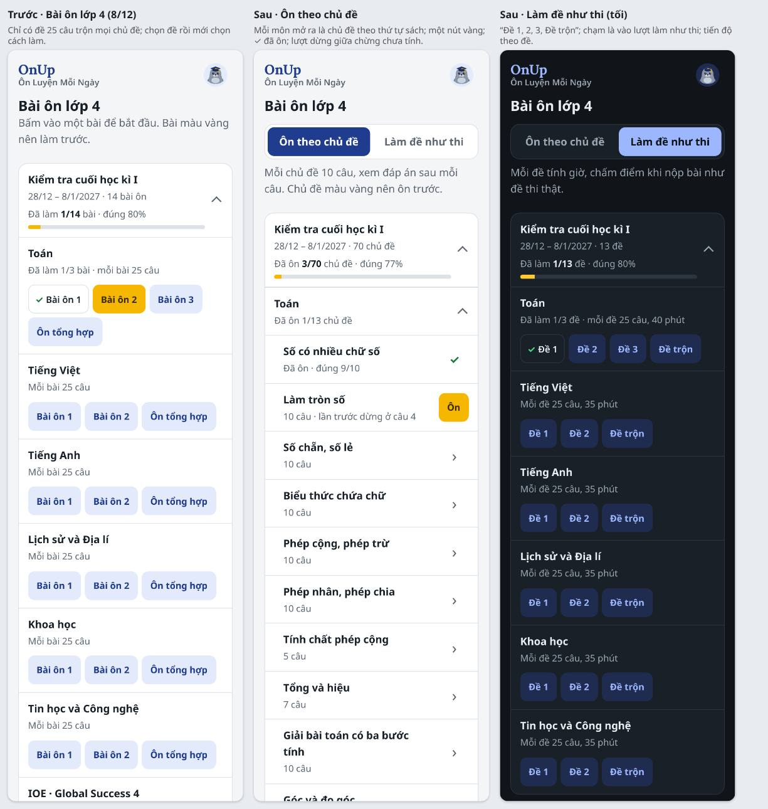

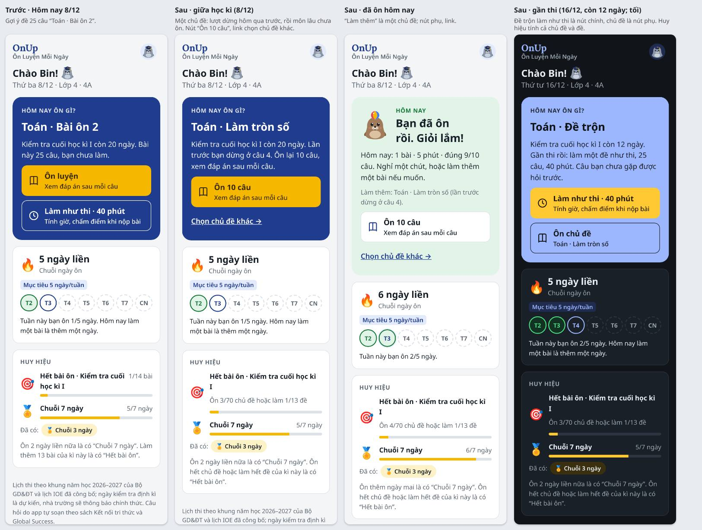

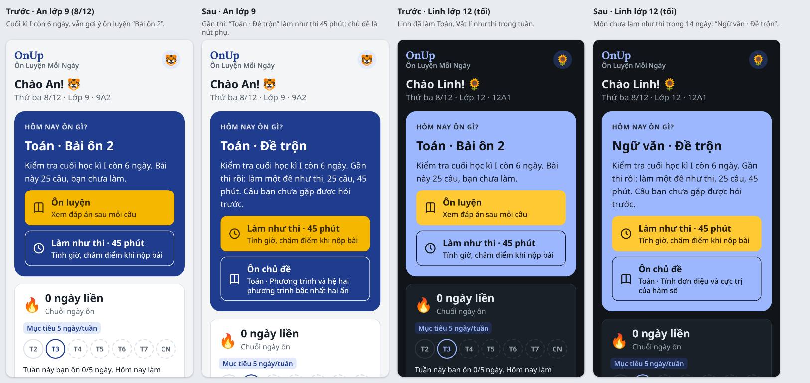

**Đo.** Bản đo là `main` `6d12d9e`, trước Phiên 9aa. Dữ liệu mẫu:
- Bin lớp 4, ngày 8/12/2026 19:30, cuối kì I còn 20 ngày. Bin đã ôn ba chủ đề (Tiếng Việt “Danh từ” 8/10, “Danh từ chung, danh từ riêng” 6/10, Toán “Số có nhiều chữ số” 9/10). Hôm qua Bin dừng “Làm tròn số” ở câu 4. Bin đã làm Toán · Bài ôn 1.
- Bin ngày 16/12/2026, cuối kì I còn 12 ngày.
- An lớp 9 và Linh lớp 12 ngày 8/12/2026, cuối kì I còn 6 ngày.

Cột “Sau” là đề xuất chèn vào trang thật.

| | Trước | Sau |
|---|---|---|
| Hôm nay giữa kì (Bin 8/12): hành động · chữ · màn | 2 · 138 · 1,7 | 2 · 151 · 1,8 |
| Hôm nay gần thi (Bin 16/12; An, Linh 8/12) | 2 · 133–138 · 1,7 | 2 · 159–162 · 1,8–1,9 |
| Tab Bài ôn (Bin 8/12): nút vàng · hành động · chữ · màn | 1 · 20 · 231 · 2,6 | Ôn theo chủ đề (Toán mở sẵn): 1 · 16 · 227 · 3,3. Làm đề như thi: 0 · 21 · 158 · 2,2 |
| Chạm từ “Xin chào!” tới câu 1 của chủ đề gợi ý | không có. Chủ đề hay sai: 8 chạm (hồ sơ, 4 số PIN, tab Kết quả, Ôn 10 câu, Ôn luyện) | 6 chạm (hồ sơ, 4 số PIN, Ôn 10 câu) |
| Chạm tới câu 1 của chủ đề khác | không có | 7–8 chạm (tab Bài ôn, mở môn nếu môn đó đang thu gọn, chủ đề) |
| Tải thêm để biết chủ đề và số câu | — | 0 KB. Danh mục có sẵn; tải file câu hỏi thì lớp 9 cuối kì I phải tải 8 file, 2,3 MB |

Hành động là nút, link trong nội dung màn. Không tính thanh trên, thanh tab, nút bật của `#pMode`. Danh sách chủ đề, đề để chọn là một nhóm. Màn là chiều cao trang chia 740, tính cả chú thích lịch thi cuối trang. Không màn nào cuộn ngang, có nút dưới 44px.

**Các điểm PO để PD chọn**

| Điểm | PD chọn | Lí do, persona |
|---|---|---|
| Chữ hai nút chọn cách ôn | Giữ “Ôn theo chủ đề” · “Làm đề như thi”. Dòng dưới đổi theo bên: “Mỗi chủ đề 10 câu, xem đáp án sau mỗi câu. Chủ đề màu vàng nên ôn trước.” · “Mỗi đề tính giờ, chấm điểm khi nộp bài như đề thi thật.” | Chữ nói đúng việc, hai nút vừa một hàng ở 360px (đo). Bin đọc dòng dưới là biết bấm vào đâu. |
| Dòng chủ đề | Cả dòng là link. Chữ đậm là tên chủ đề. Dòng nhỏ: “10 câu” (chủ đề ít câu ghi số thật: “5 câu”), “10 câu · lần trước dừng ở câu 4”, hoặc “Đã ôn · đúng 9/10”. Bên phải: dấu “›”, ✓ khi đã ôn, nút vàng nhỏ “Ôn” khi là chủ đề gợi ý. Không ghi chữ “ít câu”. | Bin chạm cả dòng, không phải tìm nút. Số câu thật nên con không bất ngờ khi lượt ngắn. Chữ “ít câu” không giúp con chọn chủ đề. |
| Tên đề rút ngẫu nhiên | “Đề trộn”, tiếng Anh “Mixed test”. Dòng môn và Hôm nay nói thêm: “Câu bạn chưa gặp được hỏi trước.” | Ở trường, “đề trộn” là chữ quen. Chữ ngắn, vừa nút. “Ôn tổng hợp” không hợp ở bên làm như thi. |
| Số ngày “gần thi” | 14 ngày trước ngày đầu kì, đến hết kì | Trùng mốc “Sắp thi” của báo cáo tuần (`weekTips`). An, Linh còn 6 ngày, Bin còn 12 ngày: cả ba được gợi ý đề. |
| Đề gợi ý khi gần thi | Đề trộn của môn đầu tiên (theo ô “Môn thi” của kì) chưa có lượt làm như thi trong 14 ngày. Môn không có đề trộn thì lấy đề cố định chưa làm đầu tiên. Mọi môn đã làm như thi thì lấy môn có lượt làm như thi gần nhất đúng thấp nhất. | Đề trộn hỏi câu chưa gặp trước (X68). Linh đã làm Toán, Vật lí như thi thì được gợi ý Ngữ văn. |
| Chủ đề gợi ý (khác yêu cầu của PO, chủ app quyết) | Lượt dừng giữa chừng trong 7 ngày đứng trước. Rồi môn lâu chưa ôn chủ đề nhất (môn chưa ôn lần nào theo thứ tự môn của kì). Trong môn đó lấy theo thứ tự của PO: chủ đề chưa ôn đầu tiên theo thứ tự sách, rồi chủ đề có lượt gần nhất đúng dưới 80%, rồi chủ đề lâu chưa ôn nhất. | Theo đúng thứ tự của PO thì Bin ôn hết 13 chủ đề Toán rồi mới tới Tiếng Việt. Xoay vòng môn thì mỗi tuần Bin gặp nhiều môn. Lượt dừng hôm qua nên làm nốt trước. |
| Chữ tiến độ | Mỗi bên một dòng: “Đã ôn 3/70 chủ đề · đúng 77%” và “Đã làm 1/13 đề · đúng 80%”. Thẻ kì thi ở Lịch thi, chi tiết kì thi: “Đã ôn 3/70 chủ đề · làm 1/13 đề”. Huy hiệu: dòng nhỏ “Ôn 3/70 chủ đề hoặc làm 1/13 đề”, thanh theo phần nhiều hơn. | Mỗi bên đếm đúng thứ của nó. Bố mẹ thấy cả hai số ở một dòng. |
| Đếm số câu chủ đề | Ghi vào danh mục: `window.ONTAP_SEED_TOPICS` cuối `data/banks/index.js` (chi tiết ở UX23a). `tests/ghep-de.js` ghi, `tests/kiem-tra-de.js` kiểm. | Muốn đếm lúc xem thì lớp 9 cuối kì I phải tải 2,3 MB. Danh mục đã nằm trong đệm, nên vẽ được cả khi mất mạng. Hôm nay biết ngay chủ đề “Viết” không có câu chấm tự động. Danh mục nặng thêm khoảng 60 KB (nay 334 KB). |
| Màn dùng chung | “Bài ôn của <tên>” (bố mẹ) có cùng hai bên: không có nút vàng, chạm là xem thử (màn mở đề). Chi tiết kì thi mở từ Lịch thi của học sinh: dòng tiến độ và một nút `#evPractice` “Ôn cho kì này” tới `#/practice?ki=<mã kì thi>`. Bố mẹ, quản trị xem chi tiết kì thi thì giữ danh sách đề như nay. | Chi tiết kì thi nằm trong thẻ lịch, đã có nút “Thêm vào lịch điện thoại”. Thêm hai bên ở đó là quá ba hành động. |
| Kì chỉ có đề thi thử | Bên Ôn theo chủ đề lấy chủ đề có trong các đề của kì (cột thứ ba của danh mục). Môn không có câu chấm tự động (Toán 9 thi vào 10) không có dòng; cuối nhóm ghi “Toán chỉ có ở Làm đề như thi.”. Hôm nay: xa thi thì gợi ý chủ đề của kì đó, gần thi thì như UX22 (“Mở đề thi thử”). | An, Linh ôn chủ đề yếu từ tháng 3, đến tháng 5 làm đề thi thử. |
| Tách phiên | UX23a trước 3/12/2026, UX23b trước 6/12/2026 | Mỗi phiên sửa nhiều bước kiểm thử cũ. Sau UX23a, Hôm nay vẫn gợi ý đề như UX22 (tên “Toán · Đề 2”). Như vậy vẫn đúng, chỉ chưa gợi ý chủ đề. |

**Đề xuất · UX23a (tab Bài ôn, danh mục chủ đề, tên đề, lượt dừng giữa chừng, lịch sử câu)**

*Danh mục chủ đề* (`data/banks/index.js`, `tests/ghep-de.js`, `tests/kiem-tra-de.js`):
- Cuối file, sau `ONTAP_SEED_BANKS`, có thêm khối do công cụ ghi:
  ```
  window.ONTAP_SEED_TOPICS = { "4-toan.js": [["Số có nhiều chữ số", 31, "gk1 ck1"], …], … };
  ```
  Đầu khối có lời chú thích “do tests/ghep-de.js ghi, không sửa tay”.
- Mỗi file câu hỏi là một danh sách chủ đề theo thứ tự gặp (đề trong danh mục, câu trong đề). Mỗi mục có ba phần:
  - chữ `topic`, đã gộp khoảng trắng như `topicKey`;
  - số câu chấm tự động không trùng (`Quiz.key`) mà `Quiz.topicBank` rút được (đề ngẫu nhiên chỉ góp câu riêng);
  - mã các kì có câu của chủ đề (`gk1`, `ck1`, `gk2`, `ck2`, `vao10`, `tn`, lấy từ mã đề).
- Chủ đề toàn câu tự luận (Viết) không có trong danh sách.
- Khối nặng khoảng 60 KB (đo bằng bản thử, 56 file, 1 252 chủ đề).
- `tests/ghep-de.js` ghi lại khối mỗi lần ghép. Lệnh `node tests/ghep-de.js --chu-de` chỉ ghi lại khối.
- `tests/kiem-tra-de.js` báo lỗi khi khối khác với số đếm lại (như `Quiz.topicBank`), và khi một chủ đề trong `pool.matrix` không có trong danh sách của file đó mà có câu chấm tự động.
- `sw.js` không đổi (`data/banks/index.js` đã có trong `FILES`).

*Chủ đề của một kì* (`topicsOf(e, grade)` trong js/app.js):
- Kết quả là mỗi môn một mục `{ subject, file, code, list: [{ t, n, ref, href }] }`. Môn theo thứ tự của `examItems` (ô “Môn thi” của kì, rồi lịch thi của khối).
- Môn có đề ngẫu nhiên trong kì: chủ đề theo thứ tự `pool.matrix`, chỉ những chủ đề có trong danh mục.
- Môn không có đề ngẫu nhiên: chủ đề trong danh mục của file có mã kì của kì đó, theo thứ tự trong danh mục.
- `n` = min(`Quiz.TOPIC_N`, số câu). `ref` = `topicRef`. `href` = `topicHref`.

*Trạng thái một chủ đề* (`topicState(results, ref)`):
- `full`: kết quả gần nhất có `refId` = `ref` mà `mode` không phải `"part"` và không phải `"self"`.
- `part`: kết quả gần nhất có `mode: "part"`, chỉ khi nó mới hơn `full`.
- Đã ôn = có `full`, lúc nào trong năm học cũng được. Chủ đề có ở hai kì thì tính cho cả hai, vì cùng `refId`.
- Kết quả “Ôn chủ đề” lưu trước UX23 không phân biệt được lượt dừng giữa chừng, nên tính là đã ôn.

*Lượt dừng giữa chừng* (`quizScreen`, chỉ lượt “Ôn chủ đề”):
- Lượt ôn luyện kết thúc khi `res.t` nhỏ hơn số câu của lượt: `onFinish` lưu `mode: "part"`. Cột `mode` của máy chủ nhận chuỗi tới 20 kí tự, nên không đổi bảng, SQL.
- Lượt dừng vẫn tính vào số bài hôm nay, chuỗi ngày, điểm (như nay). Nó không tính là đã ôn chủ đề.
- `Quiz.TXT`: thêm `appPrevMode.part` “dừng giữa chừng” / “stopped early”. Dòng bài ở tab Kết quả, báo cáo tuần ghi “ · dừng giữa chừng”.
- Phiên UX16 dùng lại cách đánh dấu này cho đề cố định.

*Tab Bài ôn* (`renderPractice`, `practiceGroups`, `practiceList`; khung S1, S2):
- Dưới “Bài ôn lớp 4” là nhóm nút bật `div.tabs#pMode` (`role="group"`, `aria-label` “Cách ôn”), dùng lớp `.tabs` có sẵn:
  - `button[data-cach="chu-de"]` “Ôn theo chủ đề”, mặc định;
  - `button[data-cach="thi"]` “Làm đề như thi”;
  - `aria-pressed` theo bên đang chọn.
- Dưới nhóm nút là dòng `p.muted#pModeTxt` theo bên (chữ ở bảng trên).
- Bên đang chọn:
  - `?cach=chu-de` hoặc `?cach=thi` mở sẵn một bên;
  - không có thì lấy lựa chọn gần nhất ở localStorage khóa `ontap_cach_v1` (`{ <mã học sinh>: "chu-de" | "thi" }`, bọc try/catch);
  - chưa có thì “chu-de”.
- Đổi bên thì vẽ lại `#allPractice`, giữ nhóm kì thi đang mở. Không đổi hash.
- `?ki=<mã kì thi>` vẫn mở sẵn và cuộn tới nhóm đó.
- **Bên Ôn theo chủ đề:**
  - Nhóm theo kì (`details.grp`) như nay, kì gần nhất mở sẵn (sau 9aa: kì thường, IOE cuối, “Tự chọn”).
  - Dòng tóm tắt: “28/12 – 8/1/2027 · 70 chủ đề”, rồi `progBox`: “Đã ôn **3/70** chủ đề · đúng 77%” (tỉ lệ câu đúng của lượt làm hết gần nhất của mỗi chủ đề đã ôn).
  - Trong `.list`:
    - dòng bài ôn dạng trang thường như nay;
    - mỗi môn một `details.tsub` (lớp mới). `summary` có tên môn đậm và dòng nhỏ “13 chủ đề” hoặc “Đã ôn 1/13 chủ đề”, cao ≥ 52px, chữ V xoay như `.grp>summary`. Chỉ môn có chủ đề gợi ý mở sẵn;
    - mỗi chủ đề một `a.item.trow` (lớp mới; lề trái 28px, cao ≥ 56px). Học sinh: tới `href + "?cach=on-luyen"`. Bố mẹ: tới `href` (màn mở đề, xem thử). Có `aria-label` “Làm tròn số, 10 câu, lần trước dừng ở câu 4, nên ôn trước”;
    - dòng nhỏ của chủ đề: có `full` thì “Đã ôn · đúng 9/10” (theo `full`, kể cả khi có lượt dừng mới hơn); chỉ có `part` thì “10 câu · lần trước dừng ở câu 4” (4 là số câu đã làm, `part.t`); chưa có gì thì “10 câu”;
    - bên phải dòng chủ đề: `span.chev` “›” (`muted`); đã ôn thì `span.done-ic` ✓; chủ đề gợi ý thì `span.btn.main.sm` “Ôn” (`aria-hidden`, cả dòng là link). Ô bên phải rộng 44px;
    - dòng bài ôn IOE cuối nhóm như 9aa.
  - Kì chỉ có đề thi thử, môn không có chủ đề: dòng `p.small.muted` cuối nhóm “Toán chỉ có ở Làm đề như thi.”.
  - Nhóm cuối “Chủ đề khác” (thu gọn): chủ đề của khối không thuộc kì nào đang hiện, theo môn, kèm bài ôn dạng trang không thuộc kì nào.
  - Một nút vàng: chủ đề gợi ý của Hôm nay (UX23b). Ở UX23a chưa có chủ đề gợi ý, nên bên này chưa có nút vàng.
- **Bên Làm đề như thi:**
  - Nhóm theo kì, chỉ có đề (không có bài ôn dạng trang, IOE).
  - Tóm tắt: “28/12 – 8/1/2027 · 13 đề”, rồi “Đã làm **1/13** đề · đúng 80%” (`progressOf` như nay, chỉ đề cố định).
  - Dòng môn: “Mỗi đề 25 câu, 40 phút”, đã làm “Đã làm 1/3 đề · mỗi đề 25 câu, 40 phút”. Các đề khác số câu, số phút thì ghi “3 đề”. Đề thi thử như UX22 (“Mỗi đề 120 phút”).
  - Nút theo `bankOrder`: “Đề 1”, “Đề 2”, “Đề 3”, rồi “Đề trộn” (`.rnd`) cuối hàng. Đề đã làm là `btn sm done` có ✓, như nay.
  - Học sinh chạm đề có số phút, không phải đề thi thử: tới `#/quiz/<mã>?cach=thi` (vào thẳng lượt làm như thi, UX22). Đề thi thử, đề không có số phút, bố mẹ xem thử: tới `#/quiz/<mã>` (màn mở đề).
  - Nhóm cuối “Đề khác”: đề của kì đã qua, đề chưa gắn kì, như “Bài ôn khác” nay, nút ghi kèm tên kì (“Giữa kì I · Đề 1”).
  - Nút vàng: bài chính của Hôm nay khi bài đó là đề.
- Ở 360px: hai nút của `#pMode` một hàng, mỗi nút ≥ 44px; dòng chủ đề dài (“Đường thẳng vuông góc, song song”) xuống dòng trong ô, không đè ô bên phải.

*Tên hiển thị* (`Quiz.title`, `bankLabels`, `TXT`; dữ liệu không đổi):
- Kì kiểm tra định kì:
  - “· Đề N” hiện là “· Đề N” (bỏ “Bài ôn N” của UX22);
  - “· Đề ngẫu nhiên” hiện là “· Đề trộn”;
  - tiếng Anh: “Test N”, “Mixed test”.
- Đề thi thử, “Ôn chủ đề”, tên tự đặt giữ như nay. “Đề trộn” và “Đề N” không tách dòng (`nb()`).
- `TXT.appRandom`: “Đề trộn” / “Mixed test”.
- `TXT.appPoolIntro`: “Mỗi lần một đề khác: 25 câu rút từ 100 câu của các đề, câu bạn chưa gặp đứng trước” / “A new test every time: 25 questions from the 100 in the tests, ones you haven't seen first”.
- Ô tìm đề (`bankKeys`) ghi tên trong danh mục và tên hiển thị: “toan de tron”, “toan de ngau nhien” đều ra.
- Huy hiệu vẫn tên “Hết bài ôn”. Tab vẫn tên “Bài ôn”.

*Vào thẳng câu 1 của một chủ đề* (`route`, `renderTopic(u, g, code, enc, cach)`):
- `#/chu-de/<khối>/<mã môn>/<chủ đề>?cach=on-luyen` vẽ màn mở đề rồi bắt đầu ngay lượt ôn luyện, như `?cach=` của UX22.
- Ngay sau đó `history.replaceState` về địa chỉ không có `?cach`. Tải lại trang thì là màn mở đề.
- Chủ đề chưa tải câu hỏi: màn tải đề, tải xong thì bắt đầu.

*Lịch sử câu (X68)* (`poolHist`, `PoolHist`):
- `poolHist(u, b)` cộng thêm `PoolHist` của mọi đề “Ôn chủ đề” cùng khối, môn (mã bắt đầu bằng `chu-de:<khối>:<mã môn>:`), theo `Quiz.key`. Cách này như `topicHist` đọc `PoolHist` của đề ngẫu nhiên.
- `PoolHist` thêm hàm liệt kê mã đề có lịch sử của một học sinh theo tiền tố (`PoolHist.ids(uid, prefix)`).
- Nhờ vậy Đề trộn hỏi trước câu con chưa gặp khi ôn chủ đề.

*Chi tiết kì thi* (`openEvent`):
- Học sinh: thay danh sách bài ôn bằng dòng tiến độ “Đã ôn 3/70 chủ đề · làm 1/13 đề” (`progBoth`, dùng chung với UX23b) và nút `a.btn.sm#evPractice` “Ôn cho kì này” tới `#/practice?ki=<mã kì thi>`.
- Bố mẹ, quản trị: danh sách đề như nay, tên mới.
- Nút “Thêm vào lịch điện thoại” giữ nguyên.

*“Bài ôn của <tên>”* (`renderChildPractice`): cùng `#pMode` và hai bên, không nút vàng, chạm là xem thử. Lựa chọn bên của bố mẹ nhớ theo mã của con xem.

**Đề xuất · UX23b (Hôm nay, huy hiệu, thẻ kì thi, báo cáo tuần)**

*Bài chính* (`todayPick(s, results)` → `{ ev, main }`; `main.kind` thêm `"topic"`):
- Kì: `practiceEvent(s)` như nay (sau 9aa không có kì IOE).
- **Gần thi** (`near`: kì đang diễn ra, hoặc còn ≤ 14 ngày):
  - bài chính là đề (`kind: "bank"`), chọn như ở bảng trên;
  - kì chỉ có đề thi thử thì như UX22 (`kind: "mock"`).
- **Không gần thi:** bài chính là chủ đề (`kind: "topic"`), chọn như ở bảng trên.
- Kì không có chủ đề nào (khối chỉ có đề tự soạn): như UX22.
- Bài ôn dạng trang không lên thẻ, trừ khi kì chỉ có bài ôn dạng trang.

*Thẻ “Hôm nay ôn gì?”* (`renderToday`, `goModes`; khung S3, S4; một chính, một phụ, một thứ ba):
- **Chủ đề:**
  - `h1`: “<môn> · <chủ đề>”, ví dụ “Toán · Làm tròn số”.
  - `p`: “<kì thi> còn N ngày.” (đang diễn ra: “<kì thi> đang diễn ra.”), rồi một lí do:
    - dừng giữa chừng: “Lần trước bạn dừng ở câu 4. Ôn lại 10 câu, xem đáp án sau mỗi câu.”;
    - chưa ôn: “10 câu, bạn chưa ôn chủ đề này.”;
    - đúng dưới 80%: “Lần trước bạn đúng 6/10, ôn lại để chắc hơn.”;
    - lâu nhất: “Bạn ôn chủ đề này lâu nhất rồi, ôn lại để nhớ lâu.”.
  - Trong `div.go-modes` (`aria-label` “Bắt đầu ôn”):
    - nút chính `a.btn.main.go#todayTopic`: biểu tượng sách, “Ôn 10 câu” (chủ đề ít câu: “Ôn 5 câu”), dòng nhỏ “Xem đáp án sau mỗi câu”; tới `href + "?cach=on-luyen"`;
    - link thứ ba `a.linkbtn#todayOther` “Chọn chủ đề khác →” tới `#/practice?cach=chu-de`. Trong thẻ xanh, link màu `on-acc`.
- **Gần thi, đề:**
  - `h1`: “Toán · Đề trộn” (đề cố định: “Toán · Đề 2”).
  - `p`: “<kì thi> còn 12 ngày. Gần thi rồi: làm một đề như thi, 25 câu, 40 phút. Câu bạn chưa gặp được hỏi trước.” Đề cố định thì bỏ câu cuối.
  - Nút chính `a.btn.main.go#todayExam`: đồng hồ, “Làm như thi · 40 phút”, dòng nhỏ “Tính giờ, chấm điểm khi nộp bài”; tới `?cach=thi`.
  - Nút phụ `a.btn.ghost.go#todayTopic`: sách, “Ôn chủ đề”, dòng nhỏ “<môn> · <chủ đề>”; tới chủ đề gợi ý (như không gần thi).
- **Đã ôn hôm nay** (`.hero.done`; khung S5):
  - `.done-tip`: “Làm thêm: Toán · Làm tròn số (lần trước dừng ở câu 4).”. Ghi chú khác: “bạn chưa ôn”, “lần trước đúng 6/10”, “ôn lâu nhất rồi”.
  - `#todayTopic` là nút phụ (`btn ghost go`), “Ôn 10 câu”.
  - `#todayOther` là link.
  - Gần thi: “Làm thêm: Toán · Đề trộn (gần thi).”; `#todayExam` là nút phụ, `#todayTopic` là link “Ôn chủ đề: Toán · Làm tròn số →”.
- Bỏ `#todayPractice` (Ôn luyện một đề) ở Hôm nay. Ôn luyện một đề vẫn có ở màn mở đề.

*Tab Bài ôn:* nút vàng là bài chính. Chủ đề gợi ý có `span.btn.main.sm` “Ôn” ở bên Ôn theo chủ đề; đề gợi ý là nút vàng ở bên Làm đề như thi. Nhóm môn chứa chủ đề gợi ý mở sẵn.

*Tiến độ, huy hiệu* (`progressOf` giữ cho đề; thêm `topicProgress(e, s, results)` → `{ done, total, p }`, `progBoth`):
- Thẻ kì thi (`.ready`, Lịch thi của con, báo cáo tuần), chi tiết kì thi: “Đã ôn 3/70 chủ đề · làm 1/13 đề”. Bên nào là 0 thì bỏ bên đó. Cả hai là 0 thì không có dòng. Ôn hết hoặc làm hết thì `.good`.
- Huy hiệu `exam:<mã kì thi>` (`badges`): đạt khi ôn hết chủ đề của kì hoặc làm hết đề của kì. Con đã có huy hiệu vẫn giữ (`ontap_badges_v1` như nay). Tên “Hết bài ôn · <kì>”.
- Mục tiêu ở `badgePanel`:
  - tên “Hết bài ôn · <kì>”;
  - bỏ số bên phải, thay bằng dòng nhỏ `span.small.muted.bdg-sub` “Ôn 3/70 chủ đề hoặc làm 1/13 đề”;
  - thanh theo phần lớn hơn của hai tỉ lệ.
- `#badgeHint`: “Ôn hết chủ đề hoặc làm hết đề của kì này là có “Hết bài ôn”.”.
- Kì chỉ có đề thi thử, không có chủ đề: như nay (“2/16 đề”).

*Báo cáo tuần, tin nhắn, thẻ của con* (`weekTips`, `reportMsg`, `kidCard`):
- Gợi ý `k: "later"` “Bài ôn chưa làm: …” đổi thành “Chủ đề chưa ôn của <kì>: Toán · Làm tròn số; Tiếng Anh · Unit 1 · My Friends; Tiếng Việt · Đọc hiểu và 64 chủ đề khác.”:
  - tối đa 3 tên theo thứ tự gợi ý của Hôm nay, ngăn bằng “; ”;
  - tin nhắn dùng cùng câu, cắt theo `MSG_MAX`.
- Kết quả Ôn chủ đề đã có trong báo cáo: giữ nguyên, lượt dừng ghi “ · dừng giữa chừng”.
- Thẻ của con: “chưa ôn <môn>” tính như nay (đã tính lượt Ôn chủ đề).

**Persona:**
- Bin: mỗi tối Hôm nay gợi ý một chủ đề 10 câu (khoảng 5 phút), xoay qua các môn. Tuần học “Danh từ” trên lớp thì chọn được đúng “Danh từ” ở tab Bài ôn. Mẹ thấy “Đã ôn 3/70 chủ đề” và “Chủ đề chưa ôn: …” trong báo cáo tuần.
- An, Linh: ôn chủ đề yếu trong tuần; hai tuần trước kì thi, Hôm nay chuyển sang một đề trộn làm như thi mỗi ngày, mỗi môn một lần.
- Bố mẹ: tiến độ đúng với việc con làm. Lượt dừng giữa chừng không được tính là đã ôn.

**Xong khi (UX23a):**
- `node tests/kiem-tra-de.js` in `DE OK`:
  - khối `ONTAP_SEED_TOPICS` khớp số đếm lại;
  - tự thử với một khối cố ý sai số câu (phải báo lỗi).
- `node tests/ghep-de.js --chu-de` không đổi file.
- Bước mới của `tests/e2e.js` (“practice tab: by topic or exam-style tests (UX23a)”), 360 × 740 sáng và tối:
  - **Dữ liệu:** Bin lớp 4 ngày 8/12/2026 19:30, kết quả như ở phần Đo. Lượt “Làm tròn số” lưu `mode: "part"`, `t` 4.
  - **Bên Ôn theo chủ đề:**
    - `#pMode` có hai nút, “Ôn theo chủ đề” đang bật;
    - nhóm cuối kì I mở, ghi “70 chủ đề” và “Đã ôn 3/70 chủ đề”;
    - môn Toán có 13 dòng theo thứ tự `pool.matrix`;
    - “Làm tròn số” ghi “10 câu · lần trước dừng ở câu 4”, không có ✓;
    - “Số có nhiều chữ số” có ✓ và “Đã ôn · đúng 9/10”;
    - “Tính chất phép cộng” ghi “5 câu”;
    - Tiếng Việt không có dòng “Viết”.
  - **Chạm “Danh từ”:** “Câu 1/10” hiện ngay; địa chỉ là `#/chu-de/4/tv/<chủ đề>`, không có `?cach`; tải lại trang thì là màn mở đề.
  - **Làm 3 câu rồi “← Thoát”, Dừng:** kết quả có `mode: "part"`; dòng “Danh từ” vẫn ✓ (lượt cũ làm hết), ghi “Đã ôn · đúng 8/10”.
  - **Bên Làm đề như thi:**
    - nút “Đề 1” có ✓, rồi “Đề 2”, “Đề 3”, “Đề trộn” (cuối hàng), không có chữ “Bài ôn 1”, “Ôn tổng hợp”;
    - nhóm ghi “13 đề”, “Đã làm 1/13 đề”;
    - chạm “Đề 2” thì “Còn 40:00” hiện ngay.
  - **Nhớ bên:** tải lại `#/practice` vẫn là bên Làm đề như thi; `#/practice?cach=chu-de` mở bên chủ đề.
  - **Đề trộn (X68):** ôn hết 10 câu “Danh từ” rồi mở “Tiếng Việt 4 · Cuối kì I · Đề trộn”. Nếu kho còn câu “Danh từ” chưa gặp thì câu “Danh từ” rút được không có câu nào trong 10 câu vừa ôn (`Quiz.key`).
  - **Chi tiết kì thi** mở từ Lịch thi của Bin có `#evPractice` và dòng “Đã ôn … chủ đề · làm … đề”.
  - **“Bài ôn của Bin”** (Mẹ Bin xem) có `#pMode`, không có `.btn.main`, link chủ đề không có `?cach`.
  - **An ngày 20/5/2027** (thi vào 10): bên chủ đề có Ngữ văn, có dòng “Toán chỉ có ở Làm đề như thi.”.
  - `audit` mọi màn của bước.
  - Ảnh ở `tests/screenshots/ux23a/`, bản ghép `<tên>.jpg`, chép sang `docs/hinh-ux23/`.
- Sửa các bước cũ đọc tab Bài ôn, tên đề:
  - UX7, UX7b: thứ tự đề, tìm “toan de 2”;
  - UX9: nút đề đã làm, dòng môn, nhóm kì thi;
  - UX15: thứ tự nhóm;
  - UX22: tab Bài ôn, “Bài ôn 1”, “Ôn tổng hợp”;
  - K3: nút `.rnd` “Đề trộn”;
  - TA2: “Test N”, “Mixed test”;
  - UX14: dòng chủ đề, lượt dừng;
  - L54: nhóm IOE ở bên chủ đề.
- `tests/supabase/cloud-e2e.js` in OK. Sửa các kiểm tra “UX1”, “L18”, “K3”, “TA2”, “UX7b (X34)” đọc tên, thứ tự.

**Xong khi (UX23b):**
- Bước mới của `tests/e2e.js` (“today: a topic, an exam-style test near the exam (UX23b)”), 360 × 740 sáng và tối, dữ liệu như UX23a:
  - **Bin 8/12 19:30:**
    - `#today h1` là “Toán · Làm tròn số”;
    - có `#todayTopic` (`.btn.main`) và `#todayOther` (`.linkbtn`), đúng 2 hành động, không có `#todayPractice`;
    - chạm `#todayTopic` thì “Câu 1/10”;
    - tab Bài ôn: dòng “Làm tròn số” có `.btn.main` “Ôn”, nhóm Toán mở sẵn, đúng 1 `.btn.main`.
  - **Bin làm xong một chủ đề:** thẻ `.hero.done`, `.done-tip` có “Làm thêm:”, `#todayTopic` không phải `.btn.main`.
  - **Bin 16/12:**
    - `#today h1` là “Toán · Đề trộn”;
    - `#todayExam` là `.btn.main`, `#todayTopic` là nút phụ;
    - chạm `#todayExam` thì “Còn 40:00”.
  - **An, Linh 8/12:** bài chính là đề trộn của môn chưa làm như thi trong 14 ngày (Linh: Ngữ văn).
  - **An 20/5/2027:** một nút “Mở đề thi thử”.
  - **Huy hiệu:**
    - dòng `.bdg-sub` “Ôn 3/70 chủ đề hoặc làm 1/13 đề”;
    - ghi kết quả làm hết cho mọi chủ đề của kì thì có huy hiệu “Hết bài ôn · Kiểm tra cuối học kì I”, kể cả khi chưa làm đề nào.
  - **Lịch thi:** thẻ kì thi `.ready` ghi “Đã ôn 3/70 chủ đề · làm 1/13 đề”.
  - **Báo cáo tuần** của Mẹ Bin và `#rpMsgText` có “Chủ đề chưa ôn của Kiểm tra cuối học kì I: Toán · Làm tròn số”.
  - `audit` mọi màn của bước.
  - Ảnh `tests/screenshots/ux23b/`, chép sang `docs/hinh-ux23/`.
- Sửa các bước cũ đọc thẻ Hôm nay, bài chính, huy hiệu, gợi ý tuần: UX1, UX9, UX10, UX14, UX15, UX22, L47, L54, UX8 (gợi ý trong tin nhắn).
- `tests/supabase/cloud-e2e.js` in OK.

### Phiên UX17 · Màn mở đề gọn, nhãn câu giữ đúng chữ (X54, X55)

Sửa `js/app.js`, `js/quiz.js`, `css/app.css`; cả hai bản; không đổi dữ liệu.

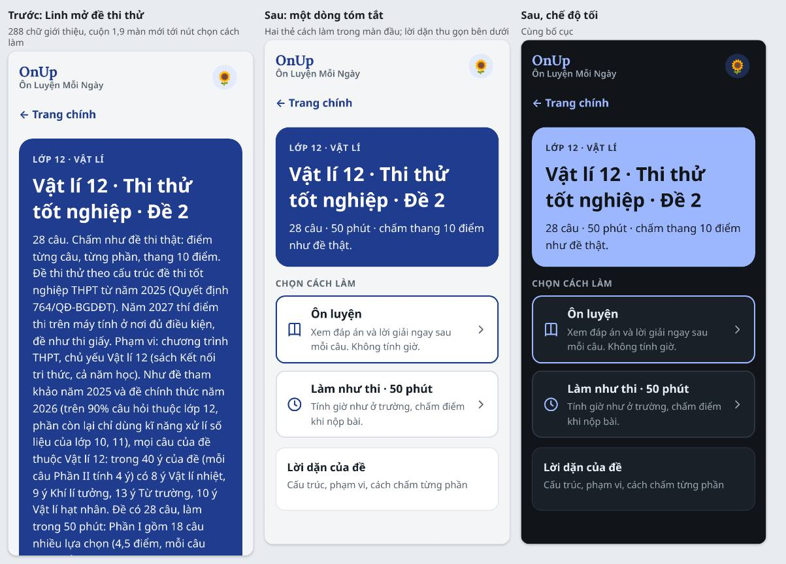

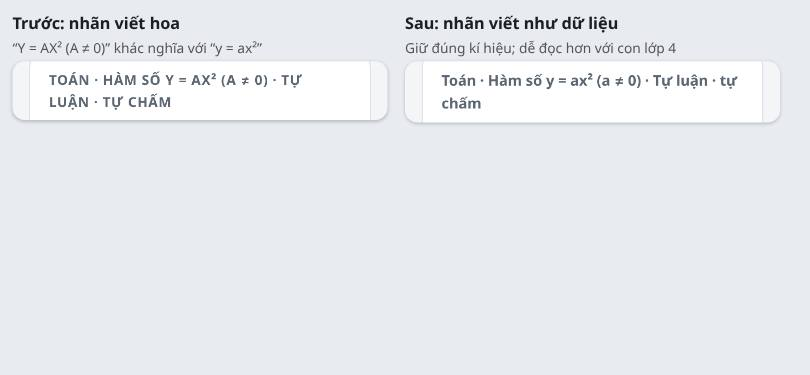

**X54. Lời dặn dài của đề đẩy hai thẻ cách làm xuống dưới màn đầu (Vừa; Linh, An, con lớp 5).**
- Đo: Linh mở “Vật lí 12 · Thi thử tốt nghiệp · Đề 2”: khối giới thiệu có 288 chữ, cả màn đầu là chữ, cuộn 1,9 màn mới tới “Làm như thi · 50 phút”. An mở đề thi thử Toán vào 10: 152 chữ. Bin mở đề lớp 4: 33 chữ, cả màn vừa một màn. Lời dặn dài lên theo khối (mục 3); lớp 5 đã dài gấp đôi lớp 4.
- Vì sao: `.hero p` của màn mở đề (`quizScreen`, js/app.js) ghép số câu, cách chấm và cả `b.note`.
- Đề xuất:
  - `.hero p` chỉ giữ một dòng do app dựng, ngăn bằng “ · ”: số câu, số phút (`b.minutes`), cách chấm. Ví dụ “28 câu · 50 phút · chấm thang 10 điểm như đề thật.” hay “25 câu · 40 phút · có lời giải từng câu.”. Câu “(15 câu tự luận tự chấm)” giữ như nay.
  - `b.note` dài hơn 40 chữ chuyển vào `details.panel.note-more#qNote` ngay sau `.modes`:
    - `summary` cao ≥ 44px, gồm dòng đậm “Lời dặn của đề” và dòng nhỏ “Cấu trúc, phạm vi, cách chấm”;
    - mở ra là cả đoạn lời dặn;
    - lời dặn từ 40 chữ trở xuống vẫn ở `.hero p`, như đa số đề lớp 4.
  - Chữ ở hai cột `TXT`: `appNoteHead` (“Lời dặn của đề” / “Test notes”), `appNoteSub` (“Cấu trúc, phạm vi, cách chấm” / “Structure, scope, marking”).
- Xong khi:
  - Bước mới của `tests/e2e.js`, ở 360 × 740 sáng và tối, học sinh chưa làm đề. Mở màn mở đề của các đề sau: đề có lời dặn dài nhất của mỗi khối có đề, mọi đề tính điểm, một đề Tiếng Anh. Với mỗi đề: `#qPractice` (và `#qExam` nếu có) nằm trọn trong màn đầu; `#qNote` có `summary` cao ≥ 44px; mở ra thì đúng chữ của `note`.
  - Đề lớp 4 có lời dặn ngắn vẫn hiện lời dặn trong `.hero`. Đề Tiếng Anh không có chữ cái tiếng Việt.
  - `audit` không báo gì.

**X55. Nhãn trên câu viết hoa làm sai kí hiệu toán, khó đọc với con nhỏ (Vừa; mọi cấp).**
- Đo: `.label` có `text-transform: uppercase` (css/app.css). Nhãn “môn · chủ đề · cách làm” trên câu (js/quiz.js) thành “TOÁN · HÀM SỐ Y = AX² (A ≠ 0) · TỰ LUẬN · TỰ CHẤM”.
  - Đã có 40 câu lớp 9 bị như vậy. Lớp 10, 11 sẽ có nhiều chủ đề có kí hiệu (hàm số, lôgarit…).
  - Nhãn đầu màn kết quả cũng viết hoa tên đề: “TOÁN 9 · THI THỬ VÀO 10 · ĐỀ 1 · LÀM NHƯ THI”.
  - Chữ hoa có dấu khó đọc hơn với con lớp 4.
- Đề xuất:
  - Nhãn có chữ lấy từ dữ liệu dùng lớp mới `.label.as-is` (`text-transform:none; letter-spacing:0`), giữ cỡ, màu, độ đậm. Chữ lấy từ dữ liệu là tên đề, môn, chủ đề, tên phần.
  - Áp cho hai chỗ: nhãn trên câu (dòng có `subj`, `q.topic`, `INSTR` trong `Quiz.run`) và nhãn đầu màn kết quả (tên đề · cách làm).
  - Nhãn cố định của giao diện vẫn viết hoa như nay: “BẢNG CÂU”, “THEO PHẦN”, “HÔM NAY ÔN GÌ?”.
- Xong khi:
  - `tests/e2e.js` mở một câu chủ đề “Hàm số y = ax² (a ≠ 0)” (lớp 9) và một câu đề lớp 4. Nhãn đọc bằng `innerText` (có tính `text-transform`) đúng chữ thường của dữ liệu.
  - Nhãn đầu màn kết quả đúng tên đề.
  - Bước TA2 vẫn qua.

### Phiên UX16 · Làm dở, làm tiếp; lời giới thiệu đúng đề (X52, X61; X53 gộp vào UX22)

Sửa `js/app.js`, `js/quiz.js`, `css/app.css`; cả hai bản. Không đổi bảng, SQL, dữ liệu đã lưu.

**Sau UX22 (25/11/2026):** tên nút là “Bài ôn N”, thẻ Hôm nay có nút chọn cách làm ngay, huy hiệu là “Hết bài ôn”. Các ý dưới đây đã viết theo đó. Ảnh của phiên này chụp trước UX22.

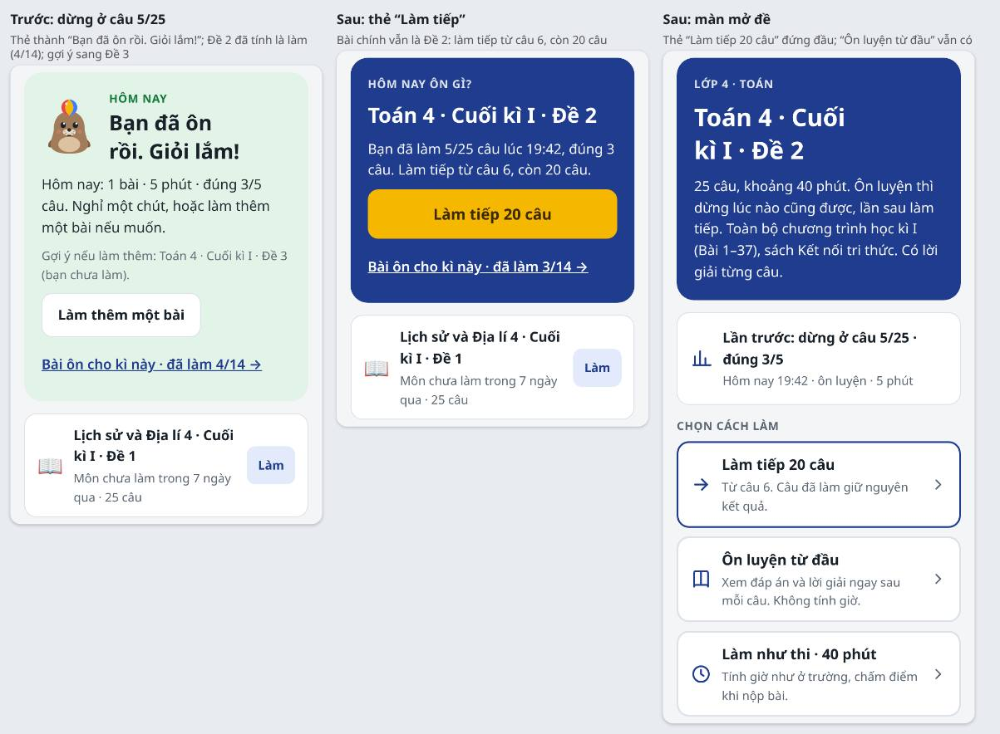

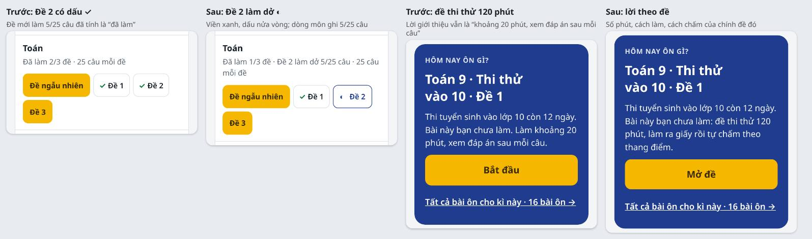

**X52. Dừng giữa đề ôn luyện vẫn tính là đã làm đề (Cao; Bin, Mẹ Hạnh; mọi cấp).**
- Tái hiện: Bin ôn luyện “Toán 4 · Cuối kì I · Đề 2”, làm 5 câu, bấm “← Thoát” rồi “Dừng”. Kết quả lưu 5 câu (`t` = 5). Sau đó:
  - nút “Đề 2” có ✓ (“đã làm, lần gần nhất đúng 0%” khi 5 câu sai);
  - tiến độ kì tính đề đó (đã làm 4/14 thay vì 3/14);
  - thẻ Hôm nay thành “Bạn đã ôn rồi. Giỏi lắm!” với “đúng 0/5 câu”, gợi ý làm thêm sang Đề 3, không nhắc 20 câu còn lại của Đề 2;
  - mở lại Đề 2 thì làm từ đầu.
  Persona: Bin hay dừng giữa chừng, mẹ thấy “1 bài” mà Bin mới làm 5 câu.
- Vì sao: `itemKey`/`resKey` và `doneMap` (`progressOf`), `todayPicks`, `practiceList` coi mọi kết quả của đề là đã làm. `Quiz.run` không giữ chỗ dừng.
- Đề xuất:
  - **Làm dở.** Kết quả ôn luyện của đề cố định không tính điểm có `t` nhỏ hơn số câu của đề (`qCount(b)`) là làm dở. Làm dở không tính vào “đã làm” của tiến độ kì, huy hiệu “Hết bài ôn”, nút ✓. Làm dở vẫn tính vào số bài hôm nay, chuỗi ngày, điểm, như nay.
  - **Nút bài làm dở:** `btn sm part`: nền `surface`, viền và chữ `acc`, đậm 600, cao 44px. Đầu nút có `span.part-ic` “◐” (`aria-hidden`). `aria-label` “…, làm dở 5 trên 25 câu”. Dòng môn ghi “Bài ôn 2 làm dở 5/25 câu”.
  - **Giữ chỗ dừng:**
    - `Quiz.run` gọi `opts.onPause(keys)` khi dừng một lượt ôn luyện chưa hết câu; `keys` là mã câu đã làm (`Quiz.key`).
    - `renderQuiz` lưu ở localStorage khóa `ontap_resume_v1`, theo mã học sinh rồi mã đề, bọc try/catch như `PoolHist`. Chỗ dừng chỉ có trên máy đó.
    - Xóa chỗ dừng khi làm hết đề hoặc chọn làm lại từ đầu.
  - **Màn mở đề có chỗ dừng:**
    - thẻ “Lần trước” ghi “Lần trước: dừng ở câu 5/25 · đúng 3/5”;
    - thẻ cách làm đầu tiên là `#qResume` (`.mode.main`): “Làm tiếp 20 câu” · “Từ câu 6. Câu đã làm giữ nguyên kết quả.”;
    - thẻ Ôn luyện đổi thành “Ôn luyện từ đầu”.
  - **Vòng làm tiếp:** chỉ gồm câu chưa làm, theo thứ tự cũ. Xong vòng thì lưu một kết quả cho cả đề: `r` cộng câu đúng của hai lần, `t` là số câu của đề, `s` cộng thời gian hai lần. Nhờ vậy đề thành đã làm. Kết quả làm dở cũ giữ trong lịch sử.
  - Máy khác (không có chỗ dừng) vẫn thấy nút làm dở, nhưng chỉ có “Ôn luyện từ đầu”.
  - **Hôm nay (`todayPicks`):** bài làm dở trong 7 ngày đứng trước bài chưa làm.
    - Lời: “Bạn đã làm 5/25 câu lúc 19:42, đúng 3 câu. Làm tiếp từ câu 6, còn 20 câu.”
    - Theo thẻ của UX22: nút chính `#todayResume` “Làm tiếp 20 câu” (`#/quiz/<mã>?cach=tiep`, vào thẳng câu 6), nút phụ `#todayPractice` “Ôn luyện từ đầu”. Không có Làm như thi ở thẻ này (vẫn có ở màn mở đề).
    - Thẻ “Hôm nay đã ôn” (X40) chỉ hiện khi hôm nay có ít nhất một bài làm hết: đề hết câu, đề làm như thi hoặc bài ôn dạng trang.
  - Chữ của màn mở đề, màn làm đề ở hai cột `TXT` (`appResume`, `appResumeNote`, `appFromStart`, `appPrevPart`), như đề Tiếng Anh: “Continue: 20 left”, “From question 6. Answers so far are kept.”, “Practice from the start”.
- Xong khi:
  - Bước mới của `tests/e2e.js`: Bin, ngày giả lập 8/12/2026 19:45, 360px sáng và tối. Ôn luyện Toán 4 · Cuối kì I · Bài ôn 2, làm 5 câu rồi dừng. Khi đó:
    - nút Bài ôn 2 có `.part`, không có ✓; nhóm kì ghi đã làm 3/14;
    - Hôm nay có bài chính “Toán · Bài ôn 2” với nút chính “Làm tiếp 20 câu”;
    - màn mở đề có `#qResume` đứng đầu.
  - Làm tiếp: vòng có 20 câu, không có câu đã làm. Xong vòng thì kết quả có 25 câu, nút có ✓, đã làm 4/14, `ontap_resume_v1` không còn mục của bài đó.
  - Dừng giữa lượt làm như thi vẫn như nay: nộp bài, câu trống tính sai.
  - `tests/supabase/cloud-e2e.js` in OK.

**X53. Lời giới thiệu bài chính ghi “khoảng 20 phút, xem đáp án sau mỗi câu” cho mọi đề (Vừa; mọi cấp). Đã gộp vào Phiên UX22 (25/11/2026).**
- Đo:
  - Toán 4 Đề 2 (25 câu, đề thật 40 phút) và đề lớp 9, 12 (25 câu, 45 phút) đều ghi “khoảng 20 phút”.
  - Ngày 20/5/2027 An được giao “Toán 9 · Thi thử vào 10 · Đề 1” (15 ý tự luận làm ra giấy, 120 phút) và Linh được giao “Toán 12 · Thi thử tốt nghiệp · Đề 1” (90 phút, tính điểm). Cả hai cùng nhận câu đó.
- Vì sao: `how(x)` trong `todayPicks` chỉ xét `intro` của bài ôn dạng trang.
- Cách sửa ở UX22: thẻ Hôm nay bỏ câu này; số phút thật ở nút “Làm như thi · 45 phút”; bài chính là đề thi thử thì chỉ có nút “Mở đề thi thử” tới màn mở đề. UX16 không còn làm X53.

**X61. Lời khen chung chung; hình hải cẩu cố định ở thẻ “Hôm nay đã ôn” (Thấp; Linh, Bin).**
- Đo: thẻ X40 ghi “Bạn đã ôn rồi. Giỏi lắm!” cả khi con dừng ở câu 5, đúng 0/5. Hình là hải cẩu tung bóng cho mọi con, kể cả Linh lớp 12 có hình đại diện 🌻. Chủ đề “quá trẻ con” với tuổi teen: [PERSONA.md](PERSONA.md), nguồn NN/g.
- Đề xuất:
  - Tiêu đề thẻ đổi thành “Hôm nay bạn đã ôn xong.”; dòng `#todayDone` giữ số bài, số phút, số câu đúng như nay.
  - Hình là hình đại diện của chính con (`avatar(s, true)`, 64px): Bin vẫn thấy hải cẩu, Linh thấy 🌻.
  - Lời khen ở màn kết quả giữ nguyên, vì đã theo điểm.
- Xong khi: bước UX9 của `tests/e2e.js` đọc chữ mới. Học sinh có hình đại diện emoji thì thẻ có emoji đó, không có `img` hải cẩu tung bóng.

### Phiên UX20 · Môn học của con, khối 10–12 (X59)

Sửa `js/store.js`, `js/store-supabase.js`, `supabase/` (cột mới), `js/app.js`, `css/app.css`.

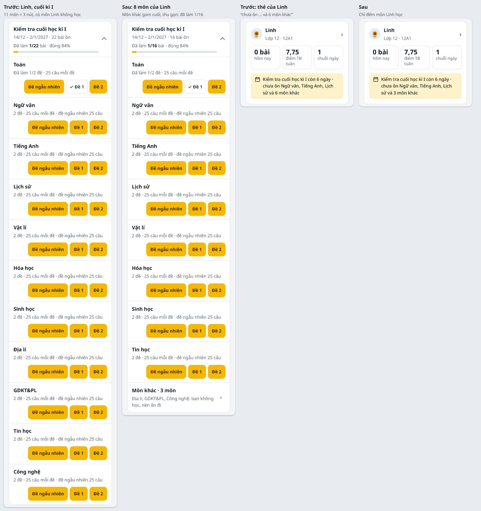

**X59. Lớp 10–12: mọi màn liệt kê 11 môn, còn con học 8 môn và thi tốt nghiệp 4 môn (Cao khi bật khối 12; Linh, Mẹ Thu).**
- Đo (khối 12 bật giả, ngày 8/12/2026):
  - Bài ôn của Linh: nhóm cuối kì I có 11 môn × 3 nút (33 nút); nhóm thi tốt nghiệp có 39 đề; mở hết các nhóm thì 8 màn, 138 nút đề.
  - Thẻ của Linh ở Các con: “chưa ôn Ngữ văn, Tiếng Anh, Lịch sử và 6 môn khác”.
  - Gợi ý trong báo cáo tuần: “Tuần này chưa ôn Ngữ văn, Tiếng Anh, Lịch sử, Hóa học, Sinh học, Địa lí, GDKT&PL, Tin học, Công nghệ cho kì thi sắp tới.”
  - Bài phụ ở Hôm nay có thể là môn Linh không học.
- Vì sao: kì thi lớp 10–12 ghi đủ 11 môn có đề. Theo Thông tư 13/2022, con học 4 môn bắt buộc có điểm (Toán, Ngữ văn, Tiếng Anh, Lịch sử) và chọn 4 môn lựa chọn; 7 trong các môn lựa chọn có đề trong app (Vật lí, Hóa học, Sinh học, Địa lí, GDKT&PL, Tin học, Công nghệ). Thi tốt nghiệp gồm Toán, Ngữ văn và 2 môn tự chọn trong các môn đã học ở lớp 12. Nguồn ở [PERSONA.md](PERSONA.md).
- Đề xuất:
  - **Chọn môn.** Hồ sơ khối 10–12 có thêm ô chọn “Môn lựa chọn” (4 môn). Hồ sơ lớp 12 có thêm “Môn thi tốt nghiệp tự chọn” (2 môn, trong Tiếng Anh, Lịch sử và 4 môn lựa chọn).
    - Ô chọn dạng chip, cao ≥ 44px, `aria-pressed`, như `.day-pick` của UX10.
    - Có ở form hồ sơ của bố mẹ (`renderUserForm`) và ở trang Tài khoản của con, vì con lớn tự chọn được.
    - Chưa chọn thì app như nay (đủ 11 môn). Hôm nay có một dòng nhắc, bấm “Thôi” thì ẩn: “Chọn môn bạn học để danh sách gọn hơn.”
  - **Dùng ở:**
    - `examItems`: môn con không học gom vào một dòng `details` “Môn khác · 3 môn” ở cuối nhóm, thu gọn sẵn;
    - `progressOf`: chỉ đếm môn của con (“đã làm 1/16”);
    - `todayPicks`: bài chính, bài phụ;
    - `kidCard`, `weekTips`, chi tiết kì thi;
    - nhóm thi tốt nghiệp: Toán, Ngữ văn và 2 môn thi tự chọn.
  - **Lưu:**
    - Bản lưu trên máy: trường `subjects` (mảng tên môn) và `tnSubjects` của học sinh. Dữ liệu cũ đọc vào là `[]`.
    - Bản đám mây: cột `profiles.subjects text[]`, `profiles.tn_subjects text[]`, thêm bằng file `supabase/cap-nhat-<phiên>.sql`, grant theo cột như các cột đang có của `profiles` (mục “Grant khi thêm bảng, cột, hàm” của CLAUDE.md). Máy chủ chưa cập nhật thì app giữ như nay.
  - **PO quyết ngày 26/11/2026** (chủ app giao chốt): lưu trên máy chủ như đề xuất ở trên. Bố mẹ và con thường dùng hai máy, mà thẻ của con, báo cáo tuần trên máy bố mẹ cần biết môn của con; lưu riêng từng máy thì phải chọn lại trên mỗi máy. Đây là thông tin học tập, không định danh trẻ. Phiên UX20 sửa câu “Thu thập dữ liệu tối thiểu” ở đầu CLAUDE.md thành “tên hiển thị, khối, lớp; con khối 10–12 thêm môn học lựa chọn và môn thi tốt nghiệp tự chọn”; trang Quyền riêng tư (Phiên G0) liệt kê hai trường này.
- Xong khi:
  - Bước mới của `tests/e2e.js` (khối 12 bật giả trong bước), chọn 4 môn cho Linh. Khi đó:
    - Bài ôn: nhóm cuối kì I có 8 dòng môn và dòng “Môn khác · 3 môn” thu gọn; đã làm 1/16;
    - thẻ của Linh và gợi ý tuần chỉ nhắc môn của Linh;
    - nhóm thi tốt nghiệp chỉ có 4 môn thi;
    - chưa chọn môn thì như nay.
  - `tests/supabase/store-test.mjs`, `cloud-e2e.js` in OK; `sh tests/supabase/run.sh` in RLS OK, có kiểm tra cột mới.
- Thời điểm: khối 12 đã bật khi Merge PR #334 (chủ app chọn bật trước, con lớp 12 thấy đủ 11 môn đến khi có phiên này). UX20 xong trước 20/1/2027, trước khi bật khối 10, 11; `run.sh` (kiểm thử RLS cho cột mới) chạy lại được từ PR #346 (Phiên 9w).

### Phiên UX18 · Đề thi thử làm ra giấy (X56)

Sửa `js/quiz.js`, `css/app.css`; cả hai bản. Làm sau Phiên 9u (L47), vì cùng phần điểm của đề có câu tự chấm.

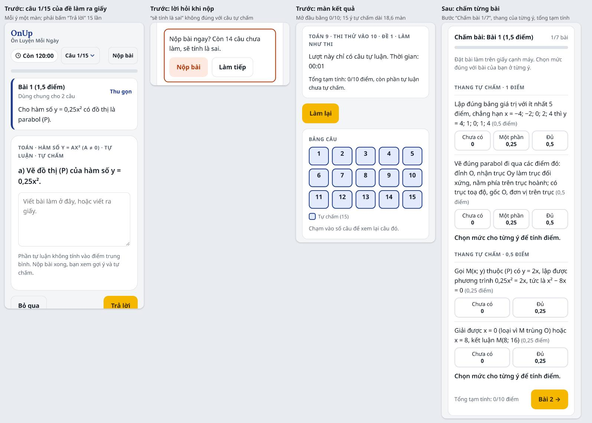

**X56. Đề thi thử làm ra giấy đi theo luồng của đề làm trên máy (Cao với lớp 9; An, Linh).**
- Đo với “Toán 9 · Thi thử vào 10 · Đề 1” (15 ý tự luận, 120 phút; cả 10 đề Toán thi thử vào 10 như vậy), làm như thi:
  - mỗi ý một màn; muốn tới “Nộp bài” phải bấm “Trả lời” hoặc “Bỏ qua” ở từng ý; không xem được cả đề một lúc, trong khi đọc cả đề trước là kĩ năng làm bài thi;
  - bấm “Nộp bài” sau câu 1 thì app hỏi “Nộp bài ngay? Còn 14 câu chưa làm, sẽ tính là sai.”, nhưng câu tự luận không bị tính sai, vì con tự chấm sau khi nộp;
  - màn kết quả mở đầu bằng “Lượt này chỉ có câu tự luận… Tổng tạm tính: 0/10 điểm”; 15 ý tự chấm nằm dưới bảng câu và mục “Theo phần”, cả trang dài 18,6 màn.
- Đề xuất:
  - **Trang cả đề.** Đề tính điểm có câu tự luận, khi làm như thi, có nút “Xem cả đề” (`#qzAll`) trong bảng số câu.
    - Nút mở trang đọc cả đề theo thứ tự: đoạn chung, hình, các ý; không có ô trả lời. Trang có đồng hồ ở hàng trên cùng và hai nút “Về câu đang làm”, “Nộp bài”.
    - Đề mà mọi câu tự chấm (làm ra giấy) mở thẳng trang này khi bắt đầu.
  - **Lời hỏi khi nộp:** đếm riêng hai loại câu còn trống.
    - Câu chấm tự động: “… sẽ tính là sai”.
    - Câu tự luận: “15 câu tự luận: bạn chấm ngay sau khi nộp, theo thang điểm của từng ý.”
    - Chữ ở hai cột `TXT`.
  - **Chấm từng bài.** Màn kết quả của đề tính điểm có câu tự luận mở đầu bằng khối `section.panel#qzMark`.
    - Khối gồm: “Chấm bài: Bài 1 (1,5 điểm) · 1/7 bài”, thanh tiến độ, dòng “Đặt bài làm trên giấy cạnh máy. Chọn mức đúng với bài của bạn ở từng ý.”, các ý của bài (thang tự chấm như nay), nút “Bài 2 →”.
    - Bài là `part` của câu; đề không có `part` thì theo đoạn chung `p`, rồi từng câu.
    - Chấm xong mọi bài thì khối thu thành dòng “Đã chấm 7/7 bài”; điểm to là điểm cả đề.
    - Điểm to, bảng câu, mục “Theo phần” đứng sau khối chấm.
- Xong khi:
  - Bước mới của `tests/e2e.js`: An, 360px sáng và tối, làm như thi “Toán 9 · Thi thử vào 10 · Đề 1”.
    - Bắt đầu là trang cả đề.
    - Nộp ngay thì lời hỏi không có “sẽ tính là sai”.
    - Khối chấm 1/7 đứng đầu màn kết quả; chấm hết 7 bài thì điểm to là tổng điểm tự chấm.
  - “Ngữ văn 9 · Thi thử vào 10 · Đề 1” (vừa chấm tự động vừa tự luận): lời hỏi đếm hai loại câu.
  - `audit` không báo gì; `tests/supabase/cloud-e2e.js` in OK.

### Phiên UX19 · Đường tới kì thi lớn (X57, X58)

Sửa `js/app.js`, `css/app.css`; cả hai bản. Làm sau 9u, để điểm của đề tính điểm ghi cùng một cách.

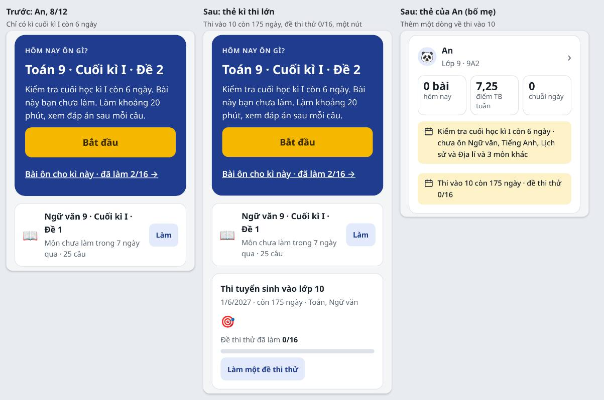

**X57. Lớp 9, 12 không thấy đường tới kì thi lớn ở Hôm nay và thẻ của con (Vừa; An, Linh, Bố Tuấn, Mẹ Thu).**
- Đo: ngày 8/12, Hôm nay của An, Linh chỉ nói “Kiểm tra cuối học kì I còn 6 ngày”. 16 đề thi thử vào 10 và 39 đề thi thử tốt nghiệp chỉ có ở tab Bài ôn (nhóm thu gọn) và Lịch thi. Thẻ của An, Linh ở Các con cũng chỉ có kì gần nhất.
- Đề xuất:
  - **Hôm nay.** Khối có kì thi `kind: "thi-khac"` chưa qua (thi vào 10, tốt nghiệp), mà kì đó không phải kì gần nhất, thì thêm `section.panel#bigExam` ngay sau thẻ bài chính (sau UX22 Hôm nay không còn bài phụ). Thẻ gồm:
    - tên kì; ngày · “còn N ngày” · môn thi;
    - “Đề thi thử đã làm 0/16” (đề cố định của kì, tính bằng `progressOf`) và thanh `.bar`;
    - “gần nhất 6,5/10” khi đã có điểm;
    - link (hành động thứ ba của màn, theo quy tắc ở mục 2) “Xem đề thi thử →” tới `#/practice?ki=<mã kì thi>`. Không có nút: thẻ bài chính đã có nút chính và nút phụ.

    Khi kì thi lớn đã là kì gần nhất thì không có thẻ, vì bài chính đã là đề của kì đó.
  - **Thẻ của con** (`kidCard`): thêm dòng `.kid-ev` thứ hai, có biểu tượng icon/target: “Thi vào 10 còn 175 ngày · đề thi thử 2/16 · gần nhất 6,5/10”.
  - **Tin nhắn tuần:** khi đã làm ít nhất một đề thi thử, thêm dòng “• Thi thử vào 10: 2/16 đề, gần nhất 6,5/10.”.
- Xong khi:
  - Bước mới của `tests/e2e.js`: An ngày 8/12/2026 có `#bigExam` ghi “còn 175 ngày”, “0/16”; link “Xem đề thi thử →” mở tab Bài ôn ở nhóm thi vào 10; Hôm nay có đúng 3 hành động. Làm một đề thi thử thì thẻ ghi “1/16” và điểm.
  - Ngày 20/5/2027 An không có `#bigExam`. Bin không có thẻ này.
  - Thẻ của An có dòng thứ hai. Linh (khối 12 bật giả trong bước) có thẻ của thi tốt nghiệp.
  - `tests/supabase/cloud-e2e.js` in OK.

**X58. Gợi ý tuần cho đề tính điểm nói theo phần trăm (Thấp; Linh, Mẹ Thu).**
- Đo: báo cáo tuần của Linh ghi “Gợi ý: Vật lí mới đúng 65%: xem lại lời giải các câu sai rồi làm lại đề đó.” cho một đề thi thử được 6,5/10 điểm.
- Đề xuất: khi môn có điểm thấp nhất là đề tính điểm (`scoredRes`), gợi ý ghi theo điểm: “Vật lí thi thử 6,5/10 điểm: xem lại các câu sai rồi làm một đề thi thử khác.” (`weekTips`).
- Xong khi: bước mới của UX19 đọc gợi ý theo điểm.

### Phiên UX21 · Làm đề bằng bàn phím (X60)

Sửa `js/quiz.js`, `css/app.css`.

**X60. Làm đề trên máy tính không có phím chọn đáp án (Thấp; Linh).**
- Đo ở 1366 × 768: cột app rộng 720px, lựa chọn xếp 2 cột. Phím 1, a, A không chọn được đáp án. Phải bấm Tab 3 lần mới tới lựa chọn đầu; phím cách chọn được; viền focus 3px, rõ. Năm 2027 thí điểm thi tốt nghiệp trên máy tính, nên Linh muốn tập trên máy tính.
- Đề xuất:
  - Câu nhiều lựa chọn: phím 1–4 hoặc A–D chọn lựa chọn theo thứ tự đang hiện.
  - Enter bấm nút chính (Kiểm tra, Trả lời, Câu tiếp).
  - Không bắt phím khi con đang gõ trong ô nhập.
  - Sau lần gõ phím đầu tiên, dưới câu có dòng nhỏ “Phím 1–4 chọn đáp án, Enter để tiếp”. Máy cảm ứng không thấy dòng này. Chữ ở hai cột `TXT`.
- Xong khi:
  - `tests/e2e.js` ở 1366 × 768: phím 2 chọn lựa chọn thứ hai, Enter kiểm tra, Enter nữa sang câu tiếp.
  - Ở 360px không có dòng phím; gõ trong ô điền không bị bắt phím.

## 5. Ghi nhận khác, chưa cần phiên

- **Máy riêng của con lớn** (An, Linh): mỗi lần mở app phải chọn lại hồ sơ ở “Ai đang học?”, vì hồ sơ đang dùng giữ trong sessionStorage. Lựa chọn “Máy này của Linh” có thể bớt 1–5 chạm mỗi lần. Chờ ghi chép dùng thử.
- **Tab Kết quả với con lớp 4:** “Điểm trung bình tháng”, “Theo môn · 30 ngày” trừu tượng với con 9 tuổi, nhưng Bin thường xem cùng mẹ. Chờ ghi chép dùng thử.
- **L47** (Phiên 9u; cách sửa ở mục 2 của [SUA-LOI-CHAY-THU.md](SUA-LOI-CHAY-THU.md), đoạn “Phiên 9u”) đã ghi điểm của đề tính điểm có câu tự luận. UX18, UX19 làm sau 9u.
- Lịch thi của phụ huynh bản lưu trên máy có tab “Mọi khối” dài 7,9 màn khi nhà có 4 con ở 4 khối. Bản đám mây (UX2) đã chia tab theo con, nên không cần sửa.
- **Màn chưa theo quy tắc “tối đa một hành động chính, một phụ, một thứ ba”** (mục 2; ghi ngày 25/11/2026, chưa có phiên). Hai màn này dùng lúc xem lại, không phải lúc bắt đầu, nên UX22 chưa sửa. PD rà các màn còn lại ở đợt UAT sau.
  - Màn kết quả đề: nút chính “Ôn lại N câu sai”, nút phụ “Làm lại cả đề”, thêm “Làm đề khác” (đề ngẫu nhiên), tối đa ba nút “Ôn 10 câu: <chủ đề>”, link “Báo câu này sai” trong từng câu.
  - Báo cáo tuần của bố mẹ: nút chính “Gửi báo cáo”, thêm “Chép tin nhắn”, “In”, “Sửa hồ sơ”, hai nút chọn tuần, link “Xem cả năm →”, “Bài ôn của <tên> →”.

## 6. Kiểm thử thiết kế sau khi gộp

Chưa có. Phiên 4.x nào gộp thì ghi kết quả kiểm thử thiết kế ở đây, theo cách của mục 6 trong [CAI-TIEN-UX-3X.md](CAI-TIEN-UX-3X.md).
