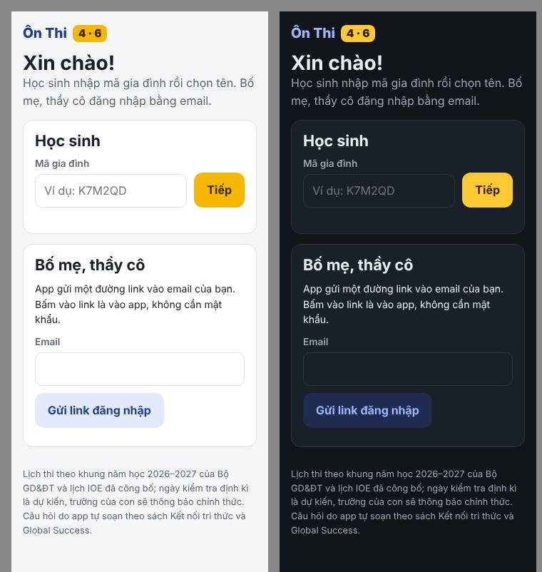
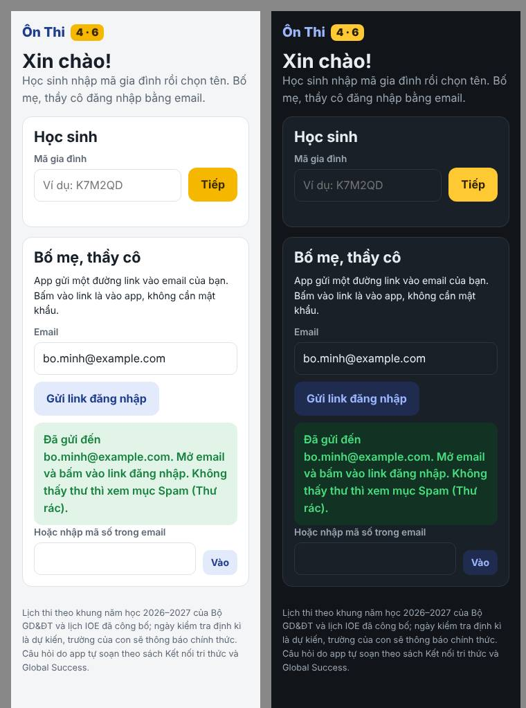
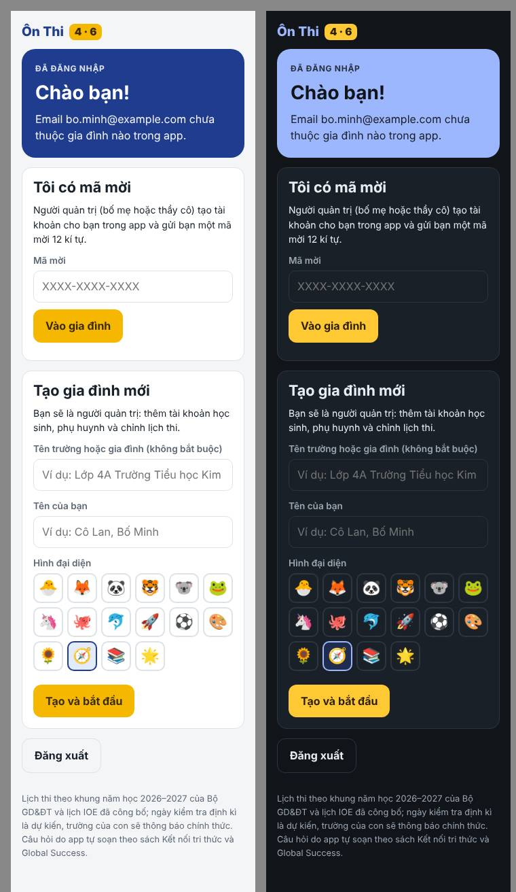
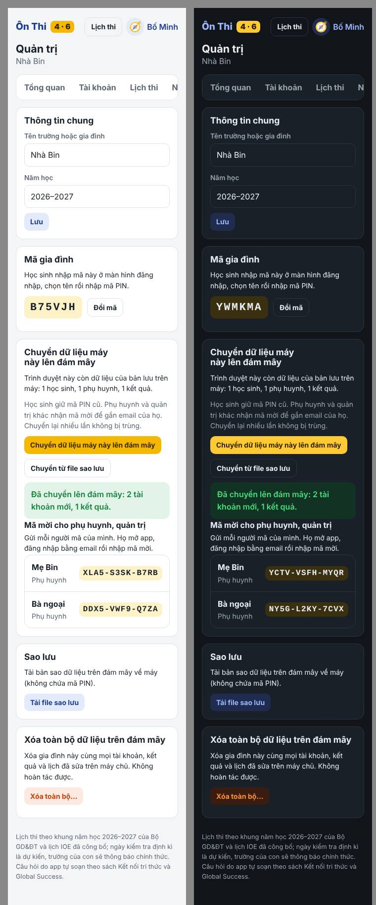
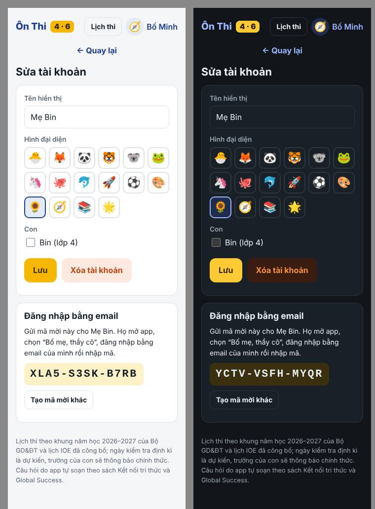
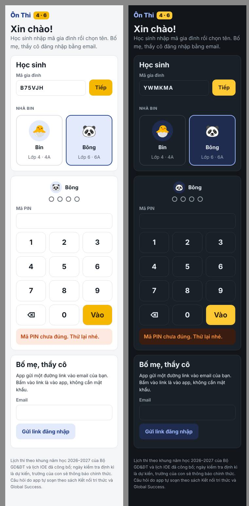

# Hướng dẫn bật đồng bộ đám mây (Supabase)

Mặc định app lưu dữ liệu trong trình duyệt của từng máy. Làm theo hướng dẫn này để dữ liệu nằm trên máy chủ Supabase (miễn phí), dùng chung trên nhiều máy:

- **Bố mẹ, thầy cô** đăng nhập bằng email: app gửi một đường link, bấm vào là vào, không cần mật khẩu.
- **Học sinh** không cần email: nhập **mã gia đình**, chọn tên, nhập **mã PIN** như trước.
- Phụ huynh chỉ xem được hồ sơ và kết quả của con mình. Quản trị quản lý cả gia đình (hoặc cả lớp).

Mất khoảng 30–45 phút. Cần: một máy tính, một tài khoản GitHub (đã có), một địa chỉ Gmail để app gửi email đăng nhập.

> Tên các mục trong trang Supabase đôi khi được đổi. Nếu không thấy đúng chữ như dưới đây, tìm mục có ý nghĩa gần nhất (hoặc gõ vào ô tìm kiếm của trang).

---

## Bước 0. Tải file sao lưu dữ liệu cũ (nên làm)

Trước khi đổi gì, mở app bản hiện tại (https://dunglnh.github.io/OnUp/), đăng nhập quản trị → **Quản trị → Dữ liệu → Tải file sao lưu**. Giữ file này phòng khi cần.

## Bước 1. Tạo project Supabase

1. Vào https://supabase.com → **Start your project** → đăng nhập bằng GitHub.
2. **New project**:
   - Name: `OnUp`
   - Database Password: bấm **Generate a password**, chép lại cất kĩ (ít khi cần dùng).
   - Region: **Southeast Asia (Singapore)** cho nhanh ở Việt Nam.
   - Gói: **Free**.
3. Bấm **Create new project**, đợi 1–2 phút.

## Bước 2. Tạo bảng dữ liệu (chạy schema.sql)

1. Mở file [`supabase/schema.sql`](../supabase/schema.sql) trên GitHub → bấm nút **Copy raw file** (biểu tượng hai tờ giấy).
2. Trong Supabase: thanh bên trái → **SQL Editor** → **New query** → dán toàn bộ → **Run**.
3. Thấy dòng `Success. No rows returned` là xong.

Chỉ chạy một lần trên project mới. Chạy lần hai sẽ báo lỗi `already exists`, không sao, dữ liệu không mất.

## Bước 3. Bật cách đăng nhập

Thanh bên trái → **Authentication**:

1. **Sign In / Providers** (hoặc **Providers**):
   - **Email**: bật (thường đã bật sẵn).
   - **Allow anonymous sign-ins**: **bật**. Học sinh cần mục này để đăng nhập bằng mã gia đình + PIN (học sinh không có email).
   - Nếu có mục **Allow new users to sign up**: để **bật** (phụ huynh mới cần tạo tài khoản bằng email).
2. **Emails → SMTP Settings**: bật **Enable custom SMTP**. Máy chủ email có sẵn của Supabase chỉ gửi được cho thành viên của project, nên phải dùng email riêng. Dễ nhất là Gmail:
   1. Tài khoản Google phải bật xác minh 2 bước. Vào https://myaccount.google.com/apppasswords → tạo **mật khẩu ứng dụng** tên `OnUp` → chép 16 kí tự.
   2. Điền: Sender email = địa chỉ Gmail; Sender name = `Ôn Thi 4·6`; Host = `smtp.gmail.com`; Port = `465`; Username = địa chỉ Gmail; Password = 16 kí tự vừa chép. **Save**.
   3. (Cách khác: dịch vụ như Brevo, Resend có gói miễn phí; điền thông số SMTP họ cung cấp.)
3. **Emails → Templates → Magic Link** (tùy chọn, nên làm): thêm dòng dưới đây vào nội dung thư, để người dùng có thể gõ mã số khi mở email trên máy khác:
   ```html
   <p>Hoặc nhập mã này trong app: <b>{{ .Token }}</b></p>
   ```
4. **URL Configuration**:
   - **Site URL**: `https://dunglnh.github.io/OnUp/`
   - **Redirect URLs** → **Add URL**, thêm từng dòng:
     - `https://dunglnh.github.io/OnUp/`
     - `https://dunglnh.github.io/OnUp/**`
     - `http://localhost:8000/**` (chỉ để thử trên máy tính, không bắt buộc)

## Bước 4. Triển khai Edge Function `student-login`

Hàm này kiểm tra mã gia đình + PIN của học sinh và băm PIN trên máy chủ, nên PIN không bao giờ nằm trong trình duyệt.

**Cách A — ngay trên trang Supabase (không cần cài gì):**

1. Thanh bên trái → **Edge Functions** → **Deploy a new function** → **Via Editor**.
2. Đặt tên đúng là `student-login`.
3. Xóa code mẫu. Mở [`supabase/functions/student-login/index.ts`](../supabase/functions/student-login/index.ts) trên GitHub → **Copy raw file** → dán vào → **Deploy function**.
4. Mở hàm vừa tạo → tab **Details** (hoặc **Settings**) → **tắt** mục **Verify JWT** / **Enforce JWT verification** → **Save**. (Hàm tự kiểm tra người gọi; học sinh tra mã gia đình trước khi có phiên đăng nhập.)
5. **Edge Functions → Secrets** (hoặc **Manage secrets**) → thêm:
   - Name: `PIN_PEPPER`
   - Value: một chuỗi ngẫu nhiên dài, ví dụ gõ bừa 40 chữ và số. **Không chia sẻ, không đổi** sau khi đã có học sinh (đổi thì mọi PIN phải đặt lại).

   `SUPABASE_URL` và `SUPABASE_SERVICE_ROLE_KEY` Supabase tự cấp cho hàm, không cần thêm.

**Cách B — bằng dòng lệnh (nếu quen dùng):**

```bash
npx supabase login
npx supabase link --project-ref <mã project, xem trong Project Settings>
npx supabase secrets set PIN_PEPPER="<chuỗi ngẫu nhiên dài>"
npx supabase functions deploy student-login --no-verify-jwt
```

## Bước 5. Điền `js/config.js`

1. Supabase → **Project Settings → API Keys** (hoặc **API**). Chép:
   - **Project URL**, dạng `https://abcdxyz.supabase.co` (ở **Project Settings → Data API** nếu không thấy ở đây).
   - Khóa **anon public** (tab *Legacy API keys*) hoặc **publishable key** (bắt đầu bằng `sb_publishable_`).
2. Trên GitHub, mở [`js/config.js`](../js/config.js) → biểu tượng bút chì (**Edit**) → điền:
   ```js
   window.ONTAP_CONFIG = {
     supabaseUrl: "https://abcdxyz.supabase.co",
     supabaseAnonKey: "eyJhbGciOi... hoặc sb_publishable_..."
   };
   ```
3. **Commit changes**. Sau 1–2 phút GitHub Pages cập nhật.

> ⚠️ **Tuyệt đối không** dán khóa `service_role` hay `secret` (`sb_secret_...`) vào file này: khóa đó bỏ qua mọi lớp bảo vệ. App sẽ từ chối chạy nếu thấy khóa bí mật. Lỡ dán thì xóa ngay và bấm đổi khóa (Roll) trong Supabase.
>
> Khóa anon/publishable là khóa công khai, để trên GitHub được: dữ liệu được bảo vệ bằng chính sách RLS trong `schema.sql`.

Muốn quay lại bản lưu trên máy: xóa hai giá trị trong `js/config.js` (để lại `""`). Dữ liệu cũ trên từng máy vẫn còn.

## Bước 6. Đăng nhập lần đầu, tạo gia đình

1. Mở https://dunglnh.github.io/OnUp/ (tải lại trang nếu đang mở).
2. Ở ô **Bố mẹ, thầy cô**, nhập email của mình → **Gửi link đăng nhập** → mở email → bấm link (hoặc gõ mã số trong email).
3. Màn hình **Chào bạn!** → **Tạo gia đình mới** → nhập tên → **Tạo và bắt đầu**. Bạn là quản trị. Lịch thi cả năm được chép sẵn.





## Bước 7. Chuyển dữ liệu máy cũ lên đám mây

Dữ liệu cũ nằm trong trình duyệt của máy đã dùng bản cũ. Trên **chính máy và trình duyệt đó**:

1. Mở app, đăng nhập quản trị bằng email (bước 6).
2. **Quản trị → Dữ liệu → Chuyển dữ liệu máy này lên đám mây**.
3. App báo số tài khoản và kết quả đã chuyển, kèm **mã mời** cho từng phụ huynh, quản trị khác.

Nếu dữ liệu ở máy khác hoặc chỉ còn file sao lưu: bấm **Chuyển từ file sao lưu** và chọn file đã tải ở bước 0.

- Học sinh **giữ nguyên mã PIN cũ** (lần đăng nhập đầu, máy chủ tự đổi sang cách băm mới).
- Quản trị cũ trùng tên với bạn được gộp vào tài khoản của bạn.
- Bấm chuyển nhiều lần cũng không bị trùng dữ liệu.
- Dữ liệu cũ trong trình duyệt không bị xóa.



## Bước 8. Mời phụ huynh, quản trị khác

1. **Quản trị → Tài khoản → + Thêm** (phụ huynh hoặc quản trị) → nhập tên → **Tạo tài khoản**.
2. App hiện **mã mời** 12 kí tự. Gửi mã qua Zalo/tin nhắn.
3. Người đó mở app → **Bố mẹ, thầy cô** → đăng nhập bằng email của họ → nhập mã mời → **Vào gia đình**.
4. Ở trang sửa tài khoản phụ huynh, tick tên con để phụ huynh xem được hồ sơ của con.

Mất máy hoặc đổi email: mở tài khoản đó → **Gỡ email, tạo mã mời mới**.



## Bước 9. Học sinh đăng nhập

1. Lấy **mã gia đình** (6 kí tự) ở **Quản trị → Dữ liệu**, hoặc ở trang chủ phụ huynh.
2. Trên máy của con: mở app → ô **Học sinh** → nhập mã gia đình → **Tiếp** → chọn tên → nhập PIN.
3. Máy nhớ mã gia đình; lần sau con chỉ chọn tên và nhập PIN. Đóng trình duyệt thì phải nhập lại PIN (như bản cũ).

Nhập sai PIN 5 lần thì phải đợi 30 giây; nếu tiếp tục sai, thời gian đợi tăng dần. Bố mẹ đặt lại PIN cho con (sửa tài khoản của con) thì mở khóa ngay. Lỡ để lộ mã gia đình: **Quản trị → Dữ liệu → Đổi mã**.



## Bước 10. Tự kiểm tra sau khi cài

Làm lần lượt, tick khi xong:

- [ ] Gửi link đăng nhập: email đến trong 1 phút, bấm vào thì vào app.
- [ ] Tạo gia đình, thêm 1 học sinh (có PIN) và 1 phụ huynh.
- [ ] Trên điện thoại khác: học sinh đăng nhập bằng mã gia đình + PIN, làm một đề ngắn.
- [ ] Thử nhập sai PIN 5 lần: app báo đợi 30 giây.
- [ ] Phụ huynh nhận mã mời, đăng nhập bằng email khác, thấy kết quả vừa làm của con.
- [ ] Phụ huynh **không** thấy học sinh không phải con mình.
- [ ] Bấm **Chuyển dữ liệu máy này lên đám mây** trên máy cũ; học sinh cũ đăng nhập được bằng PIN cũ.
- [ ] Supabase → **Table Editor**: các bảng có dữ liệu; bảng `student_pins` chỉ chứa chuỗi bắt đầu bằng `pbkdf2$` hoặc `legacy$`, không có PIN gốc.
- [ ] Supabase → **Edge Functions → student-login → Logs**: không có lỗi đỏ.

## Bảo mật và quyền riêng tư

- App chỉ lưu: tên hiển thị, hình đại diện, khối, lớp của học sinh; email của bố mẹ/thầy cô (do Supabase giữ để đăng nhập). Học sinh không có email. Không hỏi ngày sinh, số điện thoại, ảnh.
- Quyền xem, sửa được kiểm tra trên máy chủ (RLS): phụ huynh chỉ đọc hồ sơ, kết quả của con mình; quản trị đọc/ghi trong gia đình của mình; học sinh chỉ đọc và ghi kết quả của chính mình. Gia đình này không thấy gia đình khác.
- PIN được băm trên máy chủ (PBKDF2 + `PIN_PEPPER`), không gửi về trình duyệt. Mã PIN chỉ để phân biệt người dùng trong nhà, lớp — không phải mật khẩu mạnh. Muốn chặt hơn, hãy để con dùng thiết bị của con.
- Khóa `service_role`/`secret` chỉ nằm trong Supabase (Edge Function tự có), không bao giờ đưa vào code của trang.

## Gỡ lỗi thường gặp

| Hiện tượng | Cách xử lí |
|---|---|
| Không nhận được email, hoặc báo `Email address not authorized` | Làm lại bước 3.2 (SMTP riêng). Xem thư mục Spam. Supabase → Authentication → Rate Limits: tăng số email mỗi giờ nếu cần. |
| “Link đăng nhập đã hết hạn hoặc đã được dùng” | Link chỉ dùng một lần, hết hạn sau 1 giờ. Gửi link mới. Một số ứng dụng email tự mở link trước để quét virus: dùng mã số trong email (bước 3.3). |
| Bấm link xong lại quay về trang đăng nhập | Kiểm tra bước 3.4 (Site URL, Redirect URLs có đúng `https://dunglnh.github.io/OnUp/`). |
| “Máy chủ chưa bật đăng nhập cho học sinh (Anonymous sign-ins)” | Bật **Allow anonymous sign-ins** (bước 3.1). |
| Học sinh nhập mã gia đình báo “Máy chủ đang lỗi” hoặc “Không gọi được máy chủ đăng nhập” | Kiểm tra tên hàm đúng `student-login`, đã tắt Verify JWT (bước 4.4). Xem Logs của hàm. |
| “Không tải được thư viện đám mây” | Máy đang mất mạng, hoặc mạng chặn `cdn.jsdelivr.net`. Bản đám mây cần mạng; bản lưu trên máy thì không. |
| “js/config.js đang chứa khóa bí mật” | Bạn dán nhầm khóa service_role/secret. Xóa, dán khóa anon/publishable, rồi đổi (Roll) khóa bí mật trong Supabase. |
| Trang Supabase báo project **Paused** | Gói Free tạm dừng project sau khoảng 1 tuần không ai dùng. Vào Supabase bấm **Restore**; dữ liệu vẫn còn. |

## Dọn dẹp định kì (tùy chọn, vài tháng một lần)

Mỗi máy học sinh tạo một người dùng ẩn danh. Muốn xóa người dùng ẩn danh không dùng quá 90 ngày và bộ đếm thử sai cũ, chạy trong **SQL Editor**:

```sql
delete from auth.users where is_anonymous and coalesce(last_sign_in_at, created_at) < now() - interval '90 days';
delete from login_attempts where updated_at < now() - interval '30 days';
```

---

Phần kĩ thuật cho người sửa code: `js/store-supabase.js` (cùng các hàm với `Store` trong `js/store.js`), `supabase/schema.sql` (bảng, RLS, hàm), `supabase/functions/student-login/index.ts`, kiểm thử trong `tests/supabase/` (xem `CLAUDE.md`).
