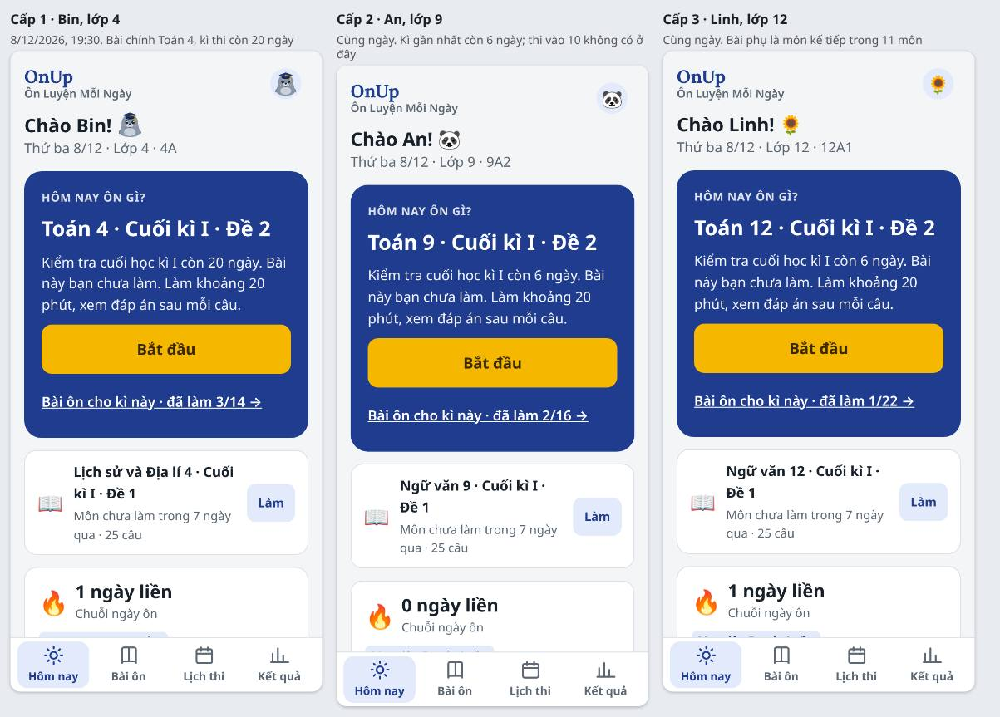

# Persona người dùng OnUp theo cấp học (11/11/2026)

OnUp phục vụ con lớp 4 đến lớp 12 cùng bố mẹ, trên cùng một giao diện. Hôm nay app bật lớp 4, 6, 9. Lớp 12 và 5 sắp bật; lớp 7, 8, 10, 11 có đề trước tháng 2/2027 (mốc ở [KE-HOACH-PHAT-TRIEN-ONUP.md](KE-HOACH-PHAT-TRIEN-ONUP.md)). Con 9 tuổi và con 17 tuổi dùng chung mọi màn, nên mỗi thay đổi giao diện cần được xét cho cả ba cấp.

File này đặt ra ba cặp persona, mỗi cấp một con và một bố mẹ. Chủ app, PO, QC, PD và các phiên giao diện dùng chung bộ persona này khi:
- đề xuất một màn mới, ghi rõ persona nào được lợi và persona nào có thể bị thiệt;
- kiểm thử thiết kế và UAT định kì (kịch bản ở mục 4);
- viết lời giao việc, ghi “Xong khi” theo kịch bản của persona.

Persona không phải người thật; tên trùng với tên dùng trong kiểm thử (Bin, Na, An, Linh). Mỗi persona dựa trên ba nguồn: dữ liệu khối, lịch thi, đề trong repo; điều chủ app, PO, QC đã ghi khi chạy thử; và vài nguồn ngoài ở mục 6. Kết quả UAT ngày 11/11/2026 theo bộ persona này nằm ở [CAI-TIEN-UX-4X.md](CAI-TIEN-UX-4X.md).

Figma: section [Persona · ba cấp](https://www.figma.com/design/9mkNYX0ZOczNDMwlKo5F4e/OnUp?node-id=376-13) ở trang Master 4.x: ghi chú nguyên tắc và ba thẻ persona.

## 1. Ba cấp trong một bảng

| | Cấp 1 · Tiểu học | Cấp 2 · THCS | Cấp 3 · THPT |
|---|---|---|---|
| Khối | 4, 5 | 6, 7, 8, 9 | 10, 11, 12 |
| Persona | Bin, 9 tuổi, lớp 4 · Mẹ Hạnh | An, 14 tuổi, lớp 9 · Bố Tuấn (thêm Na, 11 tuổi, lớp 6) | Linh, 17 tuổi, lớp 12 · Mẹ Thu |
| Máy | Điện thoại của mẹ; cuối tuần có khi dùng máy tính bảng cũ | Điện thoại Android riêng từ lớp 6 | Điện thoại riêng; máy tính xách tay khi làm đề dài |
| Lúc ôn | Sau bữa tối, khoảng 20 phút, mẹ ngồi cạnh | 21:30–22:30, sau buổi học thêm, ôn một mình | Rải rác buổi tối và cuối tuần; điện thoại không dùng được trong giờ học |
| Một lượt ôn | 10–20 phút, hay dừng giữa chừng | 20–45 phút; đề thi thử 120 phút làm ra giấy | 10 phút ôn chủ đề đến 50–90 phút làm đề thi thử |
| Môn có đề | 6 môn (lớp 4) | 8 môn | 11 môn trong app; con học 8 môn (4 bắt buộc, 4 lựa chọn) và thi tốt nghiệp 4 môn |
| Kì thi lớn | IOE (không bắt buộc); lớp 5 có đề chung của Sở ở cuối kì | Lớp 9 thi vào 10 (TP.HCM: Toán, Ngữ văn, có thể có Tiếng Anh); đề chung của Sở ở cuối kì | Lớp 12 thi tốt nghiệp THPT, thí điểm thi trên máy tính từ 2027; đề chung của Sở ở cuối kì |
| Bố mẹ làm gì | Kèm từng bài, đặt PIN, chọn bài, xem mỗi tối | Xem báo cáo tuần, lo thi vào 10, ít ngồi cạnh | Hỏi “con có ôn đều không”, không muốn kiểm soát |
| Con cần ở OnUp | Biết hôm nay làm bài gì, được khen đúng lúc, ít chữ, nút to | Đúng trọng tâm kì gần nhất và thi vào 10, thấy mình tiến tới đâu | Chỉ thấy môn mình học và thi, đề thi thử nghiêm túc, giọng không trẻ con |

## 2. Persona chi tiết

### 2.1 Cấp 1 · Bin (lớp 4) và Mẹ Hạnh

**Bin, 9 tuổi, lớp 4A, một trường tiểu học công lập ở TP.HCM.**
- Máy: dùng điện thoại Android 6,1 inch của mẹ, chưa có máy riêng. Cuối tuần có khi dùng máy tính bảng cũ 8 inch của nhà.
- Thói quen: ôn sau bữa tối, khoảng 20 phút, mẹ ngồi cạnh. Thích hình hải cẩu đội mũ, thích huy hiệu, sợ thấy chữ “sai”.
- Đọc: đọc chậm câu dài, hay bỏ qua dòng chữ nhỏ. Hiểu “3/5 bài” dễ hơn “82%”, hiểu “còn 20 câu” dễ hơn “điểm trung bình tháng”.
- Mục tiêu: “Làm xong bài mẹ giao, được huy hiệu.”
- Điều làm Bin khó:
  - đề 25 câu dài hơn một buổi tối;
  - dừng giữa chừng thì không biết lần sau làm tiếp ở đâu;
  - trang có nhiều thẻ phải cuộn;
  - chữ viết hoa có dấu ở nhãn câu hỏi khó đọc.

**Mẹ Hạnh, 35 tuổi, nhân viên văn phòng.** Có Bin lớp 4 và bé Su lớp 1 (chưa dùng app).
- Máy: điện thoại riêng. Nhận tin của cô qua nhóm Zalo lớp.
- Việc với OnUp:
  - tạo hồ sơ cho Bin, đặt PIN, chọn bài;
  - xem Bin làm mỗi tối;
  - cuối tuần gửi báo cáo cho bố Bin qua Zalo.
- Mục tiêu: “Bin ôn đều, mẹ biết Bin sai ở đâu để giảng lại.”
- Nỗi lo:
  - Bin cầm máy thì mở trò chơi;
  - không biết bài nào là trọng tâm kì này;
  - điểm trên app không khớp với điều mẹ thấy Bin làm.

**OnUp phải làm được cho cấp 1:**
- từ màn “Xin chào!” tới câu 1 không quá 7 chạm (đo 11/11: đúng 7);
- một bài chính rõ ràng, có số câu và thời gian thật;
- dừng giữa đề không mất phần đã làm và không bị tính là “xong đề”;
- lời khen đúng với việc con vừa làm.

### 2.2 Cấp 2 · An (lớp 9) và Bố Tuấn

**An, 14 tuổi, lớp 9A2, một trường THCS ở TP.HCM.**
- Máy: điện thoại Android riêng từ lớp 6, máy rẻ, màn 6,5 inch, bộ nhớ hay đầy.
- Lịch: học chính khóa; học thêm Toán, Tiếng Anh ba buổi tối mỗi tuần; ôn trên app khoảng 21:30–22:30, một mình.
- Áp lực:
  - thi vào lớp 10 công lập đầu tháng 6/2027;
  - cuối kì I và cuối năm có đề chung của Sở (Thông tư 89/2026);
  - khảo sát hơn 5 000 học sinh lớp 9 ở TP.HCM: 65,6% tự đánh giá căng thẳng cao, hơn một nửa lo lắng kéo dài, khó ngủ.
- Mục tiêu: “Đủ điểm vào trường công lập gần nhà; biết mình yếu chương nào.”
- Điều làm An khó:
  - Hôm nay chỉ nói về kì gần nhất, không cho thấy An đã đi được bao xa tới kì thi vào 10;
  - đề thi thử Toán 120 phút làm ra giấy, nhưng app bắt đi qua 15 màn rồi tự chấm 15 ý trên điện thoại;
  - lời giới thiệu “khoảng 20 phút, xem đáp án sau mỗi câu” không đúng với đề thi thử.

**Bố Tuấn, 44 tuổi, kĩ sư, hay đi công trình.**
- Xem báo cáo tuần trên điện thoại tối chủ nhật; ít khi ngồi cạnh con.
- Mục tiêu: “Biết An có ôn đều không, đề thi thử được mấy điểm, còn bao nhiêu đề.”
- Nỗi lo: con thức khuya, căng thẳng. Bố muốn đồng hành chứ không giám sát. Bài báo về khảo sát trên khuyên bố mẹ tránh so sánh con với bạn.

**Na, 11 tuổi, lớp 6:** năm đầu cấp 2, 8 môn, nhiều thầy cô.
- Na cần biết kì này thi môn gì, theo thứ tự nào (Phiên UX15 đã xếp môn theo ô Môn thi).
- Đề lớp 6 ngắn, lời dặn trung bình 65 chữ. Na dùng app gần như Bin, chỉ khác là ít khi có mẹ ngồi cạnh.

**OnUp phải làm được cho cấp 2:**
- bài chính theo kì gần nhất, nhưng con vẫn thấy đường tới kì thi lớn: số đề thi thử đã làm, điểm gần nhất;
- đề thi thử làm ra giấy có luồng hợp với giấy: đọc cả đề, nộp, rồi chấm từng bài;
- bố mẹ đọc được tiến độ thi thử trong một dòng.

### 2.3 Cấp 3 · Linh (lớp 12) và Mẹ Thu

**Linh, 17 tuổi, lớp 12A1, một trường THPT ở TP.HCM.**
- Môn học: 4 môn bắt buộc có điểm (Toán, Ngữ văn, Tiếng Anh, Lịch sử) và 4 môn lựa chọn Linh đã chọn từ lớp 10 (Vật lí, Hóa học, Sinh học, Tin học). Linh thi tốt nghiệp Toán, Ngữ văn, Vật lí, Hóa học.
- Máy: iPhone riêng; máy tính xách tay của nhà khi làm đề dài. Năm 2027 thí điểm thi tốt nghiệp trên máy tính, nên Linh muốn quen làm đề trên máy tính.
- Thói quen:
  - tự học, không thích bị nhắc;
  - quyết nhanh trong vài phút xem app có đáng dùng không;
  - đọc lướt, bỏ qua đoạn chữ dài.
- Mục tiêu: “Mỗi môn thi tốt nghiệp từ 8 điểm; chỉ luyện đúng 4 môn mình thi.”
- Điều làm Linh khó:
  - tab Bài ôn có 11 môn, khi mở hết các nhóm là 138 nút, trong đó có 3 môn Linh không học;
  - màn mở đề thi thử có 288 chữ giới thiệu, phải cuộn qua mới tới nút chọn cách làm;
  - lời và hình như “Giỏi lắm!”, hải cẩu tung bóng hợp em nhỏ hơn;
  - làm đề trên máy tính chỉ dùng được chuột, Tab và phím cách.

**Mẹ Thu, 46 tuổi, buôn bán nhỏ.**
- Mục tiêu: “Biết con có ôn đều không. Không muốn kiểm soát, sợ con khó chịu.”
- Xem thẻ của Linh ở mục Các con và tin nhắn tuần; không cần chi tiết từng chủ đề.
- Điều làm khó: thẻ của Linh ghi “chưa ôn … và 6 môn khác”, gồm cả môn Linh không học, nên mẹ không biết môn nào đáng lo.

**OnUp phải làm được cho cấp 3:**
- con chọn môn mình học và thi; mọi danh sách, gợi ý, thẻ của bố mẹ theo các môn đó;
- màn mở đề ngắn, nút làm bài nằm trong màn đầu;
- lời ngắn, nói đúng việc, không nựng;
- làm đề trên máy tính được bằng bàn phím.

## 3. Một giao diện cho ba cấp: nguyên tắc cân đối

1. **Một bộ màn, khác nhau theo dữ liệu, không theo nhãn tuổi.** Màn đổi theo số môn của con, kì thi lớn của khối, độ dài đề và lựa chọn của con, không theo kiểu “giao diện cho bé”, “giao diện cho anh chị”. Cách này giữ một bộ code, một bộ kiểm thử.
2. **Mặc định hợp với người nhỏ nhất, không làm chậm người lớn nhất.** Chữ ≥ 13px, nút ≥ 44px, câu ngắn, số dạng “3/5”: đã có trong quy tắc của CLAUDE.md. Người lớn không bị chậm vì điều đó. Thứ làm người lớn chậm là chữ dài và danh sách thừa.
3. **Lượng thông tin theo việc phải làm hôm nay.** Mỗi lần mở app có một bài chính và tối đa một bài phụ. Khối có kì thi lớn thì thêm một dòng tiến độ của kì đó. Phần còn lại để ở tab Bài ôn.
4. **Lời nói đúng việc đã làm.** Khen theo việc thật (“Bạn đã làm 5/25 câu”), không khen chung chung. Bỏ từ nựng mà vẫn giữ giọng ấm. Hình hải cẩu là hình đại diện con tự chọn, không phải hình bắt buộc của mọi cấp.
5. **Tiến độ trung thực.** Con và bố mẹ thấy cùng một con số, tính cùng một cách. Đề làm dở không tính là đề đã làm.
6. **Riêng tư theo tuổi.** Con biết bố mẹ thấy những gì: số bài, điểm, chủ đề hay sai. Con lớn được tự chọn môn của mình.
7. **Mỗi đề xuất ghi persona nào được lợi** và kiểm tra lại ở ba persona. Ví dụ: thu gọn lời dặn của đề giúp Linh nhiều nhất và không làm Bin thiệt, vì lời dặn của đề lớp 4 vốn ngắn.

## 4. Kịch bản UAT theo persona

Dùng cho kiểm thử định kì của PD. QC và phiên giao diện dùng khi cần. Chạy bản lưu trên máy của `main` ở 360px sáng và tối. Khối chưa bật thì bật giả: thay `data/grades.js` bằng `route` của Playwright, không sửa repo. Dữ liệu và ngày giả lập giữ như mục 3 của [CAI-TIEN-UX-4X.md](CAI-TIEN-UX-4X.md), để các đợt so được với nhau. Script để trong thư mục nháp, không vào repo.

| Mã | Persona | Việc | Đo | Đạt khi |
|---|---|---|---|---|
| U1 | Bin | Mở app, chọn mình, nhập PIN, bắt đầu bài chính | Số chạm tới câu 1; nút Bắt đầu nằm trong màn đầu | ≤ 7 chạm; nút trong màn đầu |
| U2 | Bin | Làm 5 câu rồi dừng; hôm sau mở lại | Nút đề, Hôm nay, tiến độ kì, báo cáo tuần | Đề ghi làm dở; bài chính là “làm tiếp” |
| U3 | Bin | Đọc thẻ Hôm nay | Số chữ trong màn đầu; lời giới thiệu khớp đề | Lời giới thiệu có số câu, số phút thật |
| U4 | Mẹ Hạnh | Xem Bin hôm nay, gửi báo cáo tuần qua Zalo | Số chạm; tin nhắn khớp số liệu | ≤ 2 chạm tới nút “Gửi báo cáo” |
| U5 | An | Ngày 8/12: biết hôm nay ôn gì và còn bao xa tới thi vào 10 | Hôm nay có tiến độ thi thử không | Thấy được ở Hôm nay, không phải mở tab khác |
| U6 | An | Làm như thi một đề Toán thi thử vào 10 làm ra giấy, rồi tự chấm | Số chạm tới lúc nộp; lời hỏi khi nộp; độ dài màn chấm | Đọc được cả đề; lời hỏi đúng với câu tự chấm; chấm từng bài |
| U7 | Bố Tuấn | Xem An có ôn đều không, đề thi thử được mấy điểm | Thẻ của con, tin nhắn tuần | Đọc được trong một dòng |
| U8 | Linh | Tìm và mở “Hóa học 12 · Thi thử tốt nghiệp · Đề 3” | Số màn phải cuộn; số chữ ở khối giới thiệu | Chỉ thấy môn của Linh; nút cách làm trong màn đầu |
| U9 | Linh | Làm đề thi thử trên máy tính 1366 × 768 | Chọn đáp án bằng bàn phím được không; viền focus | Có phím chọn đáp án; viền focus rõ |
| U10 | Mẹ Thu | Đọc thẻ của Linh và tin nhắn tuần | Thẻ có môn Linh không học không | Chỉ nhắc môn Linh học |
| U11 | Cả ba | Mọi màn trên | Cuộn ngang, nút < 44px, chữ < 13px, chữ đè, lỗi JavaScript | Không có |

## 5. Khi nào sửa file này

- Khi bật khối mới, xem lại bảng mục 1: số môn, kì thi lớn, độ dài đề.
- Khi có góp ý từ gia đình dùng thử (từ tháng 3/2027), sửa persona cho gần người thật hơn. Ghi chép dùng thử lấy ở mục 5 của [KE-HOACH-PHAT-TRIEN-ONUP.md](KE-HOACH-PHAT-TRIEN-ONUP.md).
- Khi quy chế thi đổi: Thông tư 89/2026, quy chế thi vào 10 năm 2027, đề án thi tốt nghiệp trên máy tính.

## 6. Nguồn

- Nielsen Norman Group:
  - [Designing for Children](https://www.nngroup.com/videos/designing-children/);
  - [Children's UX: Physical Development](https://www.nngroup.com/articles/children-ux-physical-development/): từ khoảng 9 tuổi, con dùng được các thao tác như người lớn, nhưng giao diện vẫn nên đơn giản hơn;
  - [Kids' cognition](https://www.nngroup.com/articles/kids-cognition/): trẻ 9–12 tuổi đã suy luận được, còn kĩ năng lập kế hoạch, tự theo dõi mình thì chưa vững; lời dặn cần rõ, cụ thể;
  - [UX Design for Teenagers (Ages 13–17)](https://www.nngroup.com/reports/teenagers-on-the-web/): tuổi teen hay làm sai rồi bỏ cuộc nhanh, đọc chưa tốt, ít kiên nhẫn;
  - bài “Usability of Websites for Teenagers” (tóm tắt ở [lorcandempsey.net](https://www.lorcandempsey.net/usability-of-websites-for-teenagers)): tuổi teen làm xong việc 55% so với 66% ở người lớn; trang được chấm cao nhất là trang gọn, không màu mè.
- [Tuổi Trẻ, 27/3/2026](https://tuoitre.vn/thi-tuyen-lop-10-lam-sao-de-hoc-sinh-khong-duoi-suc-20260327095858053.htm): khảo sát hơn 5 000 học sinh lớp 9 TP.HCM về căng thẳng trước thi vào 10.
- [Báo Lào Cai (theo Tiền Phong), 27/11/2023](https://baolaocai.vn/giao-dien-thoai-cho-hoc-sinh-tu-som-quan-ly-the-nao-post376454.html): trẻ em Việt Nam có điện thoại riêng trung bình từ 9 tuổi; Thông tư 32 không cho dùng điện thoại trong giờ học, trừ khi giáo viên cho phép để học.
- [VTC News, 12/10/2026](https://vtcnews.vn/co-nen-bo-ban-phu-huynh-khi-khong-con-thu-quy-ket-noi-thi-da-co-zalo-ar1044652.html): nhóm Zalo lớp là kênh chính giữa giáo viên và phụ huynh.
- [Sài Gòn Giải Phóng, 3/8/2022](https://www.sggp.org.vn/lich-su-thanh-mon-hoc-bat-buoc-khong-chia-mon-tu-chon-thanh-cac-nhom-mon-post646296.html): Thông tư 13/2022, THPT có các môn bắt buộc (Ngữ văn, Toán, Ngoại ngữ 1, Lịch sử…) và 4 môn lựa chọn trong 9 môn.
- [Pháp Luật TP.HCM](https://plo.vn/thi-tot-nghiep-thpt-tu-2025-chi-con-4-mon-khong-bat-buoc-thi-ngoai-ngu-post764156.html): thi tốt nghiệp từ năm 2025 gồm Toán, Ngữ văn và 2 môn tự chọn trong các môn học ở lớp 12; ngoại ngữ không bắt buộc.
- [Đại biểu Nhân dân, 4/9/2025](https://daibieunhandan.vn/thi-diem-thi-tot-nghiep-thpt-tren-may-tinh-tu-nam-2027-10385644.html): thí điểm thi tốt nghiệp THPT trên máy tính từ năm 2027.
- Trong repo:
  - `data/grades.js`, `data/calendar-2026-2027.js`, `data/banks/index.js`: khối, kì thi, số môn, số đề;
  - mục 2 của [KE-HOACH-NOI-DUNG.md](KE-HOACH-NOI-DUNG.md): Thông tư 89/2026 (đề chung của Sở), Thông tư 30/2024 (thi vào 10, môn thứ ba do tỉnh chọn; khung đề TP.HCM), Thông tư 24/2024 (thi tốt nghiệp 4 môn).
