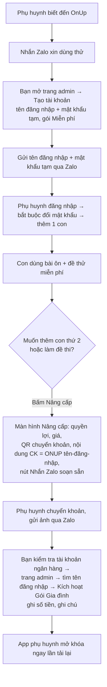
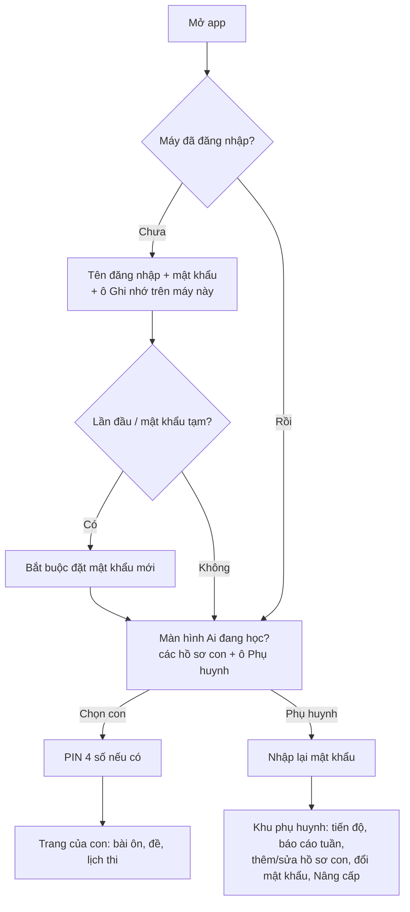

# Thiết kế: tài khoản, trang quản trị và gói trả phí

Phiên bản 1 · 16/10/2026 · Trạng thái: **đã chốt hướng, chưa làm**. Các phiên Claude Code để làm: mục 9.

Mục tiêu: chủ app (bạn) tạo và quản lý tài khoản ở một **trang admin riêng**; phụ huynh đăng nhập bằng **tên đăng nhập + mật khẩu**; **gói miễn phí** dùng được ngay, **gói trả phí** bán qua Zalo và được bạn kích hoạt tay. Làm sao cho ít công sức nhất mà vẫn an toàn khi đã thu tiền.

---

## 1. Năm quyết định chính (để ít việc nhất)

1. **Một tài khoản = một gia đình, do phụ huynh giữ.** Con **không có tài khoản riêng**, chỉ là **hồ sơ** bên trong tài khoản của bố mẹ (giống các hồ sơ trên Netflix). Bố mẹ đăng nhập một lần trên máy của con, con chọn hồ sơ của mình là học. Con không phải nhớ mật khẩu nào.
2. **Bạn tạo mọi tài khoản ở trang admin**, gửi tên đăng nhập + mật khẩu tạm qua Zalo. Chưa mở tự đăng ký (làm sau, mục 8). Nhờ vậy **không cần email, không cần xác nhận email, không cần cài hộp thư gửi**.
3. **Thu tiền qua Zalo + chuyển khoản**, bạn bấm “Kích hoạt gói” ở trang admin. Không làm trang thanh toán.
4. **Mọi giới hạn của gói kiểm tra ở máy chủ** (Supabase), không chỉ ẩn nút trên giao diện, vì đã thu tiền.
5. **Đề trả phí không nằm trong file công khai.** Repo đang public nên ai cũng tải được `data/banks.js`. Đề trả phí chuyển vào cơ sở dữ liệu, chỉ tài khoản đã trả phí mới đọc được.

Bỏ hẳn khỏi bản đám mây hiện tại (bớt việc và bớt chỗ dễ lỗi): đăng nhập email, link/mã số qua email, cài SMTP, mã mời, mã gia đình, PIN học sinh trên máy chủ, đăng nhập ẩn danh, danh sách email được tạo gia đình.

---

## 2. Có cần xác nhận email không?

**Không cần ở giai đoạn này.** Xác nhận email dùng để (a) biết người đăng ký là thật và (b) cho người dùng tự lấy lại mật khẩu. Ở đây:
- Bạn tự tạo tài khoản sau khi đã nói chuyện qua Zalo, nên đã biết người mua là ai.
- Quên mật khẩu: phụ huynh nhắn Zalo, bạn đặt mật khẩu tạm mới ở trang admin (10 giây).

Khi nào cần thêm email: khi mở **tự đăng ký** cho nhiều người lạ, hoặc khi số người nhắn “quên mật khẩu” quá nhiều. Lúc đó thêm email *không bắt buộc* để tự lấy lại mật khẩu.

## 3. Bảo mật tối thiểu cần có

| Rủi ro | Cách chặn | Công sức |
|---|---|---|
| Đoán mật khẩu | Supabase tự băm mật khẩu và giới hạn số lần đăng nhập; mật khẩu tối thiểu 8 kí tự; bật CAPTCHA khi đăng nhập (đã có sẵn từ PR #8) | Có sẵn |
| Mật khẩu tạm bị lộ qua Zalo | Lần đăng nhập đầu **bắt buộc đổi mật khẩu** | Nhỏ |
| Dùng tính năng trả phí mà không trả | Kiểm tra ở máy chủ: giới hạn số hồ sơ con bằng trigger; đề trả phí đọc qua chính sách RLS | Vừa |
| Tải trộm đề trả phí | Đề trả phí nằm trong bảng có RLS, không nằm trong repo | Vừa |
| Con vào khu phụ huynh, xóa dữ liệu | Từ hồ sơ con sang khu phụ huynh phải nhập lại mật khẩu | Nhỏ |
| Anh em dùng nhầm hồ sơ của nhau | PIN 4 số tùy chọn cho từng hồ sơ con (chỉ khóa trên giao diện, không phải bảo mật) | Nhỏ |
| Người lạ vào trang admin | Chỉ tài khoản có trong bảng `app_owners` mới gọi được chức năng admin (kiểm tra ở Edge Function và RLS); mật khẩu chủ dài; khuyên bật xác thực 2 lớp sau | Nhỏ |
| Đối soát tiền | Mỗi lần kích hoạt/gia hạn ghi một dòng nhật ký: ai, gói gì, đến ngày nào, số tiền, ghi chú Zalo | Nhỏ |
| Lộ khóa bí mật | Khóa `service_role` chỉ nằm trong Edge Function; trang web chỉ có khóa công khai (như hiện nay) | Có sẵn |

Không làm (chưa cần): chặn chia sẻ tài khoản, giới hạn số máy đăng nhập, hóa đơn điện tử. Giới hạn số hồ sơ con là đủ để chia sẻ tài khoản không có lợi nhiều.

Dữ liệu cá nhân: tài khoản chỉ có tên đăng nhập và tên hiển thị; hồ sơ con chỉ có tên, khối, lớp, hình đại diện (như hiện nay). Tên Zalo, số điện thoại, số tiền chỉ nằm trong **ghi chú admin**, chỉ bạn đọc được. Khi bắt đầu thu tiền, nên có trang **Điều khoản** và **Chính sách quyền riêng tư** ngắn gọn (ai giữ dữ liệu gì, xóa thế nào) theo quy định bảo vệ dữ liệu cá nhân hiện hành; phụ huynh tạo hồ sơ cho con nghĩa là phụ huynh đồng ý. Phần thuế/hóa đơn khi bán hàng: hỏi kế toán.

---

## 4. Gói và quyền

| | **Miễn phí** | **Gói Gia đình** (trả phí) |
|---|---|---|
| Số hồ sơ con | 1 | tối đa 3 |
| Bài ôn (4 bài ôn dạng trang: ôn giữa kì I lớp 4, lớp 6, IOE 4, IOE 6) | ✅ | ✅ |
| Đề thi (ngân hàng đề cuối kì, giữa kì II, cuối năm…) | Chỉ **đề thử miễn phí**: đề số 1 của mỗi môn ở mỗi kì | ✅ tất cả |
| Báo cáo tuần, lịch thi, theo dõi tiến độ | ✅ | ✅ |
| Thời hạn | Không hạn | Đến **31/8** cuối năm học (một mức giá cho cả năm học) |

**Đề thử miễn phí** là cái móc để bán: phụ huynh thấy chất lượng đề rồi mới mua. Mỗi bộ đề có cờ `free_trial`.

**Khi gói hết hạn:** tài khoản tự trở về Miễn phí, **không mất dữ liệu**. Hồ sơ con thứ 2, 3 vẫn hiện nhưng bị khóa (xem được kết quả cũ, không làm bài mới) cho tới khi gia hạn. Trước hạn 14 ngày, app nhắc phụ huynh.

**Bạn cần chốt:** giá gói, số hồ sơ tối đa (đề xuất 3), ngày hết hạn (đề xuất 31/8), số Zalo, ảnh QR chuyển khoản. Các giá trị này để trong `js/config.js` và bảng `plans`, đổi không cần sửa code.

---

## 5. Các luồng

### 5.1 Bán tài khoản qua Zalo

### 5.2 Đăng nhập và chọn hồ sơ

Quên mật khẩu: dưới ô đăng nhập có dòng “Quên mật khẩu? Nhắn Zalo …” mở thẳng Zalo.

### 5.3 Trang admin (`admin.html`, chỉ bạn vào được)

- **Tìm tài khoản** theo tên đăng nhập hoặc ghi chú (tên Zalo, số điện thoại).
- **Tạo tài khoản:** tên đăng nhập (4–20 kí tự `a-z 0-9 . _`), mật khẩu tạm (app gợi ý sẵn), gói, ghi chú.
- **Đặt lại mật khẩu** (sinh mật khẩu tạm, bắt buộc đổi lần sau).
- **Kích hoạt / gia hạn gói:** chọn gói, hạn (mặc định 31/8 năm học hiện tại), số tiền, ghi chú → ghi nhật ký.
- **Khóa / mở khóa / xóa** tài khoản (xóa có xác nhận, xóa luôn hồ sơ con và kết quả).
- **Nhật ký thanh toán** và **xuất CSV** để đối soát.
- **Đề trả phí:** đăng, ẩn bộ đề; đánh dấu đề thử miễn phí; gắn vào kì thi.
- Số liệu nhanh: số tài khoản, số đang trả phí, số sắp hết hạn trong 30 ngày.

---

## 6. Dữ liệu trên Supabase (thay cho lược đồ Phiên 5)

| Bảng | Nội dung | Ai đọc/ghi |
|---|---|---|
| `app_owners` | id người dùng của bạn (chủ app) | chỉ owner |
| `families` | 1 dòng mỗi tài khoản: `id`, `auth_user_id`, `username` (duy nhất), `display_name`, `plan` (`free`/`family`), `plan_until`, `must_change_password`, `status` (`active`/`locked`), `created_at` | phụ huynh đọc dòng của mình; chỉ owner sửa gói, trạng thái |
| `profiles` | hồ sơ con: `family_id`, tên, hình, khối, lớp, `pin_hash` tùy chọn, `locked` (vượt hạn mức) | phụ huynh của gia đình đó |
| `results`, `exam_events` | giữ như hiện nay, theo `family_id` | phụ huynh của gia đình đó |
| `plans` | `free`: 1 hồ sơ; `family`: 3 hồ sơ, giá | ai đã đăng nhập đều đọc |
| `plan_log` | nhật ký kích hoạt: tài khoản, gói, hạn cũ → hạn mới, số tiền, ghi chú, ai làm, lúc nào | chỉ owner |
| `admin_notes` | tên Zalo, số điện thoại, ghi chú | chỉ owner |
| `paid_banks` | đề trả phí: khối, môn, kì thi, câu hỏi (jsonb), `free_trial`, `published` | đọc được khi `free_trial` **hoặc** gói đang còn hạn; chỉ owner ghi |

Quy tắc ở máy chủ:
- Hàm `plan_active(family)` = `plan = 'family' and plan_until >= hôm nay`.
- Trigger khi thêm hồ sơ con: số hồ sơ hiện có phải nhỏ hơn hạn mức của gói đang hiệu lực.
- Ghi kết quả cho hồ sơ bị khóa thì từ chối.
- Tên đăng nhập lưu ở Supabase Auth dưới dạng email nội bộ `ten-dang-nhap@users.onup.invalid` (đuôi `.invalid` không bao giờ là email thật, không gửi thư). Phụ huynh chỉ thấy và gõ tên đăng nhập.

Edge Function `admin` (thay cho `student-login`), chỉ owner gọi được: `create_account`, `reset_password`, `set_plan`, `set_status`, `delete_account`, `list_accounts`. Dùng khóa `service_role` để tạo người dùng (`auth.admin.createUser`, đã xác nhận sẵn, không gửi email).

Bản lưu trên máy (LocalStore) giữ lại cho kiểm thử và dùng thử không cần mạng, nhưng chỉ có bài ôn và đề thử miễn phí.

---

## 7. Việc bạn tự làm (không tốn lượt Claude)

1. Chốt các giá trị ở mục 4: giá, số hồ sơ, ngày hết hạn, số Zalo, ảnh QR (VietQR của ngân hàng, nội dung để trống).
2. Tạo project Supabase (miễn phí), làm theo hướng dẫn mới mà Phiên A viết. Ngắn hơn hướng dẫn cũ vì **không còn bước cài email**.
3. Tạo tài khoản chủ app của bạn (hướng dẫn có lệnh SQL một dòng để thêm vào `app_owners`).
4. Viết 2 trang ngắn Điều khoản và Quyền riêng tư (Claude có thể soạn nháp trong Phiên C).
5. Thử toàn bộ luồng 5.1 với một tài khoản thật của gia đình mình trước khi bán.

## 8. Để sau (khi có nhu cầu thật)

- **Tự đăng ký miễn phí** (tên đăng nhập + mật khẩu + CAPTCHA) khi số người xin dùng thử quá nhiều để tạo tay.
- **Email không bắt buộc** để tự lấy lại mật khẩu.
- **Thanh toán tự động** (cổng thanh toán, webhook) khi số đơn mỗi tuần vượt khả năng kích hoạt tay.
- **Xác thực 2 lớp** cho tài khoản chủ app.
- **Gói lớp học** cho giáo viên (nhiều hồ sơ, giao bài).
- Chuyển hẳn repo sang riêng tư và đổi nơi đăng trang (ví dụ Cloudflare Pages miễn phí) nếu muốn giấu cả mã nguồn. Không bắt buộc, vì đề trả phí đã nằm trên máy chủ.

---

## 9. Các phiên Claude Code để làm

Làm **theo thứ tự**, mỗi phiên một cuộc trò chuyện mới, Merge xong mới mở phiên sau. Ước lượng: 3 phiên chính + 1 phiên tùy chọn.

**Phiên A · Máy chủ: tài khoản, gói, đề trả phí**
> Đọc CLAUDE.md và docs/THIET-KE-TAI-KHOAN-VA-GOI.md (mục 1–6). Viết lại supabase/schema.sql theo mục 6: app_owners, families (username, plan, plan_until, must_change_password, status), profiles (hồ sơ con, pin_hash tùy chọn, locked), plans, plan_log, admin_notes, paid_banks, giữ results và exam_events theo family_id; hàm plan_active, trigger giới hạn số hồ sơ con theo gói, chặn ghi kết quả cho hồ sơ bị khóa; RLS đúng bảng quyền ở mục 6. Bỏ các bảng và chức năng mục 1 nói bỏ (mã gia đình, mã mời, PIN học sinh trên máy chủ, đăng nhập ẩn danh, allowed_creators). Thay Edge Function student-login bằng Edge Function admin (create_account, reset_password, set_plan, set_status, delete_account, list_accounts; chỉ owner; tạo người dùng bằng email nội bộ tên-đăng-nhập@users.onup.invalid). Thêm script chuyển 18 đề trong data/banks.js thành SQL chèn vào paid_banks (đề số 1 mỗi môn mỗi kì là free_trial). Viết lại tests/supabase (RLS trên PostgreSQL, Edge Function trên máy chủ giả) cho đủ các quy tắc. Viết docs/HUONG-DAN-SUPABASE.md mới, ngắn, không còn bước email. Chưa sửa giao diện. Chạy sh tests/supabase/run.sh, tự rà soát một vòng, mở Pull Request.

**Phiên B · App: đăng nhập, chọn hồ sơ, khóa theo gói, Nâng cấp**
> Đọc CLAUDE.md và docs/THIET-KE-TAI-KHOAN-VA-GOI.md (mục 4, 5.1, 5.2). Sau khi Phiên A đã gộp: sửa js/store-supabase.js và js/app.js cho bản đám mây: đăng nhập tên đăng nhập + mật khẩu (+ Ghi nhớ, CAPTCHA nếu có khóa), bắt buộc đổi mật khẩu tạm, màn hình “Ai đang học?”, PIN 4 số tùy chọn cho hồ sơ con, nhập lại mật khẩu khi vào khu phụ huynh, thêm hồ sơ con theo hạn mức, đề trả phí tải từ paid_banks, khóa đề và hồ sơ vượt hạn mức kèm nút Nâng cấp, màn hình Nâng cấp (quyền lợi, giá, ảnh QR, nội dung chuyển khoản ONUP tên-đăng-nhập, nút Nhắn Zalo soạn sẵn; giá, số Zalo, đường dẫn ảnh QR đọc từ js/config.js), nhắc gia hạn trước 14 ngày, dòng “Quên mật khẩu? Nhắn Zalo”. Bỏ giao diện đăng nhập email, mã mời, mã gia đình. Bản lưu trên máy giữ nguyên nhưng chỉ có bài ôn và đề thử miễn phí. Cập nhật tests/e2e.js và tests/supabase/cloud-e2e.js, ảnh 360px sáng/tối, tự rà soát một vòng, mở Pull Request.

**Phiên C · Trang admin**
> Đọc CLAUDE.md và docs/THIET-KE-TAI-KHOAN-VA-GOI.md (mục 5.3). Sau khi Phiên B đã gộp: tạo admin.html (cùng css/app.css, JavaScript thuần, không build) cho chủ app: tìm tài khoản, tạo tài khoản (gợi ý mật khẩu tạm), đặt lại mật khẩu, kích hoạt/gia hạn gói (mặc định đến 31/8 năm học hiện tại) có số tiền và ghi chú, khóa/mở khóa/xóa có xác nhận, nhật ký thanh toán, xuất CSV, quản lý đề trả phí (đăng, ẩn, đánh dấu đề thử, gắn kì thi), số liệu nhanh. Gọi Edge Function admin; tài khoản không phải owner thấy “Không có quyền”. Soạn nháp hai trang terms.html và privacy.html ngắn gọn bằng tiếng Việt. Thêm kiểm thử trang admin vào tests/supabase/cloud-e2e.js, tự rà soát một vòng, mở Pull Request.

**Phiên D (tùy chọn) · Tự đăng ký miễn phí** — chỉ làm khi cần, xem mục 8.
