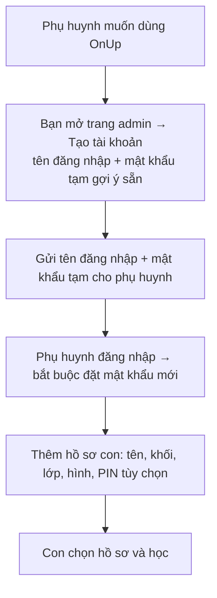
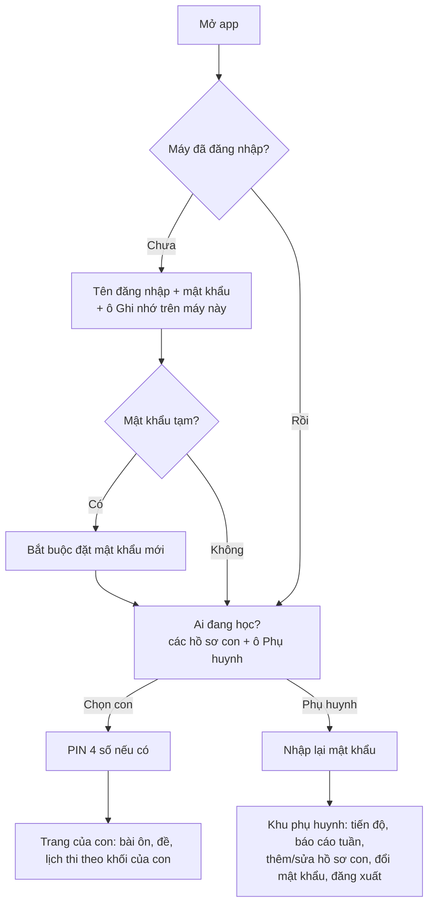

# Thiết kế: khung quản lý tài khoản và trang admin

Phiên bản 2 · 16/10/2026 · Trạng thái: **đã chốt hướng, chưa làm**. Các phiên Claude Code để làm: mục 8.

**Phạm vi bây giờ:** dựng khung tài khoản để sau này phát triển tiếp. Chủ app (bạn) tạo và quản lý tài khoản ở một **trang admin riêng**; phụ huynh đăng nhập bằng **tên đăng nhập + mật khẩu**; con là hồ sơ trong tài khoản của bố mẹ. **Chưa làm bản trả phí**: mọi tài khoản dùng được mọi nội dung. Bản trả phí chỉ tính khi app đã có đủ đề từ lớp 4 đến lớp 12 (mục 9 ghi sẵn hướng đi). Khung bây giờ chừa sẵn chỗ để lúc đó không phải làm lại.

---

## 1. Các quyết định chính

1. **Một tài khoản = một gia đình, do phụ huynh giữ.** Con **không có tài khoản riêng**, chỉ là **hồ sơ** trong tài khoản của bố mẹ (giống hồ sơ trên Netflix). Bố mẹ đăng nhập một lần trên máy của con; con chọn hồ sơ của mình là học, không phải nhớ mật khẩu.
2. **Bạn tạo tài khoản ở trang admin**, gửi tên đăng nhập + mật khẩu tạm cho phụ huynh (qua Zalo hoặc nói trực tiếp). Chưa mở tự đăng ký. Nhờ vậy **không cần email, không cần xác nhận email, không cần cài hộp thư gửi**.
3. **Quyền kiểm tra ở máy chủ** (Supabase, chính sách RLS), không chỉ ẩn nút trên giao diện.
4. **Khối lớp không cố định 4 và 6.** Danh sách khối lấy từ một chỗ duy nhất (lớp 1–12), nội dung nào gắn khối nấy. Thêm lớp mới chỉ là thêm nội dung, không sửa code.
5. **Chừa sẵn chỗ cho gói** (cột `plan`, bảng hạn mức) nhưng **chưa dùng**: hôm nay mọi tài khoản là `free` và được dùng tất cả.

Bỏ khỏi bản đám mây hiện tại (Phiên 5) cho gọn và bớt chỗ dễ lỗi: đăng nhập email, link/mã số qua email, cài SMTP, mã mời, mã gia đình, PIN học sinh trên máy chủ, đăng nhập ẩn danh, danh sách email được tạo gia đình.

---

## 2. Có cần xác nhận email không?

**Không cần.** Xác nhận email dùng để (a) biết người đăng ký là thật và (b) cho người dùng tự lấy lại mật khẩu. Ở đây bạn tự tạo tài khoản cho người mình biết; quên mật khẩu thì phụ huynh báo bạn, bạn đặt mật khẩu tạm mới ở trang admin.

Khi nào cần email: khi mở **tự đăng ký** cho người lạ, hoặc khi việc đặt lại mật khẩu tay quá nhiều. Lúc đó thêm email *không bắt buộc* để tự lấy lại mật khẩu (mục 9).

## 3. Bảo mật tối thiểu

| Rủi ro | Cách chặn | Công sức |
|---|---|---|
| Đoán mật khẩu | Supabase băm mật khẩu và tự giới hạn số lần đăng nhập; mật khẩu tối thiểu 8 kí tự; CAPTCHA khi đăng nhập (đã có từ PR #8, tùy chọn) | Có sẵn |
| Mật khẩu tạm bị lộ khi gửi | Lần đăng nhập đầu **bắt buộc đổi mật khẩu** | Nhỏ |
| Con vào khu phụ huynh, xóa dữ liệu | Từ hồ sơ con sang khu phụ huynh phải nhập lại mật khẩu | Nhỏ |
| Anh em dùng nhầm hồ sơ của nhau | PIN 4 số tùy chọn cho từng hồ sơ con (chỉ khóa trên giao diện, không phải bảo mật) | Nhỏ |
| Gia đình này xem dữ liệu gia đình khác | Chính sách RLS theo `family_id` (đã có kiểu này ở Phiên 5) | Có sẵn |
| Người lạ vào trang admin | Chỉ tài khoản trong bảng `app_owners` gọi được chức năng admin (kiểm tra ở Edge Function và RLS); mật khẩu chủ dài | Nhỏ |
| Lộ khóa bí mật | Khóa `service_role` chỉ nằm trong Edge Function; trang web chỉ có khóa công khai | Có sẵn |

Dữ liệu cá nhân: tài khoản chỉ có tên đăng nhập và tên hiển thị; hồ sơ con chỉ có tên, khối, lớp, hình đại diện. Thông tin liên lạc của phụ huynh (nếu cần ghi) nằm trong **ghi chú admin**, chỉ bạn đọc được.

---

## 4. Luồng

### 4.1 Cấp tài khoản

### 4.2 Đăng nhập và chọn hồ sơ

Quên mật khẩu: dưới ô đăng nhập có dòng “Quên mật khẩu? Liên hệ người cấp tài khoản” (nội dung và đường liên hệ lấy từ `js/config.js`).

### 4.3 Trang admin (`admin.html`, chỉ chủ app vào được)

- **Danh sách và tìm kiếm** tài khoản theo tên đăng nhập hoặc ghi chú.
- **Tạo tài khoản:** tên đăng nhập (4–20 kí tự `a-z 0-9 . _`), mật khẩu tạm (gợi ý sẵn), tên hiển thị, ghi chú.
- **Đặt lại mật khẩu** (sinh mật khẩu tạm, bắt buộc đổi lần sau).
- **Khóa / mở khóa / xóa** tài khoản (xóa có xác nhận, xóa luôn hồ sơ con và kết quả).
- **Xem nhanh** một tài khoản: số hồ sơ con, khối, lần dùng gần nhất (không xem nội dung bài làm).
- **Nhật ký** thao tác admin (ai, làm gì, lúc nào).
- Số liệu nhanh: tổng tài khoản, số hồ sơ con theo khối, số tài khoản dùng trong 7 ngày.

---

## 5. Dữ liệu trên Supabase (thay cho lược đồ Phiên 5)

| Bảng | Nội dung | Ai đọc/ghi |
|---|---|---|
| `app_owners` | id người dùng của chủ app | chỉ owner |
| `families` | 1 dòng mỗi tài khoản: `id`, `auth_user_id`, `username` (duy nhất), `display_name`, `must_change_password`, `status` (`active`/`locked`), **`plan` (mặc định `free`), `plan_until` (để trống)**, `created_at`, `last_seen_at` | phụ huynh đọc dòng của mình, sửa `display_name`; chỉ owner sửa `status`, `plan` |
| `profiles` | hồ sơ con: `family_id`, tên, hình, `grade` (1–12), lớp, `pin_hash` tùy chọn | phụ huynh của gia đình đó |
| `results`, `exam_events` | giữ như hiện nay, theo `family_id` | phụ huynh của gia đình đó |
| `plans` | hạn mức theo gói. Hôm nay chỉ có `free`: tối đa **5** hồ sơ con (chặn lạm dụng), dùng mọi nội dung | ai đã đăng nhập đều đọc; chỉ owner sửa |
| `admin_notes` | ghi chú của chủ app về tài khoản | chỉ owner |
| `admin_log` | nhật ký thao tác admin | chỉ owner |

Quy tắc ở máy chủ:
- Trigger khi thêm hồ sơ con: số hồ sơ phải nhỏ hơn `max_children` của gói (hôm nay 5).
- Tài khoản `locked` không đọc/ghi được gì.
- Tên đăng nhập lưu ở Supabase Auth dạng email nội bộ `ten-dang-nhap@users.onup.invalid` (đuôi `.invalid` không bao giờ là email thật, không gửi thư). Người dùng chỉ thấy và gõ tên đăng nhập.

Edge Function `admin` (thay cho `student-login`), chỉ owner gọi được: `create_account`, `reset_password`, `set_status`, `delete_account`, `list_accounts`. Dùng khóa `service_role` để tạo người dùng (`auth.admin.createUser`, đã xác nhận sẵn, không gửi email). Mọi thao tác ghi vào `admin_log`.

**Danh sách khối lớp** để một chỗ: `data/grades.js` (ví dụ `[{grade:4, name:"Lớp 4", active:true}, …, {grade:12, …, active:false}]`). Form hồ sơ con, lịch thi, trang quản trị đều đọc từ đây thay vì viết cứng `[4, 6]` như hiện nay (`js/store.js`, `js/store-supabase.js`, `js/app.js`). Khối chưa có nội dung thì `active:false`, không hiện cho phụ huynh chọn.

**Chỗ chừa cho gói (chưa dùng):** app có một hàm duy nhất `Store.can(feature)` (ví dụ `"addChild"`, `"bank:<mã>"`), hôm nay luôn trả lời “được” trừ hạn mức số hồ sơ. Sau này bật gói chỉ cần sửa hàm này và bảng `plans`, không phải sửa từng màn hình.

Bản lưu trên máy (LocalStore) giữ lại cho kiểm thử và dùng không cần mạng; nó cũng đọc `data/grades.js`.

---

## 6. Việc bạn tự làm (không tốn lượt Claude)

1. Tạo project Supabase miễn phí, làm theo hướng dẫn mới mà Phiên A viết. Ngắn hơn hướng dẫn cũ vì **không còn bước cài email**.
2. Tạo tài khoản chủ app của bạn (hướng dẫn có lệnh SQL một dòng để thêm vào `app_owners`).
3. Điền `js/config.js` (URL, khóa công khai, dòng liên hệ khi quên mật khẩu). `main` đang được bảo vệ: sửa trên GitHub thì chọn “Create a new branch… and start a pull request”, rồi tự Merge.
4. Thử luồng 4.1 và 4.2 với tài khoản của gia đình mình.

## 7. Để sau

Tự đăng ký; email không bắt buộc để tự lấy lại mật khẩu; xác thực 2 lớp cho tài khoản chủ app; tài khoản giáo viên/lớp học; bản trả phí (mục 9).

---

## 8. Các phiên Claude Code để làm

Làm **theo thứ tự**, mỗi phiên một cuộc trò chuyện mới, Merge xong mới mở phiên sau.

**Phiên A · Máy chủ: tài khoản, hồ sơ, Edge Function admin**
> Đọc CLAUDE.md và docs/THIET-KE-TAI-KHOAN.md (mục 1–5). Viết lại supabase/schema.sql theo mục 5: app_owners, families (username, display_name, must_change_password, status, plan mặc định 'free', plan_until, last_seen_at), profiles (hồ sơ con, grade 1–12, pin_hash tùy chọn), plans (chỉ 'free', max_children 5), admin_notes, admin_log; giữ results và exam_events theo family_id; trigger giới hạn số hồ sơ con theo plans; tài khoản locked không đọc/ghi được; RLS đúng bảng quyền mục 5. Bỏ các phần mục 1 nói bỏ (mã gia đình, mã mời, PIN học sinh trên máy chủ, đăng nhập ẩn danh, allowed_creators). Thay Edge Function student-login bằng Edge Function admin (create_account, reset_password, set_status, delete_account, list_accounts; chỉ owner; tạo người dùng bằng email nội bộ tên-đăng-nhập@users.onup.invalid; ghi admin_log). Viết lại tests/supabase (RLS trên PostgreSQL, Edge Function trên máy chủ giả) cho đủ các quy tắc. Viết lại docs/HUONG-DAN-SUPABASE.md ngắn gọn, không còn bước email. Chưa sửa giao diện app. Chạy sh tests/supabase/run.sh, tự rà soát một vòng, mở Pull Request.

**Phiên B · App: đăng nhập, chọn hồ sơ, khu phụ huynh, khối lớp chung**
> Đọc CLAUDE.md và docs/THIET-KE-TAI-KHOAN.md (mục 4.2 và 5). Sau khi Phiên A đã gộp: tạo data/grades.js (lớp 1–12, chỉ lớp 4 và 6 active) và thay mọi chỗ viết cứng [4, 6] trong js/store.js, js/store-supabase.js, js/app.js bằng danh sách này. Sửa js/store-supabase.js và js/app.js cho bản đám mây: đăng nhập tên đăng nhập + mật khẩu (+ Ghi nhớ, CAPTCHA nếu có khóa), bắt buộc đổi mật khẩu tạm, màn hình “Ai đang học?”, PIN 4 số tùy chọn cho hồ sơ con, nhập lại mật khẩu khi vào khu phụ huynh, thêm/sửa/xóa hồ sơ con (giới hạn theo plans), đổi mật khẩu, dòng “Quên mật khẩu?” lấy từ js/config.js. Thêm Store.can(feature) ở cả hai kho, hôm nay luôn cho phép trừ hạn mức hồ sơ. Bỏ giao diện đăng nhập email, mã mời, mã gia đình. Bản lưu trên máy giữ nguyên cách dùng. Cập nhật tests/e2e.js, tests/supabase/store-test.mjs, tests/supabase/cloud-e2e.js, ảnh 360px sáng/tối, cập nhật CLAUDE.md phần bản đám mây, tự rà soát một vòng, mở Pull Request.

**Phiên C · Trang admin**
> Đọc CLAUDE.md và docs/THIET-KE-TAI-KHOAN.md (mục 4.3). Sau khi Phiên B đã gộp: tạo admin.html (dùng css/app.css, JavaScript thuần, không build) cho chủ app: danh sách và tìm tài khoản, tạo tài khoản (gợi ý mật khẩu tạm), đặt lại mật khẩu, khóa/mở khóa/xóa có xác nhận, xem nhanh một tài khoản, ghi chú, nhật ký thao tác, số liệu nhanh. Gọi Edge Function admin; tài khoản không phải owner thấy “Không có quyền”. Thêm kiểm thử trang admin vào tests/supabase/cloud-e2e.js, tự rà soát một vòng, mở Pull Request.

---

## 9. Hướng phát triển bản trả phí (chưa làm — khi có đủ đề lớp 4–12)

Ghi lại để lúc đó không phải nghĩ lại từ đầu. Khung ở mục 5 đã chừa chỗ cho tất cả.

- **Gói:** ví dụ Miễn phí (1 hồ sơ con, bài ôn, đề thử số 1 mỗi môn) và Gói Gia đình (nhiều hồ sơ, mọi đề, hạn đến 31/8 cuối năm học). Cấu hình trong bảng `plans`; app chỉ đổi `Store.can()`.
- **Bán qua Zalo, kích hoạt tay:** màn hình Nâng cấp (quyền lợi, giá, QR chuyển khoản, nội dung `ONUP tên-đăng-nhập`, nút Nhắn Zalo soạn sẵn) → bạn kiểm tra tiền → trang admin thêm nút “Kích hoạt gói” (gói, hạn, số tiền, ghi chú) và bảng `plan_log` để đối soát.
- **Bảo vệ đề trả phí:** repo đang public nên đề trong `data/banks.js` ai cũng tải được. Khi bán, đề trả phí chuyển vào bảng `paid_banks` trên Supabase, đọc qua RLS khi gói còn hạn hoặc đề là đề thử.
- **Hết hạn:** về gói miễn phí, không mất dữ liệu; hồ sơ vượt hạn mức bị khóa đến khi gia hạn; nhắc trước 14 ngày.
- **Thêm khi thu tiền:** trang Điều khoản và Quyền riêng tư theo quy định bảo vệ dữ liệu cá nhân hiện hành; hỏi kế toán về thuế, hóa đơn.
- **Khi đơn nhiều:** tự đăng ký có CAPTCHA, email tự lấy lại mật khẩu, thanh toán tự động.
